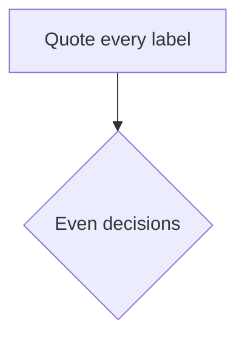

# TDStage documentation

Source for the TDStage documentation site, published with GitHub Pages at
<https://aristidesai.github.io/TDStage-Docs/>.

The system itself lives in a separate private repository. This repository
holds documentation only: how to run the console, set up the phones, operate
the TouchDesigner hub, and integrate with the tracking output.

## Editing

Pages are Markdown with YAML front matter. The theme is
[just-the-docs](https://just-the-docs.com), pulled in as a remote theme, so
there is no build step to run locally and nothing to install. Push to `main`
and GitHub Pages rebuilds the site.

Front matter controls where a page sits in the navigation:

```yaml
---
title: Running the console
parent: Console
nav_order: 2
---
```

A section index page uses `has_children: true` and no `parent`.


## Diagrams

Diagrams are Mermaid, in fenced blocks:

````

````

Three ways a diagram fails SILENTLY on this site. All three build clean, lint
clean, raise nothing visible, and render as a blank space. Every one of them
has already shipped here once.

**Never write `{{ }}`.** That is Mermaid's hexagon node shape and it is also
Liquid's output tag. Jekyll runs Liquid over Markdown before anything else
sees it, so a hexagon node is evaluated and deleted before it reaches the
browser. Use `[[ ... ]]` instead.

**Never put `//` comments in `_includes/mermaid_config.js`.** Jekyll inlines
that file onto a single line inside a `<script>` block, so a line comment
swallows the rest of the line, which is the whole config object. Mermaid then
initialises with `undefined` and every diagram on the site stops rendering.

**Never set `securityLevel: "strict"` while using `<br/>` in labels.** Strict
turns off HTML labels, which makes every `<br/>` a parse error.

**Never start a label "1. " or "- ".** Mermaid parses the label as markdown,
decides it is a list, and renders the node as the words "Unsupported markdown:
list". The diagram still parses and the checker still passes, so this one is
only visible by looking at the page. Write "Step 1 Network", not
"1. Network".

Then there is the one that is not your fault: the theme renders a diagram into
a `display:inline` element, so a correct 1800px diagram collapses to one line
height and looks like a failure. `_sass/custom/custom.scss` fixes that; do not
remove it.

Run the checks before pushing:

```
python3 tools/check_diagrams.py
python3 tools/check_links.py
python3 tools/check_tox_version.py
```

The link checker resolves every internal link, image and heading anchor. A
broken link fails silently: the build succeeds and the reader finds it at the
moment they needed the page.

It catches all three authoring traps. It cannot tell you a diagram is WRONG,
only that it will render, so open the page afterwards. A Mermaid parse error
appears on the page as a small bomb graphic rather than as an error anywhere
you would normally look.

## Generated pages

Two pages are built from the system repository's own source and must not be
edited by hand:

| Page | Built from | Regenerate |
|---|---|---|
| `operations/troubleshooting.md` | the console's `FIX_HINTS` and `AGE_FIX` | `python3 tools/gen_troubleshooting.py` |
| `console/api.md` | the console's `do_GET` and `do_POST` route handlers | `python3 tools/gen_api.py` |

Both take `--repo <path to TDStage>` and both have a `--check` mode that exits
non-zero when the page is behind the code.

**They read the committed code, not the checkout.** That is deliberate. The
system repository is worked on by more than one session at a time, so reading
the working tree means a half-finished change can be published as documentation
before it is even committed — and `--check` then calls the page stale against
code that may still be rewritten or dropped. It happened on 2026-10-27: a
regeneration picked up another session's uncommitted rewrite of the fix hints,
and the page would have described behaviour that did not exist yet.

So the default is `git show HEAD:<file>`, which is a state with a name you can
point at. `--working-tree` opts into the checkout when you genuinely want to
preview what an uncommitted change will do to a page.

Run the checks after any session where the console changed:

```
python3 tools/gen_api.py --check --repo ../TDStage
python3 tools/gen_troubleshooting.py --check --repo ../TDStage
```

`tools/check_tox_version.py` covers the one number no generator owns: the
TouchDesigner project's version. Several pages quote it, and a new saved version
usually means some saved parameter default moved with it, so a stale number is
not a cosmetic problem. The check requires that the highest version mentioned
anywhere in the docs is the highest on disk, which allows historical mentions
while catching the whole site lagging. It skips when the system repository is
not beside this one.

## Numbers

Every figure says where it came from, because the same quantity has very
different values depending on how it was produced:

- **measured, real phone** — and say the phone count, it changes the answer
- **measured, simulation** — proves the code path, not the physics
- **built, not verified** — it runs, there is no rig evidence
- **not yet verified** — needs hardware we have not had

Real-phone evidence is currently one phone. Every multi-phone figure is
simulation.

## What does not belong here

This repository is public. Commercial terms, client correspondence, pricing,
venue addresses and personal contact details stay in the private repository.
