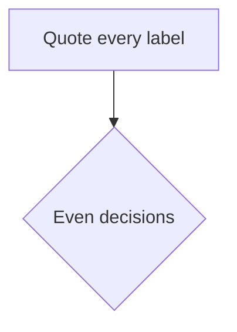

# TDStage documentation

Source for the TDStage documentation site, published with GitHub Pages at
<https://aristidesai.github.io/TDStage-Docs/>.

The system itself lives in a separate private repository. This repository
holds documentation only: how to run the console, set up the phones, operate
the TouchDesigner hub, and integrate with the tracking output.

## Editing

Pages are Markdown with YAML front matter. The theme is
[just-the-docs](https://just-the-docs.com), pulled in as a remote theme, so
there is no build step to run locally and nothing to install. Push to `main`
and GitHub Pages rebuilds the site.

Front matter controls where a page sits in the navigation:

```yaml
---
title: Running the console
parent: Console
nav_order: 2
---
```

A section index page uses `has_children: true` and no `parent`.


## Diagrams

Diagrams are Mermaid, in fenced blocks:

````

````

Three ways a diagram fails SILENTLY on this site. All three build clean, lint
clean, raise nothing visible, and render as a blank space. Every one of them
has already shipped here once.

**Never write `{{ }}`.** That is Mermaid's hexagon node shape and it is also
Liquid's output tag. Jekyll runs Liquid over Markdown before anything else
sees it, so a hexagon node is evaluated and deleted before it reaches the
browser. Use `[[ ... ]]` instead.

**Never put `//` comments in `_includes/mermaid_config.js`.** Jekyll inlines
that file onto a single line inside a `<script>` block, so a line comment
swallows the rest of the line, which is the whole config object. Mermaid then
initialises with `undefined` and every diagram on the site stops rendering.

**Never set `securityLevel: "strict"` while using `<br/>` in labels.** Strict
turns off HTML labels, which makes every `<br/>` a parse error.

**Never start a label "1. " or "- ".** Mermaid parses the label as markdown,
decides it is a list, and renders the node as the words "Unsupported markdown:
list". The diagram still parses and the checker still passes, so this one is
only visible by looking at the page. Write "Step 1 Network", not
"1. Network".

Then there is the one that is not your fault: the theme renders a diagram into
a `display:inline` element, so a correct 1800px diagram collapses to one line
height and looks like a failure. `_sass/custom/custom.scss` fixes that; do not
remove it.

Run the checks before pushing:

```
python3 tools/check_all.py
```

That runs all seven: the five checks and both generators' `--check` modes. The
ones that read the system repository skip themselves when it is not beside this
one and say so, because this repository is public and clones on its own. Run
them individually while fixing something:

```
python3 tools/check_links.py
python3 tools/check_diagrams.py
python3 tools/check_constants.py --repo ../TDStage
python3 tools/check_contracts.py --repo ../TDStage
python3 tools/check_tox_version.py
```

Every tool takes `--selftest`, which exercises its own detection on input it
writes itself. A checker that cannot fail is the thing most likely to be
quietly broken, so the GitHub Actions job runs every self-check before it runs
the checks.

The link checker resolves every internal link, image and heading anchor. A
broken link fails silently: the build succeeds and the reader finds it at the
moment they needed the page.

It catches all three authoring traps. It cannot tell you a diagram is WRONG,
only that it will render, so open the page afterwards. A Mermaid parse error
appears on the page as a small bomb graphic rather than as an error anywhere
you would normally look.

## Generated pages

Two pages are built from the system repository's own source and must not be
edited by hand:

| Page | Built from | Regenerate |
|---|---|---|
| `operations/troubleshooting.md` | the console's `FIX_HINTS` and `AGE_FIX` | `python3 tools/gen_troubleshooting.py` |
| `console/api.md` | the console's `do_GET` and `do_POST` route handlers | `python3 tools/gen_api.py` |

Both take `--repo <path to TDStage>` and both have a `--check` mode that exits
non-zero when the page is behind the code.

**They read the committed code, not the checkout.** That is deliberate. The
system repository is worked on by more than one session at a time, so reading
the working tree means a half-finished change can be published as documentation
before it is even committed, and `--check` then calls the page stale against
code that may still be rewritten or dropped. It happened on 2026-10-27: a
regeneration picked up another session's uncommitted rewrite of the fix hints,
and the page would have described behaviour that did not exist yet.

So the default is `git show HEAD:<file>`, which is a state with a name you can
point at. `--working-tree` opts into the checkout when you genuinely want to
preview what an uncommitted change will do to a page.

Run the checks after any session where the console changed:

```
python3 tools/gen_api.py --check --repo ../TDStage
python3 tools/gen_troubleshooting.py --check --repo ../TDStage
```

`tools/check_constants.py` ties numbers written in prose to the constants they
were copied from: how long an id is held before reuse, how long auto-recover
waits, how many backups are kept. Those read as facts and get planned against,
and the same drift has already happened twice by accident. Each entry names a
page, a sentence pattern and a constant; prose spells numbers out, so "twelve"
and `12.0` compare equal.

An entry whose pattern stops matching is an **error, not a pass**. If it passed,
rewording a sentence would switch its check off silently, which is exactly the
failure the file exists to prevent. Re-point the entry at the new wording
instead. Like the generators, it reads the committed code unless you pass
`--working-tree`.

`tools/check_contracts.py` checks the tables that are really **sets**, where
the whole value is that nothing is missing from either side. The `/ctl` verbs
are the case today: an integrator sends what that table says, so a verb in the
app and not on the page is a capability nobody knows about, and a verb on the
page and not in the app is an instruction that silently does nothing.

Only lists the code states **literally** belong in it. The telemetry paths look
like an obvious second entry and are not: the app builds them by interpolation,
`osc.send("\(ns)/calib/pose", ...)`, so matching the literal reports drift that
is not there. A check that cries wolf gets switched off, which costs more than
never having written it.

Everything that reads the system repository reads it at **HEAD**, including
the project-version check, which counts committed `.tox` files rather than what
is on disk. An untracked save is somebody's work in progress with no changelog
entry yet, and the documentation cannot say what changed in it. `--working-tree`
opts into the checkout on every one of them.

`tools/check_tox_version.py` covers the one number no generator owns: the
TouchDesigner project's version. Several pages quote it, and a new saved version
usually means some saved parameter default moved with it, so a stale number is
not a cosmetic problem. The check requires that the highest version mentioned
anywhere in the docs is the highest on disk, which allows historical mentions
while catching the whole site lagging. It skips when the system repository is
not beside this one.

## Numbers

Every figure says where it came from, because the same quantity has very
different values depending on how it was produced:

- **measured, real phone**, and say the phone count, since it changes the answer
- **measured, simulation**, which proves the code path and not the physics
- **built, not verified**: it runs, there is no rig evidence
- **not yet verified**: needs hardware we have not had

Real-phone evidence is currently one phone. Every multi-phone figure is
simulation.

## Work that is waiting on a branch

A page may describe behaviour that is on a branch in the system repository and
not yet on its trunk. Those sentences name the branch, and
`tools/check_pending.py` reads the names back off the pages and asks both
repositories two questions: does that branch still exist, and has it been
merged into trunk. A merged branch fails the build, naming the pages to
rewrite, because the site only names a branch while its work is pending.

The documentation for an unlanded feature lives on a branch of its own here,
with its pins, so the landing is a merge rather than a scramble. The sequence
on landing day:

1. `git fetch` in the system repository and confirm the feature's commit is on
   its trunk, not just on an integration branch. `check_pending.py` asks this
   question too, so a merged branch still named on a page turns the build red.
2. `git rebase master` the documentation branch, then
   `python3 tools/check_all.py --repo ../TDStage`. The pins that could not
   compare while the source file was absent now compare, and any that do not
   are named with the constant and the value.
3. Rewrite the "lands with" sentences as behaviour and delete the branch names.
4. Regenerate: `gen_status.py`, `gen_troubleshooting.py`, `gen_api.py`.
5. Merge, re-run `check_all.py`, push.

If the landing includes a tox save, check that the **binary** came with it:
`git ls-tree <trunk> -- TD/ | grep TDStageConductor_v | tail -1` and compare
`git rev-parse <trunk>:TD/TDStageConductor.tox` against
`git hash-object TD/TDStageConductor_<newest>.tox`. On 11 November every branch
carried a tox six versions behind its own Python, because a save is not a
tracked edit until somebody commits it, and the pages describing the newer
parameters would have shipped against a hub that did not have them.

Before the landing it is worth dry-running the pins against the branch, so the
day is not spent on regular expressions:

```bash
git -C ../TDStage show <branch>:WebConsole/<file>.py > /tmp/src.py
```

and comparing each pinned constant against the page's wording by hand, or with
a throwaway script. Two pins broke this way on 11 November: `--f1-hz` stopped
carrying its own default, which moved the number into the settings schema while
two pages still printed it from the flag.

## Committing in a shared checkout

Several sessions edit this repository at once, through one working tree and one
index. **A path-scoped `git add` does not make a path-scoped commit**: `git
commit` writes the whole index, including whatever another session has staged.
On 11 November a commit in the system repository carried four unrelated files'
reverted content that way, one of them a privacy regression.

So commit through `tools/safe_commit.sh`, which builds a private index from
HEAD, commits exactly the paths named, and refuses if the branch moved under
it:

```bash
tools/safe_commit.sh -m "subject" path/one.md path/two.md
```

Then read the stat it prints before pushing. Never `git reset`, `git checkout
<path>` or `git stash` in the shared tree: each of those discards work that is
not yours.

## What does not belong here

This repository is public. Commercial terms, client correspondence, pricing,
venue addresses and personal contact details stay in the private repository.
