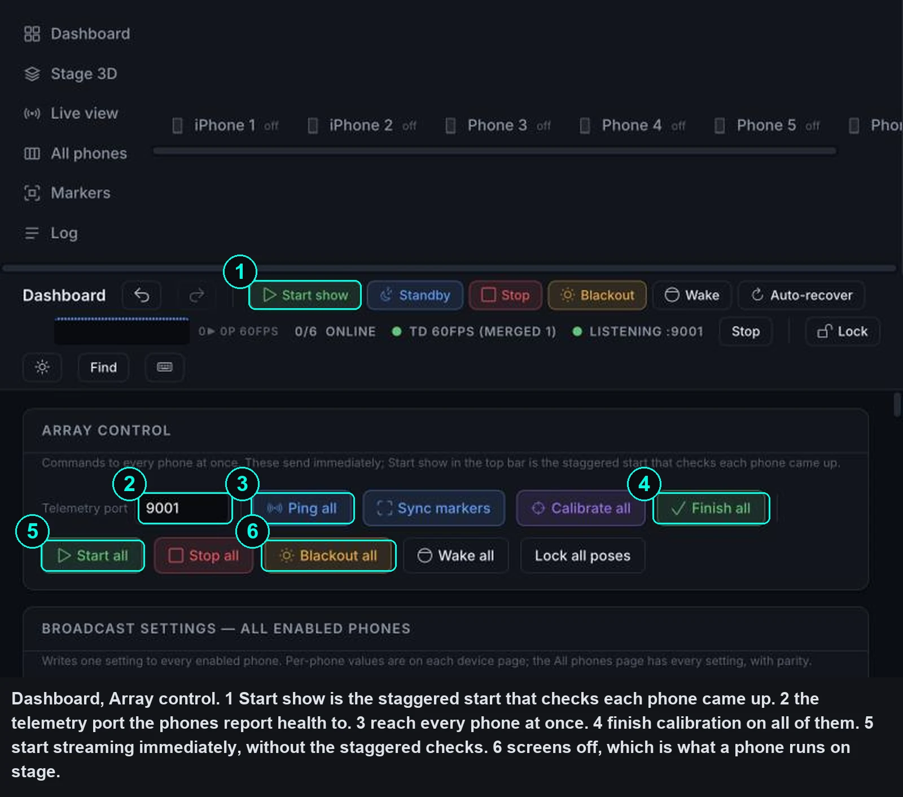
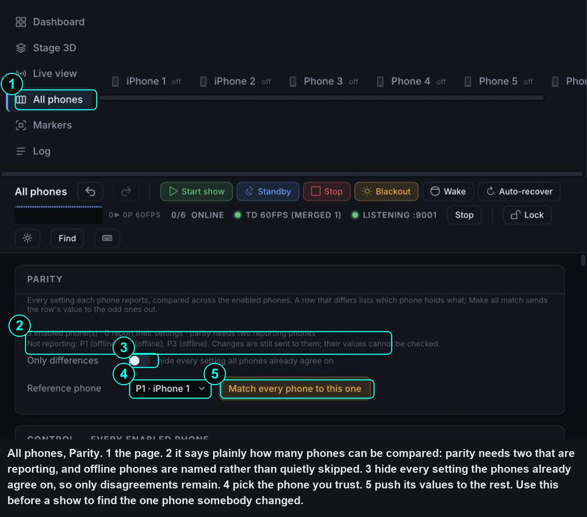
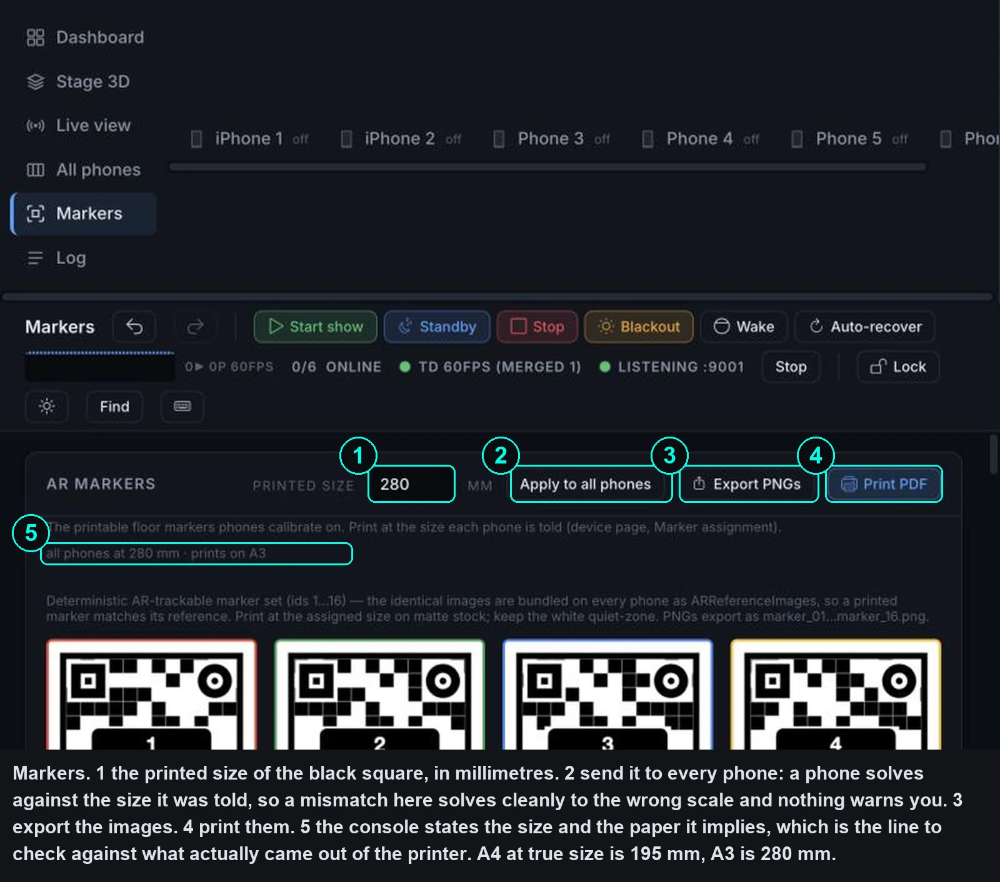
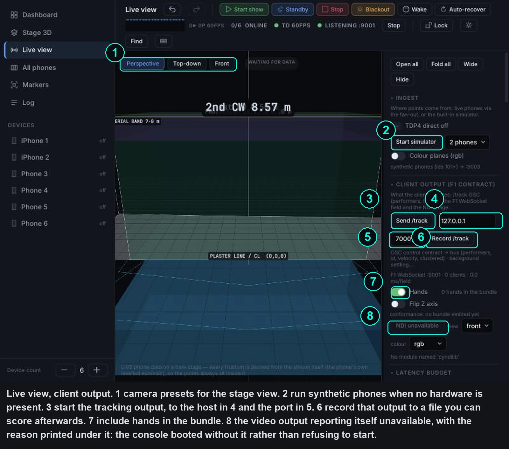

# Guided walkthrough

Three screens, with the controls that matter numbered on the picture. Read
this once before a get-in and you will know where everything is.

The numbers are drawn on the images so the pairing survives being printed,
pasted into a call sheet, or read on a phone where the caption has wrapped
somewhere else.

{: .note }
**About these screens.** They were captured on 2026-10-27 at a narrow browser
width so nothing is cut off; the console reflows, so a wide window puts the
same controls on fewer rows. Since then the console has had a visual pass —
plainer buttons, labelled control rows, explanations moved into hover text — so
the chrome around the controls looks different from what you see here. Every
control named on this page still exists, in the same place, under the same
label. One caption burned into the markers screen is now wrong, and is called
out where it matters.

## Starting the array

**Start show and Start all are not the same button**, and that is the thing
worth learning first.

**Start show** (1) is a staggered start. It sends start to each enabled phone
200 ms apart, then checks all of them together six seconds later, re-sends to
the ones not yet streaming, and names anything still down. It also arms
auto-recover and latches "the show is running", which is what lets the console
restart a phone that drops. Standby and Stop disarm it again.

That verdict lives only as a message in the browser tab that pressed the
button. If you walk away, you lose it.

**Start all** (5) sends start to every enabled phone at once, with no check, no
retry and no show-running latch, so a phone that drops later is nobody's
problem. It is faster and it tells you less. Use it when you already know the
rig is healthy and you just want pictures.

Both read "is it streaming" from telemetry, so if telemetry is not reaching
this console every phone gets named as failed while streaming perfectly. Fix
the telemetry port first and the start reports become trustworthy.

**Blackout all** (6) is not a stop. It turns the enabled phones' screens off
while they keep streaming, which is what a phone on a stand should look like
during a performance: dark, and working. A lit screen is visible from the
audience and it adds heat, and heat is what costs frame rate: a phone that
reaches **serious** is capped at 25 fps, and at **critical** it halves its
nominal rate with a floor of 10. The console asks for confirmation first.

{: .note }
That 25 is a setting rather than a ratio, and it was raised deliberately: the
rung used to be a fraction of the nominal rate, which took a hot 30 fps phone
down to 20 ([#31](https://github.com/AristidesAI/TDStage/issues/31)). An
absolute floor keeps a hot phone useful instead of letting a thermal problem
become a tracking problem.

**Ping all** (3) asks every phone with a known IP for a reply, disabled ones
included, and changes nothing on them. The reply comes back over the telemetry
path rather than directly, so silence means *either* off the network *or*
telemetry not reaching this console. It is still the cheapest first question,
as long as you read the answer that way.

**Finish all** (4) ends calibration on every phone at once, which is the step
people forget after walking the markers.

**Telemetry port** (2) is where **this console listens** for health. It is not
a setting on the phones, and editing it moves nothing: the phones keep sending
wherever they were told to, which only Send telemetry here or a pushed profile
changes. It has to match. If it does not, the phones stream perfectly and read
as dead. See [Troubleshooting](troubleshooting.html).

## Finding the phone somebody changed

A rig drifts. Someone changes a setting on one phone to test something at
11pm and nobody writes it down. This page exists to find that phone.

**Parity** compares every setting across every enabled phone and lists the
ones that disagree.

The panel is honest about when it cannot help (2): it states how many phones
are actually reporting, and names the ones that are offline rather than
quietly leaving them out of the comparison. **Parity needs two reporting
phones.** A green page with five phones offline means nothing was compared.

**Only differences** (3) hides every setting the phones already agree on. An
empty list means every *reporting* phone agrees, which is not the same as every
phone. A setting only counts as differing among the phones that report it, so
an offline phone, or one on an older build, can never make a row appear. Read
the summary line (2) first: it names who could not be compared.

To fix a drifted rig: pick the phone you trust as the reference (4), then
**Match every phone to this one** (5).

It sends only the settings that actually differ, and only to phones that have
that control, so a phone running the other app is not sent something it does
not understand. Device ids and the stream and telemetry hosts are never
copied, for the obvious reason. Link and UDP port **are**, as part of the
stored profile.

{: .warning }
Two things to know before pressing it. If the reference phone is the one that
drifted, you have just spread the problem to the whole rig: look at the
differences first, not after. And a phone that reports nothing — offline, or an
older build — is sent every value blind, because "no answer" is not treated as
"agrees".

## Markers, and the mistake that does not announce itself

A phone calibrates by looking at a printed marker whose real-world size it has
been told. It solves for where it is standing from the size the square appears
to be against the size it was told to expect.

{: .warning }
**Measure the whole image, not the black square.** Printed size is the side of
the entire marker image including its white margin, which is what the four crop
marks mark out: measure between the crop-mark centres. The black square inside
is about 89 % of that, so ruling the black square and typing what you read
makes every phone solve against a marker 11 % too small. The screenshot above
was captured when this page and the console's own tooltip both said "black
square"; both have since been corrected.

| Printed on | Between the crop marks | The black square alone |
|---|---|---|
| A4 at true size | **195 mm** | about 174 mm |
| A3 at true size | **280 mm** | about 249 mm |

**It does not fail loudly if it is wrong**, and what it does instead is worth
knowing precisely, because the obvious guess is wrong. The declared size does
not rescale the stage. It only tells the phone how far away the marker is, so
the phone places *itself* at the wrong distance along its own line of sight.
Depth is measured by the LiDAR and stays metric, so inside one phone's cloud
every distance is still correct.

The direction is predictable, and it is the opposite of what most people
guess. ARKit works out how far away the marker is from how big you said it is
against how big it looks, so **declaring it too small makes the phone believe
it is standing nearer its marker than it is** — 11 % of its distance to it.

The phone's own depth readings are still true metres, so it then lays its
points out from a starting position that is too near. The whole cloud moves
rigidly **away from the phone**, along its line of sight toward the marker, by
`(1 − declared ÷ true)` times the phone-to-marker distance. About 0.66 m for a
phone 6 m from its marker.

That has one consequence that reads as nonsense until you have followed the
arithmetic: the patch of floor where the marker actually sits lands 0.66 m
**beyond** the marker, not nearer it. The phone starts 0.66 m too close and
then adds the full measured range.

So the result is not a stage that is uniformly too small, and the floor does
not tilt — a rigid translation cannot tilt anything. What you get is each
phone's cloud sliding in its own direction. **Two phones facing each other
across the stage slide in opposite directions, so their copies of one performer
separate by the sum of both shifts** — about 1.3 m for two phones 6 m out. The
symptom to look for is one performer appearing twice, not a blur. A phone
mounted high and looking down also drops its cloud, by 11 % of the height it
has on the marker.

The doubled performer is also how you check this without a ruler: one person
in the middle, two phones facing each other, one body or two. That is an
acceptance step rather than a console task, so it lives with the rest of them
in [Rig get-in](../operations/get-in.html#the-one-person-test), together with
what it does not catch.

Order of work: set the size (1), **Apply to all phones** (2) so every phone
is solving against the same number, then export (3) or print (4).

{: .warning }
**A loaded stage layout does not reach the phones.** It sets the size in the
console's roster only and sends nothing. Line (5) reads that roster, so it will
say `every phone 280 mm` while each phone still holds whatever it was last
sent — a phone sent 195 mm, calibrating on a 280 mm print, is out by 30 %.
Press **Apply to all phones** (2), or Sync markers, after loading a plan. The
console's own log line after a layout load says the same thing.

## Sending the tracking output

This is the panel another system is waiting on. The stage view beside it is
the console's own picture and is not what anyone downstream receives.

**Send /track** (3) starts the tracking output to the host (4) and port (5)
beside it. Nothing is emitted until that is on, which is worth checking before
telling anyone their receiver is broken.

**Record /track** (6) writes a trace of each emitted frame to a file: host and
capture time, which device frames fed it, and each track's id, plan position,
clustered flag and whether it was coasting. It is not a copy of the OSC bundle
— no heights, velocities or hands — and it only writes while **Send /track** is
on.

That file is what turns an impression into a number: it can be scored
afterwards for time to acquire, identity losses and position error. See
[Evidence and claims](../operations/evidence.html).

**Hands** (7) decides whether hand positions ride in the bundle.

**Start simulator** (2) runs synthetic phones for two minutes, so the whole
chain can be exercised with no hardware present. Useful for proving a receiver
before a rig exists. Two things catch people out: it stops after 120 seconds
unless you start it again, and it only reaches TouchDesigner when the bridge
or the fan-out is running. Without one it feeds this console alone, and says
so in the log.

### The console telling you what it cannot do

Look at **8**. The video output is reporting itself unavailable, and the line
under it gives the reason: a module is missing.

That is the system working as designed rather than failing. The console boots
with optional pieces absent instead of refusing to start, so a missing video
library costs you the video output and nothing else. The alternative, a
console that will not start because one optional dependency is absent, is
worse at 6pm on a show day.

The cost of that choice is that a dead feature can look like a bug. Which is
why the reason is printed next to it, and why
[Rig health](troubleshooting.html) exists.

## Where to go next

- [Running the console](running.html) for installation and the command line
- [The browser UI](ui.html) for every page and panel, control by control
- [Troubleshooting](troubleshooting.html) when something is not behaving
- [Built for a live show](resilience.html) for why the software is shaped this
  way
