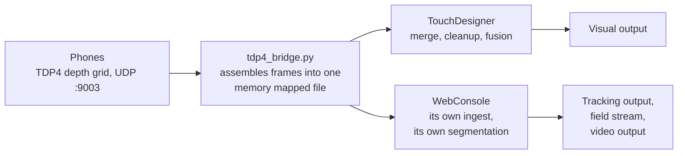
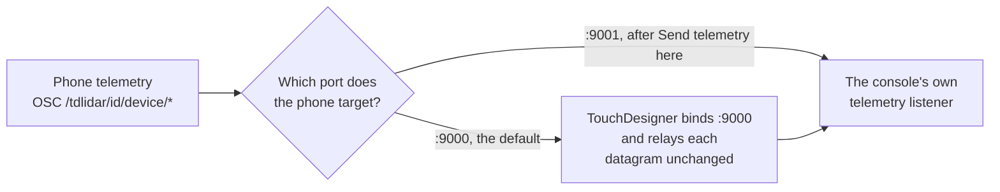
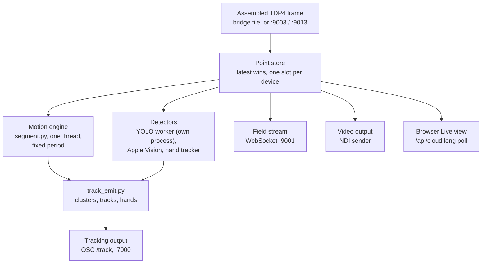

# The WebConsole

The WebConsole is the browser application the technician and the operator use to
run the phone rig. It is a single Python process (`WebConsole/server.py`) plus a
web page served from `WebConsole/static/`. Open it at
**http://localhost:9080**.

It replaced the old macOS Stage Coordinator app. There is nothing to install on
the operator's machine beyond a browser. To reach it from a tablet side stage,
browse to `http://<show-machine-ip>:9080`.

## How it is built, and why that way

Four decisions shape everything on the pages that follow. They are worth reading
before the control lists, because most of the console's odd behaviour is one of
these four being honest about itself.

**One process, many threads, no framework.** `server.py` is a
`BaseHTTPRequestHandler` on a threading server, with one daemon thread per
long lived job: the telemetry listener, the TouchDesigner link, the staleness
sweep, the cable watch, the health sampler, the auto recover supervisor, the
simulator watch, the bridge reader, the segmentation engine and the camera view
rebuild. There is no task queue and no event loop, so a thread that wedges stops
exactly one job and the rest of the console keeps answering. A stall watchdog
records every thread's stack when one of them blocks for more than 180 ms, which
is what `GET /api/stalls` returns.

**It boots degraded rather than not at all.** Every optional import is wrapped.
numpy missing, the TDP4 receiver not on the path, Apple Vision absent, NDI not
built, `settings.py` broken: each of those disables one feature and reports why,
instead of refusing to start. The reasoning is that a console which cannot show
you a point cloud is still the only thing that can manage the rig, and a get in
is the worst possible moment to be debugging a virtual environment. The cost is
that a dead feature looks like a bug until you ask it why, which is what
`doctor.py`, `GET /api/live` and the Rig health panel are for.

**The heavy model runs in its own process.** YOLO person segmentation lives in
`yolo_worker.py`, launched with its own interpreter and talking over a unix
domain socket, not imported. Three reasons, from the worker's own header: the
console's virtual environment deliberately has no torch and must not grow one,
because the two cannot share an interpreter; ultralytics does the non maximum
suppression and mask prototype decoding, so there is no hand rolled post
processing to keep in lockstep with anything; and a **native** crash inside
torch or OpenMP would take the console down with it. The console has already
lost a process to a segfault in a C extension once. A dead worker here is a
`waitpid` and a respawn, not a lost show. Data rides the socket rather than
stdout because ultralytics, torch and their downloaders all print to stdout
unbidden, and one stray byte would desynchronise a length prefixed stream
permanently.

**Nothing starts itself.** No background loop launches a process or reaches for
a phone. Every repair, bridge start, profile push and heal is something an
operator pressed. Auto recover is the one supervised exception, it is off by
default, and `Start show` is what arms it.

## What it is for

Four jobs, in the order you meet them at a get in.

1. **Manage the phones.** The roster, each phone's name, IP, colour, stage pose
   and field of view, its AR marker assignment, and every phone setting that can
   be changed remotely. Start, stop, blackout, ping, calibrate, heal.
2. **Place the rig.** The 3D stage plan, the marker plan at true printed size,
   and the live point cloud from the phones so you can see what each one
   actually sees.
3. **Carry the client outputs.** The `/track` OSC stream of performer positions
   and hands, the F1 WebSocket field, the NDI image of the cloud, and the person
   consensus behind them.
4. **Tell you why something is broken.** The Rig health panel, the Log page, and
   `GET /healthz` for a watchdog.

## The console is not downstream of TouchDesigner

This is the single most important thing to believe about the architecture, and
the moment you need to believe it is while deciding whether to restart the
console mid performance.

**Both readers are fed from the same source, in parallel.** The phones send TDP4
to `tdp4_bridge.py`. The bridge assembles whole frames into one memory mapped
file, and TouchDesigner and the console each read that file, each keeping its own
place in it. Neither is in the other's path for point data.



Two separate pipelines over one shared source. The segmentation, merge and
fusion that drive the visuals all live on the TouchDesigner side. The console
runs its own ingest and its own segmentation, for its own outputs only, and
**never writes back into TouchDesigner's cloud**. That is what makes the
independence real rather than nominal: there is no path by which the console
could corrupt or starve the visual pipeline, because it does not touch it.

So **closing the console mid show has zero effect on TouchDesigner's cloud.**
What stops is only what the console itself owns:

- phone telemetry and health, so no battery, thermal, fps or pong readings
- `/ctl` control, so no start, stop, blackout or calibrate from the browser
- auto recover
- the client outputs: `/track`, the F1 WebSocket and NDI
- person consensus, the Live view and hand tracking

TouchDesigner keeps ingesting, merging, cleaning, fusing and driving the visuals
exactly as before.

### The one real dependency: phone health

Point data is unconditional to both readers. **Telemetry is a switch**, and
which way it is thrown decides whether the console survives a TouchDesigner
outage with its health readings intact.



A phone can only send telemetry to one port, and by default that port is 9000,
which the tox binds. The tox does not parse it: `osc_in_callbacks.py` forwards
every datagram unchanged to the console over the TouchDesigner link, and sends
`/tdstage/peer` alongside it so the console learns the phone's real address
rather than TouchDesigner's. That relay is gated on the tox's `Consoleactive`
parameter, and it needs to know where the console is, which it learns from the
console's own 2 second ping.

The consequence to remember: **while TouchDesigner is down and the phones still
target 9000, the console shows phones as online from their point data but with
no battery, no temperature and no frame rate.** It looks like a dead rig and is
not one. `Send telemetry here`, or `POST /api/telemetry/retarget`, moves each
phone's telemetry to the console's own listener, after which those readings
survive a TouchDesigner outage. See
[Troubleshooting](troubleshooting.html#a-phone-is-not-behaving).

{: .warning }
A comment in `server.py` at the retarget handler says the console "never
receives a single telemetry packet" with TouchDesigner running. That comment
predates the tox relay and the code disagrees with it: `console_link_lib.relay`
forwards every telemetry datagram to the console's listen port. Trust the relay.

## What happens to a frame once it arrives



Three things in that shape matter.

**The store is latest wins, one slot per device.** A frame that arrives while the
previous one is unread replaces it. Nothing queues, so a slow consumer costs
freshness and never memory. The store also deduplicates: a device id and frame
id already stored from one path is skipped when it arrives again on another, so a
relay copy racing the bridge file is not counted twice.

**The motion engine runs on a fixed cadence over a snapshot of the store, never
per incoming frame.** It is one daemon thread. `segment.py` keeps a per voxel
leaky integrator of occupancy, promotes what stays still to background, and
suppresses that promotion inside the plan footprint of every tracked foreground
cluster, so a performer who holds a pose, or lies prone, does not fade into the
scenery. All of its state lives in parallel sorted numpy arrays found through a
dense cell to row table, with no per point Python.

**That tick is the dominant server side latency lever**, which is why
`latency.segTick` matters more than any other number in the settings. `/track`
does not re-segment: it filters the **current** cloud against the foreground set
the engine published on its **last** tick, so a performer's position is as fresh
as the cloud but their foreground membership is up to one tick old. The engine's
own work is about **15 ms per tick with eight devices in frame**, down from about
29 ms before the 2026-10-27 optimisation. *Measured, simulation* (offline bench,
29.2 to 14.6 ms a tick on a 306,000 point scene; 37.7 to 14.4 ms with the
background frozen). Eight real phones have never been run, and simulated devices
do not get hot or drop frames, so treat that as a ceiling on the code's cost and
not as a rig figure. Setting a period shorter than the work takes does not make
the engine faster, it only makes it late every tick.

The engine stayed on the CPU on purpose. A GPU engine would have to import torch
into the console, which is exactly what the YOLO worker exists to avoid, or be a
second supervised worker process fed every tick's whole cloud. That is a
decision, not a fix, and it is not needed at these numbers.

{: .warning }
`segment.py`'s own docstring says the engine runs at "a FIXED cadence (~10 Hz)".
The code disagrees: the period is `ingest.SEG_TICK_S`, whose default is 0.05 s,
which is 20 Hz. The comment is stale; the schema's default is the live value.

## What it owns

| Thing | Where it lives |
|---|---|
| The phone roster, poses, marker plan, person figures | `WebConsole/config.json`, with rotating copies in `WebConsole/backups/` |
| Each phone's last known good profile | `WebConsole/profiles/phone-<id>.json` |
| Every runtime tunable | the `settings` section of `config.json`, schema in `settings.py` |
| The log | the Log page and `WebConsole/logs/console.log` (rotating, 5 files of 5 MB) |
| Phone telemetry in | UDP, the port on the Dashboard (`--listen`) |
| `/ctl` control out to each phone | UDP to each phone's own control port, 9010 by default |
| The TouchDesigner conductor bus | UDP OSC out to `tdHost:9006`, replies to the console's telemetry port |
| `/track` out | UDP OSC to the client bus, 127.0.0.1:7000 by default |
| The F1 field | TCP WebSocket, port 9001 by default |
| The NDI source | `TDStage Point Cloud`, 960x540 at 30 fps by default |

### Why the configuration keeps rotating backups

`config.json` is the whole of the console's persistent state: the roster, every
pose, the marker plan, the person figures, the listen port, the client output
targets, the recovery policy and every tunable. It is rewritten whole on every
change, through a private temporary file that is fsynced before it is renamed
into place, under one lock so that concurrent POST handlers cannot truncate each
other's write. Before 2026-10-27 they shared one `config.json.tmp`, and the
second writer truncated the first's file: the rename raised a 500 for the
operator, and a reader could find `config.json` empty or half written.

Each save first copies the file it is about to replace into
`WebConsole/backups/`, at most once a minute, keeping the newest 50. The rate
limit is the point: a burst of edits preserves the state from **before** the
burst rather than filling the folder with 50 copies of one minute.

**What the fallback actually tests.** If `config.json` cannot be used, the
console keeps it aside as `config.json.corrupt-<timestamp>` and loads the newest
backup that passes `_config_invalid`: it must be a JSON object, it must have a
device list, every device must have an integer id, and the marker list must hold
markers with `id`, `label`, `x`, `y` and `z`. That is a **shape** test, not a
sanity test. A file that parses and has the right shape but holds the wrong
poses, the wrong roster size or last month's marker plan is accepted in silence.
Shape checking is itself recent: before 2026-10-27, `{}`, `[]` and
`"devices": null` all parsed, each seeded a fresh six device session, and the
next save wrote that seed over `config.json` and then filed it as the newest
backup.

So the console now **says** when it did this. **Rig health's first row reports
when the session started from a backup rather than from `config.json`**, with
what went wrong and what to check. It is the first check in `hands_diag()`,
deliberately, and it stays for the whole session, because the Log page scrolls a
boot message away long before anyone looks for it. Restoring a configuration is
still not a proven path. See
[Running the console](running.html#backups-and-what-is-not-proven).

## What it does NOT own

**Cleanup and fusion for TouchDesigner's own cloud stay in TouchDesigner**
(client decision). The console runs its own segmentation, but only to feed the
client outputs.

**The console does not start anything by itself**, as above.

## How the phones reach both readers

This is the current path, since 2026-10-27:

```
phones ──UDP :9003──▶ tdp4_bridge.py ──┬──▶ TouchDesigner  (reads the mmap file, "9004")
                                       └──▶ WebConsole     (reads the same file)
```

`tdp4_bridge.py` binds the phone facing port itself and hands whole assembled
frames to both readers through one memory mapped file, published under the name
`9004` so the tox's `Udpport` needs no change. Each reader keeps its own place in
the file. Nothing copies packets.

The bridge exists because of where the receive thread has to live. With the GPU
merge path, a receive thread **inside** TouchDesigner starves: the merge holds
the interpreter and datagrams are dropped while it runs. So the receiver runs in
its own process, outside TouchDesigner, and hands over assembled frames rather
than packets.

**`udp_fanout.py` is legacy, and optional.** It still exists and still works,
and the console can start and stop it, but it is not the show path. It copied
every datagram with three syscalls and lost packets above about 30,000 per
second, and eight phones with colour are 49,000 at the simulator's grid. The
bridge alone received 61,000 per second with no loss. *Measured, simulation* —
and note that real phones send a bigger grid, so eight of them with colour
would offer about 76,000. Keep the relay only for
a no bridge CPU path.

The architecture **diagram** in the system repository's `CLAUDE.md` still shows
the relay as the show path. That diagram is stale. Its **port table** is still
correct and authoritative.

## The two machines

On the show machine (Windows, RTX 4090) the tracking side is one PC: the TDP4
bridge, the console, and TouchDesigner with the tox. Phones arrive over PoE
Ethernet, one cable each. See [Running the console](running.html).

On a Mac, `Tools/show_mac.sh` starts the same two processes.

## Operating it from off site

The UI works over Tailscale, but the Live view is capped for any client that is
not on the LAN: **5 frames per second and 20,000 points shared across all
phones**. A `100.64/10` Tailscale address counts as off LAN, because it is a
tunnel. `WebConsole/README.md` describes remote operation without that caveat.

The cap is arithmetic, not policy. A LAN view is about 2 MB per poll at 30 Hz,
which is over 60 MB/s: no remote uplink carries that, and the console's own
threads stall writing into a socket that cannot drain. 20,000 points at 5 Hz is
about 147 KB a frame, roughly 6 Mbit/s, which a tunnel can actually move. The
budget is per client address, so two tabs on one remote machine share it.

Everything else in the UI behaves the same remotely. Details in
[Running the console](running.html#the-off-lan-cap).

## Where to go next

- [Running the console](running.html) for install, start commands and every CLI flag.
- [The browser UI](ui.html) for a walkthrough of each page and control.
- [HTTP API](api.html) for every endpoint, and which are POST only.
- [Settings reference](settings.html) for the tunables, their defaults and ranges.
- [Troubleshooting](troubleshooting.html) for symptom first fixes.
