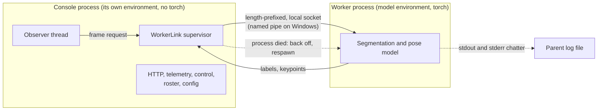
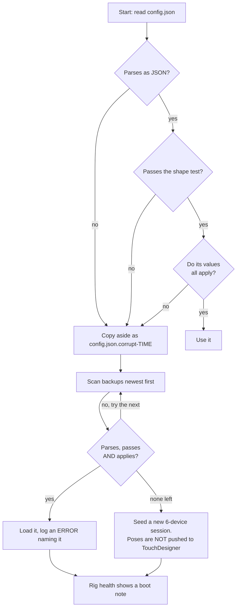

# Built for a live show

The console runs during a performance in front of an audience. Nobody is
sitting in front of it, a restart is visible from the seats, and a crash is a
failure in public. That single constraint explains most of the decisions on
this page. Out of context several of them look over careful, or look like
distrust of code that has never actually failed. In context they are the
difference between a bad minute and a dark stage.

This page walks through the patterns in the code, says what forced each one,
and says what the failure would look like without it. The last section is the
part that matters most for anyone taking the system over: where this does
**not** hold, named honestly.

The architecture overview in [the console index](index.html) states four of
these decisions in summary. This page is the evidence for them.

---

## 1. It boots degraded on purpose

Every optional import is wrapped, and the wrapper records *why* it failed
rather than only *that* it failed. `WebConsole/ingest.py` opens with:

```python
try:
    import numpy as np
except ImportError as e:                    # console must boot without numpy;
    np = None                               # the Live view just reports why
    _IMPORT_ERR = f"numpy missing: {e}"
```

`_IMPORT_ERR` is carried all the way to `GET /api/live`, so the Live view
answers "numpy missing" instead of answering nothing.

{: .warning }
**That particular message can never actually be shown**, and the gap between
the intent and the fact is the useful part of this section. `server.py`
imports the tracking and video-output modules *unwrapped*, and both import
numpy the same way, so a console without numpy does not boot at all — it dies
on the import, before any of this careful degradation gets a chance to run.
Verified by blocking numpy and running `server.py --help`:
`ModuleNotFoundError` at the bare `import track_emit`. Pillow missing does
boot, as the table below says.

`WebConsole/server.py` wraps five other modules in one block — settings, the
RGB stream, and the three person-model paths, which are the ones that really
are optional:

```python
try:
    import yolo_seg                      # YOLO multi-person instance masks (primary)
except Exception as _e:
    yolo_seg = None
    print(f"yolo_seg module unavailable: {_e}")
```

Note `except Exception`, not `except ImportError`. A module that imports but
raises while initialising, a missing model file, a pyobjc bridge that loads and
then fails on a symbol, all land in the same place. The import is allowed to
fail for any reason at all.

### What dies with each one absent

| Missing | What stops | What still works |
|---|---|---|
| numpy | **everything: the console does not start.** The tracking and video-output modules import it unwrapped | nothing — fix the install |
| the TDP4 receiver modules | ingest of point frames into the console | everything that does not need points, including control of every phone |
| `settings.py` | the Settings page — and worse, **the first save after such a boot erases the saved tunables**, because the configuration is rewritten whole and without that section. They survive only in the backups | every module keeps its own compiled in defaults |
| `rgb_stream.py` | `/api/rgb/*`: every camera view, JPEG, PNG, MJPEG and overlay | the point cloud and the masks themselves |
| Pillow | JPEG encoding inside `rgb_stream`, so the streams | the stdlib PNG debug grab |
| `person_obs.py` (pyobjc) | Apple Vision instance masks and body pose | YOLO, which is the primary model anyway |
| `vision_seg.py` (pyobjc) | the Apple semantic mask fallback for the Live view | YOLO instance labels, and the voxel background method |
| `yolo_seg.py` (its worker) | the primary person model | Apple Vision, where it exists; and see section 9 |
| `hand_track.py` | hand output | person tracking and `/track` positions |

A route whose module is gone answers a status code rather than a traceback:

```python
if path == "/api/settings":
    if settings_mod is None:
        return self._json({"error": "settings unavailable"}, 503)
```

### Why starting degraded beats not starting

A console that cannot draw a point cloud is still the only thing in the rig
that can set a phone's identity, push a profile, retarget telemetry, start and
stop streams and print the marker plan. If it refuses to start because Pillow
is missing, the rig has no management surface at all, and the moment that
discovery happens is a get in, with a stage full of people waiting.

The cost is real and worth stating: a feature that is dead because of a failed
import looks exactly like a feature that is broken. Three things exist to close
that gap. `WebConsole/doctor.py` checks every import the console and the worker
need and prints the `pip install` line for each (it is read only and never
changes the machine). `GET /api/live` carries the import error text. The Rig
health panel surfaces the same facts in the browser.

---

## 2. The crash domain is deliberately split

The person segmentation model does not run inside the console. It runs in
`WebConsole/yolo_worker.py`, as a separate operating system process, under a
different interpreter, talking over a local socket — a unix socket on macOS
and Linux, a named pipe on the Windows show machine. Its own header gives
three reasons, and they are different in kind:

1. **The interpreters cannot be shared.** The console's virtual environment has
   numpy and Pillow and deliberately no torch. The worker's environment has a
   different numpy and a different Python minor version. This is not a
   preference, it is a packaging fact: the two cannot inhabit one interpreter.
2. **The library owns its own post processing.** Ultralytics does the non
   maximum suppression and the mask prototype decoding. Reimplementing those on
   the console side would create a second copy of model logic to keep in
   lockstep with the first, which is the kind of duplication that drifts
   silently.
3. **A native crash would take the console with it.** A segfault inside torch
   or OpenMP is not a Python exception and cannot be caught by any `try`. The
   worker's header is blunt about the precedent: the console has already lost a
   process to a segfault in a C extension once. In its own process, that same
   crash is a `waitpid` and a respawn.

### Why a socket, not stdout

```
Data rides a UNIX SOCKET, never stdout: ultralytics, torch and their
downloaders all print to stdout unbidden, and a single stray byte would
desynchronise a length-prefixed stream forever.
```

That is the worker's own comment, and the word that matters is *forever*. The
protocol is `u32 length`, then a four byte tag, then the body. A length
prefixed stream has no resynchronisation point: one unexpected byte shifts
every subsequent length field by one, and the reader never recovers. A progress
bar from a model download, printed once at startup by a library the console
does not control, would permanently corrupt the channel. Putting the data on a
socket makes stdout harmless, and the worker's stdout and stderr go to the
parent's log file where chatter is exactly that.



### The supervisor, and what "never blocks" buys

`WorkerLink` in `WebConsole/yolo_seg.py` holds three states, `down`, `starting`
and `up`, and spawns on a thread of its own so the caller is never held up:

```python
def ensure(self):
    """True when a request may be sent. Never blocks, never raises."""
```

Its docstring gives the reason directly: "a two-second torch import must not
stall the observer, it must simply leave the backend down and fail open".
Respawns are backed off, `BACKOFF_S = (0.5, 1.0, 2.0, 4.0, 8.0, 15.0)`, so a
worker that cannot start (missing weights, broken environment) settles at one
attempt every fifteen seconds instead of forking a process every tick.

A start is given ninety seconds before it counts as failed, which is generous
on purpose: loading the model library and its weights really can take that
long on a cold machine. So a worker that *hangs* rather than failing fast
retries somewhere between fifteen and a hundred and five seconds, not every
fifteen.

Without the split, the failure is simple to describe: a native fault in the
model library ends the console, and with it the roster, the control path, the
tracking output and the operator's only view of the rig, in the middle of a
performance.

Verification: `python yolo_seg.py` under the console environment runs a self
test whose TEST 4 kills the worker and checks that it restarts on its own and
that observations resume afterwards. That exercises the supervisor; it does not
exercise a real native crash.

---

## 3. Every warning carries its fix

The console can log sixty distinct warnings and errors. Every one of them
arrives with an action attached. This is enforced, not merely intended.

`FIX_HINTS` in `server.py` pairs a pattern against the message with the thing
to try:

```python
FIX_HINTS = [
    (r"phone id collisions|sending as the same id",
     "Two phones (or a phone and a replay or sim) use one Device ID, so their "
     "frames overwrite each other. Give each phone its own id: ..."),
```

`log()` attaches the hint automatically when none was passed:

```python
if fix is None and lvl in ("warn", "error"):
    fix = fix_for(msg)
```

So a call site gets its note for free, and can still override with `fix=`.

### The policy part

`Tools/check_fix_hints.py` reads `server.py` as text, without importing it,
renders each `log(..., "warn"|"error", ...)` message with its placeholders
blanked, and fails if any message has no hint and no `fix=`:

```
check_fix_hints: 60 warn/error messages, 0 without a fix
```

It runs inside the self test step of
`.github/workflows/windows-console.yml` and exits 1 on a miss, which turns the
run red.

{: .note }
Red, not blocked. That workflow runs on pushes to `main`, and work here lands
on `main` directly, so an unhinted warning is caught **after** the commit
rather than before it. Treat the check as a thing to run yourself before
pushing, not as a gate that will stop you.

The gate also has a blind spot worth knowing: it reads `server.py` as text and
only sees calls whose level and message are literals. The autofix path logs
through a variable level, so its messages — "phone offline, pinging it",
"heal storm in progress", "watchdog is STILL healing" — are outside the check
and arrive without a fix. So do messages printed by the other modules.

That turns a nicety into a rule: **an operator is never shown a problem without
a next step**. The operator in a show is often not the person who wrote the
code, is often not in the same country, and has minutes. A line reading "TDP4
receiver is NOT running" is a riddle. The same line with "check Udpactive is on
and Udpport is free; another process on that port is the usual cause" is an
instruction.

The hints also feed the generated troubleshooting list on this site, so that
page cannot drift from the software.

---

## 4. Configuration survives corruption

`WebConsole/config.json` is the whole of the console's persistent state: the
roster, every pose, the marker plan, the listen port, the client output
targets, the recovery policy and every tunable. Losing it on the morning of a
show means recalibrating the rig.

### Writing

```python
with _PERSIST_LOCK:
    saved = _cfg_doc()
    _log_config_diff(saved)            # every change, from whatever endpoint, to the Log page
    _backup_config()
    fd, tmp = tempfile.mkstemp(dir=os.path.dirname(os.path.abspath(CONFIG_PATH)),
                               prefix="config.", suffix=".tmp")
```

One lock, a private temporary file per writer, `fsync` before `os.replace`. The
comment names the bug this fixed: until 2026-10-27 concurrent requests shared a
single `config.json.tmp`, the second `open()` truncated the first writer's
file, the rename raised a 500 at the operator, and a reader could find
`config.json` empty or half written.

Backups are rate limited rather than per save:

```python
BACKUP_KEEP = 50          # config.json versions kept in backups/ beside it
BACKUP_EVERY_S = 60.0     # at most one backup a minute: a burst of edits keeps the state before it
```

The rate limit is the point. A burst of twenty edits during calibration
preserves the state from **before** the burst, instead of filling the folder
with twenty copies of one minute.

### Reading



Each cast on the way in is checked, and nothing is committed until all of them
succeed:

```python
DEVICES, MARKERS = devs, markers   # every cast succeeded: commit the lot
```

The comment above it records the bug: a failure half way used to leave the
file's markers, listen port and TouchDesigner host in a half seeded state.

### Be precise about what the check tests

`_config_invalid` tests **shape**:

- the document is a JSON object;
- `devices` is a list;
- every device has an integer id (and `True` does not count as `1`);
- no two devices share an id, because `device(id)` returns the first match and
  the second row would be a ghost;
- `markers` is a list of objects carrying `id`, `label`, `x`, `y`, `z`.

It tests **nothing about whether the values make sense**. A file with the right
shape and the wrong poses, the wrong roster size, or last month's marker plan
is accepted in silence and the show runs on it. There is no checksum, no
"expected rig" and no comparison against anything. Shape checking is itself
recent: before 2026-10-27, `{}`, `[]` and `"devices": null` all parsed, each
seeded a fresh six device session, and the next save wrote that seed over
`config.json` and filed it as the newest backup.

The case between "wrong shape" and "wrong values" used to fall through the
floor. A file with the right shape holding one value that cannot be read — a
position written `1,5` instead of `1.5` — did not go to the backups at all: it
seeded a fresh six-phone session, which was then written over `config.json`,
while a perfectly good backup sat beside it. That is fixed. A file whose values
will not apply is now treated like a file that will not parse, and the console
walks back through the backups until it finds one that both parses and applies,
skipping any that do not and naming each one it skipped.

Two consequences of the seed path that remain, and are now deliberate:

- **A seeded roster does not push poses to TouchDesigner by itself.** A seed's
  six default positions are certainly not the venue's, and the console pushes
  poses on every TouchDesigner link-up, so a seed used to move the live cloud
  as a side effect of reconnecting. It now holds them and says so in Rig
  health. The hold is **all-or-nothing**: Push poses ends it, and so does any
  saved pose edit on any single phone, which releases the other five phones'
  untouched defaults along with the one you corrected. Treating that as a
  per-phone confirmation is the mistake to avoid; a per-phone version is being
  built.
- **The newest backup is still a minute old at worst.** Backups are taken at
  most once a minute, so a restore loses whatever was saved since. Check the
  calibration after any restore rather than assuming it is the state you left.

Because the console cannot tell a good file from a plausible one, it tells the
operator instead. Boot problems are collected into a **list** that sits at the
top of Rig health, so the fact that this boot came from a backup does not
scroll away with the log, and a boot with three things wrong reports three
rather than the first one:

```python
BOOT_NOTES = []

def _boot_note(title, detail, fix):
    BOOT_NOTES.append({"title": title, "detail": detail, "fix": fix})
```

They persist until the **first successful save**, which is the right moment to
clear them: saving is the act that replaces whatever the console booted with,
so the warning stops being true at exactly that point rather than after a
timeout or a page refresh.

There is a second note for the subtler case: a fresh seed **while** a valid
roster exists in `backups/`. That is logged at error level and names the
backup, because it is the exact path by which a show's roster gets silently
replaced.

Verified: a deliberately broken config, and every invalid shape, restored a six
device roster from backups in scratch console probes (recorded in
`Notes/Fallbacks.md`); concurrent save probes ran 2 to 3 threads at 1000 to
3000 saves with no errors and no unreadable reads.

---

## 5. Nothing is trusted to stay up

### Process level

Both launchers restart the console if it exits. `WebConsole/windows/run.bat`:

```bat
rem Watchdog: the show machine runs unattended and is operated from Sydney,
rem so a console that exits is restarted after 3 s. Close the window to stop.
:again
python server.py --http 9080 --listen 9001 --tdp4-port 0 %*
```

`Tools/show_mac.sh` does the same for the receiving bridge and the console with
a small helper:

```bash
keep() {   # keep <name> <cmd...>: run, restart on exit
```

Crucially, the state that matters across a restart is persisted. Auto recover
and the "show is running" latch are written to `config.json` and restored,
because the loop used to come back disarmed with the show forgotten, mid
performance. The console also says at boot what the restored supervisor will
do, before it does anything.

Since 2026-10-27 that includes **whether `/track` and NDI were switched on**.
It used to include only their targets, so the outputs came back off after a
watchdog restart and stayed off until somebody pressed their buttons. The
console looks perfectly healthy in that state, which is what made it dangerous:
nothing is wrong, nothing is logged, and the client simply receives nothing.

### Thread level

Each long lived job runs on its own daemon thread: the telemetry listener, the
TouchDesigner link, the staleness sweep, the cable watch, the health sampler,
the recovery supervisor, the simulator watch, the bridge reader, the
segmentation engine and the camera view rebuild. There is no task queue and no
event loop, so a thread that wedges **outside** the shared locks stops exactly
one job and the rest keeps answering. One that wedges while holding the
server-wide lock, or the point store's, stalls everything that takes it —
which includes the state the browser reads, and logging itself. That is not
hypothetical: the lock ordering note below was earned by exactly that. The staleness sweep runs every two seconds, decides whether each
phone is online from **either** evidence channel, and carries a lock ordering
note earned the hard way:

```python
# Ask the store BEFORE taking the server lock. Everywhere else the
# store's lock is taken first, so acquiring it while holding LOCK is
# the reverse order and can wedge this loop
```

A stall watchdog samples at 20 Hz and dumps every thread's stack when the
newest frame in the store goes stale:

```python
time.sleep(0.05)                 # 50 ms is fine against a 180 ms stall; 20 ms cost 6 % of a core
```

The captured stacks are served at `GET /api/stalls`, bounded to the last six.
That number, 6 % of a core at 20 ms, is measured on the development machine.

### Socket level

The telemetry listener distinguishes three failures. A bind failure is reported
with the command to find whoever holds the port. A socket error tears the
listener down and says so, rather than leaving `LISTEN["running"]` true over a
dead thread. A handler that raises on one datagram is contained:

```python
except Exception as e:
    # One datagram must not end the listener (2026-10-27: a px
    # "1,5" in config.json raised inside td_push_poses on TD
    # link-up and the thread died while LISTEN said running).
```

It is reported once per distinct address and error, so a message arriving at 30
Hz does not fill the log with one fault.

### Rig level

`recovery_loop` is described in its own docstring as the console's dead man's
switch. It watches for a phone whose telemetry resumed after a silence, or a
phone that is up but not streaming while the show is running, and corrects the
phone's configuration before restarting its stream. Its restraint is as
deliberate as its action:

```python
RECOVERY = {
    "enabled": False,       # master switch. DEFAULT OFF, deliberately.
```

The comment explains why: with it on, a phone the operator had just moved onto
the cable was dragged straight back to whatever host the stored profile held,
mid show, with a visible stutter each time. The rule the console follows is
that nothing may reach for a phone unless a person pressed something, and the
supervisor is the one supervised exception.

It also deliberately does **not** try to relaunch a crashed app. Nothing
outside iOS can do that, and pretending otherwise would be a fallback that does
not exist.

---

## 6. The hot path never blocks

### No locks in the inner loop

`ingest.py` hoists every operator adjustable number out of the function bodies
into module globals:

```python
# Hoisted out of the hot function bodies so settings.py can move them live.
# Every one of these is a plain scalar read inside exactly one worker thread's
# loop body, so a bare assignment is safe with no lock (CPython global store is
# atomic)
```

`settings.py` is built around the same idea. The values live in one place, but
the modules that use them keep their own module globals and receive a plain
dict through `apply_settings(d)`, "so a hot loop never pays a dict lookup or a
lock, and a module that is missing simply never gets called".

### Latest wins, never a backlog

Every model path replaces a pending frame rather than queueing it:

```python
with self.cond:
    if did in self.pending:
        self.stats["dropped"] += 1
    self.pending[did] = job
```

A slow worker therefore loses frames and never builds a queue. The drop is
counted and reported, so slowness is visible instead of arriving later as
growing latency. The point store behind the Live view works the same way: one
latest frame per device, with a change condition for long polling.

### Work moved off the path that must not stall

The camera view rebuild used to live inside the segmentation tick and
inherited its period, pinning the operator's view at 10 to 12 fps while the
cloud itself ran at 30. It now runs at its own rate. One encode per device,
frame and variant is cached and fanned out, so N browsers watching one phone
cost one encode.

Off network viewers are budgeted rather than trusted: a LAN view is about 2 MB
per poll at 30 Hz, which no uplink carries and which stalls the console's own
threads writing it, so a remote address gets a reduced rate and a point cap.

### A broken hook cannot stop the show

```python
def _apply(groups):
    """Call every registered module of each group. Never raises: a broken
    hook must not take the console down mid-show."""
```

Errors are collected and returned to the caller, which reports them in the
Settings response. The console keeps running on the values it has.

That holds when somebody changes a setting. **At boot it does not:** the
startup path applies everything from the saved configuration and discards the
errors, then logs that settings were applied. A hook that fails only at boot
is reported nowhere, so if a tunable seems not to be taking effect after a
restart, re-save it from the Settings page and watch what comes back.

---

## 7. Failures are named, not silent

Several places in the code exist only to turn an invisible fault into a
reported one. The best example is device identity.

Two phones left on the same device id interleave their packets into one
reassembler. The reassembler then sees a frame id sequence that jumps
backwards and forwards, treats each jump as a stream restart, and delivers
almost nothing. The measured result, recorded in the code, is **0 of 60 frames
delivered and 3,060 restarts**, with that device id simply going quiet and
nothing saying why. Every fresh install starts at id 1, so two unconfigured
phones is not a hypothetical.

`TD/newtox/tdp4_receiver.py` now watches who is sending:

```python
self.srcs = {}                       # (host, port) -> last data packet time
```

Two source addresses seen within the collision window on one id is a collision,
and it is reported in `stats()`. Two refinements followed, both from review:

- Behind a relay every phone arrives from one source address, so the address
  test cannot see the fault there. Each phone announces its name and model
  every two seconds, so two different identities on one id inside the window
  counts as the same fault.
- The window is measured against **now**, not against the last packet. Measured
  against the last packet, two senders that had both stopped stayed "colliding"
  for ever.

The console aggregates collisions from every ingest path into one Rig health
row, and the fix hint names the exact cause and the two places to change an id.

The same instinct runs elsewhere. A roster host that disagrees with the address
a phone actually reports from is warned about after ten seconds, naming both
addresses, because the typed host silently wins for every control message. A
phone's stored profile revision is echoed back in telemetry so that a phone
running last night's configuration is visible at a glance. Frames arriving
twice, from both the bridge file and a socket, are dropped but counted, and the
console warns with the single sentence that fixes it.

---

## 8. Fail open, not closed

Where the console cannot be certain, it prefers degraded output to no output.
The clearest case is person segmentation, because the failure mode of getting
it wrong is a blank stage.

Each phone's mask is applied per device, before the clouds are merged:

```python
# Fails OPEN: a device with no fresh mask contributes all of its points,
# so a model miss can never blank the stage.
```

And in `ingest.py`, the function that produces the selection:

```python
Returns None when there is no fresh, meaningful mask for the device.
None means "no opinion" — the caller MUST keep every point. A model that
finds nobody never blanks the stage.
```

Two deliberate exceptions, which are easier to recognise when you know they
exist. In consensus mode the caller asks for an empty answer to be meaningful,
so a fresh "nobody" there really is a no vote. And the tracking output is fail
**closed** until its background has matured: it publishes nobody rather than
publishing everybody, for the first half minute.

The same rule is built into the YOLO link rather than left to the caller:

```python
def _ok(self):
    """The backend can currently be believed. A dead or starting worker
    makes every label accessor answer None IMMEDIATELY rather than serving
    a stale image for LABEL_FRESH_S — the console flips to Apple at once."""
```

Note what that trades away. Answering `None` immediately means the console does
**not** coast on a label image that is still within its freshness window when
the worker dies. It would rather drop to the fallback model, or to no filtering
at all, than keep cutting the stage with an opinion it can no longer refresh.

Masks also expire on their own. A mask older than a short freshness window
stops filtering, in both the Apple and the YOLO paths, so a frozen model cannot
keep carving a stale silhouette out of a live cloud.

The tracking emitter applies the same principle in time rather than space. When
the clouds stop arriving, it does not freeze the last performers on the bus. It
steps the tracker with no detections so the existing tracks coast and then
expire under the output contract, which is a defined state a client can reason
about. A frozen position that never updates is not.

---

## 9. Where this does not hold

A page claiming everything is covered would not be credible and would not be
useful. `Notes/Fallbacks.md` keeps the real list; these are the gaps that
matter most.

**There is no hot standby for the show machine.** If the machine running the
console and TouchDesigner dies, the rig stops. The way back is to rebuild from
a backup snapshot on another machine, which is a procedure measured in minutes,
not seconds. Whether the rig ships with one machine or two is still an open
decision.

**The tracking outputs stop while the console restarts.** The launcher brings
the console back in about three seconds, and the point frames do bypass the
console entirely, through the bridge file. But the tracking output, the field
feed and the video output all live in the console, so a client consuming them
sees a gap. There is no buffering and no handover.

They do come back on by themselves now. Until 2026-10-27 only the *targets*
were saved, so `/track` and NDI returned switched **off** and stayed off until
somebody noticed and pressed their buttons — which is the kind of thing nobody
notices during a show, because the console looks healthy. The on-state is
saved with them, and the boot switches them back on last.

Two cases where they deliberately do not come back, each with its own warning
in the log:

- **The saved `/track` host does not resolve on this machine.** It stays off
  rather than quietly sending to the default address, on the grounds that
  sending tracking data to the wrong machine is worse than sending none.
- **A `--config` instance.** A test or measurement console never drives the
  client bus unless started with `--client-out`, so a copy of the show's
  configuration cannot start publishing over the top of the show. Same rule
  and same reasoning as `--td-link`.

The gap a client still sees is the restart itself, plus the half minute
`/track` needs to re-learn its background before it will publish anybody.

One second-order effect, now narrower than it was: when TouchDesigner's link
comes back up the console pushes it the phone poses it loaded. A console that
came back from a **backup** therefore moves TouchDesigner's cloud as a side
effect of reconnecting. A console that came back from a **fresh seed** does not
do it on its own, because a seed's six default positions are certainly not the
venue's — but see the all-or-nothing caveat above: one saved pose edit releases
the whole seed.

**App distribution expiry is unresolved.** Test distribution builds expire after
90 days. For an engagement running well beyond that, the route is either a
re deployment roughly every quarter or a different distribution method, and
that decision has not been made.

**`graceSeconds` was dead code until 2026-10-27**, and the shape of the bug is
worth keeping even though it is fixed ([#40](https://github.com/AristidesAI/TDStage/issues/40)). The value was documented,
persisted, loaded and settable over the API, and `recovery_loop` never read it:
the loop acted on the next two second tick after a phone returned, gated only
by `cooldown`. Everything about it looked wired up except the one line that
used it.

It now does what it always said: a phone that comes back is acted on only after
staying back for `graceSeconds` (12 s by default), and a drop inside the grace
restarts its clock. One caveat worth knowing, because it moves the number: the
console keeps a phone "online" for six to eight seconds after its last packet,
so the grace counts from the first sighting of a return, not from the instant
the phone actually came back.

**Most of the fallbacks are verified in code, not on the rig.** The distinction
is in the "Verified" column of `Notes/Fallbacks.md` and it is worth taking
seriously. The worker respawn and the fix hint
gate run in the build. Config corruption recovery and concurrent saves were
verified once, by scratch-console probes on 2026-10-27, and nothing re-runs
them. The
spare phone swap, the profile push on a real phone, the heat test and the
wired adapter rebuild are **designed and not yet seen working on the rig**. Any
of them could be wrong in a way that only a stage will show.

**Shape is not sanity.** Repeating it here because it is the most likely silent
failure in the whole system: a configuration file of the right shape with the
wrong contents loads without a word, and the first sign is a point cloud in the
wrong place.

---

## Reading the code yourself

| Pattern | Where |
|---|---|
| Degraded boot | `WebConsole/server.py` optional import block; `ingest.py` top |
| Crash domain split | `WebConsole/yolo_worker.py` header; `yolo_seg.py` `WorkerLink` |
| Fix hints and their gate | `server.py` `FIX_HINTS`; `Tools/check_fix_hints.py` |
| Configuration fallback | `server.py` `_config_invalid`, `_read_config`, `persist`, `load_or_seed` |
| Watchdogs | `server.py` `staleness_loop`, `stall_watchdog`, `recovery_loop` |
| Launcher restart loops | `WebConsole/windows/run.bat`, `Tools/show_mac.sh` |
| Lock free tunables | `ingest.py` tunables block; `settings.py` header |
| Identity collisions | `TD/newtox/tdp4_receiver.py` `stats()` |
| Fail open | `ingest.py` person filter; `track_emit.py` mask gate; `yolo_seg.py` `_ok` |
| The honest list | `Notes/Fallbacks.md` |
