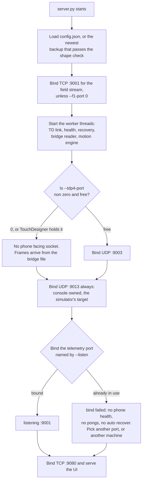

# Running the console

## What it needs

The core console boots on plain Python 3.9 or newer. The Live view, YOLO person
segmentation and MCAP export need the packages in `WebConsole/requirements.txt`.
One virtual environment serves both the console and the YOLO worker.

`torch` and `torchvision` are deliberately not in `requirements.txt`. They are
installed first, from the right index, so that `ultralytics` finds them already
satisfied instead of pulling a CPU build from PyPI.

On Windows the installer targets Python 3.12, falling back to 3.11. Those are
the versions CUDA torch wheels exist for. `doctor.py` fails below 3.9 and warns
on Windows for anything outside 3.11 and 3.12.

## Install on macOS or Linux

```bash
cd /Users/ari/Documents/XcodeProjects/TDStage/WebConsole
python3 -m venv .venv && . .venv/bin/activate
pip install torch torchvision
pip install -r requirements.txt
python3 doctor.py                 # environment check, read only
```

Keep the `TD/newtox` folder next to `WebConsole`. The console imports
`tdp4_receiver`, `tdp3_receiver` and `rgb_orient` from there, and will not serve
the Live view without them.

## Install on Windows (the show machine)

1. **Get the repo.** `git clone`, or download the ZIP and unzip. Keep
   `TD\newtox` beside `WebConsole`.
2. **Install Python 3.12 x64** from python.org with "Add to PATH" ticked, or
   `winget install -e --id Python.Python.3.12`.
3. **Run `WebConsole\windows\install.bat`.** It creates `WebConsole\.venv`,
   installs torch from the CUDA 12.6 index when `nvidia-smi` is found and from
   the CPU index otherwise, then `requirements.txt`, then runs `doctor.py`.
   Safe to re run. Override the torch index with
   `set TORCH_INDEX_URL=https://download.pytorch.org/whl/cu130` beforehand, or
   the Python version with `set TDSTAGE_PY=3.11`.
4. **Run `WebConsole\windows\firewall.bat` once.** It asks for Administrator and
   adds four inbound rules:

   | Rule | Protocol and ports | Scope |
   |---|---|---|
   | TDStage Console UDP | UDP 9001, 9003, 9013 | any |
   | TDStage TouchDesigner UDP | UDP 9000, 9004 | any |
   | TDStage Console HTTP | TCP 9080 | LocalSubnet and 100.64.0.0/10 |
   | TDStage F1 WebSocket | TCP 9001 | LocalSubnet and 100.64.0.0/10 |

5. **Check with `WebConsole\windows\doctor.bat`.** Every line should read OK,
   and the compute section must say `yoloDevice=auto resolves to cuda`. If it
   says cpu, the CUDA torch wheel did not install: set `TORCH_INDEX_URL` and run
   `install.bat` again.
6. **Run `python xplat.py` once**, from `WebConsole` with the virtual
   environment's Python. It is the cross-process self-test for the
   platform-specific half of the console — the file locking that stops two
   consoles sharing one configuration, among other things. That code takes a
   different path on Windows from the one every development machine exercises,
   so this is the first place it has ever run for real. A failure here is
   worth stopping for.

YOLO weights (`yolo26n-seg.pt`, `yolo26n-pose.pt`) ship in `WebConsole/models/`,
so the install works offline once pip has run.

Run Python with `PYTHONUTF8=1`. The `.bat` files set it. Without it, logs and
`config.json` hit the cp1252 codepage.

## Start commands

### The show machine, everything at once

```
WebConsole\windows\show.bat
```

It starts the TDP4 bridge in its own window, waits two seconds, then the console
with a watchdog, and opens the browser. Both restart themselves if they exit.
Closing a window stops that process.

The bridge command it runs is:

```
TD\newtox\tdp4_bridge.py --port 9003 --shm-port 9004
```

The bridge receives the phones on UDP 9003 in its own process and publishes
whole frames through a memory mapped file named for port 9004, which is what the
tox's `Udpport` expects. TouchDesigner and the console both read that one file,
each keeping its own place in it.

The reason the receiver is a separate process is the GPU merge path. A receive
thread **inside** TouchDesigner starves while the merge runs, because the merge
holds the interpreter and datagrams are dropped meanwhile. Outside, the bridge
drains its socket at full rate and hands over assembled frames, which TD reads
whenever it is ready. The console reads the same file for free, which is why
there is no relay in the show path any more.

**There is no fan out relay in front of it, and there should not be.**
`udp_fanout.py` is legacy. It lost packets above about 30,000 per second, and
eight phones with colour are 49,000 at the simulator's grid, about 76,000 at
the 320×240 a real iPhone 17 Pro sends; the bridge alone took 114,500 per second
with no loss at twelve colour streams, 55 per cent of one core. The 61,000 in
older notes was the highest load then tried, not a ceiling. `windows\fanout.bat` and the console's Start fan-out button remain for
the no bridge CPU path only. The architecture diagram in `CLAUDE.md` still shows
the relay as the show path and is stale; its port table is correct.

### The show machine, console only

```
WebConsole\windows\run.bat
```

which runs, in a restart loop:

```
python server.py --http 9080 --listen 9001 --tdp4-port 0
```

Extra arguments to `run.bat` pass straight through to `server.py`.

### A Mac, everything at once

```bash
./Tools/show_mac.sh
```

Same two processes, same ports, each restarted two seconds after it exits.
Ctrl-C stops both.

### A Mac, console only

```bash
cd WebConsole && . .venv/bin/activate
python3 server.py --http 9080 --listen 9001 --tdp4-port 0
```

Use `--listen 9001` whenever TouchDesigner is on the same machine. TD binds UDP
9000 for phone telemetry, and the console cannot have it as well.

## Start up, and what binds which port

Boot is a fixed order, and only one step in it can fail in a way that leaves the
console running but half useful.



**The telemetry bind is the one that fails softly.** The console logs the error,
the top bar reads `bind failed` instead of `listening :<port>`, and it carries on
serving the UI: you can still see the roster, edit poses and send `/ctl`, but no
phone health arrives, no pong lands, and auto recover has nothing to act on. The
cause is almost always TouchDesigner already holding 9000 on the same machine,
which is why the show machine runs the console on `--listen 9001`.

The platform behaves differently here, deliberately. On macOS and Linux the
listener sets `SO_REUSEADDR`; on Windows it does not, because there
`SO_REUSEADDR` lets a second socket **steal** a port another process already
holds, and silently taking TouchDesigner's telemetry port is worse than
refusing to start the listener.

**`--tdp4-port 0` on the show machine is not a performance choice, it avoids a
deadlock.** TouchDesigner must be able to bind 9003 the instant it launches. A
console that opportunistically grabs the port while TD is down wedges the pair,
because the console only yields the port once it learns from TD's status message
that TD wants it, and TD cannot send that message until it has started. With `0`
the question never arises: the bridge owns the phone port, and both readers take
frames from its file.

**9001 appears twice and is not a clash.** `--listen 9001` is a **UDP** socket
for phone telemetry and TouchDesigner's replies. `--f1-port 9001` is a **TCP**
listener for the client field stream. Different protocols share a port number
without seeing each other, and the pairing is intentional so there is one number
to remember and one firewall rule per direction.

## Every CLI flag

| Flag | Default | What it does | When to change it |
|---|---|---|---|
| `--http PORT` | `9080` | TCP port for the browser UI and the whole HTTP API. | Only if something else holds 9080, or you are running a second instance. |
| `--listen PORT` | not set, falls back to the saved value in `config.json`, else `9000` | UDP port the console binds for phone telemetry (`/tdlidar/<id>/device/*`) and for TouchDesigner's health and pong replies. | Set `9001` whenever TouchDesigner runs on the same machine, because the tox binds 9000. The phones must then be pointed at it, which the Dashboard's telemetry retarget button does. |
| `--no-autostart` | off | Do not bind the telemetry listener at boot. | For a bring up where you want the port left free. Start it later from the toolbar. |
| `--tdp4-port PORT` | `9003` | A direct TDP4 UDP listener on the phone facing port. It is bound only while nothing else claims it, and the console gives it up once TouchDesigner's status message (`/tdstage/td/status`) reports that the tox wants that `Udpport`. `0` disables it. | `0` on the show machine, where TouchDesigner must be able to bind 9003 the instant it launches and the console reads the bridge file instead. Another number to run a measurement instance beside TD. |
| `--sim-port PORT` | `9013` | A second TDP4 listener the console always owns. The built in simulator is aimed at it. A real phone can be pointed here when TD is not in the loop. | Rarely. Change it only to avoid a clash, and then set the fan out's second target to match. |
| `--f1-port PORT` | `9001` | The F1 0.4 draft WebSocket (SMSF, SMSP, SMSS). **TCP**, so it coexists with a UDP `--listen 9001`. `0` turns it off. | `0` when no client machine is consuming it. |
| `--f1-hz RATE` | `15.0` | Rate of the F1 field. | Only if the client asks for a different rate. |
| `--config PATH` | `config.json` beside `server.py` | The config file to load and save. Phone profiles move with it, into a `profiles` folder beside it. **Also marks this a test instance**, so the TouchDesigner link and the client outputs start off. | Always, when you run a second instance for a test or a measurement. |
| `--td-link` | off for a test instance, on otherwise | Lets a test instance drive TouchDesigner: push poses, own the registration table. | Only when a second instance is deliberately taking over TD from the show console. |
| `--client-out` | off for a test instance, on otherwise | Lets a test instance send `/track` and publish NDI. | Only when a second instance is deliberately taking over the client bus. |

### A second instance drives nothing until you ask it to

**What counts as a test instance:** one started with `--config`, *or* one on
any web port other than 9080. Either marks it, and both are things people do
without thinking about consequences — copying a config to try something, or
running a second console beside the first.

A test instance comes up with the **TouchDesigner link off** and **`/track` and
NDI off**, whatever its own saved configuration says. Add `--td-link` or
`--client-out` to opt in. Each refusal is logged with its fix.

The reason is a real incident rather than caution: on link-up a console pushes
its own phone poses into TouchDesigner's registration table, so a scratch
console started for a measurement moved phones 1 to 6 in the live tox. The same
argument covers the client bus — a copy of the show's configuration should not
start publishing tracking data over the top of the show.

The port half matters more than it looks. A worktree started the usual way
beside the show console cannot have 9080, because the show console already
holds it, so it is marked as a test instance without anyone remembering a flag.

**The show console is unaffected.** The launchers pass no `--config` and use
port 9080, and it restores `/track` and NDI exactly as it last saved them. A
test instance saves its own file's settings back rather than the show's, so it
cannot switch the show console's link off behind your back.

### One console per configuration file

A second console started on a configuration file that another console already
holds **exits immediately**, with status 3, naming the file that is taken. The
lock is the operating system's, on a file beside the configuration, so it is
released the moment the holder dies — a crash or a watchdog restart frees it
with nothing to clean up, and the launchers retry every two or three seconds,
so a restart takes over as soon as the old process is gone.

This closes the last route by which a second console could rewrite the show's
roster: not by driving TouchDesigner or the client bus, which the test-instance
rules already prevent, but simply by saving its own idea of the roster over the
show's file. Two consoles on one file was never a configuration anyone wanted;
now it is one that cannot happen.

To run a second console deliberately, give it its own file with `--config`,
which is what you want anyway — its phone profiles move with it.

### What `--config` does to a fresh instance

If the file named by `--config` does not exist yet, the console starts with the
TouchDesigner link **off**. A new test instance would otherwise seed TD's
registration table with its own default poses and move the real phones in TD.
Turn the link on from the Dashboard if that instance is meant to own TD.

## Verifying it came up

The console prints two lines on a successful boot:

```
TDStage Web Console → http://localhost:9080
telemetry in UDP :9001   ·   /ctl out UDP → phone :9010   ·   Ctrl-C to quit
```

Then check, in order:

1. **The web UI.** Open `http://localhost:9080`. The top bar should show a
   listen indicator reading `listening :9001`. If it reads `bind failed`,
   something else holds the port, usually TouchDesigner.

2. **The health endpoint.** This is the one command for a watchdog or a remote
   check:

   ```bash
   curl -s http://localhost:9080/healthz
   ```

   It answers `200` with `ok`, uptime, the ids of online and streaming phones,
   phones that have moved since their pose lock, the TD link state, a `degraded`
   list of phones that are hot, slow or late, and an `offWired` list of phones
   that have a wired link up but are streaming over Wi-Fi. `degraded` and
   `offWired` empty is the state you want.

3. **Frames reaching the console.** `GET /api/live` reports both ingest paths.
   `bridge.running` true with a rising `frames` count means the memory mapped
   path is working. `tdp4.held` true means TouchDesigner holds the phone port
   and the console has correctly stood aside.

4. **The Rig health panel** on the Dashboard. It re checks every ten seconds and
   names a cause and a fix for each problem it finds, with a button for the ones
   the server can repair itself.

5. **`doctor.py`** for the environment rather than the running console. It is
   read only.

   ```bash
   python3 doctor.py              # full check, waits 5 s for phone telemetry
   python3 doctor.py --wait 0     # skip the telemetry wait
   ```

   Flags: `--listen` (default `9001`), `--http` (default `9080`), `--wait`
   (default `5.0`). It checks the Python version, every import the console and
   the YOLO worker need, the torch compute device, the bundled model files,
   whether UDP 9001, 9003 and 9013 and TCP 9080 are free, the Windows Firewall
   rules with the exact `netsh` lines to add them, this machine's LAN addresses,
   and whether any phone telemetry arrives. Exit code 0 means no FAIL lines,
   1 means at least one.

## Network, PoE rig

- One gigabit 802.3at PoE+ switch with enough budget for eight 25 W phones. The
  PC on a switch port, a router or the switch's DHCP on the same LAN.
- Give the PC a fixed address, for example 10.0.0.10, and reserve one address
  per phone.
- Each phone gets a PoE adapter into USB-C. In the app, "Prefer Ethernet (PoE /
  cable)" is on by default, and the Link line must read **Ethernet**. Set the
  destination to the PC's wired address, or push it from the console.
- Bandwidth: eight phones at depth+conf is about 280 Mbit/s; with colour on
  every phone about 570 Mbit/s. Both fit one gigabit uplink. Wi-Fi is the
  fallback only.
- The console logs "stream left Ethernet" when a phone drops to Wi-Fi, and
  `GET /healthz` lists it under `offWired`.

## Operating it remotely

Install Tailscale on the show machine and on the operator's laptop, sign both
into the same tailnet, then browse to
`http://<show-machine>.<tailnet>.ts.net:9080` or its `100.x` address. The
firewall rule already admits `100.64.0.0/10`.

Never forward port 9080 to the public internet. **The console has no login.**

### The off LAN cap

`WebConsole/README.md` says the console can be operated from the other side of
the world. True, with one caveat it does not state: **the Live view is capped for
any client that is not on the LAN, to 5 frames per second and 20,000 points
shared across all phones.** At eight phones that is 2,500 points each. The
console logs the cap the first time it applies, and every capped response carries
an `X-Cloud-Remote: 5 Hz, 20000 points` header.

**Why there is a cap at all.** A LAN view is about 2 MB per poll at 30 Hz, which
is over 60 MB/s. No remote uplink carries that, and the failure is not graceful:
the console's own threads stall writing into a socket that cannot drain, so a
single remote tab degrades the show machine. 20,000 points at 5 Hz is about
147 KB a frame, roughly 6 Mbit/s, which a tunnel can move. The budget is held per
client address, so two tabs on one remote machine share it rather than doubling
it.

A Tailscale `100.64/10` address counts as off LAN, because it is a tunnel. Only
private, loopback and link local addresses count as on LAN.

Everything else in the UI is uncapped remotely: the roster, telemetry, `/ctl`,
the Log, Stage 3D, Markers and the settings. It is the point cloud, and only the
point cloud, that is thinned. Judging merge quality or cloud density needs a
browser on the venue LAN, or a remote desktop session on the show machine.

Use RDP or another remote desktop over Tailscale for TouchDesigner and for
running the `.bat` files. Phones stay on the venue LAN. Only the browser crosses
Tailscale.

## Ports, as the code binds them

| Port | Protocol | Direction | Carried by |
|---|---|---|---|
| 9080 | TCP | browser to console | The UI, the whole HTTP API, the SSE event stream |
| 9000 | UDP | phone to TouchDesigner | OSC telemetry. The tox binds this, which is why the console uses 9001 |
| 9001 | UDP | phone and tox to console | OSC telemetry in, when started with `--listen 9001` |
| 9001 | TCP | console to client machine | The F1 0.4 draft WebSocket. A different protocol on the same number, deliberately |
| 9003 | UDP | phone to bridge | TDP4 depth grid plus the TDPH hello. The bridge binds it; the console binds it only with `--tdp4-port 9003` and nothing else holding it |
| 9004 | UDP | bridge or fan out to TouchDesigner | TDP4. Also the name of the bridge's memory mapped file |
| 9013 | UDP | simulator or fan out to console | TDP4 on the console's own always bound port |
| 9006 | UDP | console to TouchDesigner | OSC: `/tdstage/pose`, `/tdstage/pose/clear`, `/tdstage/ping` |
| 9010 | UDP | console to phone | OSC `/tdlidar/ctl/*`. Per phone, settable as its Ctl port |
| 7000 | UDP | console to client bus | OSC `/track` performers and hands |

Every stream here is UDP except the browser's HTTP and the F1 WebSocket. There
is no TCP transport for depth anywhere in this system.

## Files the console writes

| Path | What |
|---|---|
| `WebConsole/config.json` | Roster, poses, marker plan, person figures, listen port, TD link, client output targets, recovery policy, every setting |
| `WebConsole/backups/config-*.json` | Rotating copies, at most one a minute, newest 50 kept. The console loads the newest usable one if `config.json` is unusable |
| `WebConsole/profiles/phone-<id>.json` | Each phone's last known good profile, with a revision number |
| `WebConsole/logs/console.log` | Rotating, 5 files of 5 MB |
| `WebConsole/logs/track-<stamp>.jsonl` | Written only while `/track` recording is on |

### Backups, and what is not proven

`./Tools/backup_state.sh` takes a **snapshot** before risky work: both repos as
git bundles, uncommitted work as patches, the console config and its rotating
backups, the profiles, the tox, TD's learned state, and a manifest with sha256
sums. Run it before anything you might want to undo.

Treat it as a snapshot, not as a tested restore. **Restoring a configuration is
not proven.** Two specific gaps:

- **The fallback tests shape, not sense.** The console keeps
  `backups/config-*.json`, and when `config.json` is unusable it sets that file
  aside as `config.json.corrupt-<timestamp>` and loads the newest backup that
  passes `_config_invalid`: a JSON object, with a device list, every device
  carrying an integer id, and a marker list whose entries have `id`, `label`,
  `x`, `y` and `z`. Nothing checks whether the **values** are the show's. A file
  that parses and has the right shape but holds the wrong poses, the wrong roster
  size or last month's marker plan is accepted in silence.

  Shape checking is itself new as of 2026-10-27, and it exists because of how the
  old behaviour failed. `{}`, `[]` and `"devices": null` all parse. Each of them
  used to seed a fresh six device session, the next save wrote that seed over
  `config.json`, and the save after that filed the seed as the newest backup, so
  the real roster aged out of the folder. The console now also says what it did:
  **Rig health's first row reports a session that started from a backup, or from
  a seed**, and the note stays for the whole session rather than scrolling away
  in the Log.
- The backup path has open review findings, and no restore has been exercised
  end to end.

So: keep the snapshots, and if you ever need one, check the restored roster,
poses, marker plan and listen port by eye against what you expected before
trusting them. Do not plan a show around an unattended restore.

### Why saves are serialised and fsynced

`config.json` is written whole on every change, into a private temporary file
that is fsynced before it is renamed over the real one, under one lock. All three
parts earn their keep. Until 2026-10-27 concurrent POST handlers shared a single
`config.json.tmp`: the second `open()` truncated the first writer's file, the
rename raised a 500 for whoever pressed the button, and a reader could find
`config.json` empty or half written. The rename is atomic, so a crash mid save
leaves the previous file intact rather than a partial one. The temporary file is
created with mode 0600, so the code reads `config.json`'s own mode and restores
it before the rename.

### Restarting to pick up a code change

The Rig health panel's Restart buttons clear state and revive dead threads. They
do **not** reimport any Python module. An edit to the console's code needs the
console process restarted: Ctrl-C and run it again, or close the `run.bat` or
`show.bat` window. Both watchdogs restart the process on their own if it exits,
so on the show machine the process comes straight back.

The reason the buttons stop short of reloading code is what they are for. They
exist to recover a service that has wedged or is erroring **during a show**,
where the fastest safe action is to drop its queued work and cached results,
clear its error counters and start a fresh thread if the old one died. Reimporting
a module under a live rig would swap code out from under threads that hold
references to the old one, which is a different and much worse failure than the
one being fixed. So the split is: Restart to recover, process restart to deploy.
For the YOLO backend the distinction is narrower, because its Restart really does
restart the separate worker process, but even there the console's own code is
unchanged.
