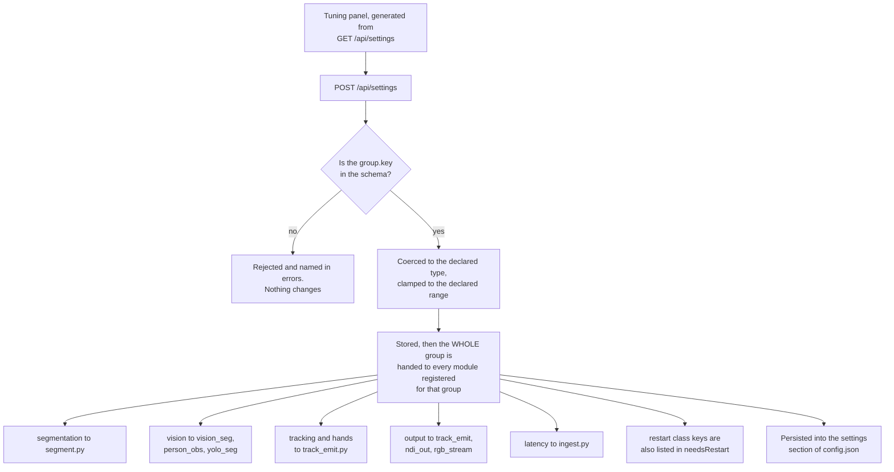

# Settings reference

These are the console's runtime tunables. They live in `WebConsole/settings.py`,
are persisted in the `settings` section of `config.json`, and are edited from the
**Tuning** panel in the Live view's side rail.

They are **not** phone settings. Phone settings are sent over OSC to each phone
and live on the [device page](ui.html). These change the console's own
segmentation, tracking, hand emission and output.

## How a setting reaches the code that reads it

Three design choices in that path explain most of the odd cases further down
this page.

**The values live in `settings.py`; the modules keep their own globals.** A
module does not look a setting up when it needs it. It receives the whole group
as a plain dict through `apply_settings(d)` and copies what it owns into its own
module globals, which its hot loop then reads with no dict lookup and no lock.
Every one of those globals is a plain scalar written from the HTTP thread and
read inside exactly one worker loop, which is safe without a lock because a
CPython global store is atomic, and the loop reads them once at the top of each
tick so a change lands cleanly on the next one.

**Several modules can own one group, and a missing module is skipped silently.**
`output` goes to `track_emit`, `ndi_out` and `rgb_stream`; `vision` goes to
`vision_seg` and to whichever observers started. Each is handed the whole group
and ignores the keys it does not own. A module with no `apply_settings` attribute
is accepted and skipped, and starts working on its own if it later grows one,
because the attribute is looked up at dispatch time rather than at registration.
That is what lets the console boot without NDI, or without Vision, and still
accept their settings. A hook that raises is caught and reported as an error on
the group: **a broken hook must not take the console down mid show.**

**Some hooks spell keys in snake_case.** Those schema entries carry `aliases`,
and the dispatched dict holds the value under both spellings, so either
implementation works without a translation layer.

**The panel cannot drift from the server**, because it is built from
`GET /api/settings`, which returns the schema, the current values and the
defaults together. The hover text you see on a row is the schema's own `help`
string. If a page and the panel disagree, the panel is right.

### Which groups apply live, and which need more

| Group | Applied by | Live |
|---|---|---|
| `segmentation` | `segment.py` | Live, except `vox`, which requantises every learned key and so **resets** the engine |
| `vision` | `vision_seg`, `person_obs`, `yolo_seg` | Live, except `yoloModel` and `yoloDevice`, which **rebuild** the worker |
| `tracking` | `track_emit.py` | Live |
| `hands` | `track_emit.py` | Live |
| `output` | `track_emit`, `ndi_out`, `rgb_stream` | Live, except the four `ndi*` geometry and naming keys, which **rebuild** the sender and make receivers reconnect |
| `latency` | `ingest.py` | Live |

Nothing in any group needs the console **process** restarted. `restart` here
means one object is rebuilt, and the console tells you which key by naming it in
`needsRestart`. A console process restart is only needed to pick up a **code**
change. See
[Running the console](running.html#restarting-to-pick-up-a-code-change).

## How to read the table

| Column | Meaning |
|---|---|
| **Key** | `group.key`. Hover a label in the Tuning panel to see it |
| **Default** | What the code ships with |
| **Range** | The schema's min and max. Values outside are clamped, not rejected |
| **What moves** | The observable consequence |

The **Live** class says what happens when you change it:

| Class | Meaning | Shown as |
|---|---|---|
| `safe` | Lands on the next tick | nothing |
| `reset` | The owning module throws its learned state away and relearns from scratch | ⚠ |
| `restart` | An object has to be rebuilt before it takes effect, and the console reports the key in `needsRestart` | ⚠ |

Keys marked **expert** are hidden until you turn on **Expert settings**. They
are hidden because they can wedge a show.

One key is **locked**: the server refuses to move it. It is shown greyed with
the reason rather than hidden, because it records a contract decision.

`GET /api/settings` returns the schema, the current values and the defaults, so
the panel can never drift from the running server. `POST /api/settings` changes
them and reports only the keys that actually changed.

### Resetting

Per group, with the **Reset** button on the group's header. All groups, with
**Reset all**, which asks first because the background relearns and the tracker
may hand the client new performer ids.

A small number of defaults have been retuned after measurement. When that
happens the console moves a saved value **only if it equals the old default**,
on the grounds that nobody chose it; a value someone set differently is kept.
The pairs it migrates are listed as `RETUNED` in `WebConsole/settings.py`.

That migration runs **once**, not on every boot. The saved settings block
carries a `_rev`, and a file already at the current `SETTINGS_REV` is never
touched. The first version of this had no revision and re-ran at every start,
which made the old value unsettable: an operator who deliberately chose the
previous default had it silently moved back on the next restart. A file written
before revisions existed counts as revision 0 and is migrated once.

## What this page deliberately does not cover

**The tracker and identity tunables are being revised and are not documented
here.** A build then refute batch is in progress across `track_emit.py`,
`settings.py`, the simulators and the identity contract, so any number printed
here for identity thresholds, publication delay, sighting counts or crossing
behaviour would be wrong by the time you read it.

For those, read the live source instead of a page:

- `WebConsole/settings.py`, `SCHEMA["tracking"]`, for the current defaults,
  ranges and help text.
- `WebConsole/track_emit.py` for what each one actually does.
- `GET /api/settings` on the running console, which is the only truth that
  cannot drift. The Tuning panel is built from it, so the panel's own hover
  text is always current.

A labelled gap is safer than a confident wrong number. The same applies to any
other default on this page: if you need to act on an exact value, read it from
`GET /api/settings` rather than from here.

---

## segmentation (21 keys)

The motion and auto background engine, `segment.py`. It learns the static scene
so that what is not background is a performer. This is what the Live view's
Motion mode shows and what `/track` filters against.

| Key | Default | Range | Live | What moves |
|---|---|---|---|---|
| `vox` | 0.05 m | 0.03 to 0.10 | **reset** | Occupancy lattice edge. Changing it requantises every learned key, so the engine resets and the background relearns from scratch |
| `emaWindow` | 45.0 s | 10 to 180 | safe | Background learn horizon. A still object crosses the threshold after about 0.6 times this, so 27 s at 45 s |
| `bgThresh` | 0.45 | 0.25 to 0.85 | safe | Occupancy above which a voxel is scenery. Deliberately below the sway equilibrium of 0.6 to 0.8, so a breathing cloud still promotes; the footprint guard is what protects held poses |
| `admitTicks` | 2 ticks | 1 to 10 | safe | Consecutive ticks a new voxel must be seen before it can display. 1 means no debounce |
| `holdS` | 0.8 s | 0.2 to 2.0 | safe | How long an already admitted voxel stays foreground after it was last seen. This is the per frame LiDAR dropout flicker filter |
| `pruneS` | 10.0 s | 3 to 60 | safe | Rows unseen this long with near zero occupancy are dropped. Memory and CPU only |
| `clusterMinVox` | 40 vox | 10 to 200 | safe | Foreground plan view clusters smaller than this are not displayed once the background is mature |
| `guardMinVox` | 20 vox | 5 to 200 | safe | Lower bar for footprint protection: a coherent blob this big keeps its floor cells out of the background. This is what lets a performer lie prone |
| `heightMin` | 0.30 m | 0.10 to 1.00 | safe | Displayable cluster height floor. Live view only; `/track` uses `tracking.spanMin` |
| `heightMax` | 2.40 m | 1.50 to 3.50 | safe | Displayable cluster height ceiling. Live view only |
| `seedHoldS` | 2.0 s | 0.5 to 5.0 | safe | "Stage is empty now" keeps promoting the observed scene for this long, so a cold engine still gets a seed |
| `matureFrac` | 0.15 | 0.02 to 0.60 | safe | Background voxels over all voxels above this means mature. **Until mature, all foreground shows and `/track` emits zero performers** |
| `motionBornS` | 3.0 s | 1 to 10 | safe | A voxel born later than this after engine start counts as "walked in" rather than scenery |
| `guardMotionFrac` | 0.3 | 0.1 to 0.6 | safe | Fraction of motion born voxels a cluster needs before its footprint is protected. Too low and the from boot scene guards itself and never learns |
| `freezeBg` | off | | safe | Background learned at calibration, with no absorption on stage. Press "Stage is empty now" on the empty stage; after that a performer holding still never fades into the background. Off means keep learning, which absorbs anything still for about 0.6 times the learn time |
| `fringeFrac` | 1.0 x bgThresh | 0.0 to 2.0 | safe | A foreground voxel below this times `bgThresh` that touches background is speckle and is dropped. 0 disables |
| `stageX` | 9.0 m | 3 to 15 | safe | Engine inclusion box half width |
| `stageZlo` | -9.0 m | -15 to -3 | safe | Downstage edge of the kept volume |
| `stageZhi` | 9.0 m | 3 to 15 | safe | Upstage edge. Points past it, such as the back wall, never enter the engine |
| `stageYlo` | -0.6 m | -1.0 to 0.0 | safe | Floor margin. Points below never enter the engine |
| `stageYhi` | 3.6 m | 2.5 to 6.0 | safe | Ceiling. Rigging and lights above this never enter the engine |

**If `/track` reports nobody**, look at `matureFrac` here and at the settle
window in the `tracking` group. Both deliberately publish zero performers
rather than the raw room until the background is mature and has settled. Read
the tracking side from `GET /api/settings`, not from this page.

## vision (18 keys)

The person segmentation backends. YOLO is primary when it is available; Apple
Vision stays loaded as a hot standby.

| Key | Default | Range | Live | What moves |
|---|---|---|---|---|
| `quality` | `balanced` | `fast`, `balanced`, `accurate` | safe | Apple segmentation model. Measured at 256x192: fast 1.6 ms, balanced 8 ms, accurate 29.5 ms |
| `dilate` | 2 cells | 0 to 8 | safe | Safety dilation around the silhouette before it filters points |
| `maskFresh` | 1.5 s | 0.3 to 5.0 | safe | A mask older than this stops filtering that device |
| `rateCap` | 0.15 s | 0.03 to 1.0 | safe | Minimum interval between inferences for one device. All devices share one worker thread |
| `maskThresh` | 127 /255 | 64 to 200 | safe | Binarisation level of the soft mask. Lower gives a more generous silhouette |
| `enabled` | on | | safe | The person observer: Vision instance masks plus 2D body pose, the source of split seeds and hand wrists. Off leaves the motion engine alone |
| `yoloEnabled` | on | | safe | The YOLO backend. Measured 4 of 4 people on a crowd photo where Apple's model merged them to 2. Off means Apple Vision only |
| `yoloModel` | `yolo26n-seg` | `yolo26n-seg`, `yolo26m-seg`, `yolo26l-seg`, `yolo26x-seg` | **restart** | n measured 11 ms at 256x192; m is 48 ms and too slow for 30 Hz |
| `yoloConf` | 0.25 | 0.05 to 0.9 | safe | Detection floor. Lower finds more people and more false ones |
| `yoloRateHz` | 30.0 Hz | 1 to 30 | safe | Per device inference cap for the YOLO worker |
| `yoloPose` | off | | safe | Second pass for multi person wrists, which is what feeds `/track/performer/hand`. Costs about +10 ms per frame, so leave it on at three phones or fewer and off for a full rig |
| `yoloDevice` | `auto` | `auto`, `cuda`, `mps`, `cpu` | **restart** | `auto` means cuda if available, else mps, else cpu. Pick `cpu` to keep the GPU entirely for TouchDesigner |
| `obsTotalHz` | 70.0 inf/s | 5 to 240 | safe | **Total** inferences per second across all phones. Each phone runs at the lesser of its own rate and this divided by the phone count, so two phones get the full rate while eight degrade evenly instead of starving the rest of the console. One inference is about 11 ms on a Mac |
| `standbyHz` | 3.0 Hz | 0.5 to 30 | safe | Rate for the secondary backend, kept warm so it can answer immediately if the primary goes quiet |
| `rateHz` | 30.0 Hz | 1 to 60 | safe | Per device inference cap for the person observer, round robin across devices |
| `minJointConf` | 0.4 | 0.0 to 1.0 | safe | Body pose joint confidence floor for a wrist to be used |
| `erodePx` | 1 px | 0 to 4 | safe | Erosion of each instance mask before points are gathered. Drops the silhouette edge that straddles the background |
| `depthBandM` | 0.6 m | 0.1 to 2.0 | safe | Points further than this behind an instance's median depth are not that person |

## tracking

**Not documented here: in change.** This group drives `track_emit.py`, which is
mid revision together with the identity contract and the simulators. It holds
the association gate, the clustered flag distance, the cluster point and shape
gates, the sighting count before an id is published, the settle window that
delays publication, the re acquire gates that decide when a lost track is
reclaimed, the coast timeout, the performer ceiling, the detection source, and
the per device liveness window.

Read the current values and ranges from `GET /api/settings`, or from
`SCHEMA["tracking"]` in `WebConsole/settings.py`. Hover any row in the Tuning
panel for its help text, which comes from that same schema.

Two of its behaviours are worth knowing even without the numbers, because they
look like faults:

- **`/track` deliberately publishes zero performers rather than the raw room**
  until the learned background is mature and has settled. Walls and tripods are
  not performers, so reporting none is the correct answer during that window.
- **The RGB person mask gate fails open per device.** A phone with no fresh mask
  contributes all of its points rather than none, so a model miss can never
  blank the stage.

## hands

What `/track` emits for hands. **These are not the hand detector's settings.**
The detector is configured by `POST /api/hands` and by the Live view's Hand
tracking panel, with its own separate keys (`maxHands`, `rateHz`, `depthWin`,
`smooth`, `minPoints`). This group governs emission only, and it is applied by
`track_emit.py`.

Three of its keys decide when a hand is first published, how a lost hand is
closed off, and which emitted performer an observed hand belongs to. Those are
publication and identity thresholds in code that is mid revision, so they are
**not documented here**: `birthHits`, `holdS` and `matchM`. Read their current
values from `GET /api/settings` or `SCHEMA["hands"]` in
`WebConsole/settings.py`.

The rest are signal conditioning on the wrist samples themselves.

| Key | Default | Range | Live | What moves |
|---|---|---|---|---|
| `enabled` | on | | safe | Emit `/track/performer/hand` at all. Off stops hands reaching the client while the detector keeps running, so the Live view's hand rings still show |
| `minConf` | 0.4 | 0.0 to 1.0 | safe | Body pose confidence floor for a wrist sample |
| `lsFrames` | 5 frames | 2 to 20 | safe | Least squares velocity window. 5 frames tolerates 49 mm of position noise at the bus's 2.2 m/s gesture threshold; a one frame difference tolerates only 11 mm |
| `maxSpeed` | 6.0 m/s | 0.5 to 20 | safe | Velocity clamp |
| `outlierM` | 0.25 m | 0.01 to 2.0 | safe | A single frame jump larger than this is rejected and the last position kept |
| `birthHits`, `holdS`, `matchM` | in change, not documented yet | | safe | Publication and identity thresholds. See the note above |

## output (10 keys)

The two client feeds: `/track` on the wire, and the NDI image.

| Key | Default | Range | Live | What moves |
|---|---|---|---|---|
| `zFlip` | off | | safe | Negate z and vz on the wire. One click if the depth axis sign turns out reversed against the client's sim |
| `emitRate` | 30.0 Hz | 1 to 60 | safe | `/track` bundle rate. The contract's native rate is 30 Hz |
| `emitProps` | off | | safe | **LOCKED, off.** The client has not defined props, prop yaw is undefined, and their bus shares one smoothing filter across all props. Design only |
| `ndiWidth` | 960 px | 320 to 3840 | **restart** | Baked into the sender, so changing it rebuilds it and receivers reconnect |
| `ndiHeight` | 540 px | 240 to 2160 | **restart** | As the width |
| `ndiFps` | 30 fps | 15 to 60 | **restart** | Frames per second the sender advertises and renders |
| `ndiName` | `TDStage Point Cloud` | | **restart** | The name the client's receiver selects. NDI renames a duplicate, so check the published name in the status line |
| `ndiSplat` | 2 px | 1 to 4 | safe | Each point is drawn as a square this many pixels wide |
| `ndiHeightNorm` | 3.0 m | 0.5 to 10 | safe | In `height` colour mode, floor to this many metres is white |
| `ndiLiveS` | 1.0 s | 0.2 to 5.0 | safe | A phone with no frame for this long drops out of the NDI image |

## latency (16 keys)

Rates, polls and freshness windows across the ingest and camera view paths.

| Key | Default | Range | Live | What moves |
|---|---|---|---|---|
| `segTick` | 0.05 s | 0.02 to 0.5 | safe | Segmentation engine period, and **the dominant server side latency lever**, because `/track` filters the current cloud against the last published set. 0.05 is 20 Hz |
| `rgbHz` | 30.0 Hz | 1 to 60 | safe | Rate for the flattened camera view rebuilt from the coloured point cloud. The points already carry colour, so this is a projection, not a decode |
| `rgbStabilise` | on | | safe | Reproject through the **first** camera pose seen for each phone instead of the live one. The phone's pose micro corrects every frame, which makes the picture shimmer even when the room is still. Off follows the live pose |
| `consensusFree` | on | | safe | Consensus mode only. A phone whose depth shows it saw **through** a voxel to a farther surface votes that voxel empty. Removes flying pixels and mask bleed between a body and the wall. Turn off if real bodies lose limbs, which means the phones are badly aligned |
| `rgbReanchor` | off | | safe | A one shot trigger: forget the frozen camera poses and take the current ones |
| `rgbFill` | 4 | 0 to 12 | safe | Passes that fill black gaps from surrounding pixels. Each pass spreads colour one pixel in all four directions, about 0.5 ms |
| `realStickyS` | 1.0 s | 0.0 to 5.0 | safe | A phone that sent its own camera frame this recently is never rebuilt from points. Mixing the two made the view change size every frame. 0 always rebuilds from the points |
| `tdp4Poll` | 0.005 s | 0.001 to 0.05 | safe | Direct UDP path poll interval. Adds 0 to this to capture to emit |
| `segLive` | 1.5 s | 0.5 to 3.0 | safe | Devices with a frame younger than this are concatenated into the engine tick |
| `depthGate` | 0.45 m | 0.2 to 1.0 | safe | Inside the silhouette, keep only points within this of the nearest surface per pixel. Cuts the background column behind the body |
| `minCover` | 0.004 | 0.0 to 0.05 | safe | A mask covering less of the image than this is "no person found" and never vetoes the view |
| `confMin` | 0 | 0 to 2 | safe | Zero out depth cells below this Apple confidence level before unprojecting. 0 keeps everything |
| `splatW` | 320 px | 160 to 640 | safe | Reconstruction canvas width for the Vision fallback when no real camera frame is available |
| `splatH` | 240 px | 120 to 480 | safe | Height of that canvas |
| `snapshotMaxAge` | 2.0 s | 0.5 to 5.0 | safe | A device with no frame for this long vanishes from `/api/cloud`. **The browser view only** |
| `personMode` | `off` | `off`, `motion`, `vision`, `combined` | safe | Which signal filters the Live view cloud. The motion engine keeps learning in every mode |

{: .warning }
**Consensus can be chosen but not saved.** The console offers a Consensus
mode and applies it, but the saved settings cannot hold the value, so any
restart puts the rig back on whatever was saved, silently. The console
restarts itself after a crash, so this can happen without anyone touching
it. Re-select Consensus after any restart until this is fixed.

---

## Three things about this schema that will trip you up

### 1. `latency.personMode` cannot select Consensus

The schema's options are `off`, `motion`, `vision` and `combined`. The ingest
module also accepts **`consensus`**, and the Live view's People only panel
offers it, because that button uses `POST /api/person` rather than
`POST /api/settings`.

Consequences, both verified in the source:

- `POST /api/settings {"latency": {"personMode": "consensus"}}` will be rejected
  as an invalid enum value.
- Selecting Consensus in the UI works, but the mode is held in the ingest module
  rather than written back into the settings store, so **it does not survive a
  console restart.** After a restart the persisted `personMode` is applied
  instead, which is `off` unless someone set it.

If the show needs Consensus, set it from the UI after every console start, and
check the People only panel before the house opens. This looks like an
oversight rather than a decision, but that is unverified.

### 2. Two camera view tunables are not reachable from the Tuning panel

`rgb_stream.py` has an apply hook that reads `jpegQuality` and `rgbMaxAge` from
the `output` group. **Neither key exists in the schema's `output` group**, so
the hook is never handed them and the panel never shows them.

They are still adjustable, just per request, as query parameters on the image
routes: `?q=` (10 to 95, default 75) and `?maxAge=` (default 2.0 s). The module
globals keep their defaults otherwise.

### 3. The two "hands" are different things

| Thing | Set by | Keys |
|---|---|---|
| The hand **detector** | `POST /api/hands`, and the Live view's Hand tracking panel | `enabled`, `maxHands`, `minConf`, `rateHz`, `depthWin`, `smooth`, `minPoints` |
| Hand **emission** to `/track` | `POST /api/settings`, group `hands`, and the Hands switch in Client output | `enabled`, `minConf`, `holdS`, `birthHits`, `lsFrames`, `maxSpeed`, `outlierM`, `matchM` |

Both have an `enabled` and a `minConf`, and they mean different things. Turning
the detector off stops hands existing. Turning emission off stops them reaching
the client while the detector keeps running, which is what the Live view's hand
rings still show.

## Where the values are stored

In the `settings` section of `WebConsole/config.json`. A config file with no
`settings` section behaves exactly as the shipped defaults.

If that section is malformed, the console logs `saved settings ignored`, runs on
defaults, and tells you to fix or delete the block and restart. Settings are not
undoable: the undo stack covers poses, markers, the person figures and the
roster, not these.

## What a tick costs

The engine's own work is about **15 ms per tick with eight devices in frame**,
down from about 29 ms before the 2026-10-27 optimisation. *Measured,
simulation.* Eight real phones have never been run, and simulated devices do not
get hot or drop frames, so treat this as a ceiling on the code's cost and not as
a rig figure.

The bench numbers behind that, on the same scene at 306,000 points a tick: 29.2
to 14.6 ms, and 37.7 to 14.4 ms with the background frozen. The live figure
before the change was worse than the bench, 44.8 ms a tick on a 50 ms period,
which is one core with no slack left. The optimisation itself replaced
`searchsorted` joins of each observation against roughly 170,000 sorted state
rows, which were 40 per cent of a tick, with a dense cell to row table over the
stage box. Published arrays are bit identical before and after, checked tick by
tick for 900 ticks.

The engine stayed on the CPU on purpose. A GPU version would mean importing
torch into the console process, which is exactly what the YOLO worker exists to
avoid, or running a second supervised worker fed every tick's whole cloud. That
is a decision rather than a fix, and it is not needed at these numbers.

{: .note }
*Built, not verified on a running console.* The figure the Rig health panel shows
on the Motion background engine row comes from the live engine, so a console
started before this change still reports the old cost until it is restarted.

That matters when choosing `segTick`, because the engine period is the dominant
server side latency lever: `/track` does not re-segment, it filters the
**current** cloud against the foreground set the engine published on its **last**
tick. A period shorter than the work takes does not make the engine faster, it
only makes it late every tick.

{: .warning }
`segment.py`'s docstring says the engine runs at a fixed cadence of about 10 Hz.
The code disagrees: the period is `latency.segTick`, default 0.05 s, which is
20 Hz. The comment is stale; the schema's default is what runs.
