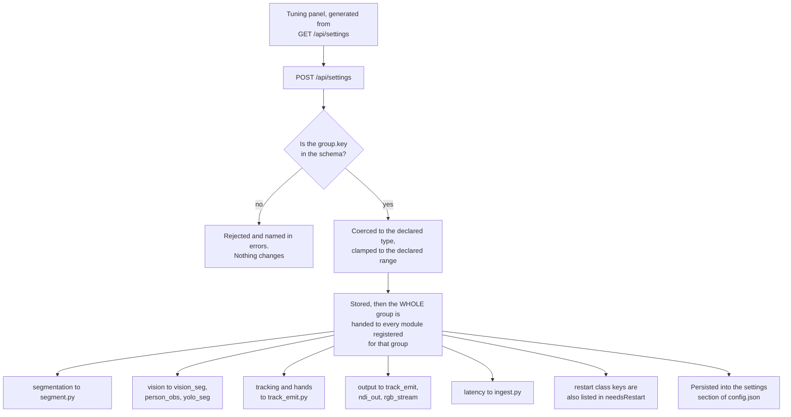

# Settings reference

These are the console's runtime tunables. They live in `WebConsole/settings.py`,
persist in the `settings` section of `config.json`, and you edit them from the
**Tuning** panel in the Live view's side rail.

They are **not** phone settings. Phone settings are sent over OSC to each phone
and live on the [device page](ui.html). These change the console's own
segmentation, tracking, hand emission and output.

## How a setting reaches the code that reads it

Four design choices in that path explain most of the odd cases further down
this page.

**The values live in `settings.py`; the modules keep their own globals.** A
module does not look a setting up when it needs it. It receives the whole group
as a plain dict through `apply_settings(d)` and copies what it owns into its own
module globals, which its hot loop then reads with no dict lookup and no lock.
Every one of those globals is a plain scalar, written from the HTTP thread and
read inside exactly one worker loop. That is safe without a lock because a
CPython global store is atomic. The loop reads them once at the top of each
tick, so a change lands cleanly on the next one.

**Several modules can own one group, and a missing module is skipped silently.**
`output` goes to `track_emit`, `ndi_out` and `rgb_stream`; `vision` goes to
`vision_seg` and to whichever observers started. Each is handed the whole group
and ignores the keys it does not own. The dispatcher accepts and skips a module
with no `apply_settings` attribute. If that module later grows one, it starts
working on its own, because the dispatcher looks the attribute up at dispatch
time rather than at registration. That is what lets the console boot without
NDI, or without Vision, and still accept their settings. The dispatcher catches
a hook that raises and reports it as an error on the group: **a broken hook must
not take the console down mid show.**

**Some hooks spell keys in snake_case.** Those schema entries carry `aliases`,
and the dispatched dict holds the value under both spellings, so either
implementation works without a translation layer.

**The panel cannot drift from the server**, because it is built from
`GET /api/settings`, which returns the schema, the current values and the
defaults together. The hover text you see on a row is the schema's own `help`
string. If a page and the panel disagree, the panel is right.

### Which groups apply live, and which need more

| Group | Applied by | Live |
|---|---|---|
| `segmentation` | `segment.py` | Live, except `vox`, which requantises every learned key and so **resets** the engine |
| `vision` | `vision_seg`, `person_obs`, `yolo_seg` | Live, except `yoloModel` and `yoloDevice`, which **rebuild** the worker |
| `tracking` | `track_emit.py` | Live |
| `hands` | `track_emit.py` | Live |
| `output` | `track_emit`, `ndi_out`, `rgb_stream` | Live, except the four `ndi*` geometry and naming keys, which **rebuild** the sender and make receivers reconnect |
| `latency` | `ingest.py` | Live |

Nothing in any group needs the console **process** restarted. `restart` here
means one object is rebuilt, and the console tells you which key by naming it in
`needsRestart`. A console process restart is only needed to pick up a **code**
change. See
[Running the console](running.html#restarting-to-pick-up-a-code-change).

## How to read the table

| Column | Meaning |
|---|---|
| **Key** | `group.key`. Hover a label in the Tuning panel to see it |
| **Default** | What the code ships with |
| **Range** | The schema's min and max. Values outside are clamped, not rejected. One hook can still refuse an in range value: `segment.py` refuses a stage box or `vox` whose cell table would pass 64 million cells, the store keeps the value that runs, and the key is reported in `errors` rather than `applied` |
| **What moves** | The observable consequence |

The **Live** class says what happens when you change it:

| Class | Meaning | Shown as |
|---|---|---|
| `safe` | Lands on the next tick | nothing |
| `reset` | The owning module throws its learned state away and relearns from scratch | ⚠ |
| `restart` | An object has to be rebuilt before it takes effect, and the console reports the key in `needsRestart` | ⚠ |

Most keys are **expert** and are hidden until you turn on **Expert settings**.
They are hidden because they can wedge a show. The keys shown without it are
`segmentation.emaWindow`, `bgThresh` and `freezeBg`; `vision.quality` and
`dilate`; `tracking.clusterDistance`, `minTrackPts`, `spanMin`, `spanMax` and
`settleWindow`; `hands.enabled`; `output.zFlip` and `emitProps`; and
`latency.segTick` and `consensusFree`.

One key is **locked**: the server refuses to move it. The panel shows it greyed
with the reason rather than hiding it, because it records a contract decision.

`GET /api/settings` returns the schema, the current values and the defaults, so
the panel can never drift from the running server. `POST /api/settings` changes
them and reports only the keys that changed.

### Resetting

Reset one group with the **Reset** button on the group's header. Reset every
group with **Reset all**, which asks first because the background relearns and
the tracker may hand the client new performer ids.

One key is deliberately exempt: `latency.personMode` survives both kinds of
reset, because it says what the rig is doing rather than how well. The list is
`KEEP_ON_RESET` in `WebConsole/settings.py`.

A small number of defaults have been retuned after measurement. When that
happens the console moves a saved value **only if it equals the old default**,
on the grounds that nobody chose it, and keeps a value someone set differently.
The pairs it migrates are listed as `RETUNED` in `WebConsole/settings.py`.

That migration runs **once**, not on every boot. The saved settings block
carries a `_rev`, and the console never touches a file already at the current
`SETTINGS_REV`. The first version of this had no revision and re-ran at every
start, which made the old value unsettable: an operator who deliberately chose
the previous default had it silently moved back on the next restart. A file
written before revisions existed counts as revision 0 and is migrated once.

## What this page deliberately does not cover

**The tracker and identity tunables are being revised and are not documented
here.** A build then refute batch is in progress across `track_emit.py`,
`settings.py`, the simulators and the identity contract, so any number printed
here for identity thresholds, publication delay, sighting counts or crossing
behaviour would be wrong by the time you read it.

For those, read the live source instead of a page:

- `WebConsole/settings.py`, `SCHEMA["tracking"]`, for the current defaults,
  ranges and help text.
- `WebConsole/track_emit.py` for what each one does.
- `GET /api/settings` on the running console, which is the only truth that
  cannot drift. The Tuning panel is built from it, so the panel's own hover
  text is always current.

A labelled gap is safer than a confident wrong number. The same applies to any
other default on this page: if you need to act on an exact value, read it from
`GET /api/settings` rather than from here.

---

## segmentation (21 keys)

The motion and auto background engine, `segment.py`. It learns the static scene
so that what is not background is a performer. This is what the Live view's
Motion mode shows and what `/track` filters against.

| Key | Default | Range | Live | What moves |
|---|---|---|---|---|
| `vox` | 0.05 m | 0.03 to 0.10 | **reset** | Occupancy lattice edge. Changing it requantises every learned key, so the engine resets and the background relearns from scratch |
| `emaWindow` | 45.0 s | 10 to 180 | safe | Background learn horizon. A still object crosses the threshold after about 0.6 times this, so 27 s at 45 s |
| `bgThresh` | 0.45 | 0.25 to 0.85 | safe | Occupancy above which a voxel is scenery. Deliberately below the sway equilibrium of 0.6 to 0.8, so a breathing cloud still promotes; the footprint guard is what protects held poses |
| `admitTicks` | 2 ticks | 1 to 10 | safe | Consecutive ticks a new voxel must be seen before it can display. 1 means no debounce |
| `holdS` | 0.8 s | 0.2 to 2.0 | safe | How long an already admitted voxel stays foreground after it was last seen. This is the per frame LiDAR dropout flicker filter |
| `pruneS` | 10.0 s | 3 to 60 | safe | Rows unseen this long with near zero occupancy are dropped. Memory and CPU only |
| `clusterMinVox` | 40 vox | 10 to 200 | safe | Foreground plan view clusters smaller than this are not displayed once the background is mature |
| `guardMinVox` | 20 vox | 5 to 200 | safe | Lower bar for footprint protection: a coherent blob this big keeps its floor cells out of the background. This is what lets a performer lie prone |
| `heightMin` | 0.30 m | 0.10 to 1.00 | safe | Displayable cluster height floor. Live view only; `/track` uses `tracking.spanMin` |
| `heightMax` | 2.40 m | 1.50 to 3.50 | safe | Displayable cluster height ceiling. Live view only |
| `seedHoldS` | 2.0 s | 0.5 to 5.0 | safe | "Stage is empty now" keeps promoting the observed scene for this long, so a cold engine still gets a seed |
| `matureFrac` | 0.15 | 0.02 to 0.60 | safe | Background voxels over all voxels above this means mature. **Until mature, all foreground shows and `/track` emits zero performers** |
| `motionBornS` | 3.0 s | 1 to 10 | safe | A voxel born later than this after engine start counts as "walked in" rather than scenery |
| `guardMotionFrac` | 0.3 | 0.1 to 0.6 | safe | Fraction of motion born voxels a cluster needs before its footprint is protected. Too low and the from boot scene guards itself and never learns |
| `freezeBg` | off | | safe | Background learned at calibration, with no absorption on stage. Press "Stage is empty now" on the empty stage; after that a performer holding still never fades into the background. Off means keep learning, which absorbs anything still for about 0.6 times the learn time. **Moving a phone while this is on clears the frozen background and `/track` publishes nobody until somebody presses it again.** With it off, only the moved phone drops out, for about 30 s |
| `fringeFrac` | 1.0 x bgThresh | 0.0 to 2.0 | safe | A foreground voxel below this times `bgThresh` that touches background is speckle and is dropped. 0 disables |
| `stageX` | 9.0 m | 3 to 15 | safe | Engine inclusion box half width |
| `stageZlo` | -9.0 m | -15 to -3 | safe | Downstage edge of the kept volume |
| `stageZhi` | 9.0 m | 3 to 15 | safe | Upstage edge. Points past it, such as the back wall, never enter the engine |
| `stageYlo` | -0.6 m | -1.0 to 0.0 | safe | Floor margin. Points below never enter the engine |
| `stageYhi` | 3.6 m | 2.5 to 6.0 | safe | Ceiling. Rigging and lights above this never enter the engine |

**If `/track` reports nobody**, look at `matureFrac` here and at the settle
window in the `tracking` group. Both deliberately publish zero performers
rather than the raw room until the background is mature and has settled. Read
the tracking side from `GET /api/settings`, not from this page.

### `matureFrac` in a room the stage does not fill

The default of 0.15 assumes the learned background eventually covers a decent
share of the voxels in the stage box. **In a room where the playing area is a
small part of the volume, it may never comfortably clear that line**, and then
the gate flickers: the tracker publishes performers while the ratio is above
0.15 and goes silent whenever it dips, with people plainly in view.

Reported from a studio test on 2026-11-06, two phones, one take with two people
replayed six times on a test copy of the console after two settling passes:

| `matureFrac` | Frames with no track | Frames with two | Polls mature |
|---|---|---|---|
| 0.15, the default | 63 to 66 % | 10 to 11 % | about 42 % |
| 0.05 | about 1 % | 53 to 57 % | about 99 % |

The learned ratio in that room sat between about 0.13 and 0.20, which is why
the default landed on the line rather than above or below it. Identity losses
were about the same at both values, one or two a run, so this moves whether the
tracker publishes at all rather than how well it holds people.

{: .warning }
> **Lowering it has not been tested for false bodies on an empty stage**, which
> is the failure it protects against: a less mature background means more of
> the raw room can be read as a performer. The same runs showed `/track` rows
> arriving about 15 per cent slower at 0.05, around 23 a second against 27,
> which is also unexplained.
>
> So treat a lower value as a room-by-room measurement, not a better default.
> Measure it the way that test did: replay one take at each value, and include
> thirty seconds of empty stage at each.

{: .warning }
> **Maturity is being redefined, and the figures above are measured against the
> old rule.** With `sys/integ-c`, landing 12 November 2026, maturity becomes the
> learned share of the scenery actually in view, and a view with nothing static
> to learn counts as mature on its own. The change came out of the stage cut: a
> hard cut leaves so little scenery that the old background-over-all-voxels
> ratio fell to 0.018 and `/track` went silent. Two settle-gate changes ride
> with it, and the set is **under review**, so treat this section as the
> behaviour before that lands rather than a value to carry across it.

### `settleWindow` and `settleGrowth`, the second gate

Maturity is not the only thing `/track` waits for. The engine calls itself
mature at a low bar, and while the rest of the static scene is still being
learned its unlearned remainder clusters into person-shaped junk. So the
emitter waits for the **background count to stop growing** as well:

- `settleWindow`, 5 seconds by default, is how long the count has to hold.
- `settleGrowth`, 0.05, is how much it may grow across that window - 5 per
  cent of where it started.

Both have to be satisfied before anybody is published, so **the earliest
`/track` can carry a performer is about five seconds after the background is
learned**, not the moment the panel says mature. A count still climbing resets
nothing but also never clears the test, which is what a room being learned
slowly looks like from the outside: mature, settled never, nobody published.

`settleWindow` set to 0 turns the gate off: the emitter then publishes as soon
as the engine is mature, with the junk that the gate exists to keep out. It is
a diagnostic, not a show setting - if `/track` is silent and you want to know
whether this gate is the reason, 0 answers that in one step and should go back
afterwards.

{: .note }
The plateau also restarts from nothing after a phone's placement changes,
which is why the wait after moving a stand is about 35 seconds rather than the
30 of the hold itself: see [What a placement change does to
you](../reference/track.html#what-a-placement-change-does-to-you). And one of
the two settle-gate changes riding with `sys/integ-c` is here: a floor of a
couple of hundred voxels added to the 5 per cent, so that a stage cut back to
almost nothing static can still settle. Until that lands this is the behaviour.

The F1 presence channel is a useful cross-check here, because it does not pass
through this gate. On that same take, presence reported two people in about 70
to 85 per cent of messages while `/track` was silent, which is how the test
established that the silence was specific to `/track`.

## vision (21 keys)

The person segmentation backends. YOLO is primary when it is available; Apple
Vision stays loaded as a hot standby.

| Key | Default | Range | Live | What moves |
|---|---|---|---|---|
| `quality` | `balanced` | `fast`, `balanced`, `accurate` | safe | Apple segmentation model. Measured at 256x192: fast 1.6 ms, balanced 8 ms, accurate 29.5 ms |
| `dilate` | 2 cells | 0 to 8 | safe | Safety dilation around the silhouette before it filters points |
| `maskFresh` | 1.5 s | 0.3 to 5.0 | safe | A mask older than this stops filtering that device |
| `rateCap` | 0.15 s | 0.03 to 1.0 | safe | Minimum interval between inferences for one device. All devices share one worker thread |
| `maskThresh` | 127 /255 | 64 to 200 | safe | Binarisation level of the soft mask. Lower gives a more generous silhouette |
| `enabled` | on | | safe | The person observer: Vision instance masks plus 2D body pose, the source of split seeds and hand wrists. Off leaves the motion engine alone |
| `yoloEnabled` | on | | safe | The YOLO backend. Measured 4 of 4 people on a crowd photo where Apple's model merged them to 2. Off means Apple Vision only |
| `yoloModel` | `yolo26n-seg` | `yolo26n-seg`, `yolo26m-seg`, `yolo26l-seg`, `yolo26x-seg` | **restart** | n measured 11 ms at 256x192; m is 48 ms and too slow for 30 Hz |
| `yoloConf` | 0.25 | 0.05 to 0.9 | safe | Detection floor. Lower finds more people and more false ones |
| `yoloRateHz` | 30.0 Hz | 1 to 30 | safe | Per device inference cap for the YOLO worker |
| `yoloPose` | off | | safe | Second pass for multi person wrists, which is what feeds `/track/performer/hand`. Costs about +10 ms per frame, so leave it on at three phones or fewer and off for a full rig |
| `yoloDevice` | `auto` | `auto`, `cuda`, `mps`, `cpu` | **restart** | `auto` means cuda if available, else mps, else cpu. Pick `cpu` to keep the GPU entirely for TouchDesigner |
| `yoloTotalHz` | 0 inf/s (no cap) | 0 to 240 | safe | **Total** YOLO frames per second across all phones, 0 = no total cap, so each phone runs up to `yoloRateHz` and eight phones ask for 240 a second between them. On a machine shared with TouchDesigner this is the knob for the YOLO worker's share of the GPU: each phone then gets about this divided by the phone count, round robin, freshest frame first. Every frame costs the segmentation pass plus keypoints and hand landmarks when those are on. Lower means older person masks on `/track` and F1 presence: a phone at 5 a second labels its points with a mask up to 0.2 s old. The performance presets set it (60 balanced, 30 lite). **On the Mac it was measured on the cap never engaged**, because the worker there serves only about 25 to 30 frames a second anyway; on a faster GPU it is expected to be the lever, and that is **not measured** |
| `obsTotalHz` | 70.0 inf/s | 5 to 240 | safe | **Total** inferences per second across all phones. Each phone runs at the lesser of its own rate and this divided by the phone count, so two phones get the full rate while eight degrade evenly instead of starving the rest of the console. One inference is about 11 ms on a Mac |
| `standbyHz` | 3.0 Hz | 0.5 to 30 | safe | Rate for the secondary backend, kept warm so it can answer immediately if the primary goes quiet |
| `rateHz` | 30.0 Hz | 1 to 60 | safe | Per device inference cap for the person observer, round robin across devices |
| `minJointConf` | 0.4 | 0.0 to 1.0 | safe | Body pose joint confidence floor for a wrist to be used |
| `erodePx` | 1 px | 0 to 4 | safe | Erosion of each instance mask before points are gathered. Drops the silhouette edge that straddles the background |
| `depthBandM` | 0.6 m | 0.1 to 2.0 | safe | Points further than this behind an instance's median depth are not that person |
| `yoloTimeoutS` | 1.5 s | 0.5 to 10 | safe | How long one request to the segmentation worker may take before the console restarts it; Apple Vision covers the masks meanwhile, where it exists. 1.5 s suits an idle machine. **On a loaded show PC - TouchDesigner, segmentation and hands on one GPU - raise it to 3** if the log shows restarts with no answer inside the limit. It applies to the next request, so it takes effect without a restart |
| `rotateRetry` | off | | safe | For a performer upside down or sideways, which is the cyr wheel case. When the model finds nobody in a phone's upright picture but that phone's depth holds a body-sized blob the learned background does not explain, the picture is tried again rotated. **Simulated only: no real inverted body has been through it** |

## tracking

**Not documented here: in change.** This group drives `track_emit.py`, which is
mid revision together with the identity contract and the simulators. It holds
the association gate, the clustered flag distance, the cluster point and shape
gates, the sighting count before an id is published, the settle window that
delays publication, the re acquire gates that decide when a lost track is
reclaimed, the coast timeout, the performer ceiling, the detection source, and
the per device liveness window.

Read the current values and ranges from `GET /api/settings`, or from
`SCHEMA["tracking"]` in `WebConsole/settings.py`. Hover any row in the Tuning
panel for its help text, which comes from that same schema.

**Five of them do have a documented meaning**, because the cyr preset sets
them: `detSource`, `maskGate`, `footMax`, `spanMin` and `maxPerformers`, in
[f1, and the inverted performer](#f1-and-the-inverted-performer). Applying that
preset changes this group, so read what it does before pressing it.

**Six more have a documented meaning**, because they are new, off by default,
and self-contained: the body points keys. `bodyPoints` turns on
`/track/performer/body`, 17 COCO joints per confirmed performer that is neither coasting nor
clustered, as stage points with a confidence and a view count each, no bones or
rotations. It ships **switched off and is not for a show**: a red-team review on 11
November passed it to land off, with two faults to fix first - a joint can come
out on the wrong side of the body when one view swaps left and right, and the
phones are not time-aligned, so a body lags its own performer during movement.
How a point is made, and the numbers behind it, are on
[Why it is built this way](../reference/design.html#sparse-body-points-17-joints-per-performer-from-several-phones-with-the-depth-as-referee).
Turning it on also turns on the YOLO keypoint pass when YOLO is the primary
observer and `/track` hands are off, at about 10 to 15 ms per YOLO frame (a
figure from a comment in the code, not re-measured for this feature). The toggle is in the Tuning panel, not in
the Live view's hand-written controls. The message is proposed to Default Ltd
for 17 November, not yet agreed.

| Key | Default | Range | Live | What moves |
|---|---|---|---|---|
| `bodyPoints` | off | | safe | Emit `/track/performer/body` at all. Off: no message and no work beyond one attribute read per tick and one per person per observer frame |
| `bodyFusion` | `hybrid` | `hybrid`, `combined`, `triangulate`, `depth` | safe | How the phones' views of one joint become one point. `hybrid`: triangulate across phones to choose the views, then position from their depth-lifted points. `combined`: the triangulated position, with the same depth check. `triangulate`: no depth check (a joint one phone sees still gets its depth-lifted point). `depth`: the phones' depth-lifted points voted, no triangulation. Expert |
| `bodyOutlierM` | 0.25 m | 0.05 to 1.0 | safe | A phone whose depth-lifted joint is this far in front of the triangulated one is looking at an occluder and is dropped. In `depth` mode, views farther apart than this disagree. Expert |
| `bodyReprojPx` | 8 px | 1 to 30 | safe | A phone whose keypoint lands farther than this from the triangulated joint, in pixels of its own depth grid, is dropped. **The number is the gate at a 256-wide grid and scales with each view's own width**, so it is 8 px at 256 and 10 px at 320 - a phone sending the wider grid is not held to a tighter angle than one sending the narrower. Expert |
| `bodyMaxAge` | 0.15 s | 0.03 to 1.0 | safe | A phone's keypoints older than this are not a view. The phones are not synchronised, so a longer window fuses a moving limb seen at different times. Expert |
| `bodySmooth` | 0 | 0.0 to 0.95 | safe | EMA weight of the previous position. 0 is raw; the bus smooths positions itself. Expert |
| `bodyTimeAlign` | `extrapolate` | `extrapolate`, off | safe | The phones are not synchronised, so each view is moved to the tick's time along the performer's own `/track` velocity before the views are fused. It takes the lag out of a walking body: a hip's median error dropped from 93 to 135 mm down to 23 to 44 mm in the desync simulation. An arm swinging relative to the body still lags up to one observation period, because the correction uses the body's velocity and not the limb's. Expert |

Not settings, but fixed in the code and worth knowing: a phone's person is
matched to a performer within 0.8 m in plan (the hands' own distance); rays
closer than 5 degrees apart cannot seed a triangulation; in `hybrid` a depth point
confirms the triangulated joint when it is within 0.12 m of it; a performer
with no body for 0.5 s restarts their smoothing, and a joint that drops out
comes back raw; a lift found only in the wider search ring counts 0.3x in
every depth median.

Two of its behaviours look like faults and are not:

- **`/track` deliberately publishes zero performers rather than the raw room**
  until the learned background is mature and has settled. Walls and tripods are
  not performers, so reporting none is the correct answer during that window.
- **The RGB person mask gate fails open per device.** A phone with no fresh mask
  contributes all of its points rather than none, so a model miss can never
  blank the stage.

## hands

What `/track` emits for hands. **These are not the hand detector's settings.**
The detector is configured by `POST /api/hands` and by the Live view's Hand
tracking panel, with its own separate keys (`maxHands`, `minConf`, `rateHz`,
`depthWin`, `smooth`, `minPoints`). This group governs emission only, and it is applied by
`track_emit.py`.

Three of its keys, `birthHits`, `holdS` and `matchM`, decide when a hand is
first published, how a lost hand is closed off, and which emitted performer an
observed hand belongs to. Those are publication and identity thresholds in code
that is mid revision, so they are **not documented here**. Read their current
values from `GET /api/settings` or `SCHEMA["hands"]` in
`WebConsole/settings.py`.

The rest are signal conditioning on the wrist samples themselves.

| Key | Default | Range | Live | What moves |
|---|---|---|---|---|
| `enabled` | on | | safe | Emit `/track/performer/hand` at all. Off stops hands reaching the client while the detector keeps running, so the Live view's hand rings still show |
| `minConf` | 0.4 | 0.0 to 1.0 | safe | Body pose confidence floor for a wrist sample |
| `lsFrames` | 5 frames | 2 to 20 | safe | Least squares velocity window. 5 frames tolerates 49 mm of position noise at the bus's 2.2 m/s gesture threshold; a one frame difference tolerates only 11 mm |
| `maxSpeed` | 6.0 m/s | 0.5 to 20 | safe | Velocity clamp |
| `outlierM` | 0.25 m | 0.01 to 2.0 | safe | A single frame jump larger than this is rejected and the last position kept |
| `birthHits`, `holdS`, `matchM` | in change, not documented yet | | safe | Publication and identity thresholds. See the note above |

## output (12 keys)

The two client feeds, `/track` on the wire and the NDI image, plus the two
camera image keys that `rgb_stream.py` reads from this group. Twelve keys.

| Key | Default | Range | Live | What moves |
|---|---|---|---|---|
| `zFlip` | off | | safe | Negate z and vz on the wire. One click if the depth axis sign turns out reversed against the client's sim |
| `emitRate` | 30.0 Hz | 1 to 60 | safe | `/track` bundle rate. The contract's native rate is 30 Hz |
| `emitProps` | off | | safe | **LOCKED, off.** The client has not defined props, prop yaw is undefined, and their bus shares one smoothing filter across all props. Design only |
| `jpegQuality` | 75 | 10 to 95 | safe | JPEG quality of the per phone camera images and the MJPEG stream (`/api/rgb`). `?q=` on a request overrides it once |
| `rgbMaxAge` | 2.0 s | 0.2 to 30 | safe | A camera image older than this answers 204, meaning the phone stopped sending. `?maxAge=` on a request overrides it once |
| `ndiWidth` | 960 px | 320 to 3840 | **restart** | Baked into the sender, so changing it rebuilds it and receivers reconnect |
| `ndiHeight` | 540 px | 240 to 2160 | **restart** | As the width |
| `ndiFps` | 30 fps | 15 to 60 | **restart** | Frames per second the sender advertises and renders |
| `ndiName` | `TDStage Point Cloud` | | **restart** | The name the client's receiver selects. NDI renames a duplicate, so check the published name in the status line |
| `ndiSplat` | 2 px | 1 to 4 | safe | Each point is drawn as a square this many pixels wide |
| `ndiHeightNorm` | 3.0 m | 0.5 to 10 | safe | In `height` colour mode, floor to this many metres is white |
| `ndiLiveS` | 1.0 s | 0.2 to 5.0 | safe | A phone with no frame for this long drops out of the NDI image |

## latency (16 keys)

Rates, polls and freshness windows across the ingest and camera view paths.

| Key | Default | Range | Live | What moves |
|---|---|---|---|---|
| `segTick` | 0.05 s | 0.02 to 0.5 | safe | Segmentation engine period, and **the dominant server side latency lever**, because `/track` filters the current cloud against the last published set. 0.05 is 20 Hz |
| `rgbHz` | 30.0 Hz | 1 to 60 | safe | Rate for the flattened camera view rebuilt from the coloured point cloud. The points already carry colour, so this is a projection, not a decode |
| `rgbStabilise` | on | | safe | Reproject through the **first** camera pose seen for each phone instead of the live one. The phone's pose micro corrects every frame, which makes the picture shimmer even when the room is still. Off follows the live pose |
| `consensusFree` | on | | safe | Consensus mode only. A phone whose depth shows it saw **through** a voxel to a farther surface votes that voxel empty. Removes flying pixels and mask bleed between a body and the wall. Turn off if real bodies lose limbs, which means the phones are badly aligned |
| `rgbReanchor` | off | | safe | A one shot trigger: forget the frozen camera poses and take the current ones |
| `rgbFill` | 4 | 0 to 12 | safe | Passes that fill black gaps from surrounding pixels. Each pass spreads colour one pixel in all four directions, about 0.5 ms |
| `realStickyS` | 1.0 s | 0.0 to 5.0 | safe | A phone that sent its own camera frame this recently is never rebuilt from points. Mixing the two made the view change size every frame. 0 always rebuilds from the points |
| `tdp4Poll` | 0.005 s | 0.001 to 0.05 | safe | Direct UDP path poll interval. Adds 0 to this to capture to emit |
| `segLive` | 1.5 s | 0.5 to 3.0 | safe | Devices with a frame younger than this are concatenated into the engine tick |
| `depthGate` | 0.45 m | 0.2 to 1.0 | safe | Inside the silhouette, keep only points within this of the nearest surface per pixel. Cuts the background column behind the body |
| `minCover` | 0.004 | 0.0 to 0.05 | safe | A mask covering less of the image than this is "no person found" and never vetoes the view |
| `confMin` | 0 | 0 to 2 | safe | Zero out depth cells below this Apple confidence level before unprojecting. 0 keeps everything |
| `splatW` | 320 px | 160 to 640 | safe | Reconstruction canvas width for the Vision fallback when no real camera frame is available |
| `splatH` | 240 px | 120 to 480 | safe | Height of that canvas |
| `snapshotMaxAge` | 2.0 s | 0.5 to 5.0 | safe | A device with no frame for this long vanishes from `/api/cloud`. **The browser view only** |
| `personMode` | `off` | `off`, `motion`, `vision`, `combined`, `consensus` | safe | Which signal filters the Live view cloud. The motion engine keeps learning in every mode |

{: .note }
**Consensus used to be lost on every restart and on any edit to the latency
group**, because the schema had no such option. Fixed on 2026-10-27
([#37](https://github.com/AristidesAI/TDStage/issues/37)):
`consensus` is now a valid `personMode` value and persists like any other
setting. The story is in section 1 below.

---

## f1, and the inverted performer

{: .note }
> **Both of these are off by default and land 12 November 2026** with
> `sys/integ-c` ([#62](https://github.com/AristidesAI/TDStage/issues/62)).
> Every figure is **simulated**. No real inverted body has been through either
> of them.

The person model wants an upright body. The client's own rotation test on
6 November found about **22 per cent of the upright detection rate at 180
degrees**, which matters because the Stroud performer is a cyr wheel artist and
is inverted or sideways for much of the act. Anything downstream that waits for
a person-model vote loses that body.

Two settings answer it, and they can be used separately.

The group has two keys. The first sets the pace of the whole F1 producer:

| Key | Default | Range | Live | What moves |
|---|---|---|---|---|
| `rateHz` | 15.0 Hz | 2 to 30 | safe | Ticks per second of the F1 producer: `SMSF` field and `SMSP` presence every tick, `SMSS` poses about once a second. Each tick with a client connected votes every phone's points for presence, which makes an F1 client the single largest console cost: about 40 to 60 per cent of a core at eight phones, about 45 ms a tick at 15 Hz, measured with simulated phones on a Mac. A `--f1-hz` on the command line wins over this setting. The lite preset sets 10 |

The second, `presenceSource`, is the inverted-performer setting below.

### Where F1 presence comes from

| Key | Default | What it does |
|---|---|---|
| `presenceSource` | `consensus` | `consensus` is the strict multi-view person-model vote, and `SMSP` stays byte-identical to before. `depth` takes the motion engine's foreground with no model vote, which is the same set of points **People only = Motion** keeps |

`SMSF`, the occupancy field, is the same either way. On `depth`, presence
reports nobody until the engine has matured.

In simulation with the model seeing nobody, `consensus` gave **0 clusters in
207 of 207 frames** against a mean of **2.56** under `depth`. That is the whole
case for the setting, and also the shape of its cost.

{: .warning }
> **`depth` presence will report things that are not people.** Any cluster that
> is not learned background and passes presence's body gates, a top between
> 0.3 and 2.6 m and a radius up to 1.2 m, becomes a presence cluster: a prop, a
> chair somebody moved, the wheel itself. Those gates are fixed in code and are
> not settings.
>
> A 2 m wheel side-on with a performer sits near that 1.2 m radius limit, and
> **what it does there has not been measured**.

### The cyr preset

One button in the Live view's People only section, applying seven settings
together:

| Setting | Value |
|---|---|
| `latency.personMode` | `motion` |
| `tracking.detSource` | `geometry` |
| `tracking.maskGate` | off |
| `tracking.footMax` | 2.4 m |
| `tracking.spanMin` | 0.3 m |
| `tracking.maxPerformers` | 1 |
| `f1.presenceSource` | `depth` |

`footMax` opens to 2.4 m because the wheel side-on is about 2 m across, and
`maxPerformers` is 1 because the preset takes the model out of the loop
entirely.

{: .warning }
> **It is for one performer, and the button says so.** With the mask gate off
> and detection on geometry, it cannot separate two people who touch. This is
> arm B: a configuration for one body in a wheel, not a better general setting.

**Reverse puts back the values that were there before the apply, not the
defaults.** The prior values are stored in the configuration, so they survive a
console restart, and a key edited by hand after the apply is restored too. The
routes are `POST /api/preset` with `apply` or `reverse`, `GET /api/preset` for
the state, and `/api/live` carries a `presets` field. A reverse with nothing to
reverse answers 409.

In simulation the preset held `/track` at one performer, and after the reverse
every setting equalled its value before the apply.

{: .warning }
> **It costs frame rate, and the figure is from a Mac.** Under the same load the
> preset ran F1 at **8.3 Hz and `/track` at 9.7 Hz**, against **13.8 and 20.9**
> at the defaults. Most of that is the Motion filter and clustering every point
> with the mask off. **This has not been measured on the show PC**, which is the
> machine the number has to hold on.

### The performance presets

{: .note }
> **Landing with `sys/integ-c`** (fill in the date from the merge). The client's
> London test laptop, an RTX 4060 running TouchDesigner beside the console,
> found the console too heavy. Two presets answer it. What they cost and save,
> and which to run where, is on
> [Running the console](running.html#performance-modes); every figure there was
> **measured on one Mac with simulated phones**, nothing on Windows, an RTX
> GPU, or real phones.

Three buttons below the cyr preset in the Live view's People only section,
**Full**, **Balanced** and **Lite**, or `POST /api/preset` with `{"name":
"lite", "action": "apply"}`. Balanced and lite form a group: applying one first
reverses the other, so a reverse always lands on what ran before either. Full
is not a preset; it is the state with neither applied, and the Full button is
the reverse. What each one moves, and nothing else moves:

| Setting | full (default) | balanced | lite |
|---|---|---|---|
| `vision.yoloTotalHz` (YOLO frames a second, all phones) | 0, no cap | 60 | 30 |
| `vision.obsTotalHz` (Apple Vision budget, Mac only) | 70 | 40 | 20 |
| `vision.standbyHz` (fallback observer) | 3 | 2 | 1 |
| `latency.rgbHz` (browser camera view) | 30 | 15 | 10 |
| `latency.rgbFill` | 4 | 4 | 2 |
| `latency.segTick` (motion engine) | 0.05 s, 20 Hz | 0.05 s | 0.1 s, 10 Hz |
| `hands.enabled` (`/track/performer/hand`) | on | on | **off** |
| `tracking.bodyPoints` | off | off | off |
| `f1.rateHz` | 15 | 15 | 10 |

`output.emitRate` is not touched, so `/track` stays at 30 Hz under all three.
Both presets set `tracking.bodyPoints` off, because turning body points on
forces the YOLO keypoint pass the budget is trying to bound; a hand edit after
the apply can turn it back on, and then shows in the preset's `changed` list.

Two things about lite's hands-off depend on the machine. Where Apple Vision is
absent (Windows, or `TDSTAGE_VISION=portable` on a Mac) the auto rule keeps the
YOLO keypoint pass on in every mode when a pose model file is beside the
segmentation model, because the keypoints are the only source of wrists; that
is the code's rule, exercised on the Mac in portable mode, not on Windows. On a
Mac with YOLO as the primary observer, lite's hands off also drops the keypoint
pass.

**Reverse works as for the cyr preset.** The values the apply replaced are
stored in the configuration, so Full puts back exactly what ran before, not
the defaults, also after a console restart, and also for a key edited by hand
after the apply. A second apply while applied keeps the first apply's stored
values, so a double click can never make a preset its own "before".

{: .warning }
> **One balanced run is unexplained.** Of two 3-phone runs under balanced, one
> reported a fourth performer in 23 per cent of bundles for three walkers; the
> repeat did not, and nor did the 8-phone run. Seen once, not reproduced, cause
> not found at the time of writing. Lite's 10 Hz engine also doubles the Live
> view's admit debounce to about 0.2 s; background learning is in seconds and
> unchanged.

## Three things about this schema that will trip you up

### 1. The person filter used to forget what you picked

Fixed on 2026-10-27 ([#37](https://github.com/AristidesAI/TDStage/issues/37)),
and kept here because the failure shows how a setting can be half-wired.

The Live view's People only panel offered **Consensus**, and the ingest module
accepted it, but the settings schema's options were `off`, `motion`, `vision`
and `combined` only. So you could select and apply the mode, and could never
**save** it. Pressing the button worked; editing anything else in the same
group, or restarting the console, silently put the rig back on the saved mode.
It dropped Consensus in the middle of a demo.

Three things were wrong at once, which is why it survived: the enum was missing
a value the UI offered, the button wrote to a different route than the setting,
and that route only set the live mode. All three are fixed. `consensus` is now
a valid option, `POST /api/person` writes `latency.personMode` and persists it
like any other setting, and ingest re-applies the mode only when it changes.
The server refuses an unknown mode with a 400 naming the valid ones.

**Reset keeps it.** A reset of the `latency` group, or Reset all, leaves
`personMode` where you put it and returns everything else in the group to its
default. It is in `KEEP_ON_RESET` because it is a choice about what the rig is
doing, not a tuning value, and resetting tunables should not quietly change
that.

### 2. Two camera view tunables are not reachable from the Tuning panel

This was true until the #37 review and is kept here because it shows how a
hook can be registered for a group and never receive what it reads.
`rgb_stream.py` has an apply hook that reads `jpegQuality` and `rgbMaxAge` from
the `output` group. Neither key existed in the schema's `output` group, so the
hook was never handed them and the panel never showed them. **Both are in the
schema now** (`jpegQuality` 75, 10 to 95; `rgbMaxAge` 2.0 s, 0.2 to 30) and
appear in the panel under `output` once **Expert settings** is on.

They are also adjustable per request, as query parameters on the image routes:
`?q=` and `?maxAge=`, which override the setting for that one request.

### 3. The two "hands" are different things

| Thing | Set by | Keys |
|---|---|---|
| The hand **detector** | `POST /api/hands`, and the Live view's Hand tracking panel | `enabled`, `maxHands`, `minConf`, `rateHz`, `depthWin`, `smooth`, `minPoints` |
| Hand **emission** to `/track` | `POST /api/settings`, group `hands`, and the Hands switch in Client output | `enabled`, `minConf`, `holdS`, `birthHits`, `lsFrames`, `maxSpeed`, `outlierM`, `matchM` |

Both have an `enabled` and a `minConf`, and they mean different things. Turning
the detector off stops hands existing. Turning emission off stops them reaching
the client while the detector keeps running, which is what the Live view's hand
rings still show.

## Where the values are stored

In the `settings` section of `WebConsole/config.json`. A config file with no
`settings` section behaves exactly as the shipped defaults.

If that section is malformed, the console logs `saved settings ignored`, runs on
defaults, and its boot note says to set the values you need in Settings, since
the next save writes a valid block and files the old `config.json` in
`backups/`, with no restart needed. That log line fires only if the loader
itself raises. Bad content inside the block is reported key by key instead: a
group or key this build does not have, or a value it had to clamp, is logged as
`saved setting not read` and summed up in a boot note, and the console runs the
default or the previous value for it. Settings are not undoable: the undo stack
covers poses, markers, the person figures and the roster, not these.

## What a tick costs

The engine's own work is about **15 ms per tick with eight devices in frame**,
down from about 29 ms before the 2026-10-27 optimisation. *Measured,
simulation: eight simulated phones with colour on the show rig layout, three
walkers, on the development Mac.* Eight real phones have never been run, and
simulated devices do not get hot or drop frames, so treat this as a ceiling on
the code's cost and not as a rig figure.

The bench numbers behind that, on the same scene at 306,000 points a tick: 29.2
to 14.6 ms, and 37.7 to 14.4 ms with the background frozen. The live figure
before the change was worse than the bench, 44.8 ms a tick on a 50 ms period,
which is one core with no slack left.

The optimisation itself replaced `searchsorted` joins, which matched each
observation against roughly 170,000 sorted state rows and took 40 per cent of a
tick, with a dense cell to row table over the stage box. Published arrays are
bit identical before and after, checked tick by tick for 900 ticks.

The engine stayed on the CPU on purpose. A GPU version would mean importing
torch into the console process, which is exactly what the YOLO worker exists to
avoid, or running a second supervised worker fed every tick's whole cloud. That
is a decision rather than a fix, and it is not needed at these numbers.

{: .note }
*Built, not verified on a running console.* The figure the Rig health panel shows
on the Motion background engine row comes from the live engine, so a console
started before this change still reports the old cost until it is restarted.

Take that into account when choosing `segTick`: the engine period is the dominant
server side latency lever: `/track` does not re-segment, it filters the
**current** cloud against the foreground set the engine published on its **last**
tick. A period shorter than the work takes makes the engine late every tick,
never faster.

{: .warning }
`segment.py`'s docstring used to say the engine runs at a fixed cadence of about
10 Hz while the code ran the period `latency.segTick`, default 0.05 s, which is
20 Hz. The docstring now says 20 Hz and names `latency.segTick`. Either way the
schema's default is what runs, so read the period from `GET /api/settings`, not
from a comment.
