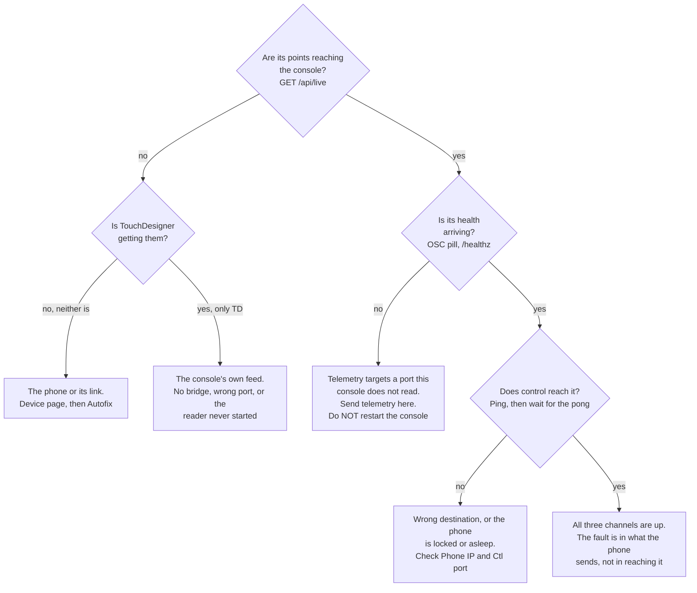

# Troubleshooting the console

## Read the generated page first

The console raises about fifty named problems of its own, each with the fix it
wants you to try, and those are listed in
**[Operations, Troubleshooting](../operations/troubleshooting.html)**. That page
is generated from the console's own fix hints, so it cannot drift from the
software.

If what you are looking at produced a line in the Log, go there. The Log page's
level filter **has a fix to try** shows only the lines that carry one, and
**Copy** puts them on the clipboard for a bug report.

This page covers the other kind: symptoms an operator sees that the console does
**not** raise a warning for, because nothing went wrong from the software's point
of view. No log line, no red pill, and nothing in the generated list.

Each entry gives what you see, the one command that confirms the cause, and the
fix.

---

## A phone is not behaving

Start here, because almost every phone symptom is one of **three independent
channels** being down, and people confuse them under pressure. Point data,
health and control each take a different route, with a different destination and
a different failure. Any one of them can be perfect while the other two are
dead.

| Channel | Route | How you see it |
|---|---|---|
| **Point data** | phone to the bridge's file, read by TouchDesigner and the console in parallel | Live view, `GET /api/live` frame counts |
| **Health** | phone telemetry to port 9000 and relayed by TouchDesigner, **or** straight to the console's own listener | the device card's `OSC` pill, battery, thermal, fps, `/healthz` |
| **Control** | console to the phone's own address on its Ctl port, 9010 | Ping, and the pong with its round trip in the Log |



**Neither reader has points.** The phone is not sending, or not sending here. Its
device page and **Autofix** are the fastest route: Autofix diagnoses the
connection and runs the known good repair sequence on the server, logging each
step.

**TouchDesigner has them and the console does not.** This is structural, not a
phone fault, and it has its own entry below:
[The console sees nothing while TouchDesigner is fine](#the-console-sees-nothing-while-touchdesigner-is-fine).

{: .warning }
**Points arriving but no health is not fixed by restarting anything.** The
telemetry is not reaching the console in the first place, so restarting the
console, the bridge or TouchDesigner changes nothing: it comes back and still
reads no port the phone is sending to. The fix is to move the phone's telemetry,
with **Send telemetry here** or `POST /api/telemetry/retarget`. This is a mistake
people make exactly once, under pressure, at the worst moment.

**Control not landing** is nearly always the destination. The console sends
`/ctl` to the phone's own address, which it learns from telemetry unless someone
typed one in, and a manual entry wins. A phone whose screen has auto locked goes
deaf to `/ctl`; builds from 2026-10-27 keep it awake, and on an older build the
phone needs Auto-Lock set to Never.

---

## Phone shows offline, or shows no health, but is streaming fine

**What you see.** TouchDesigner has the phone's cloud. The console's device card
shows no battery, no thermal, no fps, and the `STREAM` pill is dark. Depending
on the case, the card is either grey (offline) or green but with blank numbers.

**Why.** The console treats a phone as **online** on fresh evidence from either
channel: telemetry, or point data in its store. But `STREAM` and every health
number come from **telemetry only**, and telemetry takes a route that point data
does not.

A phone sends telemetry to `stage.oscHost:stage.oscPort`, which defaults to port
9000, and that is the port TouchDesigner binds. The tox does not swallow it: its
`osc_in` callback forwards every datagram unchanged to the console over the
TouchDesigner link, and sends `/tdstage/peer` alongside it so the console learns
the phone's real address rather than TouchDesigner's. So with the default ports
the console's health **comes through TouchDesigner**.

That relay has three ways to be missing, and all of them look the same on the
card:

- the tox is not running, or is running without the tox loaded
- the tox's `Consoleactive` parameter is off
- the tox does not know where the console is, which it learns from the console's
  own ping, so a disabled TouchDesigner link on the console side can break it in
  the other direction

{: .warning }
A comment in `server.py` at the retarget handler says the console "never
receives a single telemetry packet" with TouchDesigner running. The code
disagrees with that comment: `console_link_lib.relay` forwards every telemetry
datagram. The comment predates the relay. Trust the relay, and treat a missing
relay as one of the three causes above.

**Confirm.** Compare the two channels:

```bash
curl -s http://localhost:9080/api/live | python3 -m json.tool | head -30
curl -s http://localhost:9080/healthz
```

- Frames rising under `bridge` or `tdp4`, but the phone absent from
  `/healthz` `streaming`: telemetry is missing. That is this entry.
- Nothing rising anywhere: the console is blind to the stream as well. Go to
  "The console sees nothing while TouchDesigner is fine", below.

**Fix.** Press **Send telemetry here** in the Live view's Phone cameras panel,
or:

```bash
curl -s -X POST http://localhost:9080/api/telemetry/retarget \
  -H 'Content-Type: application/json' -d '{"target":"all"}'
```

The reply names the host, the port and how many phones took it. It prefers the
USB cable address when there is one, because that is the same UDP transport at
0.55 ms instead of about 8 ms over Wi-Fi. *Measured, real phone (one phone).*

Doing this also removes the dependency: once a phone's telemetry goes straight to
the console's own listener, its battery, temperature and frame rate survive a
TouchDesigner outage.

Note why this is one button and not two settings edits: the host moves by an
explicit `/ctl/set`, because the phone's profile schema keeps hosts out on
purpose so a cached profile can never move a phone's link on its own. The port
moves as a one key profile, because `stage.oscPort` is not in the phone's `/ctl`
numeric whitelist. Neither alone is enough.

**If it reports `sent: 0`**, the console has no address for those phones, which
is its own logged problem. See the generated page.

---

## The console sees nothing while TouchDesigner is fine

**What you see.** TD at 60 fps with every phone merged. The console's Live view
empty, the Rig health panel saying "Console is receiving no frames", hand
tracking reporting zero devices, and no error anywhere in TD.

**Why.** This is the single most common console failure, and it is structural.
**TouchDesigner and the console are two independent readers of the same bridge
file**, not a chain. The console is not downstream of TouchDesigner, so TD
looking healthy says nothing whatsoever about whether the console is being fed.
On the show machine the console has no socket of its own at all
(`--tdp4-port 0`) and gets every frame from the bridge's memory mapped file; the
reader is a thread that only exists if `tdp4_receiver` imported.

The same independence is why a broken console feed cannot hurt the visuals: the
two pipelines share a source and nothing else. It is also why nothing in
TouchDesigner will ever warn you about this.

**Confirm.**

```bash
curl -s http://localhost:9080/api/hands/diag | python3 -m json.tool
```

Every check comes back with a level, a cause and the fix for that cause. It
distinguishes the cases: no bridge alive, a bridge alive on a port the phones
are not sending to, a bridge alive that this console is not reading, or a relay
running with the wrong second target.

**Fix.** Whatever that output names. The common ones:

| Cause | Fix |
|---|---|
| No bridge process | Start it. `TD/newtox/tdp4_bridge.py --port 9003 --shm-port 9004`, or let `windows\show.bat` / `Tools/show_mac.sh` start and supervise it |
| Bridge alive, phones sending elsewhere | On each phone's device page check the destination host is this machine and the stream port matches the bridge's `--port`. Autofix does both |
| Bridge alive, console not reading its file | Restart the console process. The bridge reader thread only exists if `tdp4_receiver` imported |
| Simulator running but TD cannot see it | The built in simulator targets the console's own port, 9013. That is deliberate, so sim colour arrives on every frame while TD holds the phone port. The panel says `NO FAN-OUT: this console only, TD will not see it` |

**Do not reach for the fan out relay.** `udp_fanout.py` is legacy. It lost
packets above about 30,000 datagrams per second, and eight phones with colour
are 49,000. The bridge alone took 61,000 with no loss. The Start fan out button
exists for a no bridge CPU path only.

---

## No colour arriving

**What you see.** The Phone cameras tiles are blank or say "waiting for a colour
frame". The camera overlay card over the 3D view is empty. The vision observer
reports nothing.

**Why.** Colour is not on the wire by default. The only colour anywhere in this
system is the phone's camera frame resampled to the depth grid, 256x192 RGB8,
and it rides the wire only when that phone's `stage.udpPlanes` includes `rgb`.
The default is `depth+conf`.

**Confirm.**

```bash
curl -s http://localhost:9080/api/rgb
```

`{}` means no device has an image the console considers fresh. A device present
with a rising `frame` and a small `age` means colour **is** arriving and the
problem is downstream.

**Fix, in order of likelihood.**

1. **Turn colour on.** The Live view's Phone cameras panel has **Colour ON for
   all phones**, which sets `stage.udpPlanes = depth+conf+rgb` on every enabled
   phone. Budget for it: each phone goes from about 35 to about 71 Mbit/s. Eight
   phones with colour is about 570 Mbit/s, which still fits one gigabit uplink.
2. **Check the second switch.** On TDStage (not TDStage AR) `stage.colorEnabled`
   must also be on, or the rgb plane is sent empty. Two switches, both needed.
   The Dashboard's Broadcast settings panel has it.
3. **No hardware?** Start the simulator with the **Colour planes (rgb)** switch
   on. It is the only way to exercise the camera tiles and the vision observer
   without a phone.
4. **Age, not absence.** `/api/rgb/<id>.jpg` answers `204` when the newest
   image is older than `maxAge`, 2 seconds by default. A `204` is a normal
   answer, not an error. `?maxAge=10` will show you a stale frame if you want to
   confirm one exists.

If `/api/rgb` is populated but the tiles stay blank, the encoder is missing:
`rgb_stream` needs Pillow. Check `doctor.py`.

---

## Confidence map empty

**What you see.** The Confidence card beside the camera overlay says "waiting
for confidence data" and never fills, while the camera picture itself is fine.

**Why.** Two separate reasons, and they need different fixes.

**Confirm which.**

```bash
curl -s -o /dev/null -w '%{http_code}\n' http://localhost:9080/api/rgb/1/conf.jpg
curl -s http://localhost:9080/api/live | python3 -m json.tool | grep -A3 bridge
```

- `204` and the console **is** receiving frames: the phone is not sending the
  confidence plane, or the frames are arriving by a path that drops it.
- `204` and the console is receiving nothing: it is the previous entry, not this
  one.

**Fix.**

1. **The plane must be on the wire.** `stage.udpPlanes` must include `conf`.
   `depth+conf` is the default, so this is usually already right, but a phone set
   to `depth` only will never show a confidence map. Check the phone's Colour
   planes row, whose `live:` badge shows what is actually being sent.
2. **A device arriving over the TouchDesigner mirror has no confidence, ever.**
   The TDL3 mirror record the tox forwards carries the extrinsic, the
   intrinsics, the floor offset and an optional RGB image, and **no confidence
   plane**. Nothing downstream of the mirror can show it. This is a property of
   that record, not a fault. To see confidence, the console needs the phone's
   own TDP4 frames: the bridge path, the console's own port, or a direct
   `--tdp4-port`.
3. **The AVFoundation capture path has no confidence map at all.** Only the
   ARKit path produces real per cell confidence. A phone on
   `stage.capture = avfoundation` has nothing to send. The phone's Capture path
   row says which it is on.

A related trap worth knowing: `latency.confMin` zeroes out depth cells below a
confidence level before unprojecting. It defaults to 0, which keeps everything.
If someone raised it, cells vanish from the cloud with no warning and no log
line.

---

## The stream stutters

**What you see.** The cloud hitches, or bodies jump, or the whole Live view
freezes for a fraction of a second and catches up.

Two of the causes **do** log a line and are on the generated page: the receiver
rejecting the stream, and every frame arriving twice. Check the Log first. The
ones below are the silent ones.

**Confirm, in this order.**

```bash
# 1. Did a thread stall? Dumps are only kept when one did.
curl -s http://localhost:9080/api/stalls | python3 -m json.tool | head -20

# 2. Garbage collector pauses.
curl -s http://localhost:9080/api/live | python3 -m json.tool | grep -A8 '"gc"'

# 3. Where the time actually goes, thread by thread.
curl -s 'http://localhost:9080/api/diag/profile?s=5' | python3 -m json.tool | head -40

# 4. Is it the phone, the network, or us?
curl -s http://localhost:9080/api/diag/age | python3 -m json.tool
```

**Reading that.**

| What you find | Cause | Fix |
|---|---|---|
| `/api/stalls` has entries | Some thread blocked for more than 180 ms. The entry carries every thread's stack at that moment | The stack names the code. Report it with the console log |
| `gc` shows long pauses | CPython's generational collector walking many long lived numpy arrays. Every thread stops during a gen 2 pass | Lower the point budgets: `vision.obsTotalHz`, and the Live view's Max points per phone |
| `/api/diag/age` p50 already high at the phone | The phone or the network, not the console. Thermal throttling, or the stream has fallen off Ethernet onto Wi-Fi | `/healthz` `degraded` and `offWired` name it. Both are on the generated page |
| Nothing above, and only the browser hitches | The browser, not the server | See below |

**Browser side stutter has its own causes, none of which touch the show:**

- **MJPEG tiles hold a socket each.** The Phone cameras panel's MJPEG switch
  opens one long lived stream per phone. Smoother per tile, heavier overall.
  Turn it off and the tiles fall back to a still refresh.
- **The page already keeps an SSE stream and a long poll busy.** `/api/cloud` is
  a long poll that waits up to 1.2 seconds. A slow network makes the cloud
  hitch while everything else stays current.
- **Off the LAN you are capped**, to 5 frames per second and 20,000 points for
  the whole frame. That is not a stutter, it is the cap. See below.

**One server side lever worth knowing.** `latency.segTick` is the segmentation
engine's period and the dominant server side latency lever, because `/track`
filters the current cloud against the last published set. The default is 0.05 s,
which is 20 Hz.

---

## The cloud is thin and the Max points slider does nothing

**What you see.** Few points per phone. Dragging **Max points/phone** up to
100,000 changes nothing.

**Confirm.**

```bash
curl -s -D - -o /dev/null 'http://localhost:9080/api/cloud?max=100000'
```

Look for `X-Cloud-Remote: 5 Hz, 20000 points` in the headers.

**Why.** Either you are off the LAN, or you are asking for more than the server
gives.

- **Off the LAN**, the server caps the whole frame to 20,000 points at 5 Hz,
  split across however many phones are live. At eight phones that is 2,500 each.
  A Tailscale `100.64/10` address counts as off LAN, because it is a tunnel. Only
  private, loopback and link local addresses count as on.
- **On the LAN**, the server clamps `max` to 500 to 100,000 per device. The
  slider's own ceiling matches, so this only bites if you are calling the API
  by hand.

**Fix.** For a real look at merge quality or cloud density, use a browser on the
venue LAN, or a remote desktop session on the show machine. Everything else in
the UI, including the roster, telemetry, `/ctl`, the Log, Stage 3D and the
settings, is uncapped remotely. It is the point cloud, and only the point cloud,
that is thinned.

---

## Consensus mode is off again after a console restart

**What you see.** The Live view's People only panel was on **Consensus** before
you restarted the console. Now it is on whatever the saved `personMode` is,
usually **Off**.

**Why.** The mode you pick in that panel goes to `POST /api/person`, which holds
it in the ingest module. The persisted setting is `latency.personMode`, whose
schema options are `off`, `motion`, `vision` and `combined`. **`consensus` is
not among them**, so it cannot be written to the settings store, and at boot the
console applies the persisted value instead.

**Confirm.**

```bash
curl -s http://localhost:9080/api/settings | python3 -c \
  "import json,sys; print(json.load(sys.stdin)['schema']['latency']['personMode']['options'])"
```

**Fix.** There is no persistent fix today. If the show needs Consensus, set it
from the UI after every console start, and check the People only panel before
the house opens. Add it to the show day checklist. Whether the omission is
deliberate is unverified; the ingest module accepts the mode, so it looks like
an oversight.

---

## A phone setting I changed came back by itself

**What you see.** You change a setting on a device page or on All phones, it
takes, and some seconds or minutes later it is back to the old value.

**Three different causes.**

1. **Auto recover re pushed the stored profile.** While it is armed and the show
   is running, a phone whose profile revision differs gets the stored profile re
   pushed, and a stored profile carries a host. This is exactly how a phone that
   had just been moved onto the USB cable got dragged straight back, mid show,
   with a visible stutter each time. **Confirm** with the Auto-recover button's
   label in the top bar: `armed` means it is acting. **Fix**: disarm it, or
   re store the profile so it holds the value you want.

2. **The console's stored profile is stale.** Device id and UDP port are sent as
   one key profile documents, not bare `/ctl/set` messages. A stored console
   profile still holds the old value until you re store it, so the next profile
   push puts the old one back. **Confirm** with the profile line in the device
   page's Recovery panel, which reads `STALE` when the console holds a newer
   revision than the phone is running. **Fix**: **Store + push profile**.

3. **Nothing came back at all; the control is just showing you the truth.**
   Phone settings are write only on the wire. The control shows what the phone
   **reports** in its `/device/settings` telemetry, not what you sent. After a
   send the control holds your value for three seconds so a report that predates
   the change does not flick it back. If it flicks back after that, the phone did
   not take the change. **Confirm** with the row's `phone:` and `live:` badges,
   which are the phone's reported value and what is actually on the wire.

A phone on an older build reports nothing, and then the row reads
`last sent (build reports no settings)`. Changes are still sent; their values
simply cannot be checked.

---

## Restarting a vision service did not pick up my fix

**What you see.** You edited the console's Python, pressed Restart on the
relevant service in Rig health, and the old behaviour is still there.

**Why.** The button does less than its name suggests. It clears cached results
and queued work, resets the error counters, and starts a fresh thread if the old
one had died. For the YOLO worker it does restart the separate worker process.
**But nothing there reimports a Python module.**

**Fix.** Restart the console process. Ctrl-C and run it again, or close the
`run.bat` or `show.bat` window. Both have watchdogs, so on the show machine the
process comes straight back on its own.

Use Restart to recover a wedged or erroring service during a show. Use a process
restart to deploy a change.

---

## The Tuning panel says there are no tunables

**What you see.** The Live view's Tuning section reads `no tunables from this
server`, with a Retry button. Everything else in the Live view works.

**Confirm.**

```bash
curl -s -o /dev/null -w '%{http_code}\n' http://localhost:9080/api/settings
```

`503` means `settings.py` did not import in this console. `200` means the panel
failed to fetch and **Retry** will fix it.

**Fix.** On `503`, the console's startup output says why the import failed.
Everything runs on the shipped defaults meanwhile, which is a working show, just
not an adjustable one.

A separate, logged case: a malformed `settings` block in `config.json` makes the
console log `saved settings ignored` and run on defaults. That one is on the
generated page.

---

## The Live view is empty but the roster is healthy

**What you see.** Phones online, telemetry arriving, TD merging. The Live view
shows no points at all, and the Ingest chips look wrong or missing.

**Confirm.**

```bash
curl -s http://localhost:9080/api/live | python3 -c \
  "import json,sys; print(json.load(sys.stdin).get('import_error'))"
```

**Why.** The Live view needs numpy and the TDP4 receiver from `TD/newtox`. The
console boots without them on purpose, so a missing dependency never stops you
managing the rig; it just reports why the Live view is dead. The usual cause is
`TD/newtox` not sitting beside `WebConsole`, or a venv without numpy.

**Fix.** Put `TD/newtox` back beside `WebConsole`, or install the requirements,
then restart the console. `doctor.py` checks every import the console needs.

---

## Every control says "Console is locked"

**What you see.** A red toast reading `Console is locked — click the padlock
(top right) to unlock` on every button.

**Why.** Show mode. The padlock blocks every control send and config edit from
the browser, deliberately, so nobody leans on a key mid show.

**Fix.** Click the padlock. It is per browser, stored in that browser's own
preferences, so another machine is unaffected and the server does not know about
it.

Note what the lock does **not** block: the Rig health panel reads with a plain
fetch rather than through the locked API, on the grounds that a padlock should
stop you changing the rig and never stop you seeing why it is broken.

---

## A second console moved the phones in TouchDesigner

**What you see.** You started a test or measurement instance, and the real
phones jumped in TD.

**Why.** A console with the TouchDesigner link enabled seeds TD's registration
table with its own poses the moment the link comes up. A second instance with
its own fresh config has default poses, and it overwrote the real ones. This
happened on 2026-10-27.

**Fix, and how to avoid it.** Always give a second instance its own config:

```bash
python3 server.py --config /tmp/test-console.json --http 9081 --tdp4-port 0
```

When the file named by `--config` does not yet exist, the console starts with
the TD link **off** and says so at boot. Its phone profiles also move to a
`profiles` folder beside that config, so a test instance cannot re store
`phone-1.json` over the real one, which it previously did.

To recover: on the real console, press **Push poses now** on the Dashboard's
TouchDesigner link panel.

The tox's own `Posesource` parameter is the other half of this. On `console` the
pose pushes write the registration table; on `manual` the operator nudges clouds
by hand and console pushes are ignored.

---

## The browser shows stale JavaScript

**What you see.** A control you know was added is not there, or behaves like an
older version.

**Why.** The server sends static files with `Cache-Control: no-store` and no
ETag, precisely because browsers treated `no-cache` as reusable and served stale
JavaScript after edits. The page also watches the server's boot time in the event
stream and reloads itself if it changes.

**Fix.** A hard reload. If it persists, you are on a different console than you
think: check the port and the host in the address bar.

---

## Undo will not undo what I just did

**What you see.** Cmd-Z does nothing, or undoes something older than the thing
you want back.

**Why.** The undo stack covers only **persisted config**: phone poses, FOVs,
roster entries, the marker plan, and the person figures. Up to 60 steps.

It does **not** cover control sends. Start, Stop, Blackout, Calibrate, Heal,
profile pushes and marker sends are messages that already left for the phone.
Settings changes are not covered either.

**Fix.** Send the opposite command. For settings, the Tuning panel has a per
group Reset and a Reset all.

---

## Marker calibration scales the stage differently on different phones

**What you see.** Calibration succeeds on every phone with a good RMS, but the
merged cloud does not line up, and the error grows with distance from the origin.

**Why.** Every phone calibrates against the marker size **it was told**. Phones
holding different sizes scale the stage differently, and each one is internally
consistent, so nothing reports an error.

The console does log a warning about disagreeing marker sizes, and that line is
on the generated page. What has no warning is the other half: a size that every
phone agrees on but that does not match **what was actually printed**.

**Confirm.** The note under the Markers page header lists the size each phone
holds, and warns in amber when they disagree. Then measure the printed square
with a ruler: the black and white square itself, not the paper.

**Fix.** Set one size for the rig on the Markers page and press **Apply to all
phones**, which writes it to the roster and sends it with each phone's marker
ids. Print at that size. An A4 sheet takes up to 195 mm with its quiet zone, A3
up to 280 mm. Then re calibrate.

---

## The NDI source is missing, or has the wrong name

**What you see.** The client's NDI receiver does not list `TDStage Point Cloud`,
or lists something close to it.

**Why.** NDI renames a duplicate source. If anything else on the network is
already publishing that name, the sender takes a different one.

**Confirm.**

```bash
curl -s http://localhost:9080/api/live | python3 -m json.tool | grep -A10 '"ndi"'
```

`name` is the source actually published; `wanted` is the configured name. When
they differ, the status line in the Live view says so rather than showing a name
that is not on the network.

**Fix.** Either point the receiver at the published name, or stop the other
publisher and toggle NDI off and on. To change the configured name,
`output.ndiName` is a `restart` class setting: it rebuilds the sender, and
receivers reconnect.

If `available` is false, the binding is missing. NDI needs the NDI SDK and
`cyndilib`, which is deliberately not installed by default. The console still
runs; NDI just reports unavailable.

---

## A restored config looks wrong

{: .note }
**Editing a kept `.corrupt` file by hand: watch the value types.** Write
numbers with a decimal point and no thousands separators (`1.5`, never
`1,5`), and `true` or `false` for switches, never `null`. A wrong type is now
caught as the configuration loads: the console names the device and the key,
seeds a fresh session, and keeps your file. It used to load such a value as
good and then end the telemetry listener when the TouchDesigner link came up,
which presented as a network fault with no connection to the edit that caused
it. If you are running a console from before 2026-10-27, that is the failure
you are looking at.

**What you see.** After a restore, poses or the marker plan are not what you
expected, and nothing complains.

**Why.** The console keeps rotating copies in `WebConsole/backups/`, at most one
a minute, newest 50 kept. If `config.json` cannot be used it sets that file aside
as `config.json.corrupt-<timestamp>` and loads the newest backup that passes a
**shape** test: a JSON object, with a device list, every device carrying an
integer id, and markers that have `id`, `label`, `x`, `y` and `z`.

**That is shape, not sense.** Nothing checks whether the values are the show's. A
file that parses and has the right shape but holds the wrong poses, the wrong
roster size or last month's marker plan is accepted without a word about it.

**Check Rig health's first row.** When the console did not simply load
`config.json`, the top row of the Rig health panel says so: started from a
backup, or seeded a new session, with the reason and what to check. It stays
there for the whole session, because the matching Log line scrolls away in the
first minute of a get in. If that row is absent, the config was loaded normally
and a wrong looking roster is someone's edit, not a fallback.

**Restore is not a proven path.** The backup code has open review findings and
no restore has been exercised end to end. Treat `./Tools/backup_state.sh` as a
snapshot, not as a tested recovery.

**Fix.** After any restore, check the roster size, each phone's pose, the marker
plan and the listen port by eye against what you expected, before trusting them.
Do not plan a show around an unattended restore.

---

## `/track` is sending but the client sees nobody

**What you see.** The `/track` emitter is on, the conformance line is clean, and
the client's bus reports zero performers.

**Why, without the numbers.** This is usually correct behaviour rather than a
fault. `/track` deliberately publishes **zero performers rather than the raw
room** until the learned background is mature and has settled over a window.
Walls and tripods are not performers, so reporting none is the right answer in
that window.

The thresholds that govern this are in the `tracking` group, which is mid
revision along with the identity contract. **Do not act on a number from a
page.** Read the current values from the running console:

```bash
curl -s http://localhost:9080/api/settings | python3 -m json.tool
curl -s http://localhost:9080/api/live | python3 -m json.tool | grep -A20 '"person"'
```

The second shows the motion engine's background size and whether it is still
growing, which is what the settle check is watching.

**Fix.** Clear the stage and press **Stage is empty now** in the Live view's
People only panel. The whole current scene becomes background instantly, and the
engine keeps learning afterwards. Then wait for the settle window before
expecting performers. If the background is being learned with people standing in
it, they become scenery, which is the other half of the same problem.

---

## Nothing above, and no log line either

Three read only endpoints exist for exactly this case, and none of them changes
anything:

```bash
curl -s http://localhost:9080/api/rig        | python3 -m json.tool
curl -s http://localhost:9080/api/hands/diag | python3 -m json.tool
curl -s http://localhost:9080/api/vision     | python3 -m json.tool
```

`/api/rig` is the one place that holds the facts spanning phone, console, relay
and TouchDesigner at once, which is where the failures actually live.

If you are reporting it: the Log page's **Copy** button puts the shown lines
with their fix notes on the clipboard, and `WebConsole/logs/console.log` has the
same content with more history.
