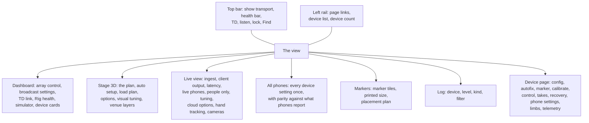

# The browser UI, control by control

Open `http://localhost:9080`. The page has three parts that never change: the
left rail, the top bar, and the view.

Each page has its own URL fragment, so you can bookmark one:
`#/dashboard`, `#/stage`, `#/live`, `#/all`, `#/markers`, `#/log`,
`#/device/<id>`.

One query parameter affects the whole app:

- `?venue=<name>` loads `static/<name>-model.json` instead of the default
  `static/stage-model.json`. That is how you swap a specific venue's massing
  model in for the generic stage. The model files themselves are not part of
  this documentation.

## Where the controls live

If you half remember a control and cannot place it, do not hunt the tree. Press
**Cmd-K** (or `/`) and type what you remember. **Find** searches every control on
the current page by its label *and* by its hover explanation, opens the folded
section it is in, scrolls to it and flashes it. That is the intended way to
navigate a page this dense, and it is why every control carries hover text.

---

## The left rail

Top to bottom:

| Control | What it does |
|---|---|
| **Dashboard**, **Stage 3D**, **Live view**, **All phones**, **Markers**, **Log** | Page links. The active one is highlighted. |
| **Devices** list | One row per phone in the roster, in id order, with its colour dot, name and a short state. **Click** opens the side drawer for that phone. **Double click** opens its full page. |
| **Device count** footer | The minus button removes the last phone slot from the roster and asks first. Removing a phone also sends `/tdstage/pose/clear` to TouchDesigner for a phone whose pose the console had sent. The plus button adds a slot, placed centre stage ready to drag, and held from TouchDesigner until it is placed or poses are pushed. |

Drag the rail's right edge to resize it, between 170 and 420 px. The console
remembers the width.

---

## The top bar

Left to right.

| Control | What it does |
|---|---|
| **View title** | The current page's name, or the phone's name on a device page. |
| **Undo** / **Redo** | One step through the config history: poses, markers, the person figures and the roster. Also Cmd-Z and Shift-Cmd-Z. Control sends are not undoable. The console keeps up to 60 steps. |
| **Start show** | Starts every enabled phone with its screen dark (the display is a big heat source; Wake shows them again), staggered 200 ms apart, so N capture sessions do not spike the network together. Six seconds later it checks telemetry, retries the phones that did not come up, and warns if they still have not. It also arms auto recover. |
| **Standby** | Stops capture and blacks out the screen on every enabled phone, 150 ms apart. Phones cool down and stay reachable for telemetry and `/ctl` as long as the app stays open. Builds from 2026-10-27 keep the phone from auto locking; on an older build set Settings, Display, Auto-Lock: Never, or a locked phone goes deaf to `/ctl`. Disarms auto recover. Asks first. |
| **Stop** | Stops streaming on every enabled phone and disarms auto recover. Asks first. |
| **Blackout** | Screens off on every enabled phone. Capture keeps running. Asks first. |
| **Wake** | Screens back on. |
| **Auto-recover** | Toggles the console side supervisor. While it is armed and the show is running, a phone that comes back idle gets its stream restarted and its stored profile re pushed. Off by default. Start show arms it; Standby and Stop disarm it. The button reads `Auto-recover` (off), `Auto-recover: on` (armed, show not running) or `Auto-recover: armed` (acting). |
| **Health bar** | The last 40 seconds. Bar height is phones streaming against the roster size; the dim part behind is phones online; a blue tip means TouchDesigner's render clock is at or above 55 fps. The label beside it reads streaming count, total points and fps. |
| **n/m online** | Phones online out of the roster. |
| **TD** indicator | The TouchDesigner conductor bus. Green dot and an fps reading when the link is up, "TD offline" otherwise. |
| **Listen** indicator and **Start** / **Stop** | The telemetry listener. It reads `listening :<port>`, `bind failed`, or `stopped`. Stopped means no phone health, no pongs and no auto recover. Stopping asks first. |
| **Lock** | Show mode. Blocks **every** control send and config edit from the browser. Read only diagnostics still work. The Rig health panel uses a plain fetch on purpose, so a padlock never stops you seeing why something is broken. The gate has one exemption: `POST /api/dev/shot`, the development screenshot hook, which writes a posted image to `dev-shot.png` or `.jpg` beside the server. No button on the page calls it, and the Log's request trace skips it when it succeeds, because its body is an image. |
| **Sun / moon** | Light or dark theme. |
| **Find** | Searches every control on the current page by its label and by its hover explanation. It opens the folded section the control is in, scrolls to it and flashes it. Cmd-K or `/` opens it; Cmd-Enter presses the match. |
| **?** | Keyboard shortcuts. |

### Keyboard shortcuts

| Keys | Action |
|---|---|
| Cmd-Z | Undo the last config change |
| Shift-Cmd-Z | Redo |
| Shift-click | Multi select phones and markers in the 3D view |
| M / R / X | Gizmo move, rotate, off (3D view) |
| P / T / F | Perspective, top down, front view |
| Esc | Close the panel, or clear the selection |
| Cmd-K or / | Find a control on this page |
| ? | This help |

---

## Dashboard

Five panels, then the device cards.

### Array control

| Control | What it does |
|---|---|
| **Telemetry port** | The UDP port the console binds for phone telemetry and TD replies. Changing it rebinds immediately. |
| **Ping all** | `/tdlidar/ctl/ping` to every phone in the roster, enabled or not. The log records each pong; the round trip is in the device page's telemetry (clock offset / rtt). |
| **Sync markers** | Sends each phone its marker ids and marker size, for every phone that has a known IP. |
| **Calibrate all** / **Finish all** | Starts and finishes marker calibration on every enabled phone. |
| **Start all** | `/tdlidar/ctl/start` to every enabled phone, with no stagger and no verification. Use Start show in the top bar for a real start. |
| **Stop all**, **Blackout all**, **Wake all** | As the top bar buttons. |
| **Lock all poses** | Locks every enabled phone's current attitude as its mounted pose. From then on "moved since lock" and the movement alarm measure against it. Do this after the get in. |

### Broadcast settings, all enabled phones

Writes to every enabled phone at once.

| Control | What it does |
|---|---|
| **Colour planes** picker and **Apply** | Sets `stage.udpPlanes` to `depth`, `depth+conf` or `depth+conf+rgb`. Adding rgb roughly doubles each phone's wire cost. |
| **Colour On** / **Off** | `stage.colorEnabled`. TDStage only; TDStage AR ignores it. The rgb plane is still only sent when the planes include it. |
| **Raw mode On** / **Off** | `/tdlidar/ctl/rawmode`. TDStage only; TDStage AR ignores it. On, depth goes straight to the wire and the phone skips its on phone processing toggles. |
| **FPS** field and **Apply** | `/tdlidar/ctl/fps`. A thermal ceiling on the phone can still cap it lower. |

### TouchDesigner link

| Control | What it does |
|---|---|
| **TD host** | Where pose pushes and pings go. Defaults to `127.0.0.1`. Changing it re seeds every pose at the new target. |
| **Bus port** | The tox's `Consoleport`. Defaults to 9006. |
| **Ping TD** | Sends `/tdstage/ping`. The pong sets the link state and the round trip time. |
| **Retry link** | Clears the link state, re pings, and re seeds every pose. |
| **Push poses now** | Sends every phone's pose to the tox. |
| **Disable** / **Enable** | Stops or starts pings and pose pushes. Disabling asks first. |

The header shows the link pill, and a line with TD's fps, merged cook time, live
device count, point count, round trip, and the TDP4 receiver's own counters
(packets per second, frames per second, stale, dropped, restarts). If the
receiver is draining its socket and rejecting everything, the line reads
`RECEIVER REJECTING`. Poses are event driven: on every edit, on link up, and on
Push. The 2 second cycle is only the health ping.

### Rig health: hands, fan-out, cable

This panel reports **causes** rather than counters, and re checks every ten
seconds. **Re-check** forces one now. Each row carries a level (ok, info, warn,
error), a title, a detail and a `Fix:` line. Rows the server can repair itself
also carry a button: **Start fan-out**, **Turn hand tracking on**, or
**Restart**.

Before the chain itself come the rows about this session: how it booted
(below), console code changed on disk since it started, a screen lit during an
armed show, the USB cable address moved, TestFlight builds near their 90 days,
what the last rig align left unplaced, pairs of phones whose clouds disagree,
phones that shed colour for heat, a stale phone IP, a frozen background that
was cleared, and poses held from TouchDesigner for unchecked phones. Then it
checks, in this order:

1. whether `hand_track` imported;
2. whether the Apple Vision bridge is present;
3. whether a YOLO pose model is loaded, and whether the worker has a Python
   with ultralytics to run under (said only when it has not);
4. whether any frames are reaching **the console** (as opposed to TouchDesigner,
   which is fed by a different socket and can look healthy while the console
   sees nothing);
5. whether two senders are using the same device id;
6. the bridge's state;
7. the hand engine itself;
8. every vision service;
9. TouchDesigner's own hand poller.

Below it, **Vision services** lists the five restartable services with a state
pill and a button each:

| Service | What it is | What Restart does |
|---|---|---|
| Hand pose (Apple Vision) | Finds hands in each phone's camera image | Clears its cached hands and error count, and switches hand tracking on if it was off |
| Person observer (Apple Vision) | Person masks and body pose per phone | Drops queued work and cached results, new thread if the old one died |
| YOLO worker | Multi person masks and pose in its own process | A real process restart |
| Live-view person mask (Apple Vision) | The mask behind the Live view and the vision and consensus modes | As the observer |
| Motion background engine | Learns the empty stage | **Re-learns the background NOW.** Its button reads **Re-learn** and asks first. Clear the stage first or performers become scenery. |

**What Restart does not do.** The button implies more than it delivers. It
clears cached results and queued work, resets the error counters, and starts a
fresh thread if the old one had died. For the YOLO worker it does restart the
separate worker process. But **nothing here reimports a Python module.** If
someone has edited the console's code, that change does not take effect until
you restart the console process itself. Restart recovers a wedged or erroring
service; a code fix needs a console restart.

The limit is deliberate. These buttons exist to be pressed during a performance,
where dropping a service's queued work is safe and swapping its code under
running threads is not, because a reimport would leave threads holding
references to the old module while new work ran on the new one. Recovery and
deployment are different operations, so they have different mechanisms. See
[Running the console](running.html#restarting-to-pick-up-a-code-change).

**Calibration, one person on stage** sits under the services: a **Person**
picker and a **Check calibration** button. With exactly one person on stage, it
asks `GET /api/rig/calib` whether the phones agree where that person is.
A disagreement over 15 cm names the phone and points at the marker size, because
a size read off the black square instead of the crop marks shifts a phone's
whole cloud along its line to the marker. The picker chooses the spot. **anywhere
(agreement)** sends no position and tests agreement only, which cannot see an
error every phone shares. **on stage centre** sends `x=0, z=0`. **on marker N**,
one entry per marker in the plan with its label, sends that marker's planned
position (x as planned, z as minus the plan's y), so standing on the taped mark
also tests correctness. Errors under about 5 cm are invisible. The result line
is coloured by state and its hover carries the method's limits and, on a
warning, the fix; a second line lists every phone as `#id N cm off`, `too few
points (n)`, or with `← check` after a suspect. It is a plain fetch like
Re-check, read only, so the padlock does not stop it, and a console on older
code answers `this console has no calibration check yet`. The method and its
limits are in [Rig get-in](../operations/get-in.html#the-one-person-test).

Four of the session rows carry Fix lines. Read them before you need them:

| Row | When it appears | Fix |
|---|---|---|
| **Console code changed since it started** (warn) | Files changed on disk after the console booted; the row names up to six of them and the boot time. The page is already the new one, so panels that need the new code answer `unknown endpoint` or show nothing until the console restarts. | Restart the console between runs: `Tools/show_mac.sh` on the Mac, `show.bat` on the show machine. TouchDesigner's cloud is unaffected; the client outputs (`/track`, F1, NDI) pause while it restarts. |
| **USB cable address moved** (error) | A phone is still streaming to the Mac's old cable address, and the row gives the old and new addresses and when it moved. Nothing arrives from it until it is re-taught. | Click **Autofix** on that phone, or Link over cable: either re-teaches the phone the new address. |
| **TestFlight build expiring** (warn from 75 days) / **TestFlight build about to stop working** (error from 85 days) | Named phones with their build date and age. TestFlight builds stop working 90 days after upload. | Run `Support/testflight.sh --upload` in both repos, then update the phones from TestFlight. |
| **Phone(s) N shed colour for heat** (warn) | Their thermal ladder took the colour plane off the wire before lowering the frame rate (`stage.thermalColourAt`). Depth keeps its rate, but no fresh camera image reaches the console from them: their person masks and hand tracking stop about 1.5 s later, and consensus counts them as abstaining. Colour comes back on its own once they cool, after a 45 s hold. | Cool the phones: blackout their screens, shade them, add airflow. To keep colour at any temperature, `/ctl set stage.thermalColourAt 0`; the frame rate then drops first instead. |

**Why the first row is sometimes about `config.json`.** The panel's check list
begins with how the session started. If the console could not use `config.json`
and fell back to a backup, or seeded a new session, that is the first row you
see, with the detail and what to check. It sits first, and stays for the whole
session, because the equivalent line in the Log scrolls away in the first minute
of a get in, and nobody reads a boot log before noticing that half the roster is
missing.

### Simulator, synthetic phones

Runs synthetic TDP4 phones with no hardware. Ids start at 101.

| Control | What it does |
|---|---|
| **Scene** picker | **Walkers (articulated)** runs `human_sim4.py`: 17 joint figures, which is what a multi phone merge has to be judged on, because ellipsoids fuse into an ellipsoid however wrong the fusion is. **Blobs (load only)** runs `tdp4_sim.py`: cheap ellipsoids, for load testing. |
| **Rig** picker | Walkers only. **Ring rig** puts every phone round the stage aimed at centre. **Show rig** is the real layout: N-1 phones in a row on the audience side each owning one column, plus one upstage centre. Changing it while running relaunches. |
| **phones** | 1 to 16. |
| **people** | 1 to 5 walkers. |
| **seconds** | 5 to 3600 per run. |
| **planes** | `depth`, `depth+conf` or `depth+conf+rgb`. rgb is the only way to exercise the camera tiles and the vision observer without hardware. |
| **loop** | Relaunch when a run ends. |
| **Start** / **Stop** | Stop kills every simulator process on this machine, whoever started it. While one runs that this console did not start, the status line adopts it and says so. |

The line underneath says what is running and where it is sending. If the
target is not 9003 it warns that TouchDesigner will not see it.

### Device cards

One card per phone, coloured by its roster colour, dimmed when disabled.
Clicking the card opens the side drawer.

- **Pills**: `OSC` (telemetry arriving), `STREAM`, `CALIB`, `BLACK`, and when
  they apply `POSE HELD` (planned pose not sent to TouchDesigner until someone
  confirms it) and `AUTO-RECOVER PAUSED` (stopped from the console, so auto
  recover leaves it stopped until it is started again).
- **Stats**: battery, charging, thermal, fps, points, capture age in
  milliseconds, and the marker id it can currently see. Capture age shows the
  phone's own capture to wire p50; hovering names the slowest stage and the p95.
  It turns amber above 75 ms.
- **Calibration line**, when calibrating or calibrated: lock state, RMS in
  millimetres, and image count.
- **Buttons**: Start, Restart (stop, pause, start), Blackout / Wake, Ping,
  Calibrate / Finish.

---

## Stage 3D

The planning view. Origin is the plaster line and centreline. X across, Y
upstage, Z up, in metres. That is the venue model's frame, used only for this
view; the tracking output uses a different one (Y up, origin at the centre of
the stage floor), described in
[the tracking output](../reference/track.html). Click selects, shift-click
multi selects, and the gizmo moves the group.

**Over the canvas**: Perspective / Top-down / Front, then Gizmo off / Move /
Rotate. The gizmo is forced off while the console is locked.

**The side rail**, top to bottom:

| Section | Controls |
|---|---|
| (top) | **Auto setup coverage** optimises every enabled phone's position and aim and its marker for maximum coverage and multi phone overlap of the quoted volume, in one undo step. Under **Stroud plan**, four buttons set phone poses and marker positions from a layout held in the system repository: **Front + back · 6** and **Front + back · 3** (the show rig shape) and **Side rows · 6** and **Side rows · 3** (the coverage study's side rows). Each also sets one rig wide marker size from the layout's sheet size. All ask first, and undo reverts. |
| **TouchDesigner** | The link state line, plus **Ping**, **Retry** and **Push poses**. |
| **Selected** | What the selection is. For one phone: its name, position, yaw and pitch, its live points and fps (or online / offline), how many simulated points it sees while Person A is visible, an inline **FOV** pair (h × v, 20 to 120 degrees in 0.5 steps) that writes `fovH` and `fovV` to the roster the moment a field changes, then **Open** (its device page) and **Ping**. For a marker: its id, label and position, and a reminder that Move saves to the plan and print sheet. For several items: the count, each phone's position and each marker's id; Move and Rotate act on the whole group and rotation orbits its centre. For a person figure: position, yaw and pose. For the **Quoted show volume**: `12 × 4 × 8 m` and its offset in x, y, z; Move slides the acting volume, and Auto setup then fits the phone array to wherever it sits. |
| **Options** | **LiDAR beams**, **Range split at 7 m** (two zones against one uniform zone), **Max-range plane**, **Beyond-range reach (RGB)**, **Marker plan**, **Labels & text**, **Floor grid**, **Person A (scale figure)** with a pose slider, **Person B (occlusion)** with a pose slider. |
| **Visual tuning** | In-range brightness, Beyond-range brightness, Range-plane opacity, Shadow strength, Label size, Phone size, Sim point size, Marker locator size, Venue opacity, Grid opacity, and the backdrop: dark, black, white, or a free colour picker. |
| **Venue** and **Coverage study** | One visibility checkbox and one opacity slider per model layer. The `BAND_` layers are the coverage study supplied for the production. |
| **Per-phone frustums** | One checkbox and one brightness slider per phone, then **All on** and a **Solo** button for each of the first four phones. |

The config stores the two person figures and the quoted volume and shares them
with every browser, so moving them is a config change and is undoable.

---

## Live view

The live point cloud from the phones on a bare stage. Only live phones exist
here; planned phones, markers and figures do not appear. The view derives every
frustum from the stream itself, that is, from the phone's own levelled
extrinsic, so the points always sit inside it. An uncalibrated phone lands where
gravity levelling puts it, which means a desk cloud sits at the stage origin
rather than at the planned mount.

**Over the canvas**: Perspective / Top-down / Front, and a pill that says
whether data is arriving. It reads `waiting for data`, or `LIVE · N phones · F
fps`, where the fps is the rate at which frames reach this browser (a smoothed
gap between frames), not the phones' capture rate. When the streams stop it
clears the clouds and goes back to `waiting for data` after 3 s. Off the show
LAN it adds `· remote`, and its hover gives the cap the console applies to that
client, read from the `X-Cloud-Remote` header (`5 Hz, 20000 points`); see
[Running the console](running.html#the-off-lan-cap).

**Floating over the canvas, bottom right**: the camera overlay card. One tab per
live phone, the camera frame with the person mask and wrists drawn on it, and a
**Confidence** card beside it showing the phone's own LiDAR confidence grid in
three tones (black low, grey medium, white high). The card's buttons:

| Button | What it does |
|---|---|
| **Seg** | Turns person segmentation itself on (combined mode) or off, rather than only its drawing. |
| **Overlay** | Draws the mask and wrists over the picture, or shows the plain camera image. |
| **Steady** | Holds the virtual camera still instead of following the phone's live pose (`latency.rgbStabilise`). The phone's pose micro corrects every frame, which makes a still room shimmer. |
| **Re-anchor** | Takes the current pose as the new anchor (`latency.rgbReanchor`). |
| **⤢** and **–** | Enlarge or shrink, collapse or expand. |

**The side rail** sections, in order (Phone cameras, described below after Hand
tracking, actually folds between Live phones and People only):

### Ingest

One chip, `TDP4 direct`, says whether the console's own listener on the phone
port is running, on which port, and how many frames it has taken. `TD holds
the port` means the console correctly stood aside. The console's second
listener (:9013, the fan-out and simulator port) has no chip. Then **Start
simulator** with a phone count picker (1 to 8), and a **Colour planes (rgb)**
switch, which is the only way to exercise the camera tiles and the vision
observer without hardware.

On the show machine the phone-port listener is not running (`--tdp4-port 0`)
and the frames come from the TDP4 bridge's memory mapped file instead.
`GET /api/live` reports that path under `bridge`, and so does the Rig health
panel; this chip does not.

Two paths can deliver the same frame, so the store deduplicates by device id and
frame id: a frame already taken from one path is counted under `dup` rather than
stored twice. That is what makes it safe to leave the legacy relay running beside
the bridge while diagnosing one of them.

### Client output (F1 contract)

| Control | What it does |
|---|---|
| **Send /track** with host and port | Starts or stops the `/track` OSC stream of performers and hands to the client's bus. Default `127.0.0.1:7000`. Editing host or port while it runs applies immediately. Stopping asks first, because the client loses performer data. |
| **Record /track** | Writes every emitted `/track` frame to `logs/track-<stamp>.jsonl` for the evidence pack scorer. |
| **Hands** | Emit `/track/performer/hand` for confident wrists of confirmed, un-clustered performers. |
| **Flip Z axis** | Negates z and vz on the wire. One click if the depth axis sign turns out reversed against the client's sim. |
| **conformance** line | Reports whether every emitted bundle satisfies the contract: hands a subset of performers, all values finite, timestamps monotonic. |
| **Send NDI cloud** button with **view** and **colour** pickers | The NDI image of the cloud. View is `front` or `top`. Colour is `rgb`, `device` or `height`. Needs the NDI runtime and `cyndilib`. Stopping asks first. The status line names the source as published, which can differ from the configured name because NDI renames a duplicate. |

An F1 line below reports the WebSocket's client count and frame time.

### Latency budget

A bar and a text line breaking down the path from capture to emission.

### Live phones

**Align to #N** solves every live phone's heading and position relative to
the lowest numbered live phone, from the clouds, and writes the result to the
roster so this view and TouchDesigner move together. It needs shared walls or
set in view. It grades every phone: OK and WARN phones are placed, FAIL phones
keep their pose and say why. **use plan as prior** restricts the search to near
each phone's planned pose, which you need in rooms dominated by one wall, where
an open search is ambiguous. The **solver** picker chooses `Clouds` (the
console's own, about 1 s a pair) or `Open3D` (about 6 s a pair, in its own
Python; it does not use the plan prior). **Record walk** / **Stop walk** records
one person walking the stage for about 20 s, and **Solve walk** places the
phones from that walk against the anchor, which works for phones facing each
other, or only the phones the last clouds align left where they were. Below,
one line per pair of phones says how well their placed clouds agree where they
overlap.

Then one row per live phone with its fps, point count and source, plus **Move**
and **Rotate** (the gizmo on the whole phone, cloud and frustum together; on
release the pose is saved to the roster, applied by the server and sent to
TouchDesigner), **Reset**, and the pose as numbers: x, y, z, yaw, and the tilt
correction pitch and roll (plus or minus 30 degrees). The fields are read only
for a marker calibrated phone. There is no browser only offset any more: the
view shows exactly what the server places.

A phone not yet in the roster gets **Place this phone** instead, which adds it
at its current placement.

### People only

Five mode buttons, written to the server so every browser agrees:

| Mode | What filters the cloud |
|---|---|
| **Off** | Nothing. Show everything. |
| **Motion+BG** | The auto learned background plus motion, with cluster gates. Depth true, works in the dark. |
| **Vision** | Person segmentation on the phone's RGB (a real frame, or one reconstructed from the points) plus a nearest surface depth gate. |
| **Combined** | The vision silhouette intersected with the motion foreground. |
| **Consensus** | Every phone's person mask votes per 5 cm voxel of the merged cloud. Kept where the phones that see it agree, floor band removed. |

**Stage is empty now** tells the motion engine the whole current scene is
background, instantly. The engine keeps auto learning afterwards either way.

The status line reports the vision mask ages and coverage per phone, the motion
engine's foreground voxels, clusters and background size, and in consensus mode
the voters, how many candidate voxels were kept, and how many were seen through.

Below the mode buttons sit the one-step presets.

**Cyr wheel (arm B)** is the inverted-performer preset, described with its
seven settings on [Settings reference](settings.html#the-cyr-preset).

**Full / Balanced / Lite** are the performance presets, in their own row with
a status line under them. Balanced and Lite each ask before applying and say
what they set; Full asks too, and puts every setting the applied preset changed
back to the value it had before. The button for the mode in force is disabled,
and an applied preset's button is highlighted. Hovering a button lists the
exact settings it moves. The seven keys each one moves, and what they cost on a
Mac with simulated phones, are on
[Settings reference](settings.html#the-performance-presets) and
[Running the console](running.html#performance-modes).

**The load line** under the buttons has the shape `Mode lite: console 53 %
CPU, YOLO worker 49 %, YOLO 12 ms a frame, engine 20 ms, F1 42 ms at 10 Hz
(% of one core, 18 cores)` (the shape is from the code; the values here are
illustrative, not a measurement). Console and worker CPU are per cent of one
core, so 200 is two cores busy; they are deltas since the previous read, at
most one new sample a second. The worker figure needs psutil on the console
machine. The F1 part appears only while an F1 client is connected. Behind it,
`/api/live` carries a `load` object with more than the line shows: `cpu`,
`workerCpu`, `cores`, `mode` (`full` or the applied preset), `parts` (engine ms
a tick; F1 ms a tick, rate and client count; YOLO ms a frame round trip and in
the worker, keypoint ms, hand ms, YOLO frames a second), and `threads`, per
thread CPU where psutil's thread ids match Python's (Linux; expected on
Windows, not yet run there; not macOS).

### Tuning

Generated from `GET /api/settings`, so it always matches the running server.
One folding group per settings group with a live chip, a **Reset** button per
group, an **Expert settings** switch that reveals the tunables that can wedge a
show, and **Reset all** at the bottom which asks first.

A ⚠ beside a row means changing it resets the engine (the background relearns
from scratch) or makes its worker or sender (the YOLO worker, the NDI sender)
restart by itself to apply it, a few seconds without that output. A greyed row with a reason is locked,
and the server refuses to move it. Hovering a label shows its help text and its
`group.key`. See [Settings reference](settings.html).

### Cloud options

- **Point size** (4 to 60 mm) and **Point opacity**.
- **Max points per phone**, 2,000 to 100,000. The server clamps to 500 to
  100,000, and for a client that is not on the LAN it caps the whole frame to
  20,000 points at 5 Hz regardless of the slider, so the slider does nothing
  useful over Tailscale.
- **Frustum opacity**.
- **Real RGB colour**: camera colour per point, or each phone's roster colour.
- **Instance colours**: colour every point by the person it belongs to. With
  `/track` sending, the colour is the performer's `/track` id, so one person
  keeps one colour across phones and through crossings. White means a person no
  performer claims yet. This overrides Real RGB colour.
- **Consensus** (below).
- **Live frustums**.
- **IMU heading**: rotate each cloud and frustum by the phone's IMU heading.
  Marker calibrated phones are left alone.
- **Mirror upstage axis**.
- **Heading trim**: rotate every cloud by a fixed offset, -180 to 180 degrees.

### Consensus: why points survive

Consensus is a third colour mode, and the only one that shows you points that
are **not there**. It colours every point by which test of the multi-view vote
removed it, or by the fact that nothing did.

| Colour | Category | What it means |
|---|---|---|
| dark | unseen | No phone with a fresh person mask saw that space |
| dim khaki | outvoted | Phones saw it and did not agree it was a person |
| **magenta** | **carved** | They agreed, and another phone could see *straight through* that space, so it was removed |
| dark slate | background | The motion engine has learned it as the room |
| dark | floor | Below the floor band |
| **green** | **kept** | Survived every test |

**Carved is the one worth the mode.** Carving is how mask bleed (the patch of
wall a phone paints onto the body standing in front of it) gets removed, and
without this view it is invisible, because a carved point and a point nobody
saw are both not drawn. Somebody watching a performer lose an arm cannot otherwise
tell "the masks disagreed" from "free space carved it" from "the background ate
it", and those three have three different fixes.

Two things to know before reading it:

- **This mode sends the whole room, people and all**, because a removed point
  has to arrive to be coloured. The points-per-phone budget therefore bounds
  the room here, so a stage that looked fine in another mode can come back
  sparse. Raise the budget rather than concluding points are missing.
- **The colours are weighted by rarity rather than importance.** On a simulated
  room (two simulator phones, about 67k points; not yet measured on real
  phones) the split was roughly: unseen 47 %, outvoted 31 %, background 16 %,
  carved 4 %, kept 1.4 %. The two bright colours are the two rare ones, so the room
  reads as texture and the answers stand out of it.

Each point reports the **first** test that removed it, in the order they run,
so the colour names the test that killed it rather than one that would have.

### Hand tracking

**Detect hands**, a Found readout, and four sliders: Max hands, Min confidence,
Rate, Smoothing. These drive `hand_track`, which is a different thing from the
`hands` settings group. The `hands` group governs what `/track` emits; these
govern the detector.

### Phone cameras

A grid of per phone tiles, the camera frame resampled to the depth grid
with the instance mask and wrists drawn on. Blank until a phone or the simulator
puts the rgb plane on the wire.

| Control | What it does |
|---|---|
| **Colour ON for all phones** | Sets `stage.udpPlanes = depth+conf+rgb` on every phone in the roster, enabled or not. Each phone then costs about 71 Mbit/s instead of 35. |
| **Send telemetry here** | Points every phone's telemetry at this console. Phones default to port 9000, which TouchDesigner holds and relays to this console; when that relay is missing (the tox not running, its console link off, or the console not yet found) every phone reads offline or without health. This is the fix for that, and afterwards health no longer depends on TouchDesigner. |
| **MJPEG stream** | One long lived multipart stream for the phone shown in the camera overlay card, instead of a 5 Hz still refresh; the other tiles stop refreshing while it is on, because browsers allow about six sockets per origin and the event stream and cloud poll already hold most of them. |

### Visual tuning, Venue, Coverage study

Venue opacity, Grid opacity, Floor grid and the backdrop, then the same Venue
and Coverage study layer controls as Stage 3D, so the study geometry can be
switched off here too.

---

## All phones

This page shows the device page's settings once, for every enabled phone. Each
control sends to every enabled phone that **has** that control, so a TDStage AR
only key goes only to the phones reporting it.

The page reads parity from what the phones report in their `/device/settings`
telemetry, never from what this console last sent.

| Control | What it does |
|---|---|
| **Summary** line | How many phones are enabled, how many report their settings, and how many settings differ. |
| **Not reporting** line | Phones on an older build or offline. Changes are still sent to them; their values cannot be checked. |
| **Only differences** switch | Hides the rows where every reporting phone agrees. |
| **Reference phone** picker and **Match every phone to this one** | Copies every setting the reference phone reports to each other enabled phone that reports a different value. Settings a phone does not have are skipped. Device id, playback device id and destination hosts are never copied. Asks first, and names the phones and the change count. |
| Per row: a control, a parity badge, and **Make all match** | Sends the value shown in that row to the phones that report something else, and to the phones that report nothing, which cannot be checked. |

Between the parity panel and the setting groups sit two panels that are not
settings. **Control, every enabled phone** is the transport for the whole rig,
each button sending the same `/tdlidar/ctl/` verb to every enabled phone:

| Row | Buttons |
|---|---|
| **Stream** | **Start** (`/ctl/start`). **Stop** asks first, stops the stream (telemetry and `/ctl` stay up) and disarms auto recover, which would otherwise restart them. |
| **Screens** | **Blackout** (screens off, capture keeps running) and **Wake**. |
| **Check** | **Ping** (each pong is logged) and **IMU report** (a one shot attitude report from every phone). |
| **Record** | **Record** starts every phone recording its live wire to a take now; **Stop recording** closes the takes. An **armed in** field (3 s by default, 0 to 60) feeds **Arm record** (`/ctl/rec/startat`, a shared second start after that delay) and **Cancel arm** (`/ctl/rec/cancel`, which cancels an armed record or play). |
| **Replay** | A take name field and **Arm play** (`/ctl/rec/playat` with the delay and the name; each phone plays its own copy of that take, and a blank name is refused). **Pause** and **Resume** (`/ctl/rec/pause` 1 and 0) freeze and continue every replay on its current frame, **Stop replay** ends them, and **Refresh takes** asks every phone for its take list, shown on each device page. |

**Phones** is a state table with one row per enabled phone: **Phone** (a link to
its page), **State** (the phone's own reported state, or streaming / idle /
offline), **Source** (`live` or `PLAYBACK`), **Take** (the recorder's state and
the take name), **Armed** (what is armed and in how many seconds), **Replay**
(frame index of total, and `paused`), and **Phone says** (the phone's own note
about its recording or replay).

---

## Markers

### AR markers

One tile per marker, ids 1 to the marker count. Each tile shows the
deterministic AR trackable image, its id, and which phones it is assigned to.
Every phone bundles the identical images as `ARReferenceImage`s, so a printed
marker matches its reference.

| Control | What it does |
|---|---|
| **printed size** field, in mm | The printed side of the whole marker image, measured between the crop marks, white margin included (the black square is 89 % of it); not the paper. Range 50 to 800 mm. An A4 sheet takes up to 195 mm, A3 up to 280 mm. |
| **Apply to all phones** | Sets that size on every phone in the roster and sends it, with each phone's marker ids, to every enabled phone, so plan, print and phones agree. |
| **Export PNGs** | Writes `marker_01.png` upward. |
| **Print PDF** | The browser print dialogue, one marker per page at the size in the box, plus a placement sheet on the last page. Only the assigned markers if any are assigned, otherwise all of them. It warns if the size will not fit an A3 sheet with its quiet zone. |

**A fresh roster now defaults to 195 mm**, which is A4 printed at true size: the
sheet's short side less a quiet zone, rounded to 5 mm. It used to default to
200 mm, which matched no paper exactly, so the shipped default was a number
nobody could print without either cropping the quiet zone or scaling the square.
The same rule gives 280 mm for A3.

**Loading a stage layout also sets one rig wide marker size.** Each marker in a
layout carries its own **sheet** size, and the loader derives the printed side
from the smallest sheet in the layout and writes that size onto every phone in
the roster. It used to copy positions and labels only and leave every phone at
200 mm, so the plan, the print and the phones disagreed the moment a layout was
loaded. The loader writes the size to the roster but does **not** send it to the
phones, so press **Apply to all phones** here afterwards, which is what the log
line after a load tells you to do.

The note under the header warns when phones disagree on the size, and names
which phone has which. They must agree: every phone calibrates against the size
it was told, so phones that disagree scale the stage differently.

Print at the assigned size on matte stock and keep the white quiet zone.

### Placement plan

One row per marker: id, label or stage position, and X, Y, Z in metres. Edits
save automatically half a second after you leave the field, as one undo step. This
table prints on the last PDF page and is drawn in the 3D view.

---

## Log

Everything the console does, newest at the bottom. The server also writes all of
it to `WebConsole/logs/console.log`.

| Control | What it does |
|---|---|
| **Device** picker | All devices, system only, or one phone. |
| **Level** picker | `everything (verbose)` includes the debug trace of every request the UI makes with its reply and timing; `hide debug trace`; `warn + error`; `has a fix to try`; `error only`. |
| **Kind** picker | `config changes` (every saved setting that changed, with the request that changed it); `OSC out` (every `/ctl` and TouchDesigner send with destination and size); `OSC in` (telemetry: the first report of each path, value changes, and a rate summary every 10 s); `runtime state` (fan out, bridge, TD link, phones reaching the console, sim, `/track`, F1, NDI, when they change); `HTTP requests` (every POST with its reply and timing); `events + warnings`. |
| **filter text** | Shows only lines containing this text, in the message, the fix note or the device name. Case insensitive. |
| **autoscroll** | Follow the bottom. |
| **Copy** | Puts the lines currently shown, with their fix notes, on the clipboard for a bug report. |
| **Clear** | Clears the browser's copy. The server keeps its own. |

Warnings and errors carry a `try:` note with the fix to attempt. The "has a fix
to try" filter shows only those.

---

## Device page and side drawer

Click a phone in the rail to open its side drawer; double click to open the full
page at `#/device/<id>`. The page header has the phone's name, an **enabled**
switch, and badges for streaming, OSC, calibrating, thermal and battery.

The drawer opens beside the rail, 620 px wide by default and never wider than
the viewport minus the rail. Drag its right edge to resize it, between 380 and
980 px; the console remembers the width. Its header has **Full page**, which
closes the drawer and opens the same phone at `#/device/<id>`.

The left column shows the phone's assigned marker at a readable size, with a
caption that reads `aim phone at marker #N` or `● seeing marker #N`.

### Config

| Row | What it changes |
|---|---|
| **Name** | The roster name. |
| **Phone IP** | A manual destination IP for `/ctl`. The note beside it says what was auto learned from telemetry, and that a manual entry wins. |
| **Ctl port** | Where `/ctl` is sent. 9010 by default. |
| **Colour** | The roster colour, used in every view. |
| **Stage pos (m)** | x, y, z. |
| **Plan aim (°)** | yaw, pitch, roll. Yaw turns the live phone; pitch and roll only draw the planned frustum. |
| **Tilt (°)** | pitch, roll: a correction about the camera, plus or minus 30, for a phone whose own levelling is off. Moves the live cloud here and in TouchDesigner. |
| **FOV (°)** | h and v, used for the frustum and the simulated returns. A new device defaults to **71.0 × 56.0**, which is ARKit's 256×192 intrinsics rather than the 58 × 43.5 it used before 10 November 2026. **Since 12 November 2026 an old roster is corrected on load**: a phone still holding exactly 58 × 43.5 takes the new pair, with one info line in the log naming the phones it moved. Any other stored value is kept, so a phone deliberately set to 65 × 50 stays there.. **That default is an iPhone 18 Pro's lens** - the client has reported 65.1 × 51.1 from a 12 Pro Max - but it matters less than it looks: this number is a **fallback**. TouchDesigner and `/track` use each frame's own intrinsics, and the placement helper uses live intrinsics once a phone streams, so the roster value only decides what the view draws before that. On a mixed rig the helper places **each phone with its own lens** - its live intrinsics when it is streaming, its roster FOV before that - so a 12 Pro Max at about 65° standing beside 71° phones is placed with its own narrower frustum. It used the first phone's lens for every phone until 11 November 2026, which placed a mixed rig as though every phone had phone one's lens; a uniform rig is unaffected either way |
| | The migration matches **that exact pair**, so a phone somebody deliberately set to 58 × 43.5 is moved as well, silently apart from the log line. It runs before the padlock takes its snapshot, so the new value is what a locked roster is judged against rather than a refused write. |
| | The placement helper reads the first phone's **live intrinsics** when it is streaming, falls back to its configured FOV, then to 71 × 56. Its usable range is **5.0 m**, Apple's own figure for the sensor, where it used to search 0.3 to 6.6 m. |
| **Mount orientation** | Auto, Left up, Right up. Sets `stage.mountedge` remotely and flips the 3D arrow immediately. The phone's IMU report overwrites it when it arrives. |

Position, yaw and tilt place the live phone here **and** stream live to
TouchDesigner as `/tdstage/pose` and `/tdstage/tilt`; the plan's pitch, roll
and FOV only draw its frustum. With the tox's Pose Source on `auto`, the merge
uses this pose until a marker calibration wins.

### Autofix

One button diagnoses this phone's connection and runs the known good repair
sequence on the server: wake, break heal loops, start the stream, migrate to
USB or shed load. Every step lands in the log and in the step list under the
button, which ends with `✓ connection healthy` or `✗ needs a hand`.

### Marker assignment

Primary marker, secondary marker (or none), size in mm, and **Send to phone**,
which sends `/tdlidar/ctl/marker <primary> <secondary> <size>`.

### Calibrate

**Start calibrate** swaps the phone to ARKit and it hunts its markers. On a good
lock, **Finish (store extrinsic)** stores the extrinsic and resumes show
streaming. The stats show marker seen, image count, RMS in millimetres, and the
lock state.

### Control

Start, Stop, Restart stream, Blackout / Wake, Ping, IMU report (a one shot
attitude report), and **Lock pose**, which locks this phone's current attitude
as its mounted pose so that "moved since lock" and the movement alarm measure
against it.

### Take recording and playback

The take controls are a transport rather than a setting, because a replay is
byte identical to a live phone on the wire by design. The `live` / `playback`
badge is the only thing that tells you which you are looking at. Without it you
can debug a rehearsal against a recording and never know.

The **State** line carries the recorder state badge, the `live` / `PLAYBACK`
badge and the take name, then a stats line with frames, seconds, MB, dropped
frames and GB free on the phone. The rows below send the `/tdlidar/ctl/rec/`
verbs listed in [the /ctl reference](../ios/ctl.html#recording):

| Row | Controls |
|---|---|
| **Record** | A take name field (blank uses the phone's auto name), **Record** (`rec/start`, with the name if given), **Stop**, and **Refresh takes** (`rec/list`). |
| **Play** | The take picker, **Play** (`rec/play` with the take, loop and speed; TouchDesigner and the console see it as live), a **loop** box on by default, a **speed** field from 0.25 to 4 in 0.25 steps where 1 is as recorded, **Pause** and **Resume** (`rec/pause` 1 and 0), and **Stop replay** (`rec/stopplay`). |
| (play line) | What the phone reports back: `ARMED: <label> in N s`, then `frame i / n · s / d s`, the loop count, `PAUSED`, and `trim in–out` when a trim is set, or `no replay running`. Below it, in amber, `phone says:` with the phone's own note. These come from the phone's `/rec/play`, `/rec/arm` and `/rec/note` replies, so the line shows what the phone is doing, not what was sent. |
| **Frame** | **Prev** and **Next** step one frame (`rec/step` -1 and 1) either side of a scrub bar that is the phone's own: release it to jump the replay to that frame (`rec/seek`). Disabled while no replay runs. |
| **Trim** | **Set in here**, **Set out here** and **Clear trim** (`rec/trim in`, `out`, `clear`): replay from, or up to, the frame now playing, or the whole take again. |
| **Take** | A new name field and **Rename take** (`rec/rename old new`, refused for a take that is recording or playing, and the list is refreshed afterwards), and **Delete take**, which asks first and removes the take from the phone with its IMU file. |
| **Armed** | An **in** delay (3 s by default, 0 to 60), **Arm record (all)** (`rec/startat` to every phone in the roster) and **Arm play (all)** (`rec/playat` with the selected take, to every phone in the roster), and **Cancel arm** for this phone (`rec/cancel`). An armed start is a shared second start, not a frame lock: an OSC f32 cannot carry a unix time, so it is a delay from receipt. |

### Recovery / failsafe

| Control | What it does |
|---|---|
| **Health report** | A one shot health report into the log. |
| **Heal 1 · capture** | Restart capture, about 300 ms. |
| **Heal 2 · link** | Reconnect the transport. |
| **Heal 3 · reconfig** | Full reconfigure from the last known good profile. |
| **Heal 4 · relaunch** | The app exits and relies on Single App Mode to relaunch it. On an unsupervised phone it just quits. Asks first. |
| **Reset history** | Clears the phone's crash loop counter and leaves SAFE MODE. Asks first. |
| **Store + push profile** | Builds a profile from this phone's console config and sends it. |
| **Re-push** | Sends the stored profile again unchanged. |
| **Snapshot on phone** | Tells the phone to snapshot its own live config as last known good. |

The profile line warns `STALE` when the console holds a newer revision than the
phone is running.

### Phone settings

Eight folding groups, all written to the phone. Phone settings are **write only
on the wire**: phones do not echo their whole config back. So each row shows
what the phone reports in its `/device/settings` telemetry (`phone:`) and, where
it exists, what is on the wire right now (`live:`). A phone on an older build
reports nothing, and then the control shows the last value sent from this
browser. After a send the control holds the sent value for three seconds, so a
report that predates the change does not flick it back. The page hides a row
for a control this phone does not have.

The reason is that a phone is a streamer, and a streamer that echoes its whole
configuration back on a cadence spends bandwidth and invites a feedback loop
where a stale echo overwrites an operator's fresh edit. So the wire is one way,
the phone volunteers only the subset it reports in `/device/settings`, and the
console says which of the three numbers you are looking at: what the phone says,
what is on the wire, and what this browser last sent. The three second hold
after a send exists because the phone's report is on its own 2 Hz cadence and
will often predate the change by a fraction of a second.

| Group | Covers |
|---|---|
| **Transport & network** | Transport readout, Device ID, TD host (`stage.tcpHost`, which is a legacy key name for the destination IP, not a transport), Destination preset (Use Ethernet host, Use cable host, Use Wi-Fi host: the addresses the phone learned on each link, set together with the link), Link (auto, ethernet, cable, wifi), UDP port, Prefer Ethernet, Colour planes, OSC host |
| **Capture** | Target FPS, Depth grid, Colour capture, Confidence gate, Apple depth filter (must stay off for the show) |
| **Processing** | RAW streamer mode, Lens rectification, QR marker detect, Skeleton detect, Stabilization, Thermal ladder |
| **ARKit depth conditioning** | Capture path, Applied last frame (read back from the frame flags, which is proof the conditioning is on the wire rather than merely requested), Edge cull, Max slope, Edge band, Threshold floor, Test diagonals, Keep high confidence, Temporal median, Motion threshold, Motion flip guard, Motion hold, Flip limit, Minimum confidence, Apple smoothed depth, Range near, Range far |
| **Person isolation (ARKit)** | Stream performers only, Grow matte one cell, Invert, Vision matte quality |
| **Playback settings** | Loop, Loop gap, Speed, Pose sent, Planes on the wire, Rewrite timestamps, Resume live after play, Playback net override, Playback host, Playback port, Play as device id |
| **Recording settings** | Auto-name, Name prefix, Notes, Compress, Frame divisor, Pre-roll, Max minutes, Min free GB, Auto-stop GB, Keep last, Record IMU |
| **Geometry & registration** | Flip Z, Mount edge (read only here) |

The console sends Device ID and UDP port as one key profile documents rather
than bare `/ctl/set` messages, because identity and ports never move on a bare
set. When the console holds a stored profile for the phone, the new value is
folded into it, the profile is re-stored (its revision moves on) and the whole
document is pushed, so a later push carries the new value rather than the old.
With no stored profile the phone gets a one-key document with `autoStart` off,
so re-applying it at boot does not start the stream.

### Limbs and latency (live)

Four live readouts, polled every second: limbs kept, body kept, flying pixels
(bleed), and capture to console p50 and p95. Limbs is the share of the person mask's thin
parts (arms and legs) that kept depth on that frame. Below 60 per cent means
arms or legs are dropping out. The readouts need the phone streaming
`depth+conf+rgb` with someone in view.

### Telemetry

The full device namespaced telemetry grid, as it arrives: fps, points, battery,
charging (`NO` in amber when unplugged), thermal (amber from serious), low power,
uptime, stream (`w×h@fps`), planes, net as frames / packets / dropped, gravity,
extrinsic (mode, pitch and roll), screen (`on` or `BLACKOUT`), source
(`playback` highlighted), conditioning (the frame flag bits as `edge`, `person`,
`conf`, `temporal`), footprint in MB, capture age p50 / p95, the age split
(medians per stage: delivery, prep, hop, main, queue, pack, socket), IMU roll /
pitch / yaw (`mag` when the yaw is magnetic, `arb` otherwise; a dash after 3 s
without a report), clock offset / rtt, and phone state. Five cells are the ones
an operator acts on:

| Cell | What it shows |
|---|---|
| **app build** | The app, version, build number and commit this phone runs (`/device/app`), then `· N behind` in amber, or `· current`, against this machine's checkout of that app. Behind means install the current build; see [Installing the app](../ios/install.html). |
| **capture pressure** | The capture device's own pressure (`AVCaptureDevice` system pressure): `nominal`, `fair`, `serious`, `critical` or `shutdown`, with the factors in brackets (`system`, `power`, `depth module`, `camera`, `battery`). Amber from serious. It can read serious while thermal still says fair, because the LiDAR module heats on its own, and the ladder acts on the worse of the two. |
| **fps ceiling** | The frame rate the thermal ladder currently allows. Amber when it is below the negotiated stream rate, which means the ladder is shedding load: working as designed, but you should see it. |
| **link (PoE)** | `Ethernet`, `Wi-Fi`, `Wi-Fi (wired up)` or `none`, with the interface name, then `· escaped to any route (…)` when the chosen link did not route for 5 s and the stream fell back to any route, or `· <mode> pinned` when a link is forced. Amber on an escape, or on a phone sitting on Wi-Fi while its wire is up and preferred. |
| **moved since lock** | `tilt N°` and `yaw N°` against the pose locked with **Lock pose**, red from 0.5 degrees of tilt; `not locked` before a lock. |
