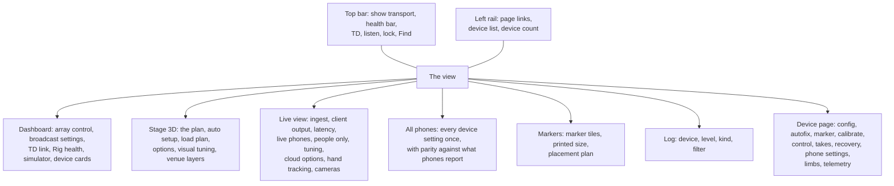

# The browser UI, control by control

Open `http://localhost:9080`. The page has three parts that never change: the
left rail, the top bar, and the view.

Pages are addressed by URL fragment, so you can bookmark one:
`#/dashboard`, `#/stage`, `#/live`, `#/all`, `#/markers`, `#/log`,
`#/device/<id>`.

Two query parameters affect the whole app:

- `?venue=<name>` loads `static/<name>-model.json` instead of the default
  `static/stage-model.json`. This is how a specific venue's massing model is
  swapped in for the generic stage. The model files themselves are not part of
  this documentation.

## Where the controls live

If you half remember a control and cannot place it, do not hunt the tree: press
**Cmd-K** (or `/`) and type what you remember. **Find** searches every control on
the current page by its label *and* by its hover explanation, opens the folded
section it is in, scrolls to it and flashes it. That is the intended way to
navigate a page this dense, and it is why every control carries hover text.

---

## The left rail

Top to bottom:

| Control | What it does |
|---|---|
| **Dashboard**, **Stage 3D**, **Live view**, **All phones**, **Markers**, **Log** | Page links. The active one is highlighted. |
| **Devices** list | One row per phone in the roster, in id order, with its colour dot, name and a short state. **Click** opens the side drawer for that phone. **Double click** opens its full page. |
| **Device count** footer | The minus button removes the last phone slot from the roster and asks first. Removing a phone also sends `/tdstage/pose/clear` to TouchDesigner. The plus button adds a slot, placed centre stage ready to drag. |

The rail is resizable by dragging its right edge, between 170 and 420 px, and
the width is remembered.

---

## The top bar

Left to right.

| Control | What it does |
|---|---|
| **View title** | The current page's name, or the phone's name on a device page. |
| **Undo** / **Redo** | One step through the config history: poses, markers, the person figures and the roster. Also Cmd-Z and Shift-Cmd-Z. Control sends are not undoable. Up to 60 steps are kept. |
| **Start show** | Staggered start on every enabled phone, 200 ms apart, so N capture sessions do not spike the network together. Six seconds later it verifies against telemetry and auto retries the ones that did not come up, then warns if they still have not. It also arms auto recover. |
| **Standby** | Stops capture and blacks out the screen on every enabled phone, 150 ms apart. Phones cool down and stay reachable for telemetry and `/ctl` as long as the app stays open. Builds from 2026-10-27 keep the phone from auto locking; on an older build set Settings, Display, Auto-Lock: Never, or a locked phone goes deaf to `/ctl`. Disarms auto recover. Asks first. |
| **Stop** | Stops streaming on every enabled phone and disarms auto recover. Asks first. |
| **Blackout** | Screens off on every enabled phone. Capture keeps running. Asks first. |
| **Wake** | Screens back on. |
| **Auto-recover** | Toggles the console side supervisor. While it is armed and the show is running, a phone that comes back idle gets its stream restarted and its stored profile re pushed. Off by default. Start show arms it; Standby and Stop disarm it. The button reads `Auto-recover` (off), `Auto-recover: on` (armed, show not running) or `Auto-recover: armed` (acting). |
| **Health bar** | The last 40 seconds. Bar height is phones streaming against the roster size; the dim part behind is phones online; a blue tip means TouchDesigner's render clock is at or above 55 fps. The label beside it reads streaming count, total points and fps. |
| **n/m online** | Phones online out of the roster. |
| **TD** indicator | The TouchDesigner conductor bus. Green dot and an fps reading when the link is up, "TD offline" otherwise. |
| **Listen** indicator and **Start** / **Stop** | The telemetry listener. It reads `listening :<port>`, `bind failed`, or `stopped`. Stopped means no phone health, no pongs and no auto recover. Stopping asks first. |
| **Lock** | Show mode. Blocks **every** control send and config edit from the browser. Read only diagnostics still work: the Rig health panel deliberately uses a plain fetch so a padlock never stops you seeing why something is broken. |
| **Sun / moon** | Light or dark theme. |
| **Find** | Searches every control on the current page by its label and by its hover explanation. It opens the folded section the control is in, scrolls to it and flashes it. Cmd-K or `/` opens it; Cmd-Enter presses the match. |
| **?** | Keyboard shortcuts. |

### Keyboard shortcuts

| Keys | Action |
|---|---|
| Cmd-Z | Undo the last config change |
| Shift-Cmd-Z | Redo |
| Shift-click | Multi select phones and markers in the 3D view |
| M / R / X | Gizmo move, rotate, off (3D view) |
| P / T / F | Perspective, top down, front view |
| Esc | Close the panel, or clear the selection |
| Cmd-K or / | Find a control on this page |
| ? | This help |

---

## Dashboard

Five panels, then the device cards.

### Array control

| Control | What it does |
|---|---|
| **Telemetry port** | The UDP port the console binds for phone telemetry and TD replies. Changing it rebinds immediately. |
| **Ping all** | `/tdlidar/ctl/ping` to every phone in the roster, enabled or not. Each pong is logged with its round trip. |
| **Sync markers** | Sends each phone its marker ids and marker size, for every phone that has a known IP. |
| **Calibrate all** / **Finish all** | Starts and finishes marker calibration on every enabled phone. |
| **Start all** | `/tdlidar/ctl/start` to every enabled phone, with no stagger and no verification. Use Start show in the top bar for a real start. |
| **Stop all**, **Blackout all**, **Wake all** | As the top bar buttons. |
| **Lock all poses** | Locks every enabled phone's current attitude as its mounted pose. From then on "moved since lock" and the movement alarm measure against it. Do this after the get in. |

### Broadcast settings, all enabled phones

Writes to every enabled phone at once.

| Control | What it does |
|---|---|
| **Colour planes** picker and **Apply** | Sets `stage.udpPlanes` to `depth`, `depth+conf` or `depth+conf+rgb`. Adding rgb roughly doubles each phone's wire cost. |
| **Colour On** / **Off** | `stage.colorEnabled`. TDStage only; TDStage AR ignores it. The rgb plane is still only sent when the planes include it. |
| **Raw mode On** / **Off** | `/tdlidar/ctl/rawmode`. On, depth goes straight to the wire and the on phone processing toggles are skipped. |
| **FPS** field and **Apply** | `/tdlidar/ctl/fps`. A thermal ceiling on the phone can still cap it lower. |

### TouchDesigner link

| Control | What it does |
|---|---|
| **TD host** | Where pose pushes and pings go. Defaults to `127.0.0.1`. Changing it re seeds every pose at the new target. |
| **Bus port** | The tox's `Consoleport`. Defaults to 9006. |
| **Ping TD** | Sends `/tdstage/ping`. The pong sets the link state and the round trip time. |
| **Retry link** | Clears the link state, re pings, and re seeds every pose. |
| **Push poses now** | Sends every phone's pose to the tox. |
| **Disable** / **Enable** | Stops or starts pings and pose pushes. Disabling asks first. |

The header shows the link pill, and a line with TD's fps, merged cook time, live
device count, point count, round trip, and the TDP4 receiver's own counters
(packets per second, frames per second, stale, dropped, restarts). If the
receiver is draining its socket and rejecting everything, the line reads
`RECEIVER REJECTING`. Poses are event driven: on every edit, on link up, and on
Push. The 2 second cycle is only the health ping.

### Rig health: hands, fan-out, cable

This panel reports **causes**, not counters, and re checks every ten seconds.
**Re-check** forces one now. Each row carries a level (ok, info, warn, error), a
title, a detail, a `Fix:` line, and for the ones the server can repair itself a
button: **Start fan-out**, **Turn hand tracking on**, or **Restart**.

It checks, in order: whether `hand_track` imported; whether the Apple Vision
bridge is present; whether a YOLO pose model is loaded; whether any frames are
reaching **the console** (as opposed to TouchDesigner, which is fed by a
different socket and can look perfectly healthy while the console sees nothing);
whether two senders are using the same device id; the bridge's state; the hand
engine itself; every vision service; and TouchDesigner's own hand poller.

Below it, **Vision services** lists the five restartable services with a state
pill and a button each:

| Service | What it is | What Restart does |
|---|---|---|
| Hand pose (Apple Vision) | Finds hands in each phone's camera image | Clears its state |
| Person observer (Apple Vision) | Person masks and body pose per phone | Drops queued work and cached results, new thread if the old one died |
| YOLO worker | Multi person masks and pose in its own process | A real process restart |
| Live-view person mask (Apple Vision) | The mask behind the Live view and the vision and consensus modes | As the observer |
| Motion background engine | Learns the empty stage | **Re-learns the background NOW.** Its button reads **Re-learn** and asks first. Clear the stage first or performers become scenery. |

**What Restart does not do.** The button implies more than it delivers. It
clears cached results and queued work, resets the error counters, and starts a
fresh thread if the old one had died. For the YOLO worker it really does restart
the separate worker process. But **nothing here reimports a Python module.** If
someone has edited the console's code, that change does not take effect until
the console process itself is restarted. Use Restart to recover a wedged or
erroring service, not to pick up a fix.

That is a deliberate limit, not an omission. These buttons exist to be pressed
during a performance, where dropping a service's queued work is safe and swapping
its code under running threads is not: a reimport would leave threads holding
references to the old module while new work ran on the new one. Recovery and
deployment are different operations, so they have different mechanisms. See
[Running the console](running.html#restarting-to-pick-up-a-code-change).

**Why the first row is sometimes about `config.json`.** The panel's check list
begins with how the session started. If the console could not use `config.json`
and fell back to a backup, or seeded a new session, that is the first row you
see, with the detail and what to check. It is first, and it persists for the whole
session, because the equivalent line in the Log scrolls away in the first minute
of a get in, and nobody reads a boot log before noticing that half the roster is
missing.

### Simulator, synthetic phones

Runs synthetic TDP4 phones with no hardware. Ids start at 101.

| Control | What it does |
|---|---|
| **Scene** picker | **Walkers (articulated)** runs `human_sim4.py`: 17 joint figures, which is what a multi phone merge has to be judged on, because ellipsoids fuse into an ellipsoid however wrong the fusion is. **Blobs (load only)** runs `tdp4_sim.py`: cheap ellipsoids, for load testing. |
| **Rig** picker | Walkers only. **Ring rig** puts every phone round the stage aimed at centre. **Show rig** is the real layout: N-1 phones in a row on the audience side each owning one column, plus one upstage centre. Changing it while running relaunches. |
| **phones** | 1 to 16. |
| **people** | 1 to 5 walkers. |
| **seconds** | 5 to 3600 per run. |
| **planes** | `depth`, `depth+conf` or `depth+conf+rgb`. rgb is the only way to exercise the camera tiles and the vision observer without hardware. |
| **loop** | Relaunch when a run ends. |
| **Start** / **Stop** | Stop kills every simulator process this console started, and adopts any it finds running. |

The line underneath says what is actually running and where it is sending. If
the target is not 9003 it warns that TouchDesigner will not see it.

### Device cards

One card per phone, coloured by its roster colour, dimmed when disabled.
Clicking the card opens the side drawer.

- **Pills**: `OSC` (telemetry arriving), `STREAM`, `CALIB`, `BLACK`.
- **Stats**: battery, charging, thermal, fps, points, capture age in
  milliseconds, and the marker id it can currently see. Capture age shows the
  phone's own capture to wire p50; hovering names the slowest stage and the p95.
  It turns amber above 75 ms.
- **Calibration line**, when calibrating or calibrated: lock state, RMS in
  millimetres, and image count.
- **Buttons**: Start, Restart (stop, pause, start), Blackout / Wake, Ping,
  Calibrate / Finish.

---

## Stage 3D

The planning view. Origin is the plaster line and centreline. X across, Y
upstage, Z up, in metres. Click selects, shift-click multi selects, and the
gizmo moves the group.

**Over the canvas**: Perspective / Top-down / Front, then Gizmo off / Move /
Rotate. The gizmo is forced off while the console is locked.

**The side rail**, top to bottom:

| Section | Controls |
|---|---|
| (top) | **Auto setup coverage** optimises every enabled phone's position and aim and its marker for maximum coverage and multi phone overlap of the quoted volume, in one undo step. **Load plan (6 phones)** and **(3 phones)** set phone poses and marker positions from a measured coverage study held in the system repository, and also set one rig wide marker size from the layout's sheet size. Both ask first, and undo reverts. |
| **TouchDesigner** | The link state line, plus **Ping**, **Retry** and **Push poses**. |
| **Selected** | The selected phone's or marker's numbers, with **Open** (its device page) and **Ping**. |
| **Options** | **LiDAR beams**, **Range split at 7 m** (two zones against one uniform zone), **Max-range plane**, **Beyond-range reach (RGB)**, **Marker plan**, **Labels & text**, **Floor grid**, **Person A (scale figure)** with a pose slider, **Person B (occlusion)** with a pose slider. |
| **Visual tuning** | In-range brightness, Beyond-range brightness, Range-plane opacity, Shadow strength, Label size, and the backdrop: dark, black, white, or a free colour picker. |
| **Venue** and **Coverage study** | One visibility checkbox and one opacity slider per model layer. The `BAND_` layers are the coverage study supplied for the production. |
| **Per-phone frustums** | **All on**, then one solo button per phone. |

The two person figures and the quoted volume are stored in the config and are
shared with every browser, so moving them is a config change and is undoable.

---

## Live view

The live point cloud from the phones on a bare stage. Only live phones exist
here. There are no planned phones, markers or figures. Every frustum is derived
from the stream itself, that is, from the phone's own levelled extrinsic, so the
points always sit inside it. An uncalibrated phone lands where gravity levelling
puts it, which means a desk cloud sits at the stage origin, not at the planned
mount.

**Over the canvas**: Perspective / Top-down / Front, and a pill that says
whether data is arriving.

**Floating over the canvas, bottom right**: the camera overlay card. One tab per
live phone, the camera frame with the person mask and wrists drawn on it, and a
**Confidence** card beside it showing the phone's own LiDAR confidence grid in
three tones (black low, grey medium, white high). The card's buttons:

| Button | What it does |
|---|---|
| **Seg** | Turns person segmentation itself on (combined mode) or off, not just its drawing. |
| **Overlay** | Draws the mask and wrists over the picture, or shows the plain camera image. |
| **Steady** | Holds the virtual camera still instead of following the phone's live pose (`latency.rgbStabilise`). The phone's pose micro corrects every frame, which makes a still room shimmer. |
| **Re-anchor** | Takes the current pose as the new anchor (`latency.rgbReanchor`). |
| **⤢** and **–** | Enlarge or shrink, collapse or expand. |

**The side rail** sections, in order:

### Ingest

A chip per source saying whether it is running, on which port, and how many
frames it has taken. `TD holds the port` means the console correctly stood
aside. Then **Start simulator** with a phone count picker, and a **Colour planes
(rgb)** switch which is the only way to exercise the camera tiles and the vision
observer without hardware.

On the show machine neither socket listener is running: `--tdp4-port 0` and the
frames come from the TDP4 bridge's memory mapped file instead. That path is
reported by `GET /api/live` under `bridge`, and by the Rig health panel, not by
these chips.

Two paths can deliver the same frame, so the store deduplicates by device id and
frame id: a frame already taken from one path is counted under `dup` rather than
stored twice. That is what makes it safe to leave the legacy relay running beside
the bridge while diagnosing one of them.

### Client output (F1 contract)

| Control | What it does |
|---|---|
| **Send /track** with host and port | Starts or stops the `/track` OSC stream of performers and hands to the client's bus. Default `127.0.0.1:7000`. Editing host or port while it runs applies immediately. Stopping asks first: the client loses performer data. |
| **Record** | Writes every emitted `/track` frame to `logs/track-<stamp>.jsonl` for the evidence pack scorer. |
| **Hands** | Emit `/track/performer/hand` for confident wrists of confirmed, un-clustered performers. |
| **Flip Z axis** | Negates z and vz on the wire. One click if the depth axis sign turns out reversed against the client's sim. |
| **conformance** line | Reports whether every emitted bundle satisfies the contract: hands a subset of performers, all values finite, timestamps monotonic. |
| **Send /track NDI** button with **view** and **colour** pickers | The NDI image of the cloud. View is `front` or `top`. Colour is `rgb`, `device` or `height`. Needs the NDI runtime and `cyndilib`. The status line names the source actually published, which can differ from the configured name because NDI renames a duplicate. |

An F1 line below reports the WebSocket's client count and frame time.

### Latency budget

A bar and a text line breaking down the path from capture to emission.

### Live phones

**Align all to device N** solves every live phone's heading and position
relative to the lowest numbered live phone, from the clouds, and writes the
result to the roster so this view and TouchDesigner move together. It needs
shared walls or set in view. Weak or ambiguous matches are left alone and
logged. **use plan as prior** restricts the search to near each phone's planned
pose, which is needed in rooms dominated by one wall where an open search is
ambiguous.

Then one row per live phone with its fps, point count and source, plus per phone
gizmo target buttons (whole phone, cloud only, frustum only), a floor solve
(**Select floor** drags a rectangle over points you know are floor and rotates
the cloud so that patch lies flat; **Auto** guesses by consensus and cycles
candidates on repeat presses within six seconds; **Clear** clears all manual
offsets), and, for a phone not yet in the roster, a button to add it at its
current placement.

### People only

Five mode buttons, written to the server so every browser agrees:

| Mode | What filters the cloud |
|---|---|
| **Off** | Nothing. Show everything. |
| **Motion+BG** | The auto learned background plus motion, with cluster gates. Depth true, works in the dark. |
| **Vision** | Person segmentation on the phone's RGB (a real frame, or one reconstructed from the points) plus a nearest surface depth gate. |
| **Combined** | The vision silhouette intersected with the motion foreground. |
| **Consensus** | Every phone's person mask votes per 5 cm voxel of the merged cloud. Kept where the phones that see it agree, floor band removed. |

**Stage is empty now** tells the motion engine the whole current scene is
background, instantly. The engine keeps auto learning afterwards either way.

The status line reports the vision mask ages and coverage per phone, the motion
engine's foreground voxels, clusters and background size, and in consensus mode
the voters, how many candidate voxels were kept, and how many were seen through.

### Tuning

Generated from `GET /api/settings`, so it always matches the running server.
One folding group per settings group with a live chip, a **Reset** button per
group, an **Expert settings** switch that reveals the tunables that can wedge a
show, and **Reset all** at the bottom which asks first.

A ⚠ beside a row means changing it resets the engine (the background relearns
from scratch) or needs a console restart. A greyed row with a reason is locked:
the server refuses to move it. Hovering a label shows its help text and its
`group.key`. See [Settings reference](settings.html).

### Cloud options

Point size (4 to 60 mm), Point opacity, Max points per phone (2,000 to 100,000;
the server clamps to 500 to 100,000, and for a client that is not on the LAN it
caps the whole frame to 20,000 points at 5 Hz regardless of the slider, so the
slider does nothing useful over Tailscale), Frustum opacity, **Real RGB colour** (camera colour per point, or each phone's roster
colour), **Instance colours** (colour every point by the person it belongs to;
with `/track` sending, the colour is the performer's `/track` id, so one person
keeps one colour across phones and through crossings; white means a person no
performer claims yet; this overrides Real RGB colour), **Live frustums**, **IMU
heading** (rotate each cloud and frustum by the phone's IMU heading; marker
calibrated phones are left alone), **Mirror upstage axis**.

### Hand tracking

**Detect hands**, a Found readout, and four sliders: Max hands, Min confidence,
Rate, Smoothing. These drive `hand_track`, which is a different thing from the
`hands` settings group. The `hands` group governs what `/track` emits; these
govern the detector.

### Phone cameras

A grid of per phone tiles, the camera frame resampled to the 256x192 depth grid
with the instance mask and wrists drawn on. Blank until a phone or the simulator
puts the rgb plane on the wire.

| Control | What it does |
|---|---|
| **Colour ON for all phones** | Sets `stage.udpPlanes = depth+conf+rgb` on every enabled phone. Each phone then costs about 71 Mbit/s instead of 35. |
| **Send telemetry here** | Points every phone's telemetry at this console. Phones default to port 9000, which TouchDesigner holds, so with TD running the console gets no telemetry at all and every phone reads offline. This is the fix for that. |
| **MJPEG stream** | One long lived multipart stream per phone instead of a 5 Hz still refresh. Smoother, but it holds a socket per tile. |

### Visual tuning, Venue, Coverage study

The same controls as Stage 3D, so the study geometry can be switched off here
too.

---

## All phones

The device page's settings, once, for every enabled phone. Each control sends to
every enabled phone that **has** that control, so a TDStage AR only key goes
only to the phones reporting it.

Parity is read from what the phones report in their `/device/settings`
telemetry, never from what this console last sent.

| Control | What it does |
|---|---|
| **Summary** line | How many phones are enabled, how many report their settings, and how many settings differ. |
| **Not reporting** line | Phones on an older build or offline. Changes are still sent to them; their values cannot be checked. |
| **Only differences** switch | Hides the rows where every reporting phone agrees. |
| **Reference phone** picker and **Match every phone to this one** | Copies every setting the reference phone reports to each other enabled phone that reports a different value. Settings a phone does not have are skipped. Device id, playback device id and destination hosts are never copied. Asks first, and names the phones and the change count. |
| Per row: a control, a parity badge, and **Make all match** | Sends the value shown in that row to the phones that report something else, and to the phones that report nothing, which cannot be checked. |

---

## Markers

### AR markers

A tile per marker, ids 1 to the marker count. Each tile shows the deterministic
AR trackable image, its id, and which phones it is assigned to. The identical
images are bundled on every phone as `ARReferenceImage`s, so a printed marker
matches its reference.

| Control | What it does |
|---|---|
| **printed size** field, in mm | The printed side of the black and white square, not the paper. Range 50 to 800 mm. An A4 sheet takes up to 195 mm, A3 up to 280 mm. |
| **Apply to all phones** | Sets that size on every phone in the roster and sends it, with each phone's marker ids, to every enabled phone, so plan, print and phones agree. |

**A fresh roster now defaults to 195 mm**, which is A4 printed at true size: the
sheet's short side less a quiet zone, rounded to 5 mm. It used to default to
200 mm, which matched no paper exactly, so the shipped default was a number
nobody could print without either cropping the quiet zone or scaling the square.
The same rule gives 280 mm for A3.

**Loading a stage layout also sets one rig wide marker size.** Each marker in a
layout carries its own **sheet** size, and the loader derives the printed side
from the smallest sheet in the layout and writes that size onto every phone in
the roster. It used to copy positions and labels only and leave every phone at
200 mm, so the plan, the print and the phones disagreed the moment a layout was
loaded. The size is written to the roster but **not** sent to the phones: press
**Apply to all phones** here afterwards, which is what the log line after a load
tells you to do.
| **Export PNGs** | Writes `marker_01.png` upward. |
| **Print PDF** | The browser print dialogue, one marker per page at the size in the box, plus a placement sheet on the last page. Only the assigned markers if any are assigned, otherwise all of them. It warns if the size will not fit an A3 sheet with its quiet zone. |

The note under the header warns when phones disagree on the size, and names
which phone has which. They must agree: every phone calibrates against the size
it was told, so phones that disagree scale the stage differently.

Print at the assigned size on matte stock and keep the white quiet zone.

### Placement plan

One row per marker: id, label or stage position, and X, Y, Z in metres. Edits
save automatically half a second after you stop typing, as one undo step. This
table prints on the last PDF page and is drawn in the 3D view.

---

## Log

Everything the console does, newest at the bottom. The server also writes all of
it to `WebConsole/logs/console.log`.

| Control | What it does |
|---|---|
| **Device** picker | All devices, system only, or one phone. |
| **Level** picker | `everything (verbose)` includes the debug trace of every request the UI makes with its reply and timing; `hide debug trace`; `warn + error`; `has a fix to try`; `error only`. |
| **Kind** picker | `config changes` (every saved setting that changed, with the request that changed it); `OSC out` (every `/ctl` and TouchDesigner send with destination and size); `OSC in` (telemetry: the first report of each path, value changes, and a rate summary every 10 s); `runtime state` (fan out, bridge, TD link, phones reaching the console, sim, `/track`, F1, NDI, when they change); `HTTP requests` (every POST with its reply and timing); `events + warnings`. |
| **filter text** | Shows only lines containing this text, in the message, the fix note or the device name. Case insensitive. |
| **autoscroll** | Follow the bottom. |
| **Copy** | Puts the lines currently shown, with their fix notes, on the clipboard for a bug report. |
| **Clear** | Clears the browser's copy. The server keeps its own. |

Warnings and errors carry a `try:` note with the fix to attempt. The "has a fix
to try" filter shows only those.

---

## Device page and side drawer

Clicking a phone in the rail opens a side drawer; double clicking opens the full
page at `#/device/<id>`. The page header has the phone's name, an **enabled**
switch, and badges for streaming, OSC, calibrating, thermal and battery.

The left column shows the phone's assigned marker at a readable size, with a
caption that reads `aim phone at marker #N` or `● seeing marker #N`.

### Config

| Row | What it changes |
|---|---|
| **Name** | The roster name. |
| **Phone IP** | A manual destination IP for `/ctl`. The note beside it says what was auto learned from telemetry, and that a manual entry wins. |
| **Ctl port** | Where `/ctl` is sent. 9010 by default. |
| **Colour** | The roster colour, used in every view. |
| **Stage pos (m)** | x, y, z. |
| **Aim (°)** | yaw, pitch, roll. |
| **FOV (°)** | h and v, used for the frustum and the simulated returns. |
| **Mount orientation** | Auto, Left up, Right up. Sets `stage.mountedge` remotely and flips the 3D arrow immediately. The phone's IMU report overwrites it when it arrives. |

Pose and FOV feed the 3D plan **and** stream live to TouchDesigner as
`/tdstage/pose`. With the tox's Pose Source on `auto`, the merge uses this pose
until a marker calibration wins.

### Autofix

One button that diagnoses this phone's connection and runs the known good
repair sequence on the server: wake, break heal loops, start the stream, migrate
to USB or shed load. Every step lands in the log and in the step list under the
button, which ends with `✓ connection healthy` or `✗ needs a hand`.

### Marker assignment

Primary marker, secondary marker (or none), size in mm, and **Send to phone**,
which sends `/tdlidar/ctl/marker <primary> <secondary> <size>`.

### Calibrate

**Start calibrate** swaps the phone to ARKit and it hunts its markers. On a good
lock, **Finish (store extrinsic)** stores the extrinsic and resumes show
streaming. The stats show marker seen, image count, RMS in millimetres, and the
lock state.

### Control

Start, Stop, Restart stream, Blackout / Wake, Ping, IMU report (a one shot
attitude report), and **Lock pose**, which locks this phone's current attitude
as its mounted pose so that "moved since lock" and the movement alarm measure
against it.

### Take recording and playback

A transport, not a setting, because a replay is byte identical to a live phone
on the wire by design. The `live` / `playback` badge is the only thing that
tells you which you are looking at. Without it you can debug a rehearsal against
a recording and never know.

Controls: a take name field, **Record**, a take list with **Refresh** and
**Delete**, transport buttons, frame stepping, in and out trim points, rename,
cancel an armed record or play, and an arm delay for recording on every enabled
phone at once.

### Recovery / failsafe

| Control | What it does |
|---|---|
| **Health report** | A one shot health report into the log. |
| **Heal 1 · capture** | Restart capture, about 300 ms. |
| **Heal 2 · link** | Reconnect the transport. |
| **Heal 3 · reconfig** | Full reconfigure from the last known good profile. |
| **Heal 4 · relaunch** | The app exits and relies on Single App Mode to relaunch it. On an unsupervised phone it just quits. Asks first. |
| **Reset history** | Clears the phone's crash loop counter and leaves SAFE MODE. Asks first. |
| **Store + push profile** | Builds a profile from this phone's console config and sends it. |
| **Re-push** | Sends the stored profile again unchanged. |
| **Snapshot on phone** | Tells the phone to snapshot its own live config as last known good. |

The profile line warns `STALE` when the console holds a newer revision than the
phone is running.

### Phone settings

Seven folding groups, all written to the phone. Phone settings are **write only
on the wire**: phones do not echo their whole config back, so each row shows
what the phone reports in its `/device/settings` telemetry (`phone:`) and, where
it exists, what is actually on the wire right now (`live:`). A phone on an older
build reports nothing, and then the control shows the last value sent from this
browser. After a send the control holds the sent value for three seconds, so a
report that predates the change does not flick it back. A row for a control this
phone does not have is hidden.

Why it is built that way: a phone is a streamer, and a streamer that echoes its
whole configuration back on a cadence spends bandwidth and invites a feedback
loop where a stale echo overwrites an operator's fresh edit. So the wire is one
way, the phone volunteers only the subset it reports in `/device/settings`, and
the console is explicit about which of the three numbers you are looking at:
what the phone says, what is on the wire, and what this browser last sent. The
three second hold after a send exists because the phone's report is on its own
2 Hz cadence and will often predate the change by a fraction of a second.

| Group | Covers |
|---|---|
| **Transport & network** | Transport readout, Device ID, TD host (`stage.tcpHost`, which is a legacy key name for the destination IP, not a transport), Link (cable or Wi-Fi host), UDP port, Prefer Ethernet, Colour planes, OSC host |
| **Capture** | Target FPS, Depth grid, Colour capture, Confidence gate, Apple depth filter (must stay off for the show) |
| **Processing** | RAW streamer mode, Lens rectification, QR marker detect, Skeleton detect, Stabilization, Thermal ladder |
| **ARKit depth conditioning** | Capture path, Applied last frame (read back from the frame flags, which is proof the conditioning is on the wire rather than merely requested), Edge cull, Max slope, Edge band, Threshold floor, Test diagonals, Temporal median, Motion threshold, Motion flip guard, Motion hold, Flip limit, Minimum confidence, Apple smoothed depth, Range near, Range far |
| **Person isolation (ARKit)** | Stream performers only, Grow matte one cell, Invert, Vision matte quality |
| **Playback settings** | Loop, Loop gap, Speed, Pose sent, Planes on the wire, Rewrite timestamps, Resume live after play, Playback net override, Playback host, Playback port, Play as device id |
| **Recording settings** | Auto-name, Name prefix, Notes, Compress, Frame divisor, Pre-roll, Max minutes, Min free GB, Auto-stop GB, Keep last, Record IMU |
| **Geometry & registration** | Flip Z, Mount edge (read only here) |

Device ID and UDP port are sent as one key profile documents, not bare
`/ctl/set` messages, because identity and ports never move on a bare set. A
stored console profile still holds the old value until you re store it, or the
next profile push puts the old one back.

### Limbs and latency (live)

Four live readouts, polled every second: limbs kept, body kept, bleed, and
capture to console p50 and p95. Limbs is the share of the person mask's thin
parts (arms and legs) that kept depth on that frame. Below 60 per cent means
arms or legs are dropping out. It needs the phone streaming `depth+conf+rgb`
with someone in view.

### Telemetry

The full device namespaced telemetry grid, as it arrives.
