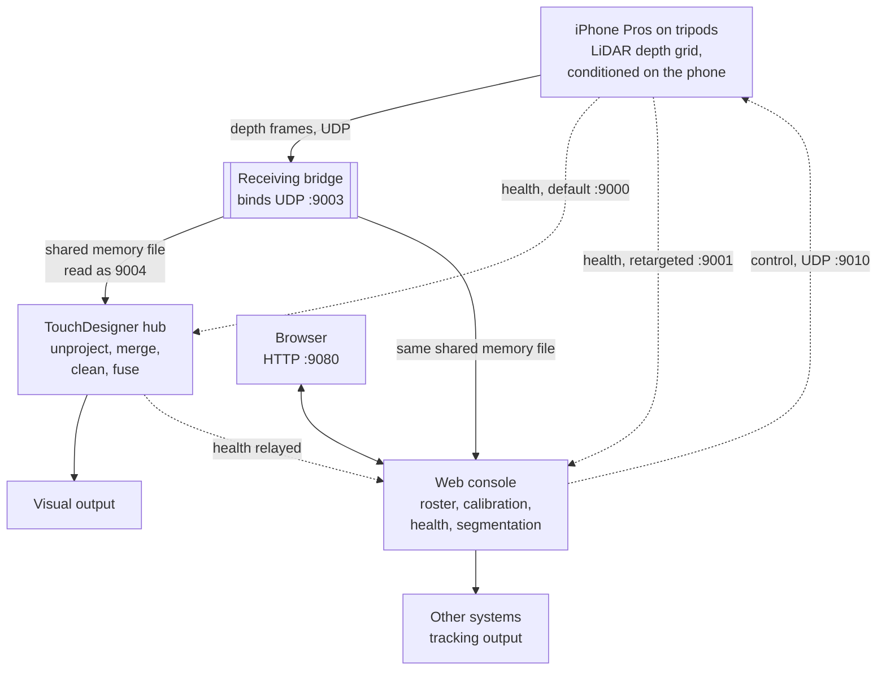

# TDStage

Multi-phone LiDAR stage tracking for live performance.

Several tripod-mounted iPhone Pros stream LiDAR depth grids over UDP into a
single TouchDesigner project, which fuses them into one point cloud in a
shared stage coordinate space and drives real-time visuals. A web console
manages the devices and carries the tracking outputs to other systems.

{: .warning }
**The system is in pre-production, and these pages describe it in the present
tense.** That is a description of what the software does, not a claim that all
of it has been proven on a stage. Before quoting anything here as a capability,
read [How far each part is proven](reference/status.html): every component with
its evidence and the level that evidence supports, generated from the
development repository's own status table so it cannot quietly improve. A page
that describes a behaviour and a table that says it has never run on real
hardware are both telling the truth, about different things.

{: .note }
**This documentation is public; the code is not.** Links on these pages to
issues, to the board or to the source repository go to a private repository and
will ask an outside reader to sign in, or show nothing. We keep them because
they are the right pointers for anyone working on the system, and because a
named issue number is still a usable reference in an email or a call. Nothing
on these pages depends on being able to open one.

## The whole system on one page

Read it as **two independent pipelines over one shared source**, plus a
health path that can point either way.

**The depth path forks at the bridge.** The bridge owns the phone-facing
socket, reassembles whole frames, and publishes them once. TouchDesigner and
the console are two readers of that same published frame. Neither reads the
other's point data. TouchDesigner makes the picture; the console makes the
tracking output. Since tox v95 (16 November) TouchDesigner can also take a copy
of the console's tracking output to draw beside its own cloud; that receiver
ships switched off and nothing draws it yet.

That fork is why the failure behaviour is simple. **Neither side is in the
other's path for point data.** TouchDesigner crashing does not stop the
tracking output. The console crashing does not touch the point cloud or the
visuals. Closing the console mid-show is a deliberate, survivable act.

**The health path has two possible destinations.** A phone reports its
battery, thermal state and frame rate to whichever port it has been told to. By
default that is port 9000, which
TouchDesigner owns, and TouchDesigner relays it to the console. The console
also has a listener of its own, and the console can tell the phones to send
there instead.

**While TouchDesigner is down and the phones are still pointed at 9000, the
console loses more than health.** It learns a phone's address only from
telemetry, so for any phone whose address nobody has typed on its device page
it has no control path, no clock sync, no battery and no thermal state
([issue 74](https://github.com/AristidesAI/TDStage/issues/74), open). Points
keep arriving the whole time, from the bridge, so frames, performers and the
tracking output keep working and the rig reads as alive. The fix is to retarget
telemetry, which reaches only the phones whose address the console already
knows, from earlier telemetry or a host typed on the device page, and reports
how many phones took it. Nothing needs a restart. See
[When something fails](operations/failure.html).

**The control path** is the console telling a phone to start, stop or
calibrate. It is the only path that needs a person.

## The parts

| Part | What it does | What it deliberately does not do |
|---|---|---|
| iOS app | Captures LiDAR depth through ARKit, runs a per-frame conditioning pass on the phone (range gate, edge cull against edge bleed, temporal median, deadband; the person matte is off by default) and streams the grid. A thermal ladder can lower its own frame rate when the phone runs hot. | No rendering, no tracking, no merging. Cleanup of the merged cloud stays in TouchDesigner. |
| Receiving bridge | Owns the phone-facing socket, reassembles frames, publishes them once for two readers. | No processing. It does not look at the data. |
| TouchDesigner hub | Regenerates points from the depth grids on the GPU, merges every phone into one cloud, cleans, fuses, drives the visuals. | Does not manage phones and does not produce the tracking output. |
| Web console | Device roster, calibration, health, and the tracking outputs to other systems. | Never feeds TouchDesigner's cloud with point data; it does send TouchDesigner the phone poses over the TD link. It is a second reader, not a relay. |

Why the parts are split this way, and which of those choices would be
expensive to revisit, is in
[Why it is built this way](reference/design.html).

## Where to start

Pick the page by what you are about to do; the pages do not need to be read
in order.

| You are about to | Read |
|---|---|
| Work out whether this fits your stage | [Questions we get asked](questions.html) |
| Send phones to a venue | [Preparing a phone](operations/phone-preparation.html) |
| Build a rig in a room | [Rig get-in](operations/get-in.html) |
| Work out why something stopped | [When something fails](operations/failure.html) |
| Quote a number to someone | [Evidence and claims](operations/evidence.html) |
| Connect another system to the tracking output | [Reference](reference/) |
| Understand why it is built this way | [Why it is built this way](reference/design.html) |

Operations pages are procedure. Reference pages are for someone integrating
another system. Someone at a get-in should never need to read a wire format,
and an integrator should never need to read a get-in sheet.

## How to read the numbers in these pages

Every figure says where it came from. A number measured on one phone on a
desk is not a number measured on a rig, and the difference matters when
someone is deciding what the system can do.

| Label | Meaning |
|---|---|
| **Measured, real phone** | Taken from hardware. The phone count is stated, because it changes the answer. On the status page: **Rig**, or **Living room** where the figure depends on the room. |
| **Measured, simulation** | Taken from synthetic streams, replayed takes or CI runners. Proves the code path, not the physics. On the status page: **Simulated**. |
| **Built, not verified** | The code and its self-tests exist. Never run on the thing it is for. On the status page: **Designed**. |
| **Not yet verified** | Needs hardware we have not had. On the status page: **Designed**. |

A "built" or "designed" item is not a working item. Do not quote one as proven.

**Today the real-phone evidence is two phones in one room** (TDStage AR on
iPhone 18 Pro, 28 October 2026, read on the dev Mac). Every figure on this
site for more phones than that is simulation. Simulated phones do not get
hot, do not fight for a switch and do not stand in front of each other.
[Evidence and claims](operations/evidence.html) explains how to turn a
demonstration into a figure that survives being questioned.
