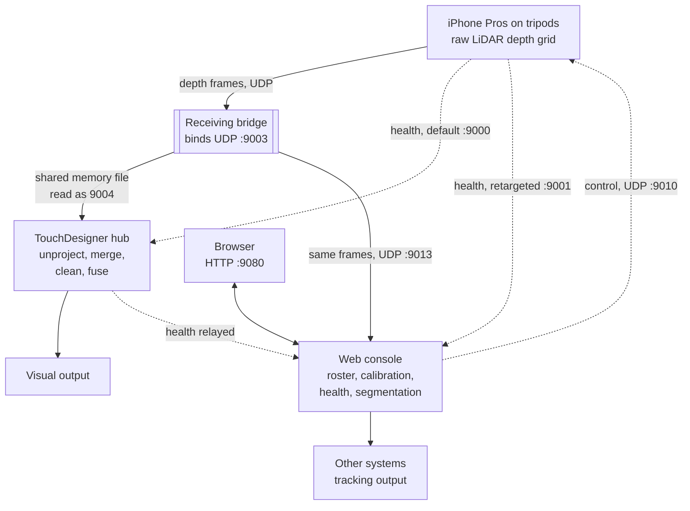

# TDStage

Multi-phone LiDAR stage tracking for live performance.

Several tripod-mounted iPhone Pros stream LiDAR depth grids over UDP into a
single TouchDesigner project, which fuses them into one point cloud in a
shared stage coordinate space and drives real-time visuals. A web console
manages the devices and carries the tracking outputs to other systems.

{: .note }
**This documentation is public; the code is not.** Links on these pages to
issues, to the board or to the source repository go to a private repository and
will ask an outside reader to sign in, or show nothing. They are kept because
they are the right pointers for anyone working on the system, and because a
named issue number is still a usable reference in an email or a call. Nothing
on these pages depends on being able to open one.

## The whole system on one page

Read it as **two independent pipelines over one shared source**, plus a
health path that can point either way.

**The depth path forks at the bridge.** The bridge owns the phone-facing
socket, reassembles whole frames, and publishes them once. TouchDesigner and
the console are two readers of that same published frame. Neither reads the
other's output. TouchDesigner makes the picture; the console makes the
tracking output.

That fork is why the failure behaviour is simple. **Neither side is in the
other's path for point data.** TouchDesigner crashing does not stop the
tracking output. The console crashing does not touch the point cloud or the
visuals. Closing the console mid-show is a deliberate, survivable act.

**The health path has two possible destinations, and that is the one thing
worth remembering.** A phone reports its battery, temperature and frame rate
to whichever port it has been told to. By default that is port 9000, which
TouchDesigner owns, and TouchDesigner relays it to the console. The console
also has a listener of its own, and the console can tell the phones to send
there instead.

So the consequence is conditional, not a law: **while TouchDesigner is down,
the console loses health only if the phones are still pointed at 9000.**
Points keep arriving the whole time, from the bridge, so the rig reads as
alive but with no battery, no temperature and no frame rate. The fix is to
retarget telemetry, not to restart anything. See
[When something fails](operations/failure.html).

**The control path** is the console telling a phone to start, stop or
calibrate. It is the only path that needs a person.

## The parts

| Part | What it does | What it deliberately does not do |
|---|---|---|
| iOS app | Captures raw LiDAR depth and streams it as a grid. | No rendering, no cleanup, no tracking, no decisions. |
| Receiving bridge | Owns the phone-facing socket, reassembles frames, publishes them once for two readers. | No processing. It does not look at the data. |
| TouchDesigner hub | Regenerates points from the depth grids on the GPU, merges every phone into one cloud, cleans, fuses, drives the visuals. | Does not manage phones and does not produce the tracking output. |
| Web console | Device roster, calibration, health, and the tracking outputs to other systems. | Never feeds TouchDesigner's cloud. It is a second reader, not a relay. |

Why the parts are split this way, and which of those choices would be
expensive to revisit, is in
[Why it is built this way](reference/design.html).

## Where to start

Pick the page by what you are about to do, not by reading in order.

| You are about to | Read |
|---|---|
| Send phones to a venue | [Preparing a phone](operations/phone-preparation.html) |
| Build a rig in a room | [Rig get-in](operations/get-in.html) |
| Work out why something stopped | [When something fails](operations/failure.html) |
| Quote a number to someone | [Evidence and claims](operations/evidence.html) |
| Connect another system to the tracking output | [Reference](reference/) |
| Understand why it is built this way | [Why it is built this way](reference/design.html) |

Operations pages are procedure. Reference pages are for someone integrating
another system. Someone at a get-in should never need to read a wire format,
and an integrator should never need to read a get-in sheet.

## How to read the numbers in these pages

Every figure says where it came from. A number measured on one phone on a
desk is not a number measured on a rig, and the difference matters when
someone is deciding what the system can do.

| Label | Meaning |
|---|---|
| **Measured, real phone** | Taken from hardware. The phone count is stated, because it changes the answer. |
| **Measured, simulation** | Taken from synthetic streams. Proves the code path, not the physics. |
| **Built, not verified** | The code exists and runs. No rig evidence yet. |
| **Not yet verified** | Needs hardware we have not had. |

A "built" item is not a working item. Do not quote one as proven.

**The state of the evidence today: real-phone evidence is one phone.** Every
multi-phone figure on this site is simulation. Simulated phones do not get
hot, do not fight for a switch and do not stand in front of each other.
[Evidence and claims](operations/evidence.html) explains how to turn a
demonstration into a figure that survives being questioned.
