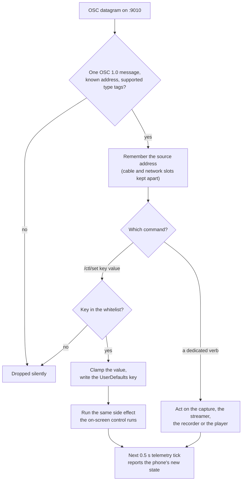

# The /ctl control surface

Every phone listens for OSC commands so that a rig runs untouched from its
mounts. Every control on the phone's three pages has a remote form, and every
value they hold is reported back, so a console can show the phone's real state
rather than the last value it happened to send.

## The socket

| Fact | Value |
|---|---|
| Direction | Console or hub to phone |
| Transport | UDP |
| Port | 9010 by default (`stage.ctlPort`) |
| Format | Single OSC 1.0 messages. No bundles |
| Discovery | Advertised over Bonjour as `_tdlidar-ctl._udp` |

Supported argument types are float (`f`), int (`i`), string (`s`) and the
booleans `T` and `F`. Any other type tag drops the whole packet. Malformed
packets are dropped silently, and unknown addresses are ignored.

The model is LAN trust. There is no authentication on this port.

### What happens when a command arrives

Two things in that path are deliberate and easy to break. The whitelist is a
`switch` over literal key names, so an unknown key cannot write arbitrary
UserDefaults: there is no dictionary and no reflection. And the side effect is
the *same function* the on-screen control calls, not a copy of it, so a remote
edit and a thumb on the phone cannot leave the phone in two different states.
A new setting that needs a side effect and does not get one in that function is
the classic defect here: the value lands, the telemetry reports it, and nothing
changes until something else is touched.

### The listener repairs itself

A deaf phone is the one failure an operator cannot fix from front of house,
because every other remedy is delivered over this socket. So:

- Re-asserting a port the listener already holds is a no-op, not a teardown.
- A genuine port change waits for the old listener to actually release the
  socket before binding the new one.
- A failed bind is retried with backoff, from 0.25 s up to 4 s, and never gives
  up.
- A watchdog polls whether the listener is bound, and rebuilds only the
  listener if it is not. Capture is never stopped for it: restarting a capture
  session cannot free a port another process holds, so a self-heal that tore
  the camera down would cost the show its cloud and still not fix the socket.

### The phone learns where you are from your packets

The source address of every accepted command is remembered. This is the only
way a phone can discover a computer's address on a USB cable, because both ends
pick a random link-local address and iOS blocks the discovery broadcast.

Cable addresses and network addresses are kept in separate slots, so one never
overwrites the other, and a cable address is only trusted while a cable is
actually attached.

---

## Argument conventions

**A missing argument on a processing toggle means off, never on.** These gate
the phone's optional per-frame work, and the phone is a pure streamer by
default. A bare pulse from a mistyped control must not switch depth
rectification or on-device pose detection back on during a show. The one
exception is `rawmode`: turning it on *is* doing less, so a bare pulse arms the
fast path.

**A non-finite number reads as no number.** A NaN or an infinity is a legal OSC
float. Converting one to an integer in Swift is a trap, not an error: it
terminates the process. One stray value from one console control would have
taken a phone off a truss, and a supervised phone would have relaunched into
the same push. Non-finite values are now dropped before anything reads them,
and what survives is clamped to a billion either way and then clamped again to
each key's own range, so two bad clamps would both have to be wrong for a value
to reach a key unbounded.

**Playback needs a name.** A bare pulse cannot start a replay, because playback
replaces the live camera. A mistyped control must never take a phone off its
own LiDAR mid-show. The same reasoning applies to pushing a profile, to seeking
and to renaming: no argument, no action. Where a bare pulse is harmless, such
as cancelling an armed start or stepping one frame forward, it is allowed.

---

## Lifecycle and display

| Address | Arguments | Effect |
|---|---|---|
| `/tdlidar/ctl/start` | none | Start the live cloud. On a phone mid-replay it stops the replay and brings the camera back. Refused while the device id has never been set |
| `/tdlidar/ctl/stop` | none | Stop sending. On a phone mid-replay it ends the replay without resuming the camera. The socket and the hello stay up |
| `/tdlidar/ctl/blackout` | `0|1`, default 1 | Screen blackout. A bare pulse blacks out |
| `/tdlidar/ctl/fps` | `n` | Capture rate, clamped 5 to 60. Applies live |
| `/tdlidar/ctl/imu` | none | One-shot attitude report. Replies on `/device/attitude` |
| `/tdlidar/ctl/ping` | none, or `seq` `[hostTime]` | Liveness, or clock sync. Replies on `/device/pong`. See [clock sync](#clock-sync) |

## Settings

| Address | Arguments | Effect |
|---|---|---|
| `/tdlidar/ctl/set` | `<key>` `<number or string>` | Set one whitelisted setting. Unknown keys are ignored |

The whitelist, the clamps and which keys a profile can reach instead are in
[the settings reference](settings.html).

After a value lands, the phone runs the same side effect the matching on-screen
control runs, so a remote edit and a thumb on the phone cannot leave the phone
in two different states.

## Processing toggles

Each of these also has a `/ctl/set` form. They apply live, with no capture
restart, except where stated.

| Address | Arguments | Effect |
|---|---|---|
| `/tdlidar/ctl/rawmode` | `0|1`, default **1** | The master switch. On: acquire depth, pack, send, with every optional stage skipped |
| `/tdlidar/ctl/lensrect` | `0|1`, default 0 | Lens-distortion rectification of the depth grid |
| `/tdlidar/ctl/markers` | `0|1`, default 0 | On-phone marker detection |
| `/tdlidar/ctl/skeleton` | `0|1`, default 0 | On-phone person and pose detection |
| `/tdlidar/ctl/depthfilter` | `0|1`, default 0 | Apple depth smoothing. **Restarts the capture session.** Must stay 0 for a show |
| `/tdlidar/ctl/depthgrid` | `"256x192"` or a width | Requested grid size. A string wins over a number. Validated, and refused while a take is recording. Currently has no effect on the captured grid |

## Calibration

| Address | Arguments | Effect |
|---|---|---|
| `/tdlidar/ctl/marker` | `primaryId` `secondaryId` `sizeMM` | Which marker ids this phone hunts, and the printed size in millimetres. A secondary below 0 means none. Re-applied live if a calibration is already running |
| `/tdlidar/ctl/markerpose` | `id` `x` `z` `yawDeg` `[y]` | A marker's known floor pose in the stage frame, from the venue layout. The id must be 1 or more |
| `/tdlidar/ctl/calibrate` | `0|1`, default 0 | 1 swaps the rear LiDAR to ARKit marker tracking, which stops the point stream. 0 stores the solved pose and resumes streaming if the phone was streaming **or** if auto-resume (`stage.showActive`) is set |
| `/tdlidar/ctl/calibclear` | none | Forget the stored solve and go back to gravity levelling |

A stored calibration survives a relaunch. Calibration replies on
`/device/calib/pose` and `/device/marker/seen`.

Entering calibration is a hard swap, because the rear LiDAR cannot feed
AVFoundation and ARKit at once. It therefore also ends a replay and stops a
recording first: the phone must not be emitting two different clouds, and a
take cannot span a camera change. Whether streaming resumes on the way out is
decided from the state on the way in, `streaming` **or** auto-resume set, and
auto-resume is not cleared by a replay. So a phone that was streaming, then
replayed a take, then was sent to calibrate, comes back streaming.

Marker calibration works end to end in the code and has unit tests. It has not
been confirmed on a phone against a printed marker (**built, not verified**).

## Configuration and recovery

| Address | Arguments | Effect |
|---|---|---|
| `/tdlidar/ctl/profile` | `<json or flat yaml or an http(s) url>` | Apply a whole profile document and store it as the new last known good. A URL is fetched, with a 5 s timeout. **Dropped** while a take is recording, with no ack. Replies on `/device/profile/ack` otherwise |
| `/tdlidar/ctl/profile/save` | none | Snapshot the live configuration as the new last known good |
| `/tdlidar/ctl/recover` | `tier`, default 1 | Force a self-heal now: 1 restart capture, 2 reconnect transport, 3 full reconfigure, 4 relaunch. Tier 4 needs the opt-in recovery key, and is only meaningful on a supervised phone |
| `/tdlidar/ctl/health` | none | One-shot health and recovery report. Replies on `/device/health`, `/device/health/cause` and `/device/profile/name` |
| `/tdlidar/ctl/reset` | none | Clear the crash history, which leaves safe mode |

A profile that cannot be parsed is never silently dropped: it replies with
`accepted = 0`, because an operator who believes a phone is reconfigured when
it is not is worse off than one who knows the push failed. A URL fetch that
fails replies the same way.

{: .warning }
**A profile pushed while a take is recording is dropped, and no ack is sent.**
It is not queued and not applied later. The only report is one line of text on
`/device/rec/note`, reading "Profile push deferred — a take is recording",
which a console shows on the phone's row but which is easy to miss and is
overwritten by the recorder's next note. The two `accepted = 0` acks exist for
an unparseable document and for a failed URL fetch, so the absence of an ack is
the only signal that a push went nowhere.
  
The refusal itself is right: a profile can carry a grid size, a plane set and a
transport, and a take is one file with one geometry in its header. Push the
profile before you arm the recorder, not during.

A profile can only reach the keys in its schema. Everything else in the
document is ignored, including the destination address: see
[the settings reference](settings.html#identity-and-network) for why.

The two authorities sit at different trust levels on purpose. `/ctl/set` is a
narrow per-key surface, numerically clamped, and a person at a console is
behind every call. A profile is a whole document applied in one go, cached on
disk, and **re-applied at boot and on a full self-heal** without anyone
pressing anything. That last property is what decides what may live in a
profile: anything a profile can set, it can also silently re-set minutes later.

## Recording

| Address | Arguments | Effect |
|---|---|---|
| `/tdlidar/ctl/rec/start` | `[name]` | Record the live wire to a take. No name means auto-name. Starts the capture if it is not running |
| `/tdlidar/ctl/rec/stop` | none | Close the take, writing its footer and sidecar |
| `/tdlidar/ctl/rec/startat` | `delay` or `"unixSeconds"` `[name]` | Armed start. See below |
| `/tdlidar/ctl/rec/cancel` | none | Cancel an armed start |
| `/tdlidar/ctl/rec/list` | none | Replies on `/device/rec/list` with a JSON array of takes |
| `/tdlidar/ctl/rec/delete` | `name` | Delete a take. No name, no action |
| `/tdlidar/ctl/rec/rename` | `old` `new` | Rename a take. Both names required. Refused while that take is in use |

## Playback

| Address | Arguments | Effect |
|---|---|---|
| `/tdlidar/ctl/rec/play` | `name` `[loop]` `[speed]` | Stop the camera and replay that take. **The name is required** |
| `/tdlidar/ctl/rec/playat` | `delay` or `"unixSeconds"` `name` | Armed play |
| `/tdlidar/ctl/rec/pause` | `0|1`, default 1 | Pause or resume a running replay. A bare pulse pauses |
| `/tdlidar/ctl/rec/stopplay` | none | End the replay |
| `/tdlidar/ctl/rec/step` | `[n]`, default +1 | Step a replay n frames, clamped to 10 000 either way. 0 is refused |
| `/tdlidar/ctl/rec/seek` | `frame` | Jump a replay to a frame. Required, and must be 0 or more |
| `/tdlidar/ctl/rec/trim` | `"in"`, `"out"`, `"clear"`, or `in` `out` | Set the in or out point to the frame now playing, clear the trim, or set both explicitly. An out below 0 means to the end |

All of these act only on a replay or an armed start that already exists, so
none of them can take a phone off its LiDAR.

## Armed starts: how several phones begin together

Two forms are accepted, and both are honest about what an OSC float can carry.

- **A number is a delay in seconds from receipt**, 0 to 60. On a LAN the packet
  jitter this adds is sub-millisecond, which is far tighter than the tens of
  milliseconds that separate two phones' notions of now.
- **A string that parses as a number above 1e9 is an absolute unix time in
  seconds**, fractions allowed, for a console that would rather trust the
  phones' clocks.

{: .note }
A wall-clock deadline in unix microseconds as a float cannot be represented. A
32-bit float carries 24 mantissa bits, so unix seconds alone quantise to about
128 seconds. Do not send one.

Either way this is a shared-second start, not a frame lock. Frame-locking
several phones is separate, later work.

An armed start is reported back on `/device/rec/arm` as a countdown in seconds
and a label, so a console can show it.

## Fault injection

| Address | Arguments | Effect |
|---|---|---|
| `/tdlidar/ctl/test` | `mode` | Inert unless the app was launched with a test argument |

A shipped phone cannot be given that argument, so this address does nothing on
a truss. It exists so that "recovers from a crash" is a tested claim rather
than a hope.

---

# Telemetry the phone sends back

Device-namespaced, so several phones coexist on one receiver. Everywhere below,
`<id>` is the device id on the wire, which during a replay with **Send as** set
is the stand-in id rather than the phone's own.

Emitted at 2 Hz as one batch, because this is health rather than signal. A
marker sighting is pushed immediately as well.

## Device and power

| Address | Arguments |
|---|---|
| `/tdlidar/<id>/device/thermal` | 0 nominal, 1 fair, 2 serious, 3 critical |
| `/tdlidar/<id>/device/battery` | 0 to 1. Omitted when the level is unknown |
| `/tdlidar/<id>/device/charging` | 0 or 1. **A 0 on a mounted phone means the power has come out** |
| `/tdlidar/<id>/device/lowpower` | 0 or 1 |
| `/tdlidar/<id>/device/footprint` | Resident memory in MB, which is what the system judges |
| `/tdlidar/<id>/device/pressure` | `level` `factors`. Level: -1 no device observed, 0 nominal, 1 fair, 2 serious, 3 critical, 4 shutdown. Factors is a bitmask: 1 system temperature, 2 peak power, 4 depth-module temperature, 8 camera temperature, 16 battery stress |
| `/tdlidar/<id>/device/fpsceiling` | The frame rate the thermal ladder allows now |
| `/tdlidar/<id>/device/uptime` | Seconds since launch |
| `/tdlidar/<id>/device/heartbeat` | A monotonically increasing tick |

The thermal ladder acts on the worse of `pressure` and `thermal`.

## Stream

| Address | Arguments |
|---|---|
| `/tdlidar/<id>/device/streaming` | 0 or 1 |
| `/tdlidar/<id>/device/video` | 0 or 1. Is the colour plane actually on the wire |
| `/tdlidar/<id>/device/screenoff` | 0 or 1. Blackout active |
| `/tdlidar/<id>/device/fps` | Measured delivery rate |
| `/tdlidar/<id>/device/points` | Valid depth cells in the last frame sent |
| `/tdlidar/<id>/device/stream` | `w` `h` `fps` `planes` `transport` `port`. Planes is a bitmask: 1 depth, 2 confidence, 4 colour. Transport is always 1, meaning UDP |
| `/tdlidar/<id>/device/net` | `framesSent` `packetsSent` `framesAbandoned` |
| `/tdlidar/<id>/device/captureage` | `p50` `p95` in ms. The capture-to-**socket** age of the last 64 live frames: the phone's own photon-to-wire latency |
| `/tdlidar/<id>/device/agesplit` | Seven medians in ms, in order: capture delivery, depth and colour prep, hop to the main thread, main-thread work, send queue, pack, socket. Where that age goes, so a warning can name the slowest stage |

#### What `captureage` measures, exactly

It is stamped when the **last datagram of the frame has left the socket**, in
that datagram's send completion, against the capture timestamp in the frame's
own header. Not when the frame was packed. The pack-to-socket leg was the one
leg the telemetry could not see, and it is the leg that grows first when a link
is congested, so measuring to the packer would have reported a healthy phone on
a saturated switch. The seventh entry in `agesplit`, `socket`, is that leg on
its own.

Both figures are kept in a 64-sample ring, which is about two seconds at
30 fps, so they describe now rather than the session. The ring is cleared when
streaming starts and when it stops, so a new session never reports the old
one's ages. Replayed frames are not sampled: the player rewrites each frame's
capture time to now, so an age measured against it would be meaningless.

{: .note }
The accessor in the source is still named and commented as a capture-to-packet
age. The code behind it stamps at the socket. Trust the code: the figure
includes the fragmenter and the send queue.
| `/tdlidar/<id>/device/link` | `"wired"|"wifi"|"none"` `wiredUp` `preferWired` `cableAttached`. A phone on a cabled rig reading `wifi` has a link problem. Read the second argument before concluding which: see below |
| `/tdlidar/<id>/device/source` | `"live"` or `"playback"`. The only thing on the wire that distinguishes a replay from a live phone |
| `/tdlidar/<id>/device/tcp` | **Always 0.** There is no TCP link. The address is kept so that consoles which parse it keep working |

{: .warning }
`/device/tcp` is not a transport report. It is a constant, left in place for
compatibility after the TCP streamer was deleted. Do not read anything into it.

#### Reading `link = "wifi"` on a cabled rig

Three causes, and the second argument, `wiredUp`, separates them.

| `link` | `wiredUp` | Cause |
|---|---|---|
| `wifi` | 0 | The adapter or the switch port is gone. A cable fault |
| `wifi` | 1, `preferWired` 0 | Nobody asked for the wire. Set `stage.preferWired 1` |
| `wifi` | 1, `preferWired` 1 | **The wired requirement was dropped after its five-second grace.** The adapter's link is up and its routing is not |

The third is the one that is read wrong. The phone required wired Ethernet,
the connection did not come up within five seconds, and the streamer rebuilt it
once without the requirement so the phone would not sit silent for the whole
session. The LIVE page reads "Wi-Fi (Ethernet waiting)" in amber. It is a
routing fault, not a cable fault: check which subnet the adapter has an
address on and whether the receiver is reachable there. The requirement
re-arms on the next wired path change, so bouncing the link makes the phone
try the wire again. See
[Prefer Ethernet](live.html#prefer-ethernet-poe--cable).

## Geometry

| Address | Arguments |
|---|---|
| `/tdlidar/<id>/device/marker` | Last-seen marker id. 0 means none |
| `/tdlidar/<id>/device/mountedge` | Declared sky side: 0 automatic, 1 left edge up, 2 right edge up |
| `/tdlidar/<id>/device/gravity` | `gx` `gy` `gz`. Camera-frame gravity, low-passed |
| `/tdlidar/<id>/device/extmode` | `mode` `pitch` `roll`. Mode: 0 identity, 1 gravity-levelled, 2 marker-calibrated. Pitch and roll in degrees from the gravity vector |

## State and configuration

| Address | Arguments |
|---|---|
| `/tdlidar/<id>/device/state` | `"idle"`, `"streaming"`, `"calibrating"` or `"playing"` |
| `/tdlidar/<id>/device/settings` | A JSON object: every setting a person can change on the phone's screens, keyed by its UserDefaults key. Sent when it changes, and every 2 s regardless, so a console that starts late still converges. A key absent from it is a control the app does not have |
| `/tdlidar/<id>/device/app` | `appName` `version` `build` `commit`. On connect, on a device-id change, and every 2 s. The commit is empty when the build did not embed one |
| `/tdlidar/<id>/device/recovery` | `launches` `crashes` `recentCrashes` `safeMode` `heals` `lastTier` `profileRevision`. The phone's own account of how stable it has been |

{: .note }
`/device/app` is how to answer "which build is this phone running". Use it
before you trust a behaviour described in these pages. See
[Installing and preparing a phone](install.html).

The device's name is not sent on this path. It rides the hello on the depth
stream instead, so that there is one authority for it.

## Recording and playback

| Address | Arguments |
|---|---|
| `/tdlidar/<id>/device/rec/state` | `"idle"`, `"recording"` or `"playing"` |
| `/tdlidar/<id>/device/rec/take` | The current take name, or empty |
| `/tdlidar/<id>/device/rec/stats` | `frames` `seconds` `megabytes` `dropped` `freeGB` |
| `/tdlidar/<id>/device/rec/arm` | `seconds` `label`. `0 ""` means nothing is armed |
| `/tdlidar/<id>/device/rec/note` | The recorder's last word to the operator: a refusal, an auto-stop, an import result. Empty means none |
| `/tdlidar/<id>/device/rec/play` | `index` `total` `seconds` `duration` `loops` `paused` `in` `out`. Zeros when nothing is playing |

## Replies and one-shots

| Address | Arguments | Sent in reply to |
|---|---|---|
| `/tdlidar/<id>/device/pong` | `deviceId` | A bare `/ctl/ping` |
| `/tdlidar/<id>/device/pong` | `seq` `hostTime` `tHi` `tLo` | `/ctl/ping <seq> [hostTime]` |
| `/tdlidar/<id>/device/attitude` | `roll` `pitch` `yaw` in degrees, then `gx` `gy` `gz` | `/ctl/imu` |
| `/tdlidar/<id>/device/health` | `launches` `crashes` `recentCrashes` `safeMode` `heals` `lastTier` `profileRevision` | `/ctl/health` |
| `/tdlidar/<id>/device/health/cause` | A string, or `"clean"` | `/ctl/health` |
| `/tdlidar/<id>/device/profile/name` | `name` `revision` | `/ctl/health` |
| `/tdlidar/<id>/device/profile/ack` | `accepted` `revision` `keysChanged` | `/ctl/profile`, `/ctl/profile/save` |
| `/tdlidar/<id>/device/rec/list` | A JSON array of takes | `/ctl/rec/list` |
| `/tdlidar/<id>/device/marker/seen` | `id` `cx` `cy` `confidence` | A marker sighting, pushed immediately |
| `/tdlidar/<id>/device/calib/pose` | `rms` `imagesSeen` `valid` | A calibration solve. `rms` is translation jitter in metres, lower is better |

### Clock sync

A ping with arguments echoes `seq` and `hostTime` back verbatim, in the same
OSC type they arrived as, followed by the device's uptime in seconds sampled at
the moment the datagram was received, split across two floats to keep the
precision.

The host clock offset is approximately
`deviceTime - (hostSend + hostReceive) / 2`.

The reply is sent straight back to the ping's source address and port as well
as on the telemetry path, so a console's round trip does not include the hub's
processing. A console that keeps the smallest round trip of its recent pings
will take the direct copy whenever it arrives.
