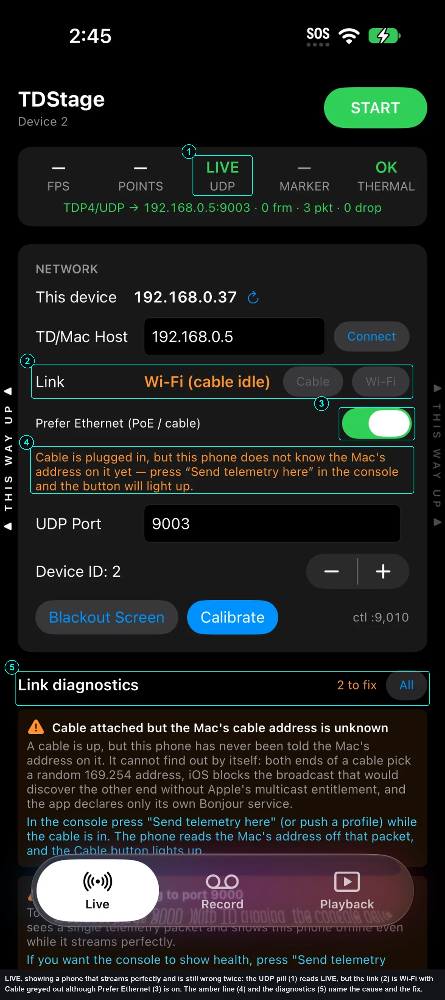
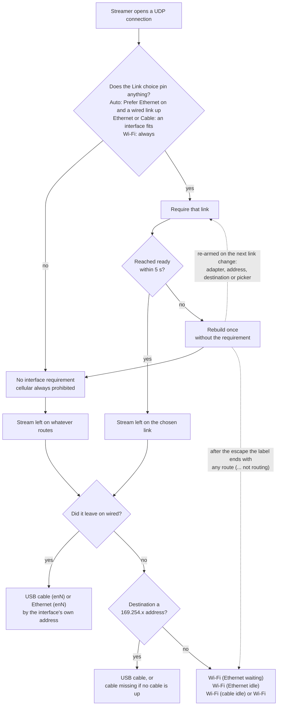
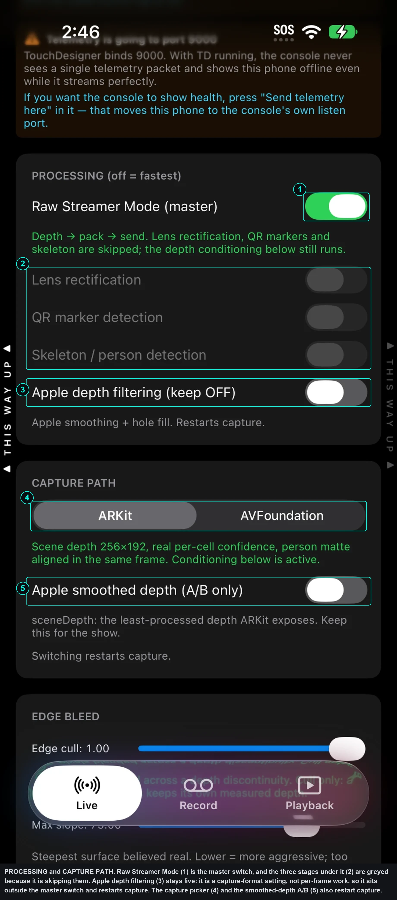
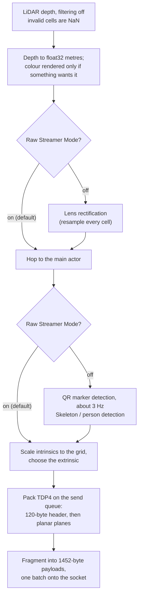

# The LIVE page

LIVE is the page you use when you mount a phone and when you need to know why
a phone is not reaching the receiver. It shows what the phone is sending, where
it is sending it, and what is wrong with the link.



The phone above is streaming with two faults, which makes it a useful example.
The UDP pill (1) reads LIVE and the thermal state is fine. But **Link** (2)
reads `Wi-Fi (cable idle)` in amber with the Cable button greyed out, even
though **Prefer Ethernet** (3) is on. The amber line (4) and the diagnostics
(5) say why: a cable is plugged in and the phone has never been told the Mac's
address on it. Neither fault stops the stream, but each costs latency or health
reporting. The screenshot predates the Link picker that replaced the Cable and
Wi-Fi buttons on 2026-10-27. The diagnostics read the same, but under Auto a
cabled phone now reads `Wi-Fi (Ethernet waiting)`, because the cable counts as
a wired link.

The numbers sit on the screenshot itself, so the pairing survives printing,
pasting into a call sheet, or reading on a phone where the caption has wrapped
somewhere else.

The app has three pages. A glass pill at the bottom of the screen switches
between LIVE, RECORD and PLAYBACK. The pill carries a coloured dot: red while a
take is recording, green while a take is replaying, orange while a start is
armed. The glow behind the glass follows the same state. Nothing else on the
pill changes, so the three shapes stay in the same places in the dark.

Everything on this page is UDP. There is no TCP mode and no TCP fallback.

{: .note }
The field labelled **TD/Mac Host** is stored under the UserDefaults key
`stage.tcpHost`. That key name is historical. It holds the **destination IP
address** and says nothing about transport. The TCP streamer was deleted from
the app.

---

## The header: START and STOP

Top left shows the app name and `Device <n>`, the device id this phone stamps
into every packet.

Top right is one button:

| Button reads | Phone state | Pressing it |
|---|---|---|
| START (green) | idle | Starts LiDAR capture and the point stream |
| STOP (red) | streaming | Stops the point stream. The socket stays up |
| START (grey) | device id never set | Refused. See below |

STOP stops the point flow only. The UDP socket stays open and the phone keeps
sending its hello every two seconds, so a receiver still sees the phone on its
roster. Telemetry keeps running.

The screen does not auto-lock while the app is in the foreground, whether the
phone is streaming or stopped. A locked phone cannot hear remote commands, so
the app holds the idle timer off from launch.

### The red "Set a unique Device ID" banner

A fresh install carries device id 1 and a flag saying nobody has chosen it.
While that flag is unset and the id is still 1, START is refused and a red
banner appears above the stats. Two phones on one id overwrite each other's
frames.

Three things clear it, and any of them counts even if the number does not
change:

- the **Device ID** stepper further down this page,
- the banner's own **This is phone 1** button,
- a device id pushed from the console.

The refusal also goes out as telemetry, so a console operator who pressed Start
sees the reason rather than silence.

Only an explicit push counts for the third of those. A profile document that
names `stage.deviceId` is someone choosing the id, which is what the console's
Device ID row sends, even to the same number. The boot re-apply of the cached
profile, and the re-apply during a full self-heal, do not go through that path
and never set the flag, because the cached profile snapshots the registered
default too and would otherwise confirm an id nobody chose. A phone whose cache
carries the untouched id 1 therefore still shows the banner after a relaunch.

#### Why this is a refusal and not a warning

The device id is in the 20-byte packet header of every datagram, and a receiver
reassembles fragments per `(deviceId, frameId)`. Two phones sharing an id
produce one stream whose packets interleave, so the receiver assembles frames
from two phones' halves. It cannot tell the two apart and discard one. The
symptom is a cloud that delivers almost nothing, or delivers geometry that
cannot exist. It is the one misconfiguration on the phone that looks like a
hardware fault, and it costs a get-in slot to find.

The flag is separate from the number so that "phone 1" stays reachable. An id
of 1 is allowed; the guard only checks that a person has chosen it, which is
why pressing the banner's own button clears it without changing anything.

---

## The stats row

Five figures across the top, refreshed twice a second. They report health, and
the app does not update them per frame.

The 2 Hz rate protects the frame path. The counters live under a lock in the
streamer, and a 2 Hz tick mirrors them into observable state; the frame path
never touches the view. `pkt` changes thirty-odd times a second, so publishing
it from the frame path would invalidate the view on every frame and put SwiftUI
layout behind the capture callback. The frame path's only jobs are to pack and
to hand off. Reading the counters is also one lock acquisition rather than
four, because the whole snapshot comes back as a single struct.

| Stat | Reads | Notes |
|---|---|---|
| FPS | Measured delivery rate | A dash when nothing is streaming. During a replay it is the replay's rate |
| POINTS | Valid depth cells in the last frame sent, in thousands | Counted by the packer. Not the grid size |
| UDP | OFF, CONNECTING or LIVE | Local socket state only. See the caveat below |
| MARKER | Id of the marker in view, or a dash | Green while a marker is in view |
| THERMAL | OK, WARM, HOT or CRIT | The device thermal state |

{: .warning }
**UDP LIVE does not mean anything is arriving.** A UDP socket reaches ready
with no receiver in existence, because there is no handshake to fail. It proves
a local socket was created. Only the console or TouchDesigner can confirm
frames are being received.

THERMAL is not only a readout. OK, WARM, HOT and CRIT are iOS's nominal, fair,
serious and critical thermal states, and the thermal ladder acts on them while
`stage.thermalLadder` is on (the default). The rungs are worked out from the
lower of the rate chosen on the RECORD page and the rate the LiDAR is actually
pinned to, and never lift it. WARM costs nothing. At HOT the capture rate is
capped at `stage.thermalSeriousFPS`, 30 by default. At CRIT it is capped at
half the lower rate the rungs are worked out from, with a floor of 10, and in
any case no higher than the HOT rung.
The cap sits on top of the chosen rate without overwriting it, and the phone
returns to that rate by itself once it has held a cooler state for 45 seconds;
every return to the rung in force restarts the clock. `stage.thermalColourAt`
can shed the colour plane
before the rate has to: 1 drops `rgb` from WARM, 2 from HOT, and the default 0
never does. Shed colour comes back with the same hold, and stopping the stream
clears it. The keys are on the [settings page](settings.html).

Under the stats row, one line describes the stream itself:

```
TDP4/UDP → 192.168.1.10:9003 · 320×240 · 41203 frm · 128744 pkt · 0 drop
```

The grid size appears once the first captured frame has revealed it. Nothing in
the app hardcodes it. The app reads the dimensions off the pixel buffer the
capture format delivers, which is why this line is blank until the first
frame.

`drop` counts frames the phone abandoned because a newer frame arrived while
the older one was still on the socket. Latest wins, by design. The mailbox
holds one frame: the capture callback deposits into it, the send queue drains
it, and a deposit onto an occupied slot overwrites it and increments this
counter. On a link that cannot keep up, the phone sends fewer, newer frames
instead of a growing backlog of stale ones. A rising `drop` with a healthy FPS
means the socket is the bottleneck rather than the camera.

The same mailbox carries replayed frames, which is why a replay inherits
latest-wins, the frame-id counter and every error path without a second send
path that could drift from this one. The recorder's tap sits on that same
drain, but it fires only for an assembled live frame. A replayed frame passes
it untouched, so a take cannot record itself; see [the RECORD page](record.html).

{: .note }
**POINTS is only a count.** The phone never puts xyz on the wire. It sends the
organised depth grid, and the receiver regenerates points on the GPU from
`depth x ray(u, v)` using the intrinsics in each frame's own header.
Unprojecting on the phone would cost about 7.5 times the bandwidth, 1.4 Gbit/s
across eight phones, to send a receiver data it already has. The count is free
because the packer decides each cell's validity as it writes it, so no extra
pass over the grid is needed to produce this figure.

If the app has an error to report, it appears in red at the bottom of this card.

### How a dead receiver does show up

The phone has one way to learn it is shouting into nothing, and the app now
reads it. When a connected UDP socket sends to a port with no listener, the far
host answers with an ICMP port-unreachable. That answer arrives as an error on
the **send completion** of a datagram, nowhere else. The app used to discard
every send completion's error by name, which is how a phone sits behind a green
pill while not one datagram is delivered. The app now keeps the last error and
translates it into something an operator can act on, and the diagnostics below
raise it as **Transport errors**:

| What the socket reported | What the app says |
|---|---|
| `ECONNREFUSED` | Nothing is listening at that address and port |
| `EHOSTUNREACH` | No route to that address: wrong subnet, or the link is down |
| `ENETUNREACH` | This device has no usable interface |
| `EMSGSIZE` | Datagram too large for the link MTU |
| a DNS failure | Name lookup failed: use a numeric IP, not a name |

An error count of zero is still not proof of delivery. A receiver that is
listening but wedged, or a switch that is dropping, answers nothing at all.

For the first row the fix text names the ports to check: TouchDesigner holds
9003, and the console falls back to 9013 whenever TD is running, so a phone
meant for the console alone while TD is up belongs on 9013. The
[ports reference](../reference/ports.html) has the full map.

---

## Mount captions

A thin `▲ THIS WAY UP ▲` caption runs along each long edge of the screen. The
interface is portrait locked, but phones are usually mounted rotated 90 degrees,
because the depth sensor's wide axis runs along the phone's long side.

Tap the caption on the edge that is pointing at the sky. It goes white. Tap it
again to clear it, and both captions go dim, which means automatic.

The selection is only consulted when gravity cannot decide, which happens when
the camera stares straight down or straight up. Real gravity stays
authoritative everywhere else. The declared edge also rides the hello and the
telemetry, so a receiver knows what the operator declared.

---

## NETWORK

### This device

The phone's own LAN address, with a refresh button. Read it out when a console
operator asks for it. Tap and hold to copy.

### TD/Mac Host

The destination IP address for the depth stream, the telemetry and the control
replies. Type four numbers separated by dots.

{: .note }
**Use the numeric address.** A hostname may connect, but the rest of the panel
stops working with one. The app's own diagnostic text says names are not
resolved here; the code is more permissive. Both the depth connection and the
telemetry client hand this string to `NWEndpoint.Host`, which accepts a
hostname, and the streamer carries an error branch for a failed lookup. The
field only files a **complete dotted quad** into the Cable and Wi-Fi memories,
so it never remembers a name for those buttons, and the diagnostics raise
"Destination is not a valid address" against it. Where the comment and the code
disagree, the code wins.

While the field has focus the button beside it reads **Done**. Otherwise it
reads **Connect**. Either one pushes the edited address into the live streamer.

The field writes on every keystroke, so a half typed address is normal while
you are typing. Only complete addresses are remembered for the Cable and Wi-Fi
buttons.

### Link

A read-only label saying which interface the depth stream is using, followed by
the **Link** picker (Auto, Ethernet, Cable, Wi-Fi) and, under Auto only, the
Prefer Ethernet toggle.

The label is the end of a decision that starts when the streamer opens its
socket. Three facts decide it: which interface the connection left on, whether
the destination is a cable address, and whether the stream has escaped a
pinned link (the label then ends with the streamer's note).



The branch that catches people is the five-second one. It is described under
[Prefer Ethernet](#prefer-ethernet-poe--cable) below, and it is the reason a
cabled phone can read Wi-Fi with the cable still in.

| Label | Meaning |
|---|---|
| USB cable (en3) | The stream left on a wired interface with a link-local address, named. With a dash and `any route (...)` after it, the stream escaped its pinned link and this is where it landed |
| USB cable | The stream is not on a wired interface, the destination is a `169.254.x` address and a cable is attached |
| cable missing | The destination is a cable address and no cable is attached. Nothing can leave |
| Ethernet (en3) | The stream left on a wired interface with a routable address, named, which is what a PoE rig wants |
| Wi-Fi (Ethernet waiting) | Link is Auto, a wired link is up (an adapter or a USB cable) and Prefer Ethernet is on, but the stream is not on it yet: the grace is running |
| Wi-Fi (Ethernet idle) | Link is Auto, a wired link is up, Prefer Ethernet is off |
| Wi-Fi (cable idle) | Link is Ethernet or Cable, a cable is attached, and the stream is on Wi-Fi |
| Wi-Fi | Wi-Fi with no wired interface, or Link set to Wi-Fi |
| Wi-Fi, a dash, `any route (wired adapter not routing)` | The pinned link did not reach ready within five seconds; the stream escaped to any route. Under Ethernet, Cable or Wi-Fi the note names that mode (`any route (ethernet not routing)`); `any route (no ethernet interface)` or `(no cable interface)` means nothing fitted the choice and nothing was pinned |

**Ethernet**, **Cable** and **Wi-Fi** in the picker pin the depth stream and the
telemetry to that link and point the destination at the last complete address
this phone learned on it (`stage.hostEthernet`, `stage.hostCable`,
`stage.hostWifi`), so an operator does not retype an address at a get-in.
**Auto** keeps the destination. A segment with no remembered address still pins
the link when an interface fits it; the caption under the picker says what is
missing. The same choice arrives from the console as
`/ctl/set stage.link <auto|ethernet|cable|wifi>`, which pins the link and
leaves the destination unchanged.

Neither the Link choice nor the three remembered hosts travel in a profile.
`stage.link`, `stage.hostEthernet`, `stage.hostCable` and `stage.hostWifi` are
left out of the profile schema on purpose, for the reason `stage.tcpHost` is:
the link is the operator's choice, set on this page or by an explicit
`/ctl/set`, and a cached profile re-applied at boot or during a self-heal must
never walk a phone back onto another link. A pushed profile that carries
`stage.link` has the key dropped, so an operator who wants a push to move the
link has to send `/ctl/set stage.link` as well. The
[settings page](settings.html) has the profile rule.

The phone cannot work out the computer's cable address by itself. Both ends of
a USB-C link pick a random `169.254.x` address, and iOS blocks the broadcast
that would discover the other end. The phone learns the address from the source
of every control packet it receives, and learns a cable address only while a
cable is attached, which is why the console has to send to it once before
Cable has somewhere to point.

A caption under the picker explains why a chosen link cannot work yet: no
Ethernet adapter with an address, Ethernet up but the show machine's address on
it unknown, a cable in but the Mac's cable address unknown, or a cable address
remembered with no cable detected.

### Prefer Ethernet (PoE / cable)

On by default, and shown only while Link is Auto. While it is on and a wired
interface is up, every outgoing UDP
connection is built with `requiredInterfaceType = .wiredEthernet`, so iOS
cannot route the depth stream over Wi-Fi even though both interfaces sit on the
same LAN with equally good routes. Cellular is prohibited on every connection,
wired or not, so show traffic never leaves over a mobile network.

Under Auto the app does not infer the requirement from the address. A USB cable
to a computer is link-local at both ends and is wired, so judging by address
would get the cable case wrong. (Ethernet in the picker does read the address,
to choose the adapter on the destination's subnet.) The only arbiter of whether
a pinned link routes is whether the connection comes up.

That rule has a cost under Auto. A USB cable to a computer counts as a wired
link exactly as a PoE adapter does, so a phone that is streaming to a Wi-Fi
address with Prefer Ethernet on pins the stream to the cable the moment one is
plugged in. The cable cannot reach the Wi-Fi address, so the phone sends no
frames for five seconds, then escapes with the note described below. Plugging
a cable into a phone that is on Wi-Fi mid-show costs that grace. Switch Link to
Wi-Fi first, or turn Prefer Ethernet off, if the cable is only there to charge.

#### The five-second grace, and why it exists

A requirement that cannot be satisfied does not fail; it waits. An adapter that
is *up* but routes nowhere (link-local only, the wrong VLAN, a receiver that
lives on the Wi-Fi subnet) leaves the connection parked in `waiting` for the
whole session, and telemetry built under the same requirement never arrives, so
the console would not even see the phone that needs `stage.preferWired 0` or
`stage.link auto`. Telemetry therefore does not wait at all: the OSC client
rebuilds on any route as soon as its connection reports waiting or loses
viability. The depth stream gets a grace instead.

So the requirement is provisional. A pinned connection that has not reached
ready within five seconds is rebuilt **once** without the requirement and goes
out over whatever routes. The streamer records that it fell back, in a link
note reading `any route (wired adapter not routing)` under Auto (under
Ethernet, Cable or Wi-Fi the note names that mode), and re-arms the requirement
on the next link change: an adapter appearing or going, an address landing or
changing on one (the interface table is also re-read every ten seconds), a new
destination, or a new choice in the picker. Unplug and replug the adapter, or
lose and regain the switch port, and the phone tries the wire again by itself.
A connection that was ready and then loses its path starts the same grace, so a
dead link is left after five seconds rather than held for the session.

{: .warning }
**A cabled phone can be streaming over Wi-Fi with the cable still in.** The
grace does not wait for the wired link to drop; an adapter that is up but not
routing is enough, and five seconds is short enough that it will already have
happened by the time anyone looks. The LIVE page reads **Wi-Fi (Ethernet
waiting)** in amber during those five seconds, then **Wi-Fi** with the note
`any route (wired adapter not routing)` after it, still in amber; telemetry
reports `link = "wifi"` with `wiredUp = 1` and `preferWired = 1`, and carries
the same note as the seventh argument of `/device/link`. The message's fourth,
fifth and sixth arguments are `cableAttached`, the link choice (`stage.link`:
`auto`, `ethernet`, `cable` or `wifi`) and the interface the stream left on
(`en3`; empty until connected), so the console can tell a cable from an
adapter and show which link was asked for; see [telemetry](ctl.html). Those
three together are the signature: the phone asked
for the wire, the wire's link is up, and the stream is not on it, so what is
missing is routing rather than a cable. Do not read it as a failed cable, and
do not go hunting for an unplugged adapter. (`link = "wifi"` with
`wiredUp = 1` and `preferWired = 0` is a different thing entirely: nobody
asked for the wire.)

Fix it on the network: check which subnet the adapter got an address on, and
whether the receiver is reachable on it. The phone will take the wire the
moment the link bounces.

Wi-Fi costs roughly 8 ms and adds jitter against roughly 0.55 ms on a cable
(**measured, real phone (one phone)**). Leave this on for a cabled rig, and
keep checking which link is carrying the show. The grace is a floor under a
mistake.

{: .note }
The Link picker (Auto, Ethernet, Cable, Wi-Fi; `stage.link`, default `auto`)
pins a named interface rather than relying on the preference alone. Ethernet
pins the adapter's own interface with `requiredInterface`: the wired interface
on the destination's subnet, else a wired one with a routable address, else a
link-local one on the destination's subnet; never the USB cable to a Mac while
an adapter has a routable address. Cable pins the wired interface with a `169.254.x` address.
Wi-Fi requires the radio. When nothing fits the choice (Ethernet with no
adapter address, Cable with no cable) nothing is pinned and the stream takes
any route at once, never the other wire. The five-second grace applies to every
pinned mode. The authority is `TDStage/Net/WiredLink.swift`.

### UDP Port

The destination port for the depth stream. Default 9003.

While the field has focus a **Done** button appears beside it. Done, or return
on the keypad, pushes the new port into the live streamer, the same commit the
host field's Done performs.

### Device ID

A stepper, 1 to 9. The id is stamped into every packet and into the telemetry
namespace, so it must be unique across the rig. Stepping it counts as a
deliberate set and clears the fresh-install guard.

Changing it re-points the stream, the hello and the telemetry together.

### Blackout, Calibrate, and the control port

Three controls on one row.

- **Blackout Screen** sets the screen brightness to zero and hides the status
  bar. The app stops drawing the page while blacked out, so it stops spending
  power on a screen nobody can see. A tiny dot in the top right
  corner stays lit, and the recorder's colour wins over the socket's: red while
  recording, green while replaying, orange while a start is armed, and
  otherwise green when the socket is up and red when it is not. Triple-tap
  anywhere to wake the screen.
  **Wake Screen** restores the previous brightness.
  The dark state is remembered under `stage.blackout`, so a phone that
  auto-resumes (`stage.showActive` set) goes dark again if it was dark when the
  app died, while one opened by hand comes up lit; the console's side and which
  builds carry it are under
  [a phone's app crashes](../operations/failure.html#a-phones-app-crashes-or-is-killed).
- **Calibrate** swaps the rear LiDAR from the capture path to ARKit marker
  tracking. The two cannot share the sensor, so this is a hard swap: the point
  stream stops. Pressing **Stop Calibrate** stores the solved pose and resumes
  streaming if the phone was streaming before **or** if auto-resume is set
  (`stage.showActive`, which START sets and STOP clears). Auto-resume is not
  cleared by a replay, so a phone that was streaming, then replayed a take,
  then went to calibrate, still comes back streaming. While calibrating, a line
  below reports the translation jitter in metres and how many markers have been
  seen. When a stored calibration exists, the line reads
  `Stage extrinsic locked`.
- `ctl :9010` is the port the phone listens on for remote commands. It is not
  editable here. If iOS's Local Network prompt was declined, nothing reaches
  this port however healthy the phone looks; see the diagnostics below.

Marker calibration works end to end in the code and has unit tests. It has not
been confirmed on a phone against a printed marker (**built, not verified**).

#### What the phone sends when it is not calibrated

The phone always stamps a pose into every frame. Without a marker calibration
that pose is the gravity levelling rotation, so the cloud arrives level at any
mounting angle. The "calibrated" bit in the frame stays false. Receivers apply
the pose as given either way.

---

## Link diagnostics

Every problem with the link, worst first, each with its evidence and a next
action. Problems are always visible. The healthy checks sit behind the **All**
button, because a screen of green ticks is how a real fault gets missed. The
header says `all clear` or `N to fix`.

The findings the app can raise:

| Finding | Level | Raised when |
|---|---|---|
| No network interface | error | No usable IPv4 interface at all |
| No destination set | error | The host field is empty |
| Destination is not a valid address | error | The host field is not a dotted quad |
| Pointed at a cable address with no cable | error | Destination is `169.254.x` and no cable interface is up |
| Cable address looks stale | error | Sending to a cable address is producing errors |
| Transport errors (n) | error | The socket reported send errors |
| Not listening for commands | error | The control listener is down |
| No USB cable | warn | Wi-Fi only |
| Cable attached but the Mac's cable address is unknown | warn | A cable is up, the destination is a valid address other than a cable address, and the phone has never been told the far address |
| Streaming over Wi-Fi with a cable attached | warn | A cable address is known and unused |
| No commands received yet | warn | Nothing has ever sent to the control port |
| Telemetry is going to port 9000 | warn | See below |
| Telemetry and depth point at different hosts | warn | Deliberate when the hub and the console are different machines |
| USB cable attached | ok | |
| Sending n frames, no errors | ok | With the UDP caveat stated in the detail |
| Last command from a.b.c.d | ok | This is how the phone learned where the console is |

{: .note }
**The port 9000 warning matters.** TouchDesigner binds 9000 and relays what
arrives there to the console, so with the hub running the console normally has
the phone's health. Without the relay (the tox not running, its console link
off, or the console not yet found) a console listening elsewhere sees no
telemetry and shows the phone offline, or without health, while it streams
perfectly. The console has a button that moves the phone to the console's own
listen port, after which health no longer depends on TouchDesigner.

**No commands received yet** also carries the one fault no diagnostic here can
see. If iOS asked for Local Network permission on first launch and it was
declined, no packet reaches the app: the control port is listening, the
counters rise, and nothing arrives. The fix text names the setting, Settings,
TDStage, Local Network. The [install page](install.html) explains why the
phone's own screen looks healthy while it happens.

A cable address is not stable. The far end re-assigns its `169.254.x` address
whenever the link is re-established, so a remembered cable address goes out of
date on a replug. Re-learn it from the console rather than retyping the old
one.

---

## PROCESSING (off = fastest)



Raw Streamer Mode (1) is the master switch. The three rows under it (2) grey
out when it is on, because they are the stages being skipped. **Apple depth
filtering** (3) is not greyed out, because it is a capture-format setting
outside the master switch rather than per-frame work, and changing it restarts
the session, which is why it does not belong in a cue.
The capture picker (4) and the smoothed-depth A/B (5) belong to TDStage AR,
whose page this screenshot shows; TDStage has neither. Its CAPTURE section is
the one Colour toggle described below.

The phone is a pure streamer. This panel lets you switch each optional stage on
for an A/B measurement; no show needs any of them.

**Raw Streamer Mode (master)** is on by default. While it is on, the frame path
is acquire depth, pack, send, and the three toggles below it are skipped
whatever they say. They grey out so you can see that. The caption under the
switch says which state you are in.

The switch is one boolean read on the frame path, in two places: once in the
capture renderer, before lens rectification, and once in the controller, before
the marker and pose detectors. That is why you can flip it mid-stream with no
restart, and why its cost when on is nil.



Three things sit outside the master switch and run either way: Apple depth
filtering, because it is a capture format rather than a stage; the choice of
extrinsic, because every frame must carry a pose; and the colour render, which
has its own gate. The colour render happens when the RGB plane is on the wire,
or, with raw mode off, when the marker detector or the pose detector needs an
image. Raw mode therefore also removes the colour render on a depth-only rig,
which is the single largest saving in the panel.

| Toggle | Default | What it does |
|---|---|---|
| Raw Streamer Mode (master) | On | Skips every optional per-frame stage below |
| Lens rectification | Off | Resamples the depth grid to the ideal pinhole model of the header intrinsics. The receiver does this better |
| QR marker detection | Off | Runs the on-phone marker detector at about 3 Hz. Forces a colour render at its own cadence, so it is never free |
| Skeleton / person detection | Off | Runs the on-phone pose detector. Its results have no wire: this is a cost measurement only |
| Apple depth filtering (keep OFF) | Off | Apple's temporal and spatial depth smoothing with hole fill |

All four of the first group apply live, with no capture restart.

**Apple depth filtering** is not covered by the master switch, because it is a
capture-format setting rather than per-frame work. Changing it restarts the
capture session. Leave it off: the show path wants raw depth, where an invalid
cell is NaN rather than an invented value.

Performer separation happens on the receiver, using the angles between several
phones. No on-device API can do it: one body per device, and world tracking
needs camera motion.

---

## CAPTURE

One toggle.

**Colour** is on by default. It controls whether a colour grid is built at all.
The RGB plane only rides the wire when **Colour** is on *and* the plane set on
the RECORD page includes `+rgb`. With Colour off, the RGB plane is dropped even
if the plane set asks for it.

The capture rate and the plane set live on the RECORD page, because what the
phone sends is also exactly what a take records.

{: .note }
**Colour and confidence are separate planes for a reason.** Confidence says
which cells to believe; colour says what the camera saw. They have different
costs (one byte a cell against three), different consumers, and different
lifetimes, so the wire gives each its own bit in the plane mask and the
receiver takes whichever it was sent. On this app the confidence plane is
*derived*: the capture path has no confidence buffer to offer, so the packer
writes 2 where the depth cell is finite and positive, and 0 where it is not.
It therefore carries nothing the depth plane does not already carry as NaN. The
ARKit sibling supplies a real per-cell confidence, and the same plane then
means what its name says. Know that before costing `depth+conf` at 1.5x
`depth` on this app.
