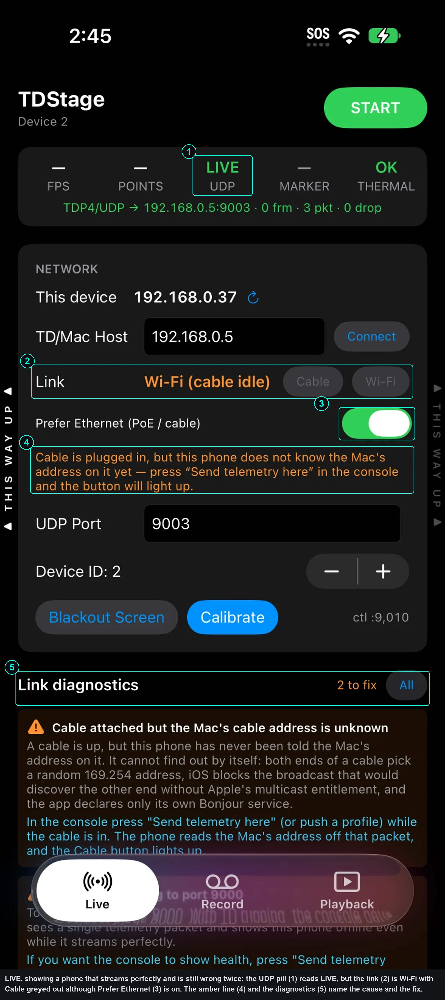
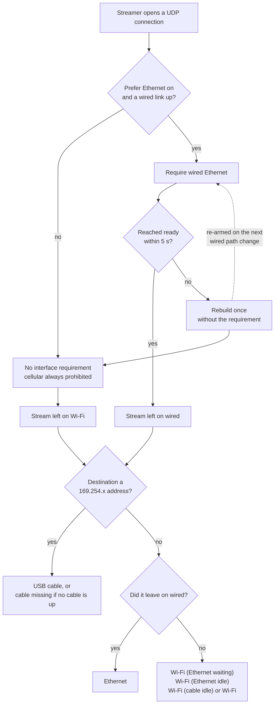
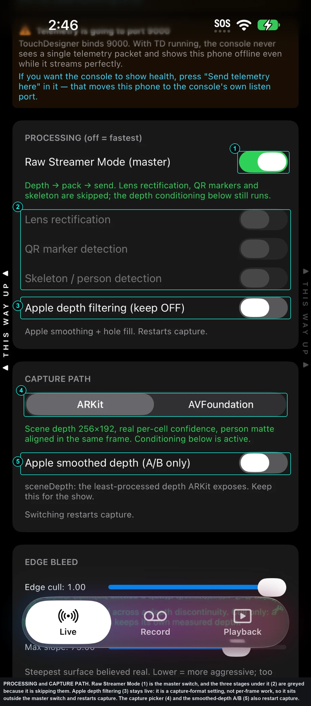
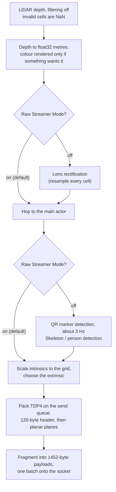

# The LIVE page

LIVE is the page you use when you mount a phone and when you need to know why
a phone is not reaching the receiver. It shows what the phone is sending, where
it is sending it, and what is wrong with the link.



The phone above is a useful example rather than a healthy one. It is streaming,
the UDP pill (1) reads LIVE, and the thermal state is fine. But **Link** (2)
reads `Wi-Fi (cable idle)` in amber with the Cable button greyed out, even
though **Prefer Ethernet** (3) is on. The amber line (4) and the diagnostics
(5) say why: a cable is plugged in and the phone has never been told the Mac's
address on it. Two problems to fix, neither of which stops the stream, and both
of which cost latency or health reporting.

The numbers are drawn on the screenshot rather than listed beside it, so the
pairing survives being printed, pasted into a call sheet, or read on a phone
where the caption has wrapped somewhere else.


The app has three pages. A glass pill at the bottom of the screen switches
between LIVE, RECORD and PLAYBACK. The pill carries a coloured dot: red while a
take is recording, green while a take is replaying, orange while a start is
armed. Nothing else on the pill changes, so the three shapes stay in the same
places in the dark.

Everything on this page is UDP. There is no TCP mode and no TCP fallback.

{: .note }
The field labelled **TD/Mac Host** is stored under the UserDefaults key
`stage.tcpHost`. That key name is historical. It holds the **destination IP
address** and says nothing about transport. The TCP streamer was deleted from
the app.

---

## The header: START and STOP

Top left shows the app name and `Device <n>`, the device id this phone stamps
into every packet.

Top right is one button:

| Button reads | Phone state | Pressing it |
|---|---|---|
| START (green) | idle | Starts LiDAR capture and the point stream |
| STOP (red) | streaming | Stops the point stream. The socket stays up |
| START (grey) | device id never set | Refused. See below |

STOP stops the point flow only. The UDP socket stays open and the phone keeps
sending its hello every two seconds, so a receiver still sees the phone on its
roster. Telemetry keeps running.

The screen does not auto-lock while the app is in the foreground, whether the
phone is streaming or stopped. A locked phone cannot hear remote commands, so
the app holds the idle timer off from launch.

### The red "Set a unique Device ID" banner

A fresh install carries device id 1 and a flag saying nobody has chosen it.
While that flag is unset and the id is still 1, START is refused and a red
banner appears above the stats. Two phones on one id overwrite each other's
frames.

Three things clear it, and any of them counts even if the number does not
change:

- the **Device ID** stepper further down this page,
- the banner's own **This is phone 1** button,
- a device id pushed from the console.

The refusal also goes out as telemetry, so a console operator who pressed Start
sees the reason rather than silence.

#### Why this is a refusal and not a warning

The device id is in the 20-byte packet header of every datagram, and a receiver
reassembles fragments per `(deviceId, frameId)`. Two phones sharing an id do
not produce two streams that a receiver can tell apart and discard one of. They
produce one stream whose packets interleave, so frames are assembled from two
phones' halves: the symptom is a cloud that delivers almost nothing, or
delivers geometry that cannot exist. It is the one misconfiguration on the
phone that looks like a hardware fault, and it costs a get-in slot to find.

The flag is separate from the number precisely so that "phone 1" is reachable.
The guard is not "the id must not be 1", it is "a person must have chosen",
which is why pressing the banner's own button clears it without changing
anything.

---

## The stats row

Five figures across the top, refreshed twice a second. They are health, not
signal: the app deliberately does not update them per frame.

That is a correctness rule rather than a taste. The counters live under a lock
in the streamer and are mirrored into observable state on a 2 Hz tick, never on
the frame path. `pkt` changes thirty-odd times a second; publishing it from the
frame path would invalidate the view on every frame and put SwiftUI layout
behind the capture callback. The frame path's only jobs are to pack and to
hand off. Reading them is also one lock acquisition rather than four, because
the whole snapshot comes back as a single struct.

| Stat | Reads | Notes |
|---|---|---|
| FPS | Measured delivery rate | Blank when nothing is streaming. During a replay it is the replay's rate |
| POINTS | Valid depth cells in the last frame sent, in thousands | Counted by the packer. Not the grid size |
| UDP | OFF, CONNECTING or LIVE | Local socket state only. See the caveat below |
| MARKER | Last marker id seen, or blank | Green while a marker is in view |
| THERMAL | OK, WARM, HOT or CRIT | The device thermal state |

{: .warning }
**UDP LIVE does not mean anything is arriving.** A UDP socket reaches ready
with no receiver in existence, because there is no handshake to fail. It proves
a local socket was created. Only the console or TouchDesigner can confirm
frames are being received.

Under the stats row, one line describes the stream itself:

```
TDP4/UDP → 192.168.1.10:9003 · 320×240 · 41203 frm · 128744 pkt · 0 drop
```

The grid size appears once the first captured frame has revealed it. Nothing in
the app hardcodes it: the dimensions are read off the pixel buffer the capture
format actually delivers, which is why this line is blank until the first
frame.

`drop` counts frames the phone abandoned because a newer frame arrived while
the older one was still on the socket. Latest wins, by design, and it is one
slot rather than a queue: the capture callback deposits into a single mailbox,
the send queue drains it, and a deposit onto an occupied slot overwrites it and
increments this counter. On a link that cannot keep up, the phone sends fewer,
newer frames instead of a growing backlog of stale ones. A rising `drop` with a
healthy FPS means the socket is the bottleneck, not the camera.

The same mailbox carries replayed frames, which is why a replay inherits
latest-wins, the frame-id counter and every error path without a second send
path that could drift from this one.

{: .note }
**POINTS is a count, not a payload.** The phone never puts xyz on the wire. It
sends the organised depth grid, and the receiver regenerates points on the GPU
from `depth x ray(u, v)` using the intrinsics in each frame's own header.
Unprojecting on the phone would cost about 7.5 times the bandwidth, 1.4 Gbit/s
across eight phones, to send a receiver data it already has. The count is free
because the packer decides each cell's validity as it writes it, so no extra
pass over the grid is needed to produce this figure.

If the app has an error to report, it appears in red at the bottom of this card.

### How a dead receiver does show up

There is one place where the phone can learn it is shouting into nothing, and
the app now reads it. When a connected UDP socket sends to a port with no
listener, the far host answers with an ICMP port-unreachable, and that arrives
as an error on the **send completion** of a datagram, nowhere else. Every send
completion's error used to be discarded by name, which is exactly how a phone
sits behind a green pill while not one datagram is being delivered. The last
error is kept and translated into something an operator can act on, and the
diagnostics below raise it as **Transport errors**:

| What the socket reported | What the app says |
|---|---|
| `ECONNREFUSED` | Nothing is listening at that address and port |
| `EHOSTUNREACH` | No route to that address: wrong subnet, or the link is down |
| `ENETUNREACH` | This device has no usable interface |
| `EMSGSIZE` | Datagram too large for the link MTU |
| a DNS failure | Name lookup failed: use a numeric IP, not a name |

An error count of zero is still not proof of delivery. A receiver that is
listening but wedged, or a switch that is dropping, answers nothing at all.

---

## Mount captions

A thin `▲ THIS WAY UP ▲` caption runs along each long edge of the screen. The
interface is portrait locked, but phones are usually mounted rotated 90 degrees,
because the depth sensor's wide axis runs along the phone's long side.

Tap the caption on the edge that is pointing at the sky. It goes white. Tap it
again to clear it, and both captions go dim, which means automatic.

The selection is only consulted when gravity cannot decide, which happens when
the camera stares straight down or straight up. Real gravity stays
authoritative everywhere else. The declared edge also rides the hello and the
telemetry, so a receiver knows what the operator declared.

---

## NETWORK

### This device

The phone's own LAN address, with a refresh button. Read it out when a console
operator asks for it. Tap and hold to copy.

### TD/Mac Host

The destination IP address for the depth stream, the telemetry and the control
replies. Type four numbers separated by dots.

{: .note }
**Use the numeric address.** The app's own diagnostic text says names are not
resolved here, and the code is more permissive than that: both the depth
connection and the telemetry client hand this string to `NWEndpoint.Host`,
which accepts a hostname, and the streamer carries an error branch for a failed
lookup. What a non-numeric host actually costs is the rest of the panel. The
field only files a **complete dotted quad** into the Cable and Wi-Fi memories,
so a name is never remembered for those buttons, and the diagnostics raise
"Destination is not a valid address" against it. Where the comment and the code
disagree, the code wins: a name may resolve, but nothing else on this page will
work properly with one.

While the field has focus the button beside it reads **Done**. Otherwise it
reads **Connect**. Either one pushes the edited address into the live streamer.

The field writes on every keystroke, so a half typed address is normal while
you are typing. Only complete addresses are remembered for the Cable and Wi-Fi
buttons.

### Link

A read-only label saying which interface the depth stream is actually using,
followed by two buttons.

The label is the end of a decision that starts when the streamer opens its
socket. Two independent facts decide it: which interface the connection
actually left on, and whether the destination is a cable address.



The branch that catches people is the five-second one. It is described under
[Prefer Ethernet](#prefer-ethernet-poe--cable) below, and it is the reason a
cabled phone can read Wi-Fi with the cable still in.

| Label | Meaning |
|---|---|
| USB cable | The destination is a `169.254.x` address and a cable is attached |
| cable missing | The destination is a cable address and no cable is attached. Nothing can leave |
| Ethernet | The stream left on a wired interface, which is what a PoE rig wants |
| Wi-Fi (Ethernet waiting) | Wired is up and preferred, but the stream is on Wi-Fi |
| Wi-Fi (Ethernet idle) | Wired is up but not preferred |
| Wi-Fi (cable idle) | A cable is attached but the stream is on Wi-Fi |
| Wi-Fi | Wi-Fi, no wired interface |

**Cable** and **Wi-Fi** switch the destination between the last complete cable
address and the last complete network address, so an operator does not retype
an address at a get-in. Each button is disabled when there is nothing to switch
to.

The phone cannot work out the computer's cable address by itself. Both ends of
a USB-C link pick a random `169.254.x` address, and iOS blocks the broadcast
that would discover the other end. The phone learns the address from the source
of the first control packet it receives, which is why the console has to send
to it once before the Cable button lights up.

A caption under the buttons explains any disabled state, rather than leaving a
dead button with no reason.

### Prefer Ethernet (PoE / cable)

On by default. While it is on and a wired interface is up, every outgoing UDP
connection is built with `requiredInterfaceType = .wiredEthernet`, so iOS
cannot route the depth stream over Wi-Fi even though both interfaces sit on the
same LAN with equally good routes. Cellular is prohibited on every connection,
wired or not, so show traffic never leaves over a mobile network.

The requirement is deliberately not inferred from the address. A USB cable to a
computer is link-local at both ends and is wired, so judging by address would
get the cable case wrong. The only arbiter is whether the connection comes up.

#### The five-second grace, and why it exists

A requirement that cannot be satisfied does not fail. It waits. An adapter that
is *up* but routes nowhere (link-local only, the wrong VLAN, a receiver that
lives on the Wi-Fi subnet) leaves the connection parked in `waiting` for the
whole session, and the phone cannot be rescued from the console either, because
its telemetry leaves under the same requirement. The one command that would fix
it, `stage.preferWired 0`, cannot reach the phone that needs it.

So the requirement is provisional. A wired-required connection that has not
reached ready within five seconds is rebuilt **once** without the requirement
and goes out over whatever routes. The streamer records that it fell back, in a
link note reading `wifi (wired adapter not routing)`, and re-arms the
requirement on the next wired path change: unplug and replug the adapter, or
lose and regain the switch port, and the phone tries the wire again by itself.

{: .warning }
**A cabled phone can be streaming over Wi-Fi with the cable still in.** The
grace does not wait for the wired link to drop; an adapter that is up but not
routing is enough, and five seconds is short enough that it will already have
happened by the time anyone looks. The LIVE page then reads **Wi-Fi (Ethernet
waiting)** in amber, and telemetry reports `link = "wifi"` with `wiredUp = 1`
and `preferWired = 1`. Those three together are the signature: the phone asked
for the wire, the wire's link is up, and the stream is not on it, so what is
missing is routing rather than a cable. Do not read it as a failed cable, and
do not go hunting for an unplugged adapter. (`link = "wifi"` with
`wiredUp = 1` and `preferWired = 0` is a different thing entirely: nobody
asked for the wire.)

What to do about it is a routing question, not a phone question: check which
subnet the adapter got an address on, and whether the receiver is reachable on
it. The phone will take the wire the moment the link bounces.

Wi-Fi costs roughly 8 ms and adds jitter against roughly 0.55 ms on a cable
(**measured, real phone (one phone)**). Leave this on for a cabled rig. The
grace is a floor under a mistake, not a reason to stop caring which link is
carrying the show.

{: .note }
Link selection is being revised in the source to add an explicit Link picker
(automatic, Ethernet, cable, Wi-Fi) so an operator can pin a named interface
rather than relying on the preference alone. The five-second grace survives
that change. The page above describes the current build; the authority is
`TDStage/Net/WiredLink.swift`.

### UDP Port

The destination port for the depth stream. Default 9003.

### Device ID

A stepper, 1 to 9. The id is stamped into every packet and into the telemetry
namespace, so it must be unique across the rig. Stepping it counts as a
deliberate set and clears the fresh-install guard.

Changing it re-points the stream, the hello and the telemetry together.

### Blackout, Calibrate, and the control port

Three controls on one row.

- **Blackout Screen** sets the screen brightness to zero and hides the status
  bar. The page itself is not drawn at all while blacked out, so it stops
  consuming power on a screen nobody can see. A tiny dot in the top right
  corner stays lit, and the recorder's colour wins over the socket's: red while
  recording, green while replaying, orange while a start is armed, and
  otherwise green when the socket is up and red when it is not. Triple-tap
  anywhere to wake the screen.
  **Wake Screen** restores the previous brightness.
- **Calibrate** swaps the rear LiDAR from the capture path to ARKit marker
  tracking. The two cannot share the sensor, so this is a hard swap: the point
  stream stops. Pressing **Stop Calibrate** stores the solved pose and resumes
  streaming if the phone was streaming before **or** if auto-resume is set
  (`stage.showActive`, which START sets and STOP clears). Auto-resume is not
  cleared by a replay, so a phone that was streaming, then replayed a take,
  then went to calibrate, still comes back streaming. While calibrating, a line
  below reports the translation jitter in metres and how many markers have been
  seen. When a stored calibration exists, the line reads
  `Stage extrinsic locked`.
- `ctl :9010` is the port the phone listens on for remote commands. It is not
  editable here.

Marker calibration works end to end in the code and has unit tests. It has not
been confirmed on a phone against a printed marker (**built, not verified**).

#### What the phone sends when it is not calibrated

The phone always stamps a pose into every frame. Without a marker calibration
that pose is the gravity levelling rotation, so the cloud arrives level at any
mounting angle. The "calibrated" bit in the frame stays false. Receivers apply
the pose as given either way.

---

## Link diagnostics

Every problem with the link, worst first, each with the evidence and a concrete
next action. Problems are always visible. The healthy checks are hidden behind
the **All** button, because a screen of green ticks is how a real fault gets
missed. The header says `all clear` or `N to fix`.

The findings the app can raise:

| Finding | Level | Raised when |
|---|---|---|
| No network interface | error | No usable IPv4 interface at all |
| No destination set | error | The host field is empty |
| Destination is not a valid address | error | The host field is not a dotted quad |
| Pointed at a cable address with no cable | error | Destination is `169.254.x` and no cable interface is up |
| Cable address looks stale | error | Sending to a cable address is producing errors |
| Transport errors (n) | error | The socket reported send errors |
| Not listening for commands | error | The control listener is down |
| No USB cable | warn | Wi-Fi only |
| Cable attached but the Mac's cable address is unknown | warn | A cable is up and the phone has never been told the far address |
| Streaming over Wi-Fi with a cable attached | warn | A cable address is known and unused |
| No commands received yet | warn | Nothing has ever sent to the control port |
| Telemetry is going to port 9000 | warn | See below |
| Telemetry and depth point at different hosts | warn | Deliberate when the hub and the console are different machines |
| USB cable attached | ok | |
| Sending n frames, no errors | ok | With the UDP caveat stated in the detail |
| Last command from a.b.c.d | ok | This is how the phone learned where the console is |

{: .note }
**The port 9000 warning matters.** TouchDesigner binds 9000. With the hub
running, a console listening elsewhere never sees a telemetry packet and shows
the phone offline while it streams perfectly. The console has a button that
moves the phone to the console's own listen port.

A cable address is not stable. The far end re-assigns its `169.254.x` address
whenever the link is re-established, so a remembered cable address goes out of
date on a replug. Re-learn it from the console rather than retyping the old
one.

---

## PROCESSING (off = fastest)



Raw Streamer Mode (1) is the master switch, and the three rows under it (2)
grey out when it is on because they are the things being skipped. **Apple depth
filtering** (3) is not greyed out, because it is not per-frame work: it is a
capture-format setting, outside the master switch, and changing it restarts the
session. So do the capture picker (4) and the smoothed-depth A/B (5), which is
why none of the three belongs in a cue.

The phone is a pure streamer. This panel exists so each optional stage can be
switched on for an A/B measurement, not because a show needs any of them.

**Raw Streamer Mode (master)** is on by default. While it is on, the frame path
is acquire depth, pack, send, and the three toggles below it are skipped
whatever they say. They are greyed out to make that visible rather than
silently ignored. The caption under the switch says which state you are in.

It is one boolean read on the frame path, in two places: once in the capture
renderer, before lens rectification, and once in the controller, before the
marker and pose detectors. That is why it can be switched mid-stream with no
restart, and why its cost when on is nil rather than small.



Three things sit outside the master switch and run either way. Apple depth
filtering, because it is a capture format rather than a stage. The choice of
extrinsic, because every frame must carry a pose. And the colour render, which
is gated on its own question: it happens when the RGB plane is genuinely on the
wire, or, with raw mode off, when the marker detector or the pose detector
needs an image. Raw mode therefore also removes the colour render on a
depth-only rig, which is the single largest saving in the panel.

| Toggle | Default | What it does |
|---|---|---|
| Raw Streamer Mode (master) | On | Skips every optional per-frame stage below |
| Lens rectification | Off | Resamples the depth grid to the ideal pinhole model of the header intrinsics. The receiver does this better |
| QR marker detection | Off | Runs the on-phone marker detector at about 3 Hz. Forces a colour render at its own cadence, so it is never free |
| Skeleton / person detection | Off | Runs the on-phone pose detector. Its results have no wire: this is a cost measurement only |
| Apple depth filtering (keep OFF) | Off | Apple's temporal and spatial depth smoothing with hole fill |

All four of the first group apply live, with no capture restart.

**Apple depth filtering** is not covered by the master switch, because it is a
capture-format setting rather than per-frame work. Changing it restarts the
capture session. Leave it off: the show path wants raw depth, where an invalid
cell is NaN rather than an invented value.

Performer separation happens on the receiver, using the angles between several
phones. No on-device API can do it: one body per device, and world tracking
needs camera motion.

---

## CAPTURE

One toggle.

**Colour** is on by default. It controls whether a colour grid is built at all.
The RGB plane only rides the wire when **Colour** is on *and* the plane set on
the RECORD page includes `+rgb`. With Colour off, the RGB plane is dropped even
if the plane set asks for it.

The capture rate and the plane set live on the RECORD page, because what the
phone sends is also exactly what a take records.

{: .note }
**Colour and confidence are separate planes for a reason.** Confidence says
which cells to believe; colour says what the camera saw. They have different
costs (one byte a cell against three), different consumers, and different
lifetimes, so the wire gives each its own bit in the plane mask and the
receiver takes whichever it was sent. On this app the confidence plane is
*derived*: the capture path has no confidence buffer to offer, so the packer
writes 2 where the depth cell is finite and positive, and 0 where it is not.
It therefore carries nothing the depth plane does not already carry as NaN. The
ARKit sibling supplies a real per-cell confidence, and the same plane then
means what its name says. Worth knowing before costing `depth+conf` at 1.5x
`depth` on this app.
