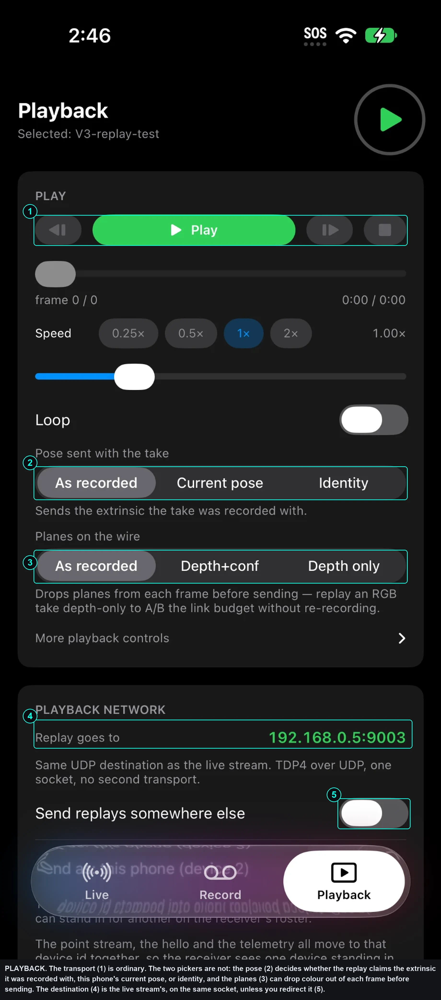
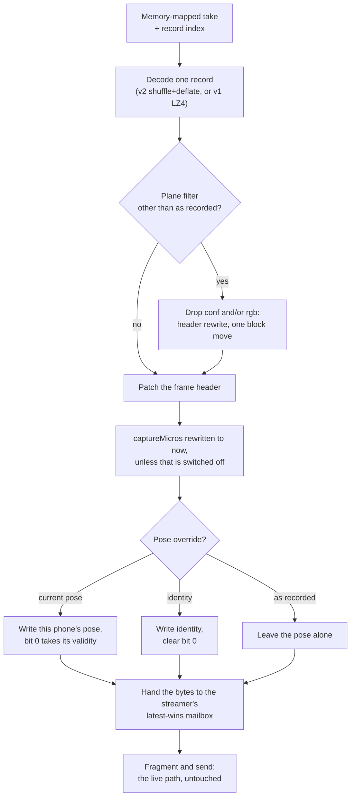

# The PLAYBACK page

PLAYBACK is the library and the transport. It lists every take on the phone
with its provenance, and controls everything about what goes down the wire when
one is replayed.

The two **As recorded** pickers are what make a take useful beyond watching it
again. Pose decides whether the replay claims the extrinsic it was recorded
with, the phone's current pose, or identity. Planes can drop the colour plane
out of each frame before sending, so a take recorded with colour can be
replayed depth-only to compare link budgets without recording anything new.

A replay re-enters the streamer one step after the packer, so a receiver cannot
tell it from a live phone except by two fields in the hello. That is why the
details on this page matter: what you are about to send is whatever the take was
recorded with, unless you change it here.

Every override on this page is applied to the frame body in memory, before the
bytes reach the streamer. Nothing downstream of that point knows a replay is
happening.

Three details in that path are worth knowing before changing anything in it.

**The frame id is not in the frame.** It lives in the 20-byte packet header, so
a replayed frame takes a fresh id from the same counter a live frame would, and
a receiver's reassembly keys never collide with the take's history.

**The header patch touches bit 0 of the frame flags and nothing else.** Bits 1
to 4 are the ARKit sibling's depth-conditioning flags. They ride through this
app untouched, which is what lets a take made in either app replay through the
other verbatim.

**The plane filter is a rewrite, not a repack.** Planes are contiguous and
ordered in the frame, so dropping colour is a new plane mask plus at most one
block move. Depth is never dropped: the mask is ANDed with the filter and then
ORed with bit 0.

**An unreadable record is skipped, never guessed at.** A corrupt record, or one
written by a codec this build does not know, is passed over and the schedule
moves on. A file whose format version is above the build's is refused up front
instead, so there is no half-played take.

While a take replays, the camera is off. The LiDAR must not compete with the
replay for thermal headroom, and a phone that captured and replayed at once
would be sending two clouds down one socket: the mailbox holds one frame, so
the two would simply overwrite each other and the receiver would get an
interleaving of a take and a camera under one device id.

Stopping the camera for a replay deliberately does **not** clear the auto-resume
flag (`stage.showActive`). A phone that dies mid-replay should come back
streaming, because that flag means "this phone's job is to stream", not "this
phone is streaming right now".

---

## The header

Top right is a round button: green play, or red stop while a replay is running.
It is disabled when no take is selected and while a take is recording.

The line under the title reads the state: `No takes on this phone` on an empty
library, `Choose a take below` once there are takes but none is selected,
`Selected: <name>`, `ARMED · 5s`, `Importing…`, `REPLAYING · <name>`,
`PAUSED · <name>`, or `Recording — stop it before replaying`.

When nothing is playing, the outcome of the last import, armed start or refused
action is shown in a panel under the header.

---

## Now playing

Five figures while a replay runs.

| Stat | Reads |
|---|---|
| SENT | Frames sent so far this replay |
| FPS | The rate the player is actually pushing through the socket |
| LOOPS | Completed loops |
| SPEED | The current speed multiplier |
| DROP | Frames abandoned by the streamer |

Under them, the same wire line the other pages show, ending in the device id
the replay is being sent as. A replay depends on the network exactly as much as
a live stream does. A green socket is still not a reachable receiver.

`DROP` is the streamer's own abandonment counter, not the player's. A replay
shares the live latest-wins mailbox, so a slow link drops replayed frames
exactly as it drops captured ones, and this figure rising means the socket
cannot keep up with the speed you have asked for.

---

## PLAY

This section appears once a take is selected.

### Transport row

Four buttons: step back one frame, play or pause or resume, step forward one
frame, stop. The step and stop buttons only act on a running replay.

### Scrub bar

A frame-accurate slider, with the frame number, the elapsed and total times,
and the loop count. Releasing the slider seeks.

### Speed

Four preset buttons (0.25×, 0.5×, 1×, 2×) and a slider from 0.05× to 4×. The
recorded intervals are scaled by this figure.

Timing follows the recorded intervals, scaled by this figure. A take recorded
at 28 fps replays at 28 fps, and a dropout stays a dropout, because a replay
that silently regularised the stream would hide exactly the faults it exists to
reproduce: a take is the only way to put a known-bad stream back in front of a
receiver and watch what it does with it.

The intervals are differences between consecutive records' recorded capture
timestamps, floored at 1 ms and capped at 5 s, so one bad timestamp cannot park
a replay forever. Those timestamps are on the recording phone's own uptime
clock, which is why they are only ever used as intervals. Each record also
carries a unix wall-clock stamp, written for aligning several phones' takes
after the fact; the player does not schedule from it.

### Loop

On by default, with an optional gap of up to 5000 ms between loops.

### Pose sent with the take

| Option | What is sent |
|---|---|
| As recorded (default) | The pose the take was recorded with |
| Current pose | This phone's pose now. Use this for a take made before the rig was calibrated, replayed on the calibrated rig |
| Identity | No transform. The cloud arrives in raw camera space |

### Planes on the wire

| Option | What is sent |
|---|---|
| As recorded (default) | Every plane in the file |
| Depth+conf | Confidence kept, colour dropped |
| Depth only | Depth alone |

Planes are dropped from each frame before it is sent. Depth is always kept.
This lets an RGB take be replayed depth-only to A/B the link budget without
re-recording.

### More playback controls

A collapsed group.

- **Rewrite timestamps to now.** On by default. The frame clock keeps moving
  forward, so latency meters read sensibly and a loop never steps backwards.
  Off replays the recorded clock verbatim, which is only useful for offline
  analysis: a receiver that judges latency will see a take-aged stream.
- **Trim.** Three buttons: *Set in here*, *Set out here*, *Clear*. "Here" is
  the frame now playing. The same code runs for the buttons and for the remote
  verb, so they cannot disagree about what "here" means.
- **Pre-roll.** A countdown of up to 30 seconds before the replay starts. This
  is the same setting the RECORD page uses.
- **Restart live capture when playback stops.** Off by default.

Every control in this section applies to a running replay on its next frame.
Nothing restarts.

---

## PLAYBACK NETWORK

A replay goes down the same socket, over UDP, to the same destination as the
live stream. That identity is the whole point of replaying from the phone
rather than from a computer. This panel exists so you can see it is true, and
override it deliberately without touching the live configuration a show depends
on.

| Row | What it shows |
|---|---|
| Replay goes to | The destination in use. Green when it matches the live stream, orange when overridden |
| Send replays somewhere else | Off by default. Turns the override on |
| Host | Only shown when the override is on. Blank follows the live host |
| Port | Only shown when the override is on. Default 9003 |
| Send as | This phone's device id, or another id from 0 to 9 |

**Send as** stamps a different device id into every replayed packet, so one
phone can stand in for another on a receiver's roster. The point stream, the
hello and the telemetry all move to that id together, so the receiver sees one
device standing in rather than two halves. This is how a bench of two phones
exercises an eight-stream receiver: each plays a take under a different
stand-in id, and the receiver's roster, reassembly and per-device tables all
behave as if the missing phones were there.

{: .warning }
Two sources sending under one id collide in the receiver's reassembler exactly
as two phones on one id would. If a stand-in id belongs to a phone that is also
streaming, the result is not two streams but one broken one.

The telemetry destination and the control listener are not affected by this
panel. Only where the replayed depth goes.

When a replay stops, the socket is put back on the live destination. The live
stream never inherits a test receiver's address.

---

## TAKES

The library. A header shows the take count, a sort picker (Newest, Longest,
Largest), a refresh button, and **Import**.

Under the header: total size on disk, total recorded duration, free space; and
a reminder that a take is one self-describing file that imports onto any other
phone and plays as if it were recorded there.

### A take's row

Each row shows an icon, the name, the duration, the date, and a one-line
summary: grid, planes, frame count, measured fps, size, codec, plus `imported`
and `recovered` where they apply. Typed notes appear in italics underneath.

The icon is a waveform while that take is the one replaying, a stack otherwise,
and a warning triangle when the take was never cleanly closed.

Tap a row to select it. Tap again to deselect. A selected row shows its
actions:

| Action | Notes |
|---|---|
| Play | Disabled while a take is recording |
| Info | Expands the details block below |
| Export | The iOS share sheet. Disabled while that take is being written |
| Rename | Asks for a name. Refused while the take is in use |
| Delete | Asks for confirmation, and says the size and duration first. Cannot be undone |

Export, Rename and Delete are all disabled for the take currently being
written, and while an import is running.

### The details block

What makes a take usable a month later: which phone, which pose, which grid,
what it was pointed at.

| Row | Reads |
|---|---|
| Device | The recording phone's device id |
| Phone | The hardware model identifier |
| App / OS | Which app and which iOS version recorded it |
| Pose at record | `identity`, `gravity` or `marker` |
| Nominal rate | The capture rate that was configured |
| Recorded | Present only on a decimated take: 1 frame in N |
| Codec | `shuffle+deflate`, `lz4` or `raw` |
| Bytes / frame | The honest measure of what compression achieved on this content |
| Dropped writing | Present only when frames were dropped |
| Origin | `recorded on this phone` or `imported` |
| Sent to | The destination address and port at record time |
| Closed | `cleanly`, or `no footer — recovered by scan` |
| File | The file name on disk |

The fields are selectable, so they can be copied into a session note.

### Empty library

The page says so, and explains that a `.tdp4rec` from Files, AirDrop or Mail
opens straight into the app, whichever phone and whichever of the two apps
recorded it.

---

## Import

**Import** opens a file picker that accepts the take type and, deliberately,
any data file, because a take that arrived by a route which lost its type
label can still be picked: the import validates the bytes, not the label.

A take arriving from outside the app switches the phone to this page on its
own, because this is where the outcome is reported and where the take can be
played.

Import and export are described in full on
[the RECORD page](record.html#export-and-import).

---

## What a receiver sees during a replay

Everything a live phone sends, with two differences:

- the hello JSON carries `source: playback` and the take's name,
- the telemetry reports `playback` rather than `live` for its source.

Nothing else changes. Same destination port, same packet layout, same
fragmentation, same latest-wins. The telemetry namespace, the stream
description, the plane mask and the grid size all describe the replay rather
than the camera that is switched off.
