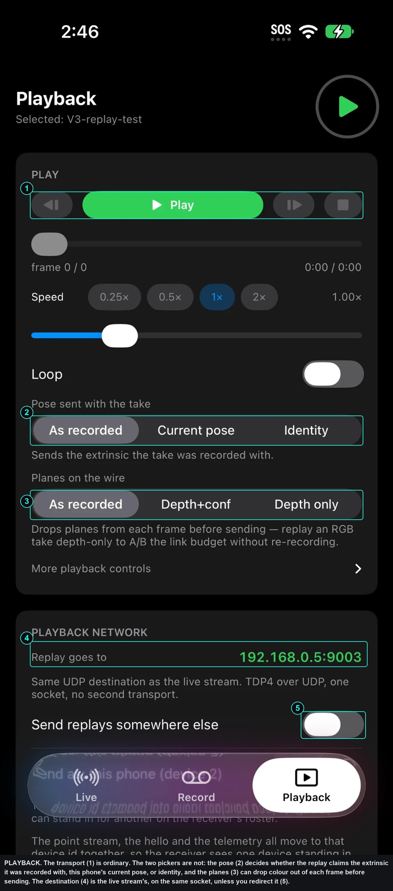
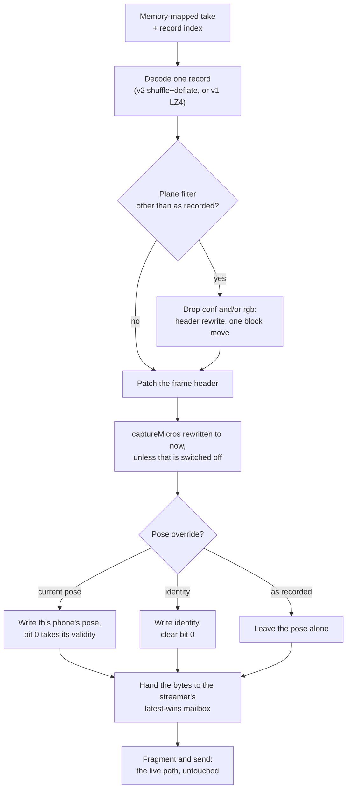

# The PLAYBACK page

PLAYBACK is the library and the transport. It lists every take on the phone
with its provenance, and controls everything about what goes down the wire when
one is replayed.

The transport (1) behaves as you would expect. The two **As recorded** pickers
are what make a take useful beyond watching it again. Pose (2) decides whether
the replay claims the extrinsic it was recorded with, the phone's current pose,
or identity. Planes (3) can drop the colour plane out of each frame before
sending, so a take recorded with colour can be replayed depth-only to compare
link budgets without recording anything new. The replay leaves by the live
stream's own destination (4) unless you redirect it (5).

A replay re-enters the streamer one step after the packer, so a receiver cannot
tell it from a live phone except by two fields in the hello. That is why the
details on this page matter. What you send is whatever the take was recorded
with, unless you change it here.

The player applies every override on this page to the frame body in memory,
before the bytes reach the streamer. Nothing downstream of that point knows a
replay is happening.

Four details in that path govern what you can safely change.

**The frame id is not in the frame.** It lives in the 20-byte packet header, so
a replayed frame takes a fresh id from the same counter a live frame would, and
a receiver's reassembly keys never collide with the take's history.

**The header patch touches bit 0 of the frame flags and nothing else.** Bits 1
to 4 are the ARKit sibling's depth-conditioning flags. They ride through this
app untouched, which is what lets a take made in either app replay through the
other verbatim.

**The plane filter rewrites the frame rather than repacking it.**
Planes are contiguous and ordered in the frame, so dropping colour is a new
plane mask plus at most one block move. Depth is never dropped: the player ANDs
the mask with the filter and then ORs it with bit 0.

**The player skips an unreadable record rather than guessing at it.** A corrupt
record, or one written by a codec this build does not know, is passed over and
the schedule moves on. A file whose format version is above the build's is
refused up front instead, so there is no half-played take.

While a take replays, the camera is off. The LiDAR must not compete with the
replay for thermal headroom. A phone that captured and replayed at once would
also be sending two clouds down one socket: the mailbox holds one frame, so the
two would overwrite each other and the receiver would get an interleaving of a
take and a camera under one device id.

Stopping the camera for a replay does **not** clear the auto-resume flag
(`stage.showActive`), and that is by design. A phone that dies mid-replay
should come back streaming, because that flag means "this phone's job is to
stream", not "this phone is streaming right now".

A replay can also be ended from the console. `/ctl/start` on a replaying phone
stops the replay and brings the camera back, `/ctl/stop` ends it and leaves the
camera off, and `/ctl/calibrate 1` ends it on the way into calibration, closing
any take being recorded as well. None of the three consults the restart toggle
below: each decides for itself whether the camera comes back. The verbs are on
[the /ctl page](ctl.html#lifecycle-and-display), with what calibration does on
the way out under [calibration](ctl.html#calibration).

---

## The header

Top right is a round button: green play, or red stop while a replay is running.
It is disabled when no take is selected and while a take is recording.

The line under the title reads the state: `No takes on this phone` on an empty
library, `Choose a take below` once there are takes but none is selected,
`Selected: <name>`, `ARMED · 5s`, `Importing…`, `REPLAYING · <name>`,
`PAUSED · <name>`, or `Recording — stop it before replaying`.

When nothing is playing, a panel under the header shows the outcome of the last
import, armed start or refused action.

The button is disabled while recording; the remote verb is not. `/ctl/rec/play`
on a recording phone stops the recording first, then starts the replay, so a
console can move a phone from recording to replay in one command. (The Play action
in a take's row is disabled while recording for the same reason as the button.)

While the line reads `ARMED · Ns` there is no cancel control on this page.
Tapping the round button again does not cancel the countdown: it arms again,
which cancels the running countdown and starts a fresh one from the pre-roll.
An armed play is cancelled with `/ctl/rec/cancel`, or from
[the RECORD page](record.html#the-record-button-and-the-status-line), whose
record button cancels any armed start during its countdown.

---

## Now playing

Five figures while a replay runs.

| Stat | Reads |
|---|---|
| SENT | Frames sent so far this replay |
| FPS | The rate the player is actually pushing through the socket |
| LOOPS | Completed loops |
| SPEED | The current speed multiplier |
| DROP | Frames abandoned by the streamer |

Under them, the same wire line the other pages show, ending in the device id
the replay is being sent as. A replay depends on the network exactly as much as
a live stream does. A green socket is still not a reachable receiver.

That line reads the live destination, `stage.tcpHost` and `stage.udpPort`, even
while the playback network override is on. The replay's own destination is the
**Replay goes to** row in PLAYBACK NETWORK.

`DROP` is the streamer's own abandonment counter, not the player's. A replay
shares the live latest-wins mailbox, so a slow link drops replayed frames
exactly as it drops captured ones, and this figure rising means the socket
cannot keep up with the speed you have asked for.

---

## PLAY

This section appears once a take is selected.

Every control in it has a remote form: `rec/play`, `rec/pause`, `rec/stopplay`,
`rec/playat`, `rec/step`, `rec/seek` and `rec/trim`, with `rec/rename` for the
library, and every playback setting sent over `/ctl/set` reaches a replay that
is already running: `stage.rec.netOverride`, `host` and `port` re-point the
socket, and the rest are applied exactly as the on-screen controls apply them.
The phone mirrors the position back at 2 Hz on
`/device/rec/play` as index, total, seconds, duration, loops, paused, in and
out. The verbs are on [the /ctl page](ctl.html#playback) and the telemetry
under [recording and playback](ctl.html#recording-and-playback).

### Transport row

Four buttons: step back one frame, play or pause or resume, step forward one
frame, stop. The step and stop buttons only act on a running replay.

Stepping pauses the replay. The player moves to the neighbouring frame, sends
it once and sends nothing more, so the last frame on the wire is the one you
stepped to until you resume or step again. Pause stops the schedule without
moving; resume continues from the frame it stopped on.

### Scrub bar

A frame-accurate slider, with the frame number, the elapsed and total times,
and, after the first loop, the loop count. Releasing the slider seeks. While
the replay is running, the schedule simply continues from the new frame. While
it is paused, the player sends that one frame, so the receiver shows what you
scrubbed to rather than the frame it was holding.

### Speed

Four preset buttons (0.25×, 0.5×, 1×, 2×) and a slider from 0.05× to 4×. The
recorded intervals are scaled by this figure. A speed set remotely, through
`/ctl/set stage.rec.speed` or the optional speed argument of `/ctl/rec/play`,
is clamped to the same 0.05 to 4.

A take recorded at 28 fps replays at 28 fps, and a dropout stays a dropout. A
replay that silently regularised the stream would hide exactly the faults it
exists to reproduce: a take is the only way to put a known-bad stream back in
front of a receiver and watch what it does with it.

Each interval is the difference between two consecutive records' recorded
capture timestamps, scaled by the speed and then floored at 1 ms and capped at
5 s, so one bad timestamp cannot park a replay forever. Those timestamps are on the recording phone's own
uptime clock, which is why the player only ever uses them as intervals. Each
record also carries a unix wall-clock stamp, written for aligning several
phones' takes after the fact; the player does not schedule from it.

### Loop

On by default, with an optional gap of up to 5000 ms between loops. That is
the stepper's ceiling; `/ctl/set stage.rec.loopGapMs` accepts 0 to 10000 ms
(see [the settings reference](settings.html#playback)).

### Pose sent with the take

| Option | What is sent |
|---|---|
| As recorded (default) | The pose the take was recorded with |
| Current pose | This phone's pose now. Use this for a take made before the rig was calibrated, replayed on the calibrated rig |
| Identity | No transform. The cloud arrives in raw camera space |

### Planes on the wire

| Option | What is sent |
|---|---|
| As recorded (default) | Every plane in the file |
| Depth+conf | Confidence kept, colour dropped |
| Depth only | Depth alone |

The player drops the planes from each frame before sending it. Depth is always
kept. This lets you replay an RGB take depth-only to A/B the link budget
without re-recording.

### More playback controls

A collapsed group.

- **Rewrite timestamps to now.** On by default. The frame clock keeps moving
  forward, so latency meters read sensibly and a loop never steps backwards.
  Switched off, the player replays the recorded clock verbatim. That is only
  useful for offline analysis, since a receiver that judges latency will see a
  take-aged stream.
- **Trim.** Three buttons: *Set in here*, *Set out here*, *Clear*. "Here" is
  the frame now playing. The same code runs for the buttons and for the remote
  verb, so they cannot disagree about what "here" means. Tapping a different
  take clears the trim to the whole take, and so does the end of a recording,
  which selects the new take. Starting a different take by name from the
  console does not: the in and out points carry over, clamped to the new
  take's length.
- **Pre-roll.** A countdown of up to 30 seconds before the replay starts. This
  is the same setting the RECORD page uses.
- **Restart live capture when playback stops.** Off by default.

The timestamp and trim controls, like the speed, loop, pose and plane controls
above them, apply to a running replay on its next frame. Nothing restarts.
Pre-roll applies to the next start, and the restart toggle to the next stop.

---

## PLAYBACK NETWORK

A replay goes down the same socket, over UDP, to the same destination as the
live stream. That identity is the whole point of replaying from the phone
rather than from a computer. This panel exists so you can see it is true, and
override it deliberately without touching the live configuration a show depends
on.

| Row | What it shows |
|---|---|
| Replay goes to | The destination in use. Green when it matches the live stream, orange when overridden |
| Send replays somewhere else | Off by default. Turns the override on |
| Host | Only shown when the override is on. Blank leaves the whole live destination in use, port included |
| Port | Only shown when the override is on. Default 9003 |
| Send as | This phone's device id (0), or a stand-in id from 1 to 9 |

Flipping **Send replays somewhere else** re-points a running replay at once. A
Host or Port you type does not: it takes effect when you tap **Apply**, the
button beside the port field, which also dismisses the keyboard. Both routes
run the same code, which does nothing unless a replay is running, and a replay
that starts later reads the override as it connects. The **Replay goes to** row
follows what you type; the socket follows Apply. A blank host means the
override is not in effect, whatever the toggle says.

**Send as** stamps a different device id into every replayed packet, so one
phone can stand in for another on a receiver's roster. The point stream, the
hello and the telemetry all move to that id together, so the receiver sees one
device standing in rather than two halves. This is how a bench of two phones
exercises an eight-stream receiver. Each plays a take under a different
stand-in id, and the receiver's roster, reassembly and per-device tables all
behave as if the missing phones were there.

{: .warning }
Two sources sending under one id collide in the receiver's reassembler exactly
as two phones on one id would. If a stand-in id belongs to a phone that is also
streaming, the result is one broken stream.

This panel does not touch the telemetry destination or the control listener,
only where the replayed depth goes.

When a replay stops, the player puts the socket back on the live destination.
The live stream never inherits a test receiver's address.

---

## TAKES

The library. A header shows the take count, a sort picker (Newest, Longest,
Largest), a refresh button, and **Import**.

Under the header: total size on disk, total recorded duration, free space; and
a reminder that a take is one self-describing file that imports onto any other
phone and plays as if it were recorded there.

### A take's row

Each row shows an icon, the name, the duration, the date, and a one-line
summary: grid, planes, frame count, measured fps, size, codec, plus `imported`
and `recovered` where they apply. Typed notes appear in italics underneath.

The icon is a waveform while that take is the one replaying, a stack otherwise,
and a warning triangle when the take was never cleanly closed.

Tap a row to select it. Tap again to deselect. A selected row shows its
actions:

| Action | Notes |
|---|---|
| Play | Disabled while a take is recording |
| Info | Expands the details block below |
| Export | The iOS share sheet. Disabled while that take is being written |
| Rename | Asks for a name. Refused while the take is in use |
| Delete | Asks for confirmation, and says the size and duration first. Cannot be undone |

Export, Rename and Delete are all disabled for the take currently being
written, and while an import is running.

### The details block

These rows are what make a take usable a month later: which phone, which pose,
which grid, what it was pointed at.

| Row | Reads |
|---|---|
| Device | The recording phone's device id |
| Phone | The hardware model identifier |
| App / OS | Which app and which iOS version recorded it |
| Pose at record | `identity`, `gravity` or `marker` |
| Nominal rate | The capture rate that was configured |
| Recorded | Present only on a decimated take: 1 frame in N |
| Codec | `shuffle+deflate`, `lz4` or `raw` |
| Bytes / frame | The honest measure of what compression achieved on this content |
| Dropped writing | Present only when frames were dropped |
| Origin | `recorded on this phone` or `imported` |
| Sent to | The destination address and port at record time |
| Closed | `cleanly`, or `no footer — recovered by scan` |
| File | The file name on disk |

The fields are selectable, so they can be copied into a session note.

### Empty library

The page says so, and explains that a `.tdp4rec` from Files, AirDrop or Mail
opens straight into the app, whichever phone and whichever of the two apps
recorded it.

---

## Import

**Import** opens a file picker that accepts the take type and, by design, any
data file. A take that arrived by a route which lost its type label can still
be picked, because the import validates the bytes rather than the label.

A take arriving from outside the app switches the phone to this page on its
own, because this is where the outcome is reported and where the take can be
played.

Import and export are described in full on
[the RECORD page](record.html#export-and-import).

---

## What a receiver sees during a replay

Everything a live phone sends, with two differences:

- the hello JSON carries `source: playback` and the take's name,
- the telemetry reports `playback` rather than `live` for its source.

Nothing else changes. Same destination port, same packet layout, same
fragmentation, same latest-wins. The telemetry namespace, the stream
description, the plane mask and the grid size all describe the replay rather
than the camera that is switched off.

That includes the hello's stream facts. When a replay starts, the phone takes
`w` and `h` from the take's own header, and `planes` becomes the take's planes
ANDed with the plane filter above. So a take recorded at a different grid from
the one this phone is configured to capture announces the take's grid for as
long as it plays, and a console that inspects stream facts sees the take, not
the camera. The camera's grid returns with the next live frame.
