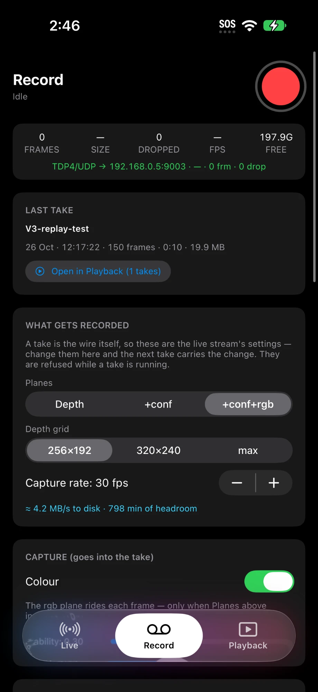
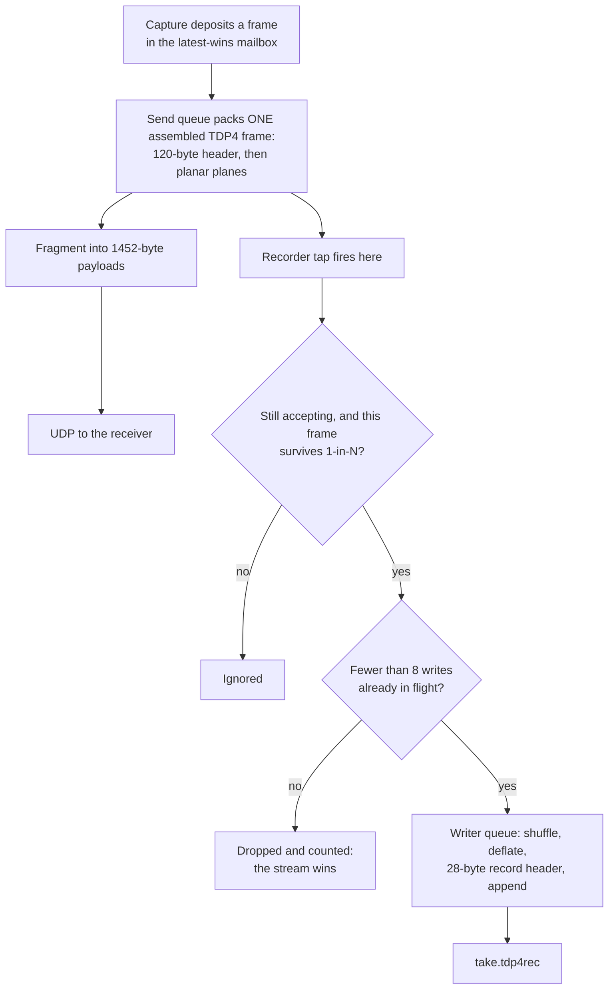
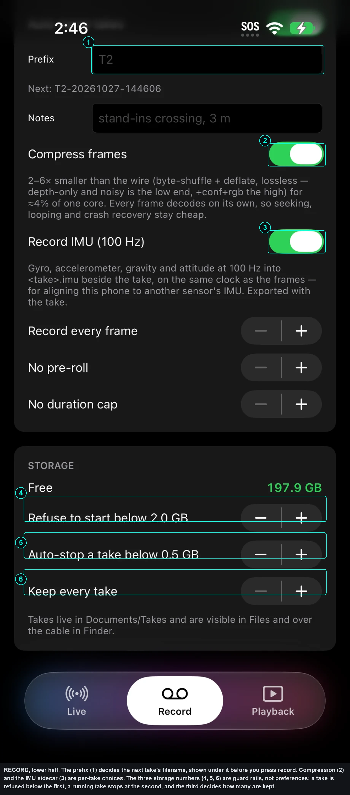

# The RECORD page and takes

RECORD turns the live stream into a file called a take. You set a take up once,
before anyone is on the floor, then press one button.



{: .note }
This screenshot was taken on 2026-10-27, shortly before the **Depth grid**
picker, marked **3**, was removed. It is shown here because the rest of the
page is current; ignore that one row. The reason it went is below.

The blue line (5) is the one to read before a session. It turns the choices
above it into bytes per second and minutes of headroom on the disk actually in
the phone, so a plane you add is immediately priced.

The numbers are drawn on the screenshot rather than listed beside it, so the
pairing survives being printed, pasted into a call sheet, or read on a phone
where the caption has wrapped somewhere else.


## What a take is

A take is the wire itself.

The streamer assembles the complete TDP4 frame, then cuts it into UDP packets.
The recorder taps that assembled frame, one step before the packets. Playback
hands the same bytes back at the same point.



The tap is a closure the streamer holds under the same lock the send queue
reads it with, so arming a recording mid-stream is not a race between the
interface and the packer. It is handed the finished byte array, a Swift array,
so the hand-off is a copy-on-write reference rather than a memcpy of the 148 to
295 kB the frame occupies, and it returns to the send queue immediately. Replayed
frames are deliberately not tapped: a take cannot record itself.

That has three consequences, and they are the reason the recorder was built
this way:

1. There is no second packer. Nothing in the recording path has to be kept in
   step with the wire format, because it *is* the wire format. The alternative
   was a recorder that captured the pixel buffers and packed its own frames, or
   one that captured the datagrams and reassembled them. Both add a second
   implementation of a layout that already has four artifacts to keep bit-exact
   (the phone's packer, the TouchDesigner receiver, the simulator and the
   bench), and both would drift silently: a recorder that writes a format no
   longer on the wire produces files that look fine and replay wrong. Tapping
   the assembled buffer removes the possibility rather than testing for it.
2. A replay is indistinguishable from a live phone to every receiver. Same
   socket, same destination, same fragmentation, same latest-wins policy, same
   hello, same telemetry shape. The differences are two fields in the hello
   JSON, `source: playback` and `take: <name>`, and one telemetry address,
   `/device/source`, reading `playback` instead of `live`. Everything else on
   the wire, down to the frame-id sequence, is produced by the same code.
3. Whatever the phone is sending is exactly what lands in the file. There is no
   separate recording quality to configure.

{: .note }
A receiver must never need to know whether a stream is live or replayed. If a
fix requires a change on the receiver to make playback work, the fix is wrong.

A take is also portable by design. Every frame carries its own grid size,
intrinsics and pose in its own header. The device id on the wire comes from the
phone that *plays* the take. Nothing in the file refers to the recording phone
except as provenance. A take recorded on one phone replays on any other, and
takes are interchangeable between this app and its ARKit sibling.

Files are named `<name>.tdp4rec` and live in `Documents/Takes`, with a `.json`
sidecar beside each one that mirrors the file's own metadata so that listing a
folder of multi-gigabyte takes never opens one. The sidecar is a convenience.
It never travels, and it never needs to: the file is self-describing, and an
import rebuilds the sidecar from the file.

---

## The record button and the status line

Top right is a round record button.

| It shows | Meaning | Pressing it |
|---|---|---|
| A red circle | Ready | Arms or starts a take |
| A dim red circle | Refused: not enough free space | Nothing |
| A number | Counting down a pre-roll | Cancels the armed start |
| A red square | Recording | Stops the take |

The button is disabled while a replay is running. Stop the replay first.

Recording starts the live capture if it is not already running, because you can
only record what is being streamed. If the capture will not start, the reason
appears instead of a silent failure.

The line under the title reads the current state: `Live capture running`,
`ARMED · 5s`, `RECORDING · 1:23 · T2-20261027-141530`, or
`Replaying <name> — stop it to record`.

## The status card

Five figures, refreshed twice a second.

| Stat | Reads |
|---|---|
| FRAMES | Frames written so far |
| SIZE | Bytes on disk so far |
| DROPPED | Frames the writer could not keep up with. Orange when above zero |
| FPS | Measured delivery rate |
| FREE | Free space in GB. Red below the floor |

Under them, a wire line, because a take only exists if the wire does. The tap
sits on the send queue, so a link that is not sending is a recording that is
not being written.

It is the LIVE page's line with the packet count left out:

```
TDP4/UDP → 192.168.1.10:9003 · 320×240 · 41203 frm · 0 drop
```

Host, port, grid, frames and drops. LIVE adds `· N pkt` between the frame and
drop counts; PLAYBACK ends instead with the device id the replay is being sent
as. The three pages read the same counters.

### Dropped frames

The live stream matters more than the recording. If the writer falls behind,
because of a NAND stall, thermal throttling, or a phone that is also pushing
several megabytes a second, frames are dropped and counted rather than queued
without bound. A recorder that backs up into the show is worse than a recorder
with a hole in it.

The mechanism is a bound rather than a timeout. The writer allows at most eight
frames in flight on its own utility queue; a ninth arriving before one of them
has landed is counted and discarded on the spot. Nothing waits, and nothing
grows.

A take with dropped frames is still valid. It has gaps.

The dropped count is written into the file header when the take is stopped, so
it survives export without the sidecar.

### Why Stop keeps two flags

Stopping a take closes the door and finishes the washing up, and those are not
the same instant. The writer holds two booleans: one stops accepting new
frames, the other allows writing at all. A normal Stop clears only the first,
so the frames already on the writer queue are still written, and the finalise
step runs behind them because the queue is FIFO. The take therefore ends
exactly where the operator ended it, rather than one frame short.

Only a hard stop, the disk floor or a write error, clears the second flag as
well, because there the whole point is to stop touching the disk now.

---

## LAST TAKE

A one-line summary of the newest take, with a button that selects it and
switches to the PLAYBACK page. It shows the name, the date, the frame count,
the duration, the size, and `recovered` if the take was never cleanly closed.

---

## WHAT GETS RECORDED

These are the live stream's own settings. Change them here and the next take
carries the change. All of them are refused while a take is running, because a
take is one file with one geometry in its header.

| Control | Options | Default |
|---|---|---|
| Planes | Depth, +conf, +conf+rgb | +conf |
| Capture rate | 5 to 60 fps, in steps of 5 | 30 fps |

Below them, an estimate of the write rate and the headroom in minutes.

### Planes

Depth is always sent: it is bit 0 of the plane mask and the packer sets it
unconditionally. The confidence plane adds one byte per cell and tells the
receiver which cells to trust. The RGB plane adds three bytes per cell.

They are separate planes, and planar rather than interleaved, for three
reasons. Each has its own cost and its own consumer, so the plane mask lets a
rig buy only what its receiver uses. A receiver can upload one plane straight
to the GPU as a texture without a stride walk. And the compressor below sees a
plane of like-valued bytes rather than a repeating six-byte pattern, which is
most of where its ratio comes from.

{: .note }
On this app the confidence plane is **derived, not measured.** The capture path
has no confidence buffer to offer, so the packer writes 2 where the depth cell
is finite and positive and 0 where it is not. It carries nothing the depth
plane does not already carry as NaN. The ARKit sibling supplies a real per-cell
confidence, and there the plane means what its name says. Cost `depth+conf` on
this app knowing that the extra 18 Mbit/s a phone buys a validity mask.

Wire cost per phone, **calculated from the wire format** at 30 fps and the
**320×240** grid an iPhone 17 Pro actually sends:

| Plane set | Bytes per frame | Per phone | Eight phones |
|---|---|---|---|
| depth | 153 720 | 36.9 Mbit/s | 295 Mbit/s |
| depth+conf | 230 520 | 55.3 Mbit/s | 442 Mbit/s |
| depth+conf+rgb | 460 920 | 110.6 Mbit/s | 885 Mbit/s |

Those are payload at the IP layer. Adding what Ethernet charges per packet
makes them 313, 469 and 937 Mbit/s against a 1,000 Mbit/s line, which is the
basis to use for a claim about fitting on a cable.

Either way: eight phones on `depth+conf` is about 47 per cent of a gigabit
link. **Eight phones on `+conf+rgb` is 94 per cent, which is not a show
configuration.**

The receiving software is not what stops you — the bridge has been measured to
114,500 packets per second, and eight colour phones offer 76,300. It is the
cable: 937 Mbit/s of framed traffic on a 1,000 Mbit/s line, with nothing spare
for a burst. Colour is for three phones and for measurement until that is
solved, and the options are open in [#42](https://github.com/AristidesAI/TDStage/issues/42).

{: .note }
**Dropping colour costs more than colour.** The console's person masks and its
hand tracking both read the colour plane, so a depth-and-confidence rig
separates performers by geometry alone and publishes no hands. Tracking
continues either way — the mask stage fails open — but two of the things that
make it good are gone. That is usually the real argument in this decision, not
the megabits.

{: .note }
Figures of 283 and 566 Mbit/s appear in older notes and in the system
repository's `CLAUDE.md`. They are the same arithmetic at **256×192**, which is
what the simulator sends and what everything here was originally computed at.
A real phone sends 1.56 times the cells.

{: .note }
**There is no longer a Depth grid picker.** It was removed on 2026-10-27,
because the format selector in the capture code accepted the target and
deliberately ignored it: the phone captures and sends whatever its own camera
format gives, whatever the picker said. A control that does nothing is worse
than no control, because it gets planned against. The key still exists, is
reported in telemetry and rides in a profile, but it is not a bandwidth or
thermal lever.

What you get instead is the smallest float depth format the camera offers,
which is **320×240 on an iPhone 17 Pro**. It is not 256×192 by rule, and a
mixed rig of models can send more than one grid — every frame carries its own
dimensions, so nothing downstream minds.

### Capture rate

The rate the renderer is asked for. It applies live, with no capture restart.

A thermal ladder can lower it on top of the chosen rate without overwriting the
choice, so the phone returns to the chosen rate by itself once it has cooled.
See [Settings](settings.html) for the ladder's own controls.

---

## CAPTURE (goes into the take) and PROCESSING (goes into the take)

These are the same keys the LIVE page shows, deliberately duplicated so that a
take can be set up without leaving this page. Change one and the other moves
with it. They are refused while a take is running.

Both sections are described in full on [the LIVE page](live.html). The captions
here say what each setting means for the file rather than for the stream.

---

## TAKE SETUP

| Control | Default | What it does |
|---|---|---|
| Auto-name takes | On | Names each take from a prefix and a timestamp |
| Prefix | Empty | Replaces the `T<id>` head. Shown with the next name |
| Name | Empty | Used only when auto-naming is off |
| Notes | Empty | Free text stored inside the take's metadata block |
| Compress frames | On | Byte-shuffle and deflate, per frame, lossless |
| Record every frame / 1 frame in N | Every frame | A decimation, 1 to 10 |
| Pre-roll | None | A countdown of up to 30 seconds before the take arms |
| Duration cap | None | Stop after up to 120 minutes |

An auto-name is `T<device id>-yyyyMMdd-HHmmss`, or `<prefix>-yyyyMMdd-HHmmss`
when a prefix is set. Names are sanitised and capped at 64 characters, and a
clash gets a `-2`, `-3` suffix rather than overwriting.

### Compression

Each frame is compressed on its own. Two lossless steps: the f16 depth plane is
split into all its high bytes followed by all its low bytes, and an RGB plane
into separate R, G and B planes; then the result is deflated. A smooth depth
field has near-constant high bytes, and only the low byte carries the sensor
noise, so the compressor sees long runs where before it saw an alternating
pattern.

Because every frame stands alone, seeking, looping and crash recovery stay
cheap. There is no keyframe, no backward reference and no decoder state, so
jumping to frame 9000 costs one record's decode and a crash costs the last
record rather than the file.

That independence was measured against the obvious alternatives rather than
assumed (**measured, simulation**): LZFSE came within one per cent of deflate
and is Apple-only, which would have made the file unreadable on the
TouchDesigner side; LZMA gained a further 30 per cent at 15 to 35 ms a frame,
which drops frames at 30 fps; a temporal XOR against the previous frame bought
nothing at all over the per-frame shuffle, so per-record independence is free;
and spatial deltas made things worse, because differencing noise adds entropy.
The deflate stream is a raw one, so the Mac-side reader decompresses it with
`zlib.decompress(data, -15)` and no Apple code.

Ratios against the raw wire bytes, **measured, simulation** (synthetic frames
with the shared-world simulator's noise model):

| Content | Raw LZ4 (the old codec) | Shuffle and deflate |
|---|---|---|
| 256×192 depth+conf | 3.07× | 5.05× |
| 320×240 depth only | 2.41× | 3.79× |
| 256×192 depth+conf+rgb | 4.41× | 6.42× |
| Deliberately harsh depth only, 1 cm uniform noise | 1.50× | 1.90× |

Expect 2× on noisy depth-only content and up to 6× on depth+conf+rgb. The floor
is the sensor: noise in the low mantissa bits is incompressible by any lossless
codec.

Encode cost is about 1.4 to 2.8 ms per frame and decode about 0.2 to 0.4 ms
(**measured, Mac, synthetic frames**). Noisy RGB has been seen at about 7 ms per
frame on a Mac, and a phone is slower. Per-frame encode cost on a real phone at
30 fps has not been measured (**not yet verified**).

Turning compression off writes the wire bytes as they are: the biggest files
and no CPU cost. It is the A/B control.

### Decimation

Recording one frame in N makes a long take at a fraction of the size. Playback
honours the recorded intervals, so a decimated take replays at its reduced rate
rather than being sped up.

### Pre-roll and armed starts

A pre-roll is a countdown on this phone. To start several phones together, the
console sends an armed start over the control port instead. See
[the control surface](ctl.html).

An armed start is a shared-second start, not a frame lock. On a LAN the packet
jitter it adds is sub-millisecond, which is far tighter than the tens of
milliseconds that separate two iPhones' notions of now. Frame-locking several
phones is separate, later work.

---

## STORAGE



The three storage numbers (4, 5 and 6) are guard rails rather than
preferences. A take is refused below the first, running takes stop at the
second, and the third decides how many are kept. A phone that fills its disk
mid-session loses the take it is writing, so these are set once and left alone.

The prefix (1) is worth one look before a session rather than after it: the
line under it shows the exact filename the next take will get.


| Control | Default | Range |
|---|---|---|
| Free | read-only | |
| Refuse to start below | 2.0 GB | 0.5 to 32 GB |
| Auto-stop a take below | 0.5 GB | 0.2 to 16 GB |
| Keep only the newest N | Keep every take | 0 to 50 |

The free-space figure is the amount the operating system will actually hand
over, not the raw free blocks.

The app refuses to start a take below the first floor, and stops a running take
by itself at the second. An auto-stop writes its reason into the recorder's
status line, and reports it in telemetry.

`Keep only the newest N` runs after a clean stop, never during one.

Takes live in `Documents/Takes`, which means they are visible in the Files app
and over a cable in Finder.

### Disk cost

Write rate at 320×240 and 30 fps, **calculated from the wire format** and then
divided by the compression ratios above:

| Plane set | Uncompressed | Compressed, best case | Compressed, assume this |
|---|---|---|---|
| depth | 4.6 MB/s | 1.2 MB/s | 2.3 MB/s |
| depth+conf | 6.9 MB/s | 1.4 MB/s | 3.5 MB/s |
| depth+conf+rgb | 13.8 MB/s | 2.2 MB/s | 6.9 MB/s |

The best case uses the simulated ratios above. The column to plan with assumes
only 2×, which is what the harshest synthetic noise produced and therefore the
safer assumption for a real stage.

The headroom figure the app shows assumes the same 2×, deliberately, so that
"about N minutes left" never over-promises. No take has yet been recorded on a
real phone and measured against these figures (**not yet verified**).

---

## If the app dies mid-take

The file is still readable. There is no index to lose: a reader walks the
records by their own length fields from the start of the file, and drops a
truncated final record. That is the entire crash story.

A take closed cleanly carries a footer. A take that was not shows `recovered`
in the library and in its details, and plays normally. At the next launch the
app gives any such take a sidecar so it lists without being opened.

---

## Export and import

### Getting a take off a phone

PLAYBACK page, tap the take, then **Export**. That is the standard iOS share
sheet, so any of these work:

- AirDrop to a computer or another phone. Fastest for multi-gigabyte files.
- Save to Files, then a cloud folder or a drive.
- Mail or Messages, for short takes.
- A cable: Finder, the phone, Files, TDStage, Takes. Drag the `.tdp4rec` out.
  The `.json` beside it is optional.

Export is disabled while that take is being written, because a copy of a file
the writer still holds would be torn.

Send the whole file untouched. Do not zip individual takes, since they are
already compressed, and do not change the extension.

### Getting a take onto a phone

Either:

- **Open it.** Tap a `.tdp4rec` in Files, Mail or AirDrop and choose this app.
- **Import.** PLAYBACK page, **Import**, then pick one or more files.

Both routes land in the same code. It validates the file before copying it,
refuses junk, short-circuits a file that is already in the Takes folder, and
rebuilds the sidecar from the file itself. The copy and the index walk run off
the main thread, because a take can be gigabytes.

The outcome appears as a line of text on the PLAYBACK page, and the last take
imported becomes the selected one, so AirDrop and then Play is two gestures.

Opening several files at once delivers them one at a time. They are folded into
one queue rather than imported concurrently, and the page says how many are
waiting.

Refusals, in the app's own words:

| Message | Meaning |
|---|---|
| could not read the file | The source could not be opened at all |
| not a TDStage take (.tdp4rec) | No valid header |
| the take has no readable frames | A valid header with nothing in it |
| copy failed: … | The destination write failed, for the stated reason |

A take whose format version is newer than the installed build is refused up
front rather than half-played.

Both this app and its ARKit sibling export the take type under one identifier,
`aristides.lintzeris.tdstage.take`, with the same conformances, description and
filename-extension tag. The two declarations are **semantically** identical
rather than byte-identical: the keys appear in a different order in the two
`Info.plist` files, and the ARKit app's list carries a second type,
`aristides.lintzeris.tdstage.imu`, for its IMU sidecar. Neither difference
affects "Open in", which matches on the identifier and the tag. What would
break it is a change to the identifier, the extension tag or the conformances
in one app and not the other.
