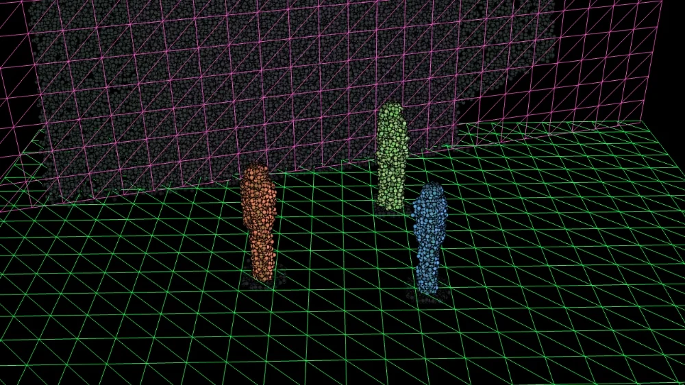
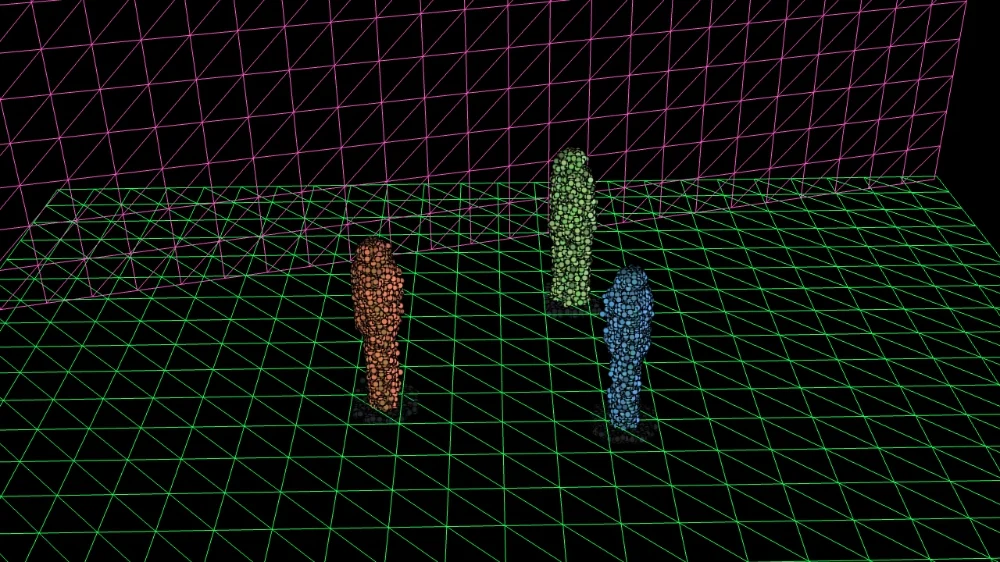
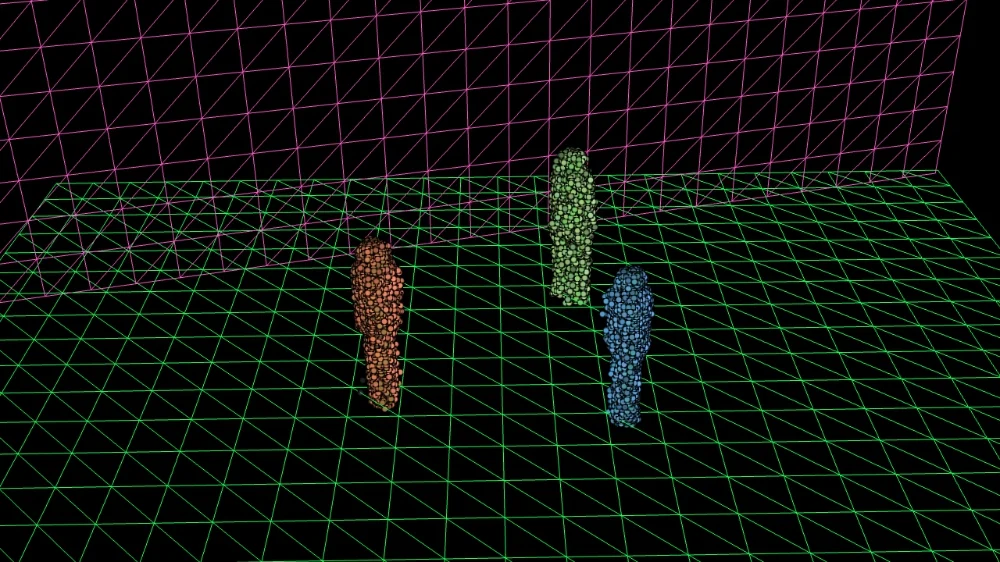
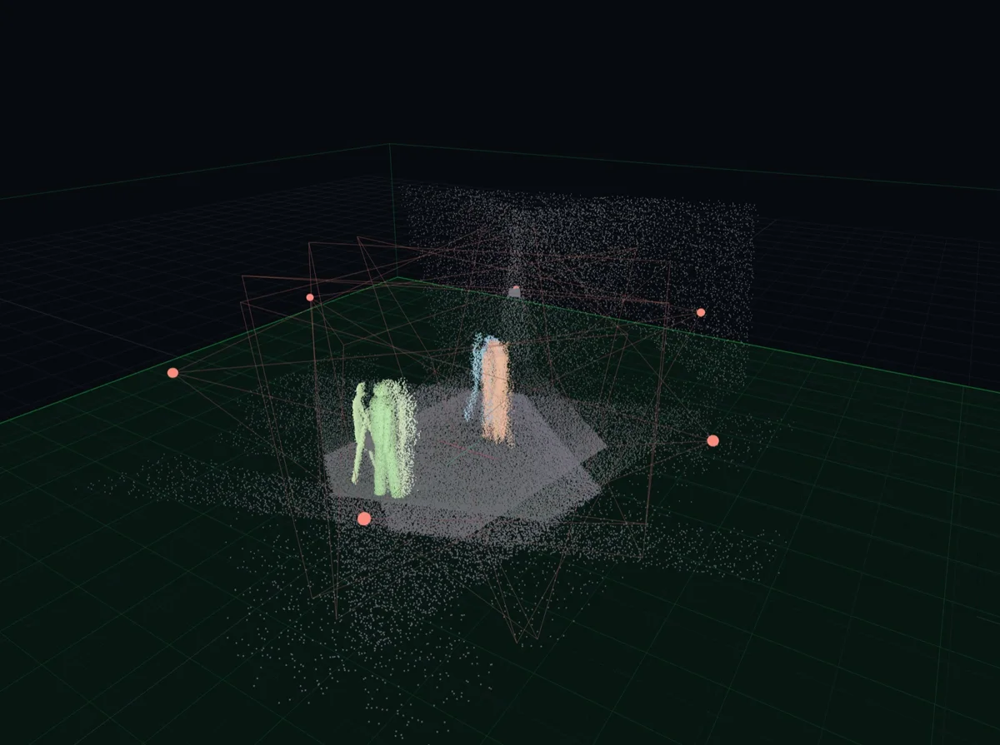
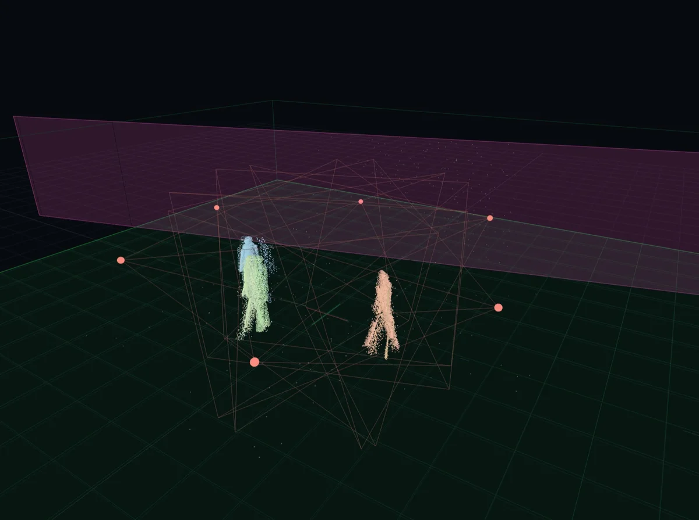
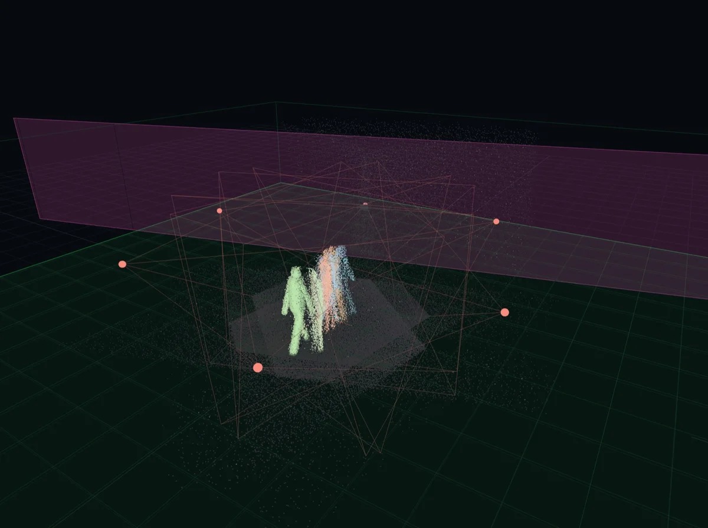

# Getting the room out of the cloud

The floor, the walls, the truss and the furniture all return depth, and a
LiDAR phone has no opinion about which of them you care about. Everything
below is how the room gets removed, and the first thing to know is that there
are **two separate answers**, because there are two pipelines.

TouchDesigner and the console both read the same published frames from the
bridge, and **neither reads the other's output**
([the fork at the bridge](../index.html#the-whole-system-on-one-page)).
So cutting the floor out of TouchDesigner's cloud does nothing to what `/track`
publishes, and cutting it in the console does nothing to the picture. A rig
that looks clean on screen while the tracking output still has the back wall in
it is not a contradiction; it is one side configured and the other not.

| You want the room gone from | Set it in |
|---|---|
| The visuals, and anything built on TouchDesigner's cloud | The tox's Point Cloud and Floor pages |
| `/track`, the field stream, NDI, the Live view | The console's `segmentation` settings |

Each side offers the same two kinds of cut, and they compose in the same order:
**a geometric box first, then a learned background.**

## Geometry: the cut that works on the first frame

A geometric cut needs nothing learned and nothing empty. It is a box, applied
per point, and it is the one to reach for first because it is deterministic:
the same point is always kept or always dropped.

### In TouchDesigner

| Parameter | Default | What it cuts |
|---|---|---|
| `Cropmin`, `Cropmax` | -8, -1, -4 and 8, 9, 4 | The stage box in metres. The saved working copy is tighter: -6, -3, -5 to 6, 3, 5 |
| `Floorcut` | 0.06 m | Points below this are floor |
| `Geoceiling` | 2.4 m | Points above this are ceiling, truss and lights. The saved copy uses 4 |

{: .warning }
> **On the GPU path the crop's Y comes from `Floorcut` and `Geoceiling`, not
> from `Cropmin` and `Cropmax`.** The shader's `uMin.y` is `Floorcut` and its
> `uMax.y` is `Geoceiling`; `Cropminy` and `Cropmaxy` are read only by the CPU
> crop. Raising `Cropminy` on the GPU path and expecting the floor to go is a
> change that does nothing, and nothing says so.
>
> `Cropminy` is not inert there, though. It sets the origin of the hash grid
> that `gpu_clean` and `gpu_hyst` use, so moving it moves where clustering
> happens without moving what is cropped.

**A band 0.08 m below `Floorcut` is kept and flagged rather than dropped**, so
feet are not cut off at the ankle. It is fixed in the shader and is not a
parameter. Anything below `Floorcut` minus 0.08 m is gone.

### Setting the cut by hand: the Stage Cut page

{: .note }
> **Tox v90, and not on `main` until 12 November 2026.** It is on the branch
> `stroud/stage-cut-td`, and the TouchDesigner that is running already has it.
> Every figure and picture below is **simulated**: six synthetic phones, one
> frozen frame. None of it has run on a rig.

The three controls above used to live on two different pages. They are now one
custom page, **Stage Cut**, second after Point Cloud, in three groups. The
names did not change, so anything reading them still works.

*The page at v89. These are the saved values rather than the manifest
defaults: the ceiling sits at 4 m and the box at 6 by 3 by 5, and the wall cut
is off, which is how a tox with the feature behaves exactly as v87 did. **v90
adds a Show Floor Plane toggle to the first group and a Show Wall Plane toggle
to the second**, and labels the third group, which reads as its parameter name
here and as "Stage box: sides and depth (GPU path always crops to it)" from
v90 on.*

| Group | Parameters |
|---|---|
| Floor and ceiling | `Floorcut`, `Geoceiling` |
| Backdrop wall | `Wallcut`, `Wallyaw`, `Walldist` |
| Stage box | `Cropmin`, `Cropmax`, `Cropon` |

Each group has a header above it saying what that group cuts.

The new part is the **backdrop wall**: a vertical plane at any angle in plan,
with everything behind it removed at every height.

| Parameter | Default | Range |
|---|---|---|
| `Wallcut` Backdrop Wall Cut | off | toggle |
| `Wallyaw` Wall Yaw (deg) | 0 | -180 to 180 |
| `Walldist` Wall Distance (m) | 6.0 | 0.5 to 20 |

`Wallyaw` points at the side the backdrop is on: **0 is upstage**, square to
the stage at +z; 90 is the +x side; 180 and -180 are downstage. A point is cut
when `sin(yaw) × x + cos(yaw) × z` is greater than `Walldist`, which is the
same expression on both merge paths and is pinned there by
`glsl_parity_test.check_wall_cut`.

#### Seeing where the cut sits before it cuts

Two wireframe planes in the preview show where the two cuts are, so they can be
placed against the cloud by eye rather than by arithmetic. **Both are display
only and remove nothing**, and the wall plane draws whether or not the cut is
on, which is what lets it be lined up first.

| Toggle | Draws |
|---|---|
| `Floorviz` Show Floor Plane | The green floor grid, at Ground Cutoff Height, sized and centred to the stage box in 0.5 m cells. It was on the View page before v90 |
| `Wallviz` Show Wall Plane | A pink grid on the Wall Yaw and Wall Distance plane, from the ground cutoff up to the ceiling and 2 m wider than the box. New in v90, off by default |

*Show Wall Plane on, Backdrop Wall Cut still off. The pink plane sits in front
of the backdrop, and the grey slab behind it is what the cut will take.*

*Backdrop Wall Cut on. The slab is gone and the performers are whole: 7,819
performer points before and after, and not one wall point left. The dark
speckle around each pair of feet is the other cut's business. Those are the
4,339 floor points still inside the feet band, which `gpu_clean` keeps near
bodies and the wall cut does not touch.*

*Ground Cutoff raised to 0.15 m. The green grid rises with it and the rings go:
4,339 floor points to none. It costs six of the 7,819 performer points, off the
soles, and what is left is 7,813 points of which every one is a performer.*

So the order to work in is: **show the wall plane, line it up, then cut.**
Turning the cut on first means placing a plane against points it is already
removing.

**Setting it, on an empty stage with the phones aligned and the merged cloud in
view:**

1. **Raise Ground Cutoff until the floor goes.** At the default 0.06 a thin
   ring of floor stays around each foot, which is the 8 cm feet band doing its
   job. About 0.15 removes all of it and costs the soles: six points out of
   7,819 on a performer, in simulation.
2. **Set Wall Yaw to face the backdrop**, then pulse **Fit Wall To Cloud**
   (v93). It reads the merged cloud along that yaw, finds the farthest dense
   band between 0.5 and 2.5 m high, sets Wall Distance **0.25 m in front of
   it** and turns on Show Wall Plane. It never turns the cut on. Dragging Wall
   Distance by hand does the same job: the target is 0.2 to 0.3 m clear of the
   backdrop points.
3. **Look at the pink plane**, then **turn on Backdrop Wall Cut**. The points
   behind the plane go.
4. **Leave the values.** They save with the tox.

{: .warning }
> **The wall cut fails closed, and it is one plane.** A plane set through the
> stage removes performers with no warning of any kind. There is no second
> plane either, so a raked or curved backdrop wants the plane just inside its
> nearest point, and whatever the backdrop hides beyond that stays in the
> cloud.
>
> It is off by default, and with it off v89 behaves exactly as v87 did.

{: .note }
> **Fit refuses rather than guessing, in two cases, and both are cases where a
> guess would cut people.** With no backdrop in view the farthest dense band
> *is* a performer, so a band narrower than 2 m across, or one filling less
> than 80 per cent of its own width in 0.25 m steps, is read as a person or a
> row of them and declined. And if the yaw faces away from the backdrop, more
> than a fifth of the remaining points lie beyond the band, which means the
> stage is behind the proposed wall; that is declined too. The log says which:
> *"no dense vertical band along yaw X deg ... Set Wall Yaw to face the
> backdrop first (if the backdrop is behind you, add or subtract 180)."*
>
> In simulation a backdrop at -165 degrees and 3.5 m gave a face at 3.35 m and
> a distance of 3.10 m, and yaws of 15, 0, 90 and -90 were all refused.

**Where it sits in the pipeline** decides what it can and cannot fix. On the
GPU path, which is the show path, each point meets the crop box and the
ceiling first, then the wall, then the floor band, then the learned
background. On the CPU paths the wall is applied after voxel fusion,
background learning and auto-align collection, and before `Segmode`.

That ordering on the CPU side is deliberate in one respect: **alignment still
sees the wall**, because a flat backdrop is a useful feature for registration.
Cutting it before the solver would take away something the solver wants.

In simulation, with a backdrop at -165 degrees and 3.5 m, the cut took 52,953
wall points to zero on the GPU path and 30,583 to zero on the CPU path, with
performer points unchanged at 7,819 and 5,825. A 0.15 m floor cut and the wall
cut together left 7,813 points, all of them performer. With the room left in,
only 5 per cent of the points were a performer at all.

{: .warning }
> **The console has its own separate cut, and setting one does not set the
> other.** TouchDesigner's Stage Cut page and the console's Live view cut are
> two controls over two pipelines. Nothing is pushed between them. This is the
> same split as everywhere else on this page, and it is the thing most likely
> to catch somebody out, because the two views can be made to look identical
> while publishing different clouds.

### In the console

The engine's inclusion box is five keys in `segmentation`, and points outside
it never enter the motion engine at all:

| Key | Default | Edge |
|---|---|---|
| `stageX` | 9.0 m | Half width |
| `stageZlo`, `stageZhi` | -9.0 m, 9.0 m | Downstage and upstage |
| `stageYlo` | -0.6 m | Floor margin |
| `stageYhi` | 3.6 m | Ceiling |

The upstage edge is the one that earns its keep at a venue: a back wall past
`stageZhi` never reaches the engine, so it cannot be learned, mistaken for a
performer, or counted in the maturity ratio.

### The console's own cut

{: .note }
> **Lands 12 November 2026** as `sys/integ-c`, with tox v92 on the other side.
> Every figure here is **simulated**: a sandboxed scratch console, the merge
> simulator, six ring phones, a wall at yaw 15 and 4.0 m. None of it has run on
> a rig.

The console has the same two cuts, in its Live view under **Stage cut**, and
they are **the same arithmetic as the tox's**. The plan normal is
`(sin yaw, cos yaw)`, a point is cut when `sin(yaw) × x + cos(yaw) × z`
exceeds the distance, yaw 0 faces upstage at +z, 90 faces +x, and the distance
is measured from the stage origin. **A number you line the pink plane up with
in TouchDesigner can be typed into the console, and the other way round.**

| Setting | Default | Range |
|---|---|---|
| `stageYlo` Floor cut height | -0.6 m, which keeps the floor | -1.0 to +0.5 |
| `wallOn` Wall cut | off | |
| `wallYaw` Wall yaw | 0 | -180 to 180 |
| `wallDist` Wall distance | 6.0 m | -20 to 20 |
| `stageX` Stage half-width | 9 m | the box is symmetric, `|x| < stageX` |
| `stageZlo`, `stageZhi` | -9 m, 9 m | |
| `stageYhi` Stage ceiling | 3.6 m | |

**Setting it in the Live view**, with the phones aligned and the cut off:

1. **Drag Floor cut height to +0.05 or +0.10.** A green 1 m grid follows the
   value and the floor points go. The engine takes the new value about 150 ms
   after the drag.
2. **Tick Wall cut and set Wall yaw** so the pink plane lies along the
   backdrop.
3. **Set Wall yaw to face the backdrop, then press Fit wall to cloud**, which
   needs People only off. It proposes a distance 0.25 m in front of the
   farthest dense band between 0.5 and 2.5 m high and says what it found.
   **It refuses the same two cases the tox refuses**, a band too narrow or too
   gappy to be a backdrop and a yaw facing away. Apply turns the wall on there.
   Dragging Wall distance by hand does the same job.
4. **Show cut points (dimmed)** draws what is being removed, and the status
   line gives the engine's kept points, its voxels and the learned share.

The colours are the tox's: green for the floor, pink for the wall.

*No cut. The engine has all of this to learn: the floor disc, the backdrop
slab and the scatter beyond the stage. Only the three figures are performers.*

*After the floor cut and the wall cut. The engine kept 39,300 of 274,900
points, an 86 per cent cut, and `/track` went from 18.3 to 28.9 frames per
second.*

*Show cut points (dimmed), which is how to check a cut rather than trust it.
The bright figures are what `/track` sees; everything dim is what the cut
removed. A performer who has gone dim is the failure this view exists to
catch.*

Both Fit buttons leave the same **0.25 m** in front of the band. The console
used 0.15 m until 10 November, which left 300 to 600 backdrop points inside the
cut in simulation, so it moved to the tox's figure rather than the other way
round.

**Where it sits is the part that makes it worth doing.** The cut runs before
everything that learns. A point outside it never becomes an engine voxel, so
it is never background, never foreground, never counted towards maturity and
never offered to `/track`. One test, `segment.in_stage`, serves the engine, the
GPU engine, ingest's person selection and both of `/track`'s background and
mask paths, which is deliberate: a consumer testing a wider volume than the
engine ingested would promote a point the background cannot contain to a
person, permanently.

In simulation the engine kept 39,300 of 274,900 points, an 86 per cent cut, and
`/track` went from 18.3 to 28.9 frames per second with a median of three
performers, which is what the simulator had. On an empty stage with the cut on
it matured in 3.3 seconds and reported nobody across 1,376 frames.

{: .warning }
> **It fails closed, and silently.** A cut that removes every point leaves the
> engine seeing nothing, which counts as mature, so `/track` keeps sending at
> full rate with zero performers. The Live view does warn in amber when the cut
> removes everything, but a cut that is merely *too tight* produces no warning
> at all: it just publishes fewer people than are standing there.
>
> Voxels the cut removes are not deleted either. They decay and prune over
> about three minutes, so the voxel count falls slowly after a change rather
> than dropping at once.

### Where the two cuts differ

They are the same arithmetic with different edges, and these are the
differences that will catch somebody who sets one from the other.

| | TouchDesigner | The console |
|---|---|---|
| **Feet** | Keeps an 8 cm band below the cut, so feet survive | **No band. A foot below the floor cut is gone** |
| Floor default | `Floorcut` 0.06, so the floor is already cut | `stageYlo` -0.6, so the floor is kept until you raise it |
| The box in x | `Cropmin` and `Cropmax`, a corner each | `stageX`, a half-width, so it is symmetric about the origin |
| Who it feeds | The visuals | `/track`, the field stream, NDI, the Live view |
| **Fit with the cut already on** | **Refuses** and changes nothing, logging *"turn Backdrop Wall Cut off first: the cut hides the wall it fits to"* | **Fits anyway**, and correctly: the view keeps every point of the frame whether the cut took it or not, so the backdrop is still there to find and pressing it again gives the same answer rather than walking the plane inward |

**Nothing is pushed between them.** Setting one does not set the other, which
is the two-pipeline split again, and with two wall planes now drawable it is
the easiest mistake on this page to make: line the pink plane up in
TouchDesigner, see the backdrop go, and leave the console cutting nothing.

## The learned background: sharper, and it needs an empty stage

A learned background records what the room looks like with nobody in it and
subtracts it. It is sharper than a box, because it removes a chair rather than
a cuboid of air around the chair, and it costs a pass on an empty stage.

**In TouchDesigner**, set `Segmode`:

| Mode | What it does |
|---|---|
| `off` | The full cloud, for setup and inspection |
| `geometric` | Floor, ceiling and stage box, then density and clustering. Works from the first frame on a levelled cloud with nothing learned |
| `learned` | Subtracts the learned background first. The sharpest, and it needs a `Learnbg` pass over `Learnframes` frames **with the stage empty** |

**In the console**, the background learns continuously unless you stop it.
`bgThresh` (0.45) is the occupancy above which a voxel counts as scenery, and
**Stage is empty now** promotes everything currently visible in one go.
`freezeBg` then stops it absorbing anything further, which is what keeps a
performer holding still from fading into the room.

{: .warning }
> **Freezing has a trap at a get-in.** With `freezeBg` on, moving a phone
> clears the frozen background and `/track` publishes nobody until somebody
> presses Stage is empty now again. With it off, only the moved phone drops
> out, for about thirty seconds. Freeze after the rig has stopped moving, not
> before.

## Which one to reach for

1. **Set the boxes first**, on both sides. They work immediately, they cannot
   learn a performer by mistake, and they make everything after them cheaper.
2. **Then learn the background**, on an empty stage, if the geometry alone
   leaves scenery inside the box.
3. **Freeze it last**, once nothing else is going to move.

A cut you can reason about beats a cut that is sharper. The box is the one you
can explain to somebody at two in the morning when a performer's arm keeps
disappearing; the learned background is the one that quietly ate a prop nobody
moved for a minute.

## When the background will not learn

A cluster that is mostly **motion-born** gets its footprint protected, so that
a performer standing still is not absorbed. The protection has a failure mode:
if a whole view arrives after the engine has started, everything in it is
motion-born, and it can guard itself and never learn.

The console carries a mechanism for most of that, called a scenery epoch.
Voxels born in the first three seconds after an epoch count as scenery rather
than as somebody walking in, and an epoch is raised in two ways: `ingest` marks
one when a phone's stream joins or comes back after an outage, and a tick that
brings in more than 6,000 new voxels at once raises one too, which covers a
phone that was re-aimed.

{: .warning }
> **One case gets through both of those, and the result is permanent.** A phone
> that joins a running console, with somebody walking about in front of it, has
> its room revealed a strip at a time: a few hundred voxels a tick, which never
> reaches the 6,000 bar, and all of it later than the three seconds the join's
> own epoch covers. So the unlearned room counts as motion-born, forms one wide
> foreground cluster, earns the footprint guard, and never promotes. `/track`
> then waits for a background that cannot arrive.
>
> **Fixed from 12 November 2026** by refusing the guard to any cluster wider
> than 2.5 m, on the grounds that no group of performers is. Until that lands,
> the way out is the same as everywhere else on this page: **Stage is empty
> now**, on an empty stage.
>
> The older self-test did not catch this because it arrives a small late view
> all at once, which the 6,000 bar handles. The strip case is a separate test,
> and it learns 0.99 with the new bar against 0.00 without it.

If `/track` still reports nobody with people plainly in view, the two things to
check are the maturity ratio and the settle window
([`matureFrac` in a room the stage does not fill](../console/settings.html#maturefrac-in-a-room-the-stage-does-not-fill)),
and the clearing action is the same one as everywhere else on this page:
**Stage is empty now**, on an empty stage.
