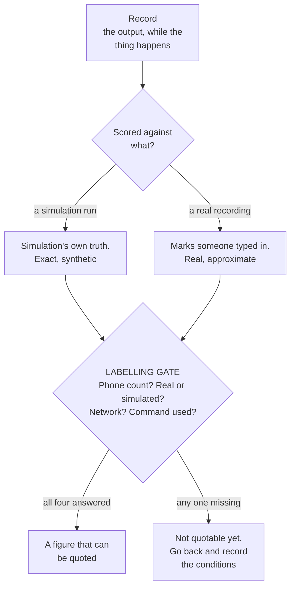

# Evidence and claims

How to produce a number you can defend, and how to say what the system does
without saying more than is true.

This page exists because the expensive mistakes in this kind of project are
not engineering mistakes. They are claims made to a client that turn out to
be a simulation figure, or a feature that was written but never run on real
hardware. Those get discovered at an integration, in front of people.

## How a claim becomes evidence

A number is not evidence because it is a number. It becomes evidence when it
can be re-produced by someone else and when it carries the conditions it was
produced under.



**The gate in the middle is the whole page.** A score with no phone count,
no statement of real or simulated, and no command attached is an impression
with a decimal point on it. It will be quoted anyway, by someone who was not
there, to someone who will hold you to it.

So the rule is: a figure travels with its conditions or it does not travel.

## The four words

Conformance is tracked with four results, and they are not interchangeable.

| Result | What it means |
|---|---|
| **PASS** | Proven by an automated check that anyone can re-run. |
| **BUILT** | The code exists and its own checks pass. It has not been proven on a rig, a show machine or a real remote session. |
| **FAIL** | Checked and does not hold. |
| **NEEDS-RIG** | Cannot be settled without hardware, a venue or a machine we have not had. |

**A BUILT row is not a PASS.** It is the most tempting row to quote, because
the work is done and it feels finished. It is not evidence. Quote the four
counts together or quote none of them.

The table is generated. Do not edit it by hand:

```
python3 Tools/requirements_check.py --write
```

**Do not run it on a machine with a live console.** One of its rows runs the
environment doctor, so on a show machine it inspects a rig that is in use.
Generate the table on a development machine instead.

That writes `Notes/Requirements-Conformance.md` with the date on it. As of
2026-10-27 it read 14 PASS, 4 BUILT, 0 FAIL, 7 NEEDS-RIG. Re-run it before
quoting any of those, because they move.

## Labelling a number

Every figure needs to carry where it came from, because the same quantity has
very different values depending on how it was produced.

| Label | What was behind it |
|---|---|
| Measured, real phone | Hardware. **Say the phone count**, it changes the answer. |
| Measured, simulation | Synthetic streams. Proves the code path, not the physics. |
| Built, not verified | It runs. No rig evidence. |
| Not yet verified | Needs hardware we have not had. |

Current state worth being honest about: real-phone evidence is **one phone**.
Every multi-phone figure is simulation. Simulated phones do not get hot, do
not drop frames on a congested switch, and do not occlude each other the way
bodies do.

### What one phone cannot evidence

Being specific about this is more useful than a general disclaimer, because
it tells you which questions a demonstration can and cannot answer.

| Question | Can one phone answer it? |
|---|---|
| Does the wire format parse correctly? | Yes. A format is a format. |
| Does a phone sustain capture while charging? | Yes, for that phone, that cable, that power. |
| Does the rig hold its frame rate at eight streams? | **No.** Simulation says yes. Simulation does not share a switch or a thermal envelope. |
| Does a phone throttle under stage lighting over two hours? | **No.** This has not been run. |
| Does coverage survive a performer walking the playing area? | **No.** This needs the angles, and angles need phones. |
| Does the system separate performers who cluster? | **No.** Separation is a multi-view property. One view has nothing to fuse. |

The last two are the interesting ones, and they are the ones a client will
ask about. Both are structural: they are not short of testing time, they are
short of phones. Say that rather than implying the test is pending.

## Producing tracking evidence

Tracking output can be recorded and then scored, which turns an impression
into a number.

1. Record the tracking output from the console while the thing you want to
   demonstrate happens.
2. Score the recording:

```
python3 Tools/track_score.py logs/track-<timestamp>.jsonl --n 3
```

It reports time until a given number of tracks are present, identity losses,
and position error against marks. Useful options:

| Option | What it does |
|---|---|
| `--n N` | Time until N tracks are present. |
| `--window a-b` | Count identity losses only in that span of seconds. |
| `--marks marks.json` | Score position against known marks. |
| `--on NAME=a-b` | Assert someone was on mark NAME during those seconds. |
| `--truth-sim RUN.LOG` | Score against a simulation's own truth, including crossings. |
| `--json` | Machine-readable output. |

`--gap` sets how soon a new identity after a lost one counts as the same
person reappearing rather than as a fresh loss.

The options above are the ones that matter, not the full set, and their
defaults are the tool's to change. Run `python3 Tools/track_score.py --help`
for the current list rather than trusting this page for a default, and quote
the value you actually ran with when you report a score.

### The distinction that matters in the room

A score from `--truth-sim` is scored against **what the simulation knows it
did**. A score from a real recording is scored against **marks someone typed
in**. The first is exact and synthetic. The second is real and approximate.
Say which one you are showing.

## Other checks

| Check | What it proves |
|---|---|
| `python3 TD/newtox/wire_fixture_test.py` | The wire format still parses byte for byte. Catches a protocol change that compiles. |
| `python3 WebConsole/doctor.py` | The machine's setup. A USB-only warning means the phone is tethered rather than on the show network, which is fine on a desk and wrong at a venue. |
| `python3 TD/newtox/tox_drift.py` | The saved TouchDesigner project against the repository, so the code in the project is the code in version control. |

## An evidence pack

When a deliverable is "show what it does and does not do", the pack should
contain:

- The conformance table, freshly generated, with its date.
- Recordings, with the scores produced from them and the command used.
- The phone count and the network for every figure.
- A plain list of what is **not** demonstrated and why.

That last item is the one that builds trust. A pack with no limitations
section reads as a pack that has not been looked at hard.

## What never to claim

Identity through sustained physical contact. When two bodies are physically
together there is no measurement that separates them, and this is true of
every markerless system at any number of cameras. Identity in that moment is
carried by prediction, and the output flags it as uncertain so the receiving
side can decide what to do.

Say that plainly and early. It is a property of the physics, not a defect in
this implementation, and it does not improve with more phones.
