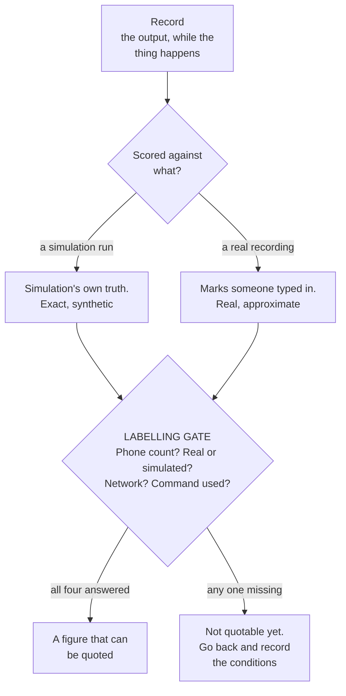
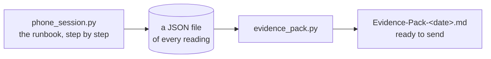

# Evidence and claims

How to produce a number you can defend, and how to say what the system does
without saying more than is true.

This page exists because the expensive mistakes in this kind of project are
claims made to a client rather than engineering mistakes. The claim turns out
to be a simulation figure, or a feature that was written but never run on real
hardware. Those get discovered at an integration, in front of people.

## How a claim becomes evidence

A number becomes evidence when someone else can reproduce it and when it
carries the conditions it was produced under.



**The gate in the middle is the whole page.** A score with no phone count,
no statement of real or simulated, and no command attached is an impression
with a decimal point on it. It will be quoted anyway, by someone who was not
there, to someone who will hold you to it.

The rule is that a figure travels with its conditions or it does not travel.

## The four words

The conformance table uses four results, and they are not interchangeable.

| Result | What it means |
|---|---|
| **PASS** | Proven by an automated check that anyone can re-run. |
| **BUILT** | The code exists and its own checks pass. It has not been proven on a rig, a show machine or a real remote session. |
| **FAIL** | Checked and does not hold. |
| **NEEDS-RIG** | Cannot be settled without hardware, a venue or a machine we have not had. |

**A BUILT row is not a PASS.** It is the most tempting row to quote, because
the work is done and it feels finished. It is not evidence. Quote the four
counts together or quote none of them.

The table is generated. Do not edit it by hand:

```
python3 Tools/requirements_check.py --write
```

**Run it with the console's environment.** One of its rows runs the
environment doctor, which is read-only and reports ports a running console
owns as warnings, so a live console is no obstacle. The row fails without the
YOLO interpreter, so on the Mac run it as
`(. Tools/show_mac.local; export TDSTAGE_YOLO_PYTHON; python3 Tools/requirements_check.py --write)`.

That writes `Notes/Requirements-Conformance.md` with the date on it. As of
2026-10-27 it read 14 PASS, 4 BUILT, 0 FAIL, 7 NEEDS-RIG. Re-run it before
quoting any of those, because they move.

The script exits 1 when any row is FAIL and 0 otherwise, which is what lets it
run as the `requirements conformance` step of the Windows console workflow
(`.github/workflows/windows-console.yml`). The counts also depend on the
machine it ran on. ST-07 runs `doctor.py` and reads PASS only on Windows,
because CUDA, the 4090 and the show PC's firewall are checked on the machine
itself; a clean run anywhere else reads BUILT. So the counts above are a Mac's
counts, and a 0-FAIL run on the show machine moves that one row from BUILT to
PASS. Say which machine produced the four numbers.

## Labelling a number

Every figure needs to carry where it came from, because the same quantity has
very different values depending on how it was produced.

| Label | What was behind it |
|---|---|
| Measured, real phone | Hardware. **Say the phone count**, it changes the answer. |
| Measured, simulation | Synthetic streams. Proves the code path, not the physics. |
| Built, not verified | It runs. No rig evidence. |
| Not yet verified | Needs hardware we have not had. |

Real-phone evidence today is **two phones** in one room (phones 1 and 2,
measured together since 2026-10-28). Every figure at more than two phones is
simulation. Simulated phones do not get hot, do
not drop frames on a congested switch, and do not occlude each other the way
bodies do.

### What two phones in one room cannot evidence

Being specific about this is more useful than a general disclaimer, because
it tells you which questions a demonstration can and cannot answer.

| Question | Can two phones in a room answer it? |
|---|---|
| Does the wire format parse correctly? | Yes. A format is a format. |
| Does a phone sustain capture while charging? | Yes, for that phone, that cable, that power. |
| Does the rig hold its frame rate at eight streams? | **No.** Simulation says yes. Simulation does not share a switch or a thermal envelope. |
| Does a phone throttle under stage lighting over two hours? | **No.** Two heat runs so far, neither two hours under stage light: 25 minutes on phone 2 while charging (2026-10-26: thermal serious throughout, and it found a frame-rate bug since fixed), and about 1.5 hours on two phones (2026-10-28, TDStage AR, plugged in, a furnished room, ambient not measured: serious at 7 to 9 minutes, never critical, phone 1 held 30 fps for 31 minutes). |
| Does coverage survive a performer walking the playing area? | **No.** This needs the angles, and angles need phones. |
| Does the system separate performers who cluster? | **No.** Separation is a multi-view property. One view has nothing to fuse, and [the measured envelope](../td/testing.html#how-close-is-too-close-separation_testpy) shows it: in simulation one or two views need bodies 0.50 to 0.60 m apart where six manage 0.30 m. |

The last two are the interesting ones, and they are the ones a client will
ask about. Both are structural, waiting on phones rather than on testing time.
Say that rather than implying the test is pending.

The conformance table's evidence column says what each rig-dependent row is
waiting on, so the next measurements are not a matter of opinion. F1-14, the
client's density and latency figures, closes when `Tools/f1_probe.py` runs
with three phones (runbook step 6, #29). ST-05, the phone count that is set
once the first three phones' synchronisation is measured, closes on the
three-phone clock measurement (runbook step 2/2a, #24); the tools pass their
self-tests, with `imu_sync.py` at 0.1 ms, which proves the tools and not the
phones. The heat run (#31) is carried in the meeting brief of 2026-10-27
rather than in the table: it has to be repeated on the fixed build, because
the 25-minute run found the bug that halved the frame rate, and it closes when
one setting holds at least 25 frames a second.

## Producing tracking evidence

You can record the tracking output and score it, which turns an impression
into a number.

1. Record the tracking output from the console while the thing you want to
   demonstrate happens. The control is **Record /track** in the Live view's
   Client output panel, described in
   [the console walkthrough](../console/guide.html#sending-the-tracking-output).
   It calls `POST /api/track/record` with `{"on": true}` to start and
   `{"on": false}` to stop, and the API answers 503 `emitter not ready` until
   the /track emitter exists. The file is `logs/track-<stamp>.jsonl` in a
   `logs/` directory beside the console's `config.json` (`WebConsole/logs/`
   unless the console was started with `--config`; git ignores it). The
   recorder drains the emitter's 60 s trace into it every 2 s;
   the button reads `Recording · <rows>` while it writes, and the console log
   says where the file went when it starts and how many frames it holds when
   it stops.
2. Score the recording:

```
python3 Tools/track_score.py logs/track-<timestamp>.jsonl --n 3
```

It reports time until a given number of tracks are present, identity losses,
and position error against marks. Useful options:

| Option | What it does |
|---|---|
| `--n N` | Time until N tracks are present. |
| `--window a-b` | Count identity losses only in that span of seconds. |
| `--marks marks.json` | Score position against known marks. |
| `--on NAME=a-b` | Declare that someone stood on mark NAME during those seconds; position error is scored there. |
| `--truth-sim RUN.LOG` | Score against a simulation's own truth, including crossings. |
| `--people N` | With `--truth-sim`, how many walkers the truth is built for. Without it the scorer takes the count from the sim log's scenario line, and it says so when the two disagree. |
| `--radius M` | With `--truth-sim`, how close a track must be to a walker, in metres, to be assigned to it. |
| `--json` | Machine-readable output. |
| `--selftest` | Checks the scorer against a built-in synthetic trace with known answers, then against truth built from the walker sim. No trace file needed. |

`--gap` sets how soon after a lost identity a new one is paired with it and
counted as one identity loss; a new identity arriving later is a fresh arrival
and counts as nothing.

The table lists the options that matter; the full set is longer, and the
defaults are the tool's to change. Run `python3 Tools/track_score.py --help`
for the current list rather than trusting this page for a default, and quote
the value you ran with when you report a score.

Since 2026-10-27 every recorded row also carries what the tracker was given
that frame: its clock (`tn`) and the detections (`dets`, rejects included with
their reason). `Tools/track_replay.py logs/track-x.jsonl -o /tmp/replayed.jsonl`
feeds the `ok` detections back through a fresh tracker with the same clock;
`--module` swaps in a candidate `track_emit.py`, and `--check` replays with the
shipped module and reports how many rows differ from what was emitted live
(0 means the replay is faithful). The output is the input with `tracks`
replaced, so `track_score.py` reads it as it reads a live recording, and a
tracker change is judged in seconds against the same inputs, with the same
scorer on both sides, instead of a new simulation run.

### The distinction that matters in the room

A score from `--truth-sim` is scored against **what the simulation knows it
did**. A score from a real recording is scored against **marks someone typed
in**. The first is exact and synthetic. The second is real and approximate.
Say which one you are showing.

## The hands scenario, which has two outputs

Hands are the one scenario where the console sends two different things and
they are easy to confuse, so the tool that measures them starts by saying
which is which:

| Output | What a point is |
|---|---|
| `/track/performer/hand` | The client contract. The **wrist** (YOLO keypoints, or Apple body pose) lifted to 3-D through each phone's own depth and fused across phones, tied to a performer id, `side` 0 the performer's left. Only for a confirmed, un-clustered, non-coasting performer |
| The hand dots at `/api/hands` | Per phone, **no identity and no fusion**: a hand detector's 21 landmarks averaged to about the palm centre, lifted to 3-D. Apple Vision on a Mac, MediaPipe in the YOLO worker on Windows. This is what the Live view rings and TouchDesigner's Hands page draw |

The field stream carries neither: F1 0.4 is field voxels, presence and sensor
poses.

```bash
python3 Tools/hands_test.py check --fix                 # can /track carry hands now?
python3 Tools/hands_test.py rec --out logs/hands-K.jsonl
python3 Tools/hands_test.py score logs/hands-K.jsonl --stands stands.json
```

`check` exits 1 when the scenario cannot run, and `--fix` switches on exactly
what it needs and nothing else: YOLO keypoints when they are the only way to
get wrists at a usable rate, the `/track` hands group, and the hand dots. **It
never switches on `/track` itself and never touches a phone**. The session
script asks for `/track`, so one tool stays responsible for it.

`rec` records both outputs itself, because the console's own `/track` recording
keeps performers only. One JSON line per `/track` bundle, including the raw OSC
in base64, and one per new hand-dot reading, each dot carrying `src`: `apple`
or `mediapipe` for a real hand detector, `yolo` for a body-pose wrist, which
`hand_track` falls back to on a phone where the hand detector found nothing.

The segments, which record who did what and when, go in a sidecar as you press Enter through
`phone_session.py --plan sydney --only K`: a palm held flat on a stand, *n*
people spread apart with hands up, two people shoulder to shoulder, fast arm
sweeps.

{: .warning }
> **Tape the stands' positions, and give them to the scorer.** A stand's flat
> top above the floor is measured with tape and goes in `stands.json` in
> **metres**. Its taped stage position is optional, and that is the trap: with
> no position, the scorer locates the stand *from the hands themselves*: the
> densest group in plan of the hands near palm height over every hold. That is
> a guess, and scoring hands against a stand position inferred from those same
> hands flatters the result. Tape the position whenever the stand sits on a
> known mark. Taped distances between stands can also be given, and check
> accuracy without reference to any frame at all.

## Other checks

| Check | What it proves |
|---|---|
| `python3 TD/newtox/wire_fixture_test.py` | Two frames a real iPhone put on the wire still parse through TD's receiver, byte for byte. Catches a phone-side packer change that compiles, which the simulator's own bytes cannot. |
| `python3 WebConsole/doctor.py` | The machine's setup. A USB-only warning means the phone is tethered rather than on the show network, which is fine on a desk and wrong at a venue. Its port checks bind each port without `SO_REUSEADDR`, a true test, so a port the running console or TouchDesigner already holds reads WARN, naming the holder when it can, never FAIL; the exit code is 1 only on a FAIL. `--wait 0` skips the telemetry wait; of the four ports it tests, `--listen` moves the telemetry port and `--http` the web port; the flags and what each check covers are on [running the console](../console/running.html). |
| `python3 TD/newtox/tox_drift.py` | The saved TouchDesigner project against the repository, so the code in the project is the code in version control. |
| `python3 Tools/doc_claims_check.py` | That a wording the record has withdrawn has not come back, and a required line has not gone. [Keeping a correction corrected](#keeping-a-correction-corrected). |

## Running a session, and the pack that comes out of it

A measurement session is where good intentions turn into a notebook nobody
can read three weeks later, so the session is scripted end to end. The
scripting buys one specific thing: **the script reads the numbers out of the
console rather than leaving whoever is holding the phone to type them in.**



`Tools/phone_session.py` walks the runbook a step at a time: it prints what to
do, waits for you, then records everything the console can tell it about that
step (telemetry, clock offsets, capture age and its split, frame rates). It
calls the specialised tools where a step needs one. You can list its steps,
narrow a run to a few of them, or resume an interrupted session into the same
file.

It saves after every step, so a crash or Ctrl-C loses nothing:
`Notes/Session-<date>.json` holds everything machine-readable and
`Notes/Session-<date>.md` is the summary to paste into issues and the email
(`--out` moves both). The default, `--plan runbook`, is the three-phone
session; `--plan sydney` is the scored stage test (#27) and writes
`Notes/Stage-Test-<date>` instead. It refuses to start when the console does
not answer.

Rehearse it with no phones before the phone day: a scratch console under the
sandbox that denies the show ports, three sims, and `TDSTAGE_CONSOLE` pointing
the script and the tools it runs at that console (`f1_probe` still reads
:9001):

```
python3 WebConsole/server.py --http 9480 --listen 9490 --tdp4-port 9493 \
    --sim-port 9494 --f1-port 0 --config /tmp/x/config.json   # {"td": {"enabled": false}}
python3 TD/newtox/tdp4_sim.py 127.0.0.1 9493 900 --devices 3 --first-id 1 --grid 256x192
curl -X POST -d '{"push":true}' localhost:9480/api/td            # check the seed poses
yes '' | TDSTAGE_CONSOLE=http://127.0.0.1:9480 python3 Tools/phone_session.py --out /tmp/x/s
```

`Tools/evidence_pack.py` then turns that file (a `--plan sydney` session, the
scored stage test) into the pack, with the build facts read off disk rather
than remembered: which commits, which project version. The venue is a flag
(`--venue`); `--out` names the file, which is otherwise
`Notes/Evidence-Pack-<date>.md`. The limits section starts from the tool's
standard list, and anything this session failed to cover is yours to add.
Section 5, the takes, states that every phone recorded every scenario
(`.tdp4rec` plus `.imu`), leaves the Dropbox link for you to attach, and tells
the reader to replay the takes into TouchDesigner with
`TD/newtox/take_play.py` and convert them with `TD/newtox/take_to_mcap.py`,
both on [the TD testing page](../td/testing.html).

| Tool | The measurement it is for |
|---|---|
| `phone_session.py` | The whole runbook, recording as it goes |
| `evidence_pack.py` | The pack, from that session's file |
| `f1_probe.py` | Density and latency of the field stream, decoded with the client's own decoder so the numbers are what they would see |
| `range_walk.py` | How far from a phone a body is still usable, by walking away from it |
| `rig_coverage.py` | How many phones see each part of the stage, on a grid |
| `heat_test.py` | One change at a time against a hot phone, restoring the screen, streaming state and planes it found afterwards (capture path and edge cull go back to the app defaults) |
| `imu_sync.py`, `limb_test.py`, `hand_truth_score.py` | Clock alignment, limb fidelity, hand accuracy |
| `hands_test.py` | The hands scenario end to end: whether it can run, both hand outputs recorded, then scored against taped stands |
| `consensus_skew_score.py` | What the phones' frame skew costs a fast forearm, scored from the takes with nothing running: it lines them up by capture time, using the console's own clock offsets and capture age |
| `track_score.py` | A recorded tracking output, scored |
| `sydney_pack.py` | Not a measurement: the delivery folder, from everything the day produced |

The pack's sections are what the agreement asks for: what was tested and on
what, a table per scenario, the limits stated plainly, and the recordings.

**The limits section is the one that builds trust.** A pack with only the
standard limits reads as a pack nobody looked at hard. The tool writes those
five (contact, long contact, frontal occlusion, range, light); it knows what
was measured, not what this measurement failed to cover.

## The delivery folder

The pack is the document. The folder beside it is the proof, and after a test
day the raw material of it is spread across three phones, the console's log
folder and a screen recorder. One command gathers it:

```
python3 Tools/sydney_pack.py --pull
```

That reads the newest `Notes/Stage-Test-*.json`, pulls the takes off every
paired phone running TDStage AR, and writes `~/TDStage-Delivery/Sydney-<date>/`.
Four ways to run it:

| Command | What it does |
|---|---|
| `--pull` | Takes pulled off the phones over Xcode device pairing |
| `--takes-dir ~/Downloads` | Takes AirDropped to the Mac instead, repeatable |
| `--pull --dry-run` | The plan only: nothing copied, nothing written |
| `--selftest` | A synthetic day and a fake phone, no hardware |

It collects the takes (`.tdp4rec` with their `.json` and `.imu`), the session
JSON from `phone_session.py --plan sydney`, the console's `/track` recordings
(`logs/track-*.jsonl`) and F1 dumps (`logs/f1-*.f1bin`), and the screen videos
from `~/Movies/TDStage-Sydney-<date>`. Pass each runbook file as well
(`--runbook`, repeatable): the rig file, and each 6g run's own file. Every take
is checked with `take_reader.py --verify` and every `.imu` with
`take_imu.py --info`, so a truncated or empty take is named in the summary
rather than shipped silently.

| In the folder | What is in it |
|---|---|
| `README.md` | What is where, the day's configuration, replay commands, the app build per phone |
| `SUMMARY.txt` | The check printed at the end. Anything missing is in ALL CAPS |
| `MANIFEST.sha256` | `shasum -a 256 -c MANIFEST.sha256` |
| `session/` | The session JSON and its summary, and the runbook's |
| `scenarios/<id>/` | `phone-<n>/` takes, the `/track` rows, the F1 dump, the video, notes |
| `scenarios/<id>/earlier/` | An attempt that quit part way and was run again, kept apart from the result |
| `scenarios/hand-<id>/` | Takes started by hand and named for a card or step, with no session file here |
| `scenarios/other/` | Files made that day that matched no step, each with its time and why |
| `mcap/<id>.mcap` | Every phone of that scenario in one file for Foxglove |

**Name a hand-started take for its card, on the phone.** That is the one thing
the tool cannot work out for you. It files a take by, in order: the session
that armed it; a name beginning with a step id or card (`6g-rgb`, `XT12`,
`W11-p2`); the recorded window it started inside; a guessed window, for a step
that recorded none; otherwise `other/`. A guess is only a guess, and the
summary names every file a guessed window took by time alone.

Re-running it is safe and cheap. Nothing on a phone is changed, since `devicectl`
lists and copies out and nothing more, and no source file is modified or deleted.
A pulled file already on the Mac is not pulled twice, copies are APFS clones on
the same volume, and verification, checksums and MCAP files are cached. The
pack folder must be new, empty, or one this tool wrote before; any other folder
holding files is refused, as is one that contains a source folder or sits
inside one. Files it did not write are left alone and listed, and only
`--prune` removes the files an earlier run of it left behind.

It exits 0 when nothing is missing, 1 when something is (those ALL CAPS lines),
and 2 when it refused the folder. The dry run gives the same code for
everything it can judge before copying (arming, takes per phone, `.imu`,
`/track`, F1, video), but a take's own frames and footer only once the file is
on the Mac.

{: .note }
> `--selftest` builds a whole synthetic test day, with a fake phone, deliberately
> broken takes and a pack folder it must refuse: **118 checks, passing on
> 9 November 2026.** No part of the tool has been run against a real test day,
> because there has not been one. It is written and rehearsed, not proven.

## What never to claim

Never claim identity through sustained physical contact. When two bodies are
physically together there is no measurement that separates them, and this is
true of every markerless system at any number of cameras. Prediction carries
identity in that moment, and the output flags it as uncertain so the receiving
side can decide what to do.

Say that plainly and early. The physics sets that limit, so it is not a defect
in this implementation, and it does not improve with more phones.

## Keeping a correction corrected

On 3 November a client document was fact-checked against the code and the
records. It came back with 51 errors, and **roughly all 51 leaned the same
way**: toward sounding more finished than the evidence supported. A second pass
on 9 November found more of the same in client-readable lines across the
repository.

That finding is not about carelessness. Drift in this material does not wander
in both directions. It flatters. So a correction is not finished when it is
made: somebody writing the next revision,
in good faith, from memory of how the system was described before, puts the old
sentence back.

```bash
python3 Tools/doc_claims_check.py            # the built-in samples, then this checkout
python3 Tools/doc_claims_check.py --root DIR # another tree, such as an old commit's files
```

It holds a list of **withdrawn wordings** and a list of **required lines**, and
fails when a withdrawn wording is back or a required line has gone. Line breaks
and runs of spaces are collapsed first, so a sentence that got re-wrapped still
matches. **12 files, 27 withdrawn wordings, 16 required, 0 problems, 9 November
2026**, and a GitHub workflow runs it on every change to the files it reads.

The records are deliberately **not** read: the changelog, the analysis that
found the errors, the day plan. They keep the history as it was written,
including the wording that was withdrawn. A check that forced the record to
agree with the current wording would be erasing the evidence that the
correction happened.
