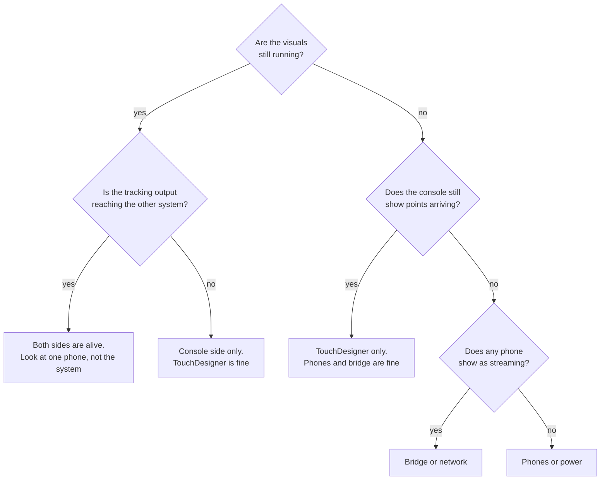
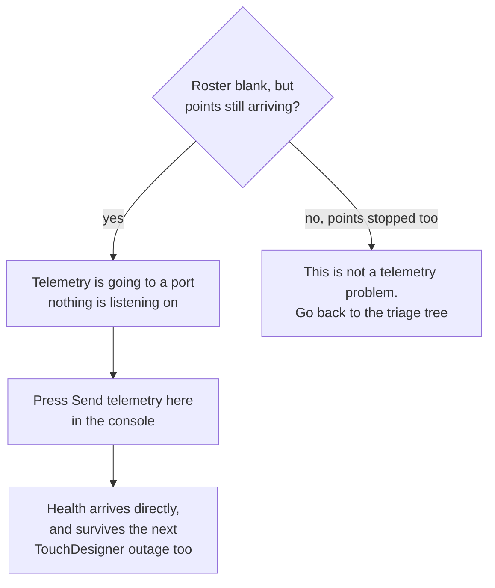

# When something fails

For each part of the rig: what takes over by itself, what an operator does,
and whether it has actually been seen working.

The status column is the important one. "Verified" means a test or a run
showed it. "Not verified" means it is designed and written but has not been
seen working on hardware. **Gap** means there is no fallback today.

Most of the "not verified" items are waiting on the same thing: a session with
real phones on real stands. That session is [#24](https://github.com/AristidesAI/TDStage/issues/24), and it is what will
move them. Where a gap has its own issue, this page links it; the live list is
the [board](https://github.com/users/AristidesAI/projects/1).

Read the gaps first. They are at the bottom of this page.

## Why the failures are shaped like this

Most of what follows is a consequence of two structural choices, and knowing
them makes the individual cases predictable rather than a list to memorise.

**The phones and the receiver share no state.** A phone holds a destination
address and sends to it. It does not negotiate, does not wait for an
acknowledgement and does not care whether anything is listening. So a
receiver can die and come back without the phones noticing, and a phone can
die and come back without the receiver needing to be told. There is no
session to re-establish, because there was never a session.

**The receiving side forks.** The bridge publishes each received frame once,
and TouchDesigner and the console each read it independently. Neither is
downstream of the other for point data. So no single process failure takes
out both the visuals and the tracking output.

The cost of the first choice is that nothing is guaranteed to arrive. That is
paid for deliberately, and the reasoning is in
[Why it is built this way](../reference/design.html).

## Triage: something has stopped, what do I check first

One question orders everything else. **Are the visuals still running?**

That answer tells you whether TouchDesigner is alive, and because
TouchDesigner and the console are two independent readers of the same
received frames, it separates three completely different problems
immediately.

Work down the branch you landed on.

| You landed on | Check, in this order |
|---|---|
| **One phone** | That phone's own health: thermal state, charging, its link. One phone misbehaving is not a rig problem and does not need a rig action. |
| **Console side only** | The console restarts itself within about three seconds, so if the output is still missing after that, look at the console rather than waiting. The point cloud and the visuals are unaffected throughout. |
| **TouchDesigner only** | Reopen the project. The phones never stopped and the console never stopped. Nothing needs restarting except TouchDesigner. |
| **Bridge or network** | The bridge restarts itself within two or three seconds. If points still do not arrive, it is the cable, the switch or the addressing. |
| **Phones or power** | Everything downstream is innocent. Go to the stands. |

### The state that fools people

**The roster goes blank but points are still arriving.**

This looks like most of the rig has died. It has not. Phone health reaches
the console by a different route from point data, and by default that route
goes through the port TouchDesigner owns. While TouchDesigner is down or
restarting, health stops and point data does not.

**Restarting the console does not fix this**, and that is the mistake worth
inoculating against, because someone makes it once, under pressure, at the
worst possible moment. The telemetry is not arriving at the console in the
first place, so restarting the thing that is not receiving it changes
nothing. Retarget instead.

Retargeting is also the better state to be in generally: once a phone sends
health to the console's own listener, that health survives a TouchDesigner
outage entirely.

## During a show

### A phone's app crashes or is killed

Automatic: the phone resumes streaming when the app relaunches. The console's
auto-recover restarts a phone that comes back without streaming, within about
twelve seconds.

Operator: relaunch the app. Nothing else.

Status: covered by an automated interface test. **Not verified on a rig.**

### A phone dies outright

Automatic: the other phones carry on. The dead phone's identity coasts
briefly, then is released after three seconds rather than frozen, so the
receiving side sees it go rather than seeing a performer stand still forever.

Operator: swap in a spare and set its device id from the console. A fresh
install refuses to stream until its id is confirmed, which prevents a spare
silently colliding with a phone already on the rig.

Status: the id guard is tested. **A spare swap has not been done on a rig.**

### A phone overheats

Automatic: the frame rate steps down as the phone gets hotter, and recovers
after about forty five seconds of cooling.

Operator: shade it or give it air. The console shows capture pressure per
device.

Status: the ladder is tested. **A real heat test has not been run.** The
measured case that needs explaining is [#31](https://github.com/AristidesAI/TDStage/issues/31): thermal serious, 14 fps,
capture age 77 ms.

### The wired link routes nowhere

Automatic: the stream falls back to Wi-Fi after five seconds.

Operator: re-seat the cable. A direct cable address can drift, in which case
the console can re-teach the phone where to send. Detecting that drift rather
than waiting for somebody to notice is [#19](https://github.com/AristidesAI/TDStage/issues/19).

Status: code review and unit tests. **Not verified on a rig.**

### The receiving bridge process dies

Automatic: the launcher restarts it within two or three seconds, and
TouchDesigner picks it up again when it reappears.

Status: verified. There is also a direct socket path when no bridge is
running.

### The legacy relay is left running beside the bridge

What happens: every frame arrives twice. The console drops the duplicate, so
nothing breaks, but it warns and tells you to stop the relay.

Status: verified by recreating it.

### TouchDesigner crashes

Automatic: the phones keep streaming and the console keeps producing its
outputs.

Operator: reopen the project. The console re-seeds the phone positions when
the link comes back.

One catch worth knowing: by default phone health reaches the console
**through** TouchDesigner, on the port TouchDesigner owns. Until it is back,
the phones look dead even though they are streaming, because the point data
comes by a different route and never stopped.

Operator: press **Send telemetry here** in the console. That moves every
phone's health to the console's own listener, so it arrives directly and
survives the next TouchDesigner outage as well. Do not restart the console:
the telemetry is not reaching it, so restarting it changes nothing.

Status: verified.

### The console crashes

Automatic: the launcher restarts it within about three seconds. The show
state survives the restart. TouchDesigner's point cloud is unaffected.

Cost: the outputs to other systems pause for the restart.

Status: verified.

### The console's configuration file is corrupt

Automatic: it loads the newest backup that parses, keeps the bad file aside
with a timestamp, and logs an error saying so.

Operator: copy another backup into place with the console stopped.

Status: verified by deliberately breaking one and watching a six phone roster
come back.

### Two performers are confused for each other

Automatic: the output flags the identity as uncertain while it cannot be
told apart, so the receiving side can treat it as provisional rather than
trusting it.

This is a property of the measurement, not a bug. See
[Evidence and claims](evidence.html). What `clustered` and an identity change
mean on the wire is being pinned down in [#32](https://github.com/AristidesAI/TDStage/issues/32).

## Between shows

| Lost | Way back |
|---|---|
| The TouchDesigner project, damaged or badly edited | Every change is saved as a numbered version, so the previous one is always on disk. A drift check shows whether a saved project's code matches version control, and can extract its code as plain files. |
| Learned background and floor | Re-learn on an empty stage. Checkpoints are included in every snapshot. |
| Roster, markers, settings | The console keeps its last fifty saves, and they are in every snapshot. |
| A phone's settings after a reinstall | The console keeps each phone's profile and can push it back. |
| Printed markers | Print them again from the console at the rig's size. |
| Everything | Snapshots contain the repositories as bundles that clone with no network, plus uncommitted work as patches. Verified by rebuilding a working tree from one. |

## The gaps

These have no fallback today. They are listed plainly because a gap you know
about can be planned around, and a gap you discover during a show cannot. Each
links its issue where it has one; the full, current list is the
[board](https://github.com/users/AristidesAI/projects/1) and the [issues](https://github.com/AristidesAI/TDStage/issues).

**No hot standby for the show machine.** If it dies, the rebuild is from a
snapshot onto another machine. Whether the rig runs one machine or two is
still an open decision.

**The outputs to other systems stop if the console stops.** TouchDesigner's
own point cloud keeps running, so the visuals continue, but anything
consuming the tracking output loses it until the console restarts. It does
restart by itself, but there is a pause.

**App distribution past ninety days.** Test builds expire. For a production
running months ahead that means a re-upload roughly every quarter, or moving
to a distribution route that does not expire. The decision is outstanding:
[#16](https://github.com/AristidesAI/TDStage/issues/16) for the expiry itself, [#21](https://github.com/AristidesAI/TDStage/issues/21) for the non-expiring route
and source escrow the agreement asks for.

## Routine that prevents most of this

- Take a snapshot before risky work and before travelling.
- Run the drift check after every project save.
- Keep the change ledger current after a working session.
