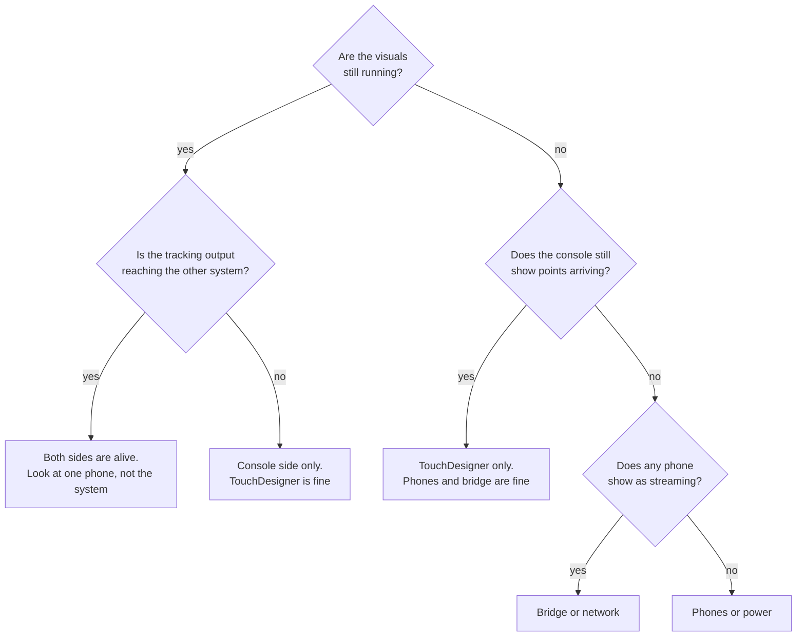
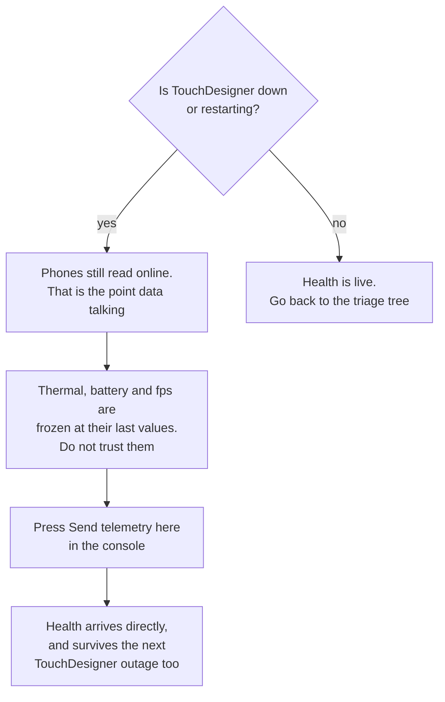

# When something fails

For each part of the rig: what takes over by itself, what an operator does,
and whether it has actually been seen working.

The status column is the important one. "Verified" means a test or a run
showed it. "Not verified" means it is designed and written but has not been
seen working on hardware. **Gap** means there is no fallback today.

Most of the "not verified" items are waiting on the same thing: a session with
real phones on real stands. That session is [#24](https://github.com/AristidesAI/TDStage/issues/24), and it is what will
move them. Where a gap has its own issue, this page links it; the live list is
the [board](https://github.com/users/AristidesAI/projects/1).

Read the gaps first. They are at the bottom of this page.

## Why the failures are shaped like this

Most of what follows is a consequence of two structural choices, and knowing
them makes the individual cases predictable rather than a list to memorise.

**The phones and the receiver share no state.** A phone holds a destination
address and sends to it. It does not negotiate, does not wait for an
acknowledgement and does not care whether anything is listening. So a
receiver can die and come back without the phones noticing, and a phone can
die and come back without the receiver needing to be told. There is no
session to re-establish, because there was never a session.

**The receiving side forks, below the bridge.** The bridge publishes each
received frame once, and TouchDesigner and the console each read it
independently, neither downstream of the other. So TouchDesigner can die
without touching the tracking output, and the console can die without touching
the visuals.

{: .warning }
**Above the fork, the bridge is a single point of failure for both.** It is the
only process listening on the port the phones send to. The console opens no
phone-facing socket of its own in the show setup, and while TouchDesigner does
bind its own socket when the bridge stops, it binds the port the bridge
publishes on, not the one the phones send to. So nothing reaches either side
until the bridge is back. The launcher restarts it in two or three seconds,
and that is the real answer here, because there is no second path.

The cost of the first choice is that nothing is guaranteed to arrive. That is
paid for deliberately, and the reasoning is in
[Why it is built this way](../reference/design.html).

## Triage: something has stopped, what do I check first

One question orders everything else. **Are the visuals still running?**

That answer tells you whether TouchDesigner is alive, and because
TouchDesigner and the console are two independent readers of the same
received frames, it separates three completely different problems
immediately.

Work down the branch you landed on.

| You landed on | Check, in this order |
|---|---|
| **One phone** | That phone's own health: thermal state, charging, its link. One phone misbehaving is not a rig problem and does not need a rig action. |
| **Console side only** | The console restarts itself within about three seconds, so if the output is still missing after that, look at the console rather than waiting. The point cloud and the visuals are unaffected throughout. |
| **TouchDesigner only** | Reopen the project. The phones never stopped and the console never stopped. Nothing needs restarting except TouchDesigner. |
| **Bridge or network** | The bridge restarts itself within two or three seconds. If points still do not arrive, it is the cable, the switch or the addressing. |
| **Phones or power** | Everything downstream is innocent. Go to the stands. |

### The state that fools people

**Every phone reads healthy, and the readings are hours old.**

This is the dangerous one, because nothing looks wrong. Phone health reaches
the console by a different route from point data, and by default that route
goes through the port TouchDesigner owns. While TouchDesigner is down, health
stops arriving and point data does not.

The console marks a phone online from **either** channel, so the point data
alone keeps every phone green. What stops is everything that can only come
from telemetry: thermal state, battery, frame rate. Those freeze at the last
value TouchDesigner relayed, and **nothing in the interface marks them stale**.
A phone climbing the thermal ladder reads `OK`, because `OK` is what it last
said.

**Restarting the console does not fix this**, and that is the mistake worth
inoculating against, because someone makes it once, under pressure, at the
worst possible moment. The telemetry is not arriving at the console in the
first place, so restarting the thing that is not receiving it changes
nothing. Retarget instead.

Retargeting is also the better state to be in generally: once a phone sends
health to the console's own listener, that health survives a TouchDesigner
outage entirely.

## During a show

### A phone's app crashes or is killed

Automatic: the phone resumes streaming when the app relaunches. If the show
was started with **Start show**, the console's auto-recover then sends start to
a phone that is back online but idle — but only once it has stayed back for
twelve seconds without dropping again, and at most once every thirty seconds
per phone. A phone that flaps restarts that twelve second clock each time,
which is the point: the console waits for a phone that is actually back rather
than chasing one that is still coming and going.

That qualifier matters. Auto-recover is off when the console boots, and
**Start all does not arm it** — only Start show does, and Standby and Stop
disarm it again. A rig started with Start all has no safety net, which is a
reasonable choice and a bad surprise.

Two more things end the watching, both deliberate:

**A phone you stopped stays stopped.** If the console stopped a phone, auto-
recover leaves it alone until something starts it again — the console, or the
phone itself. Otherwise stopping one phone to look at it would turn into a
fight with the supervisor.

**"The show is running" expires.** The latch is saved, so a watchdog restart
keeps it, but a console that was down for **more than half an hour** boots with
auto-recover disarmed and says so. The age comes from a heartbeat file the
console touches every ten seconds. The reasoning is that a restart seconds
later is the same show, and a restart the next morning is not — and a
supervisor that silently starts phones because of yesterday's latch is worse
than one that waits to be asked. Press Start show when the show should run.

Operator: relaunch the app. Nothing else.

Status: covered by an automated interface test. **Not verified on a rig.**

### A phone dies outright

Automatic: the other phones carry on. The dead phone's identity coasts
briefly, then is released after three seconds rather than frozen, so the
receiving side sees it go rather than seeing a performer stand still forever.

Operator: swap in a spare and set its device id from the console.

{: .warning }
The id guard is narrower than it sounds. It blocks a **fresh install** that
still holds the untouched default id. A spare whose id was set at some point —
in a rehearsal, last week — streams straight away and will collide silently if
that id is already on the rig. Two phones on one id black out that id
completely: the receiver discards both, in TouchDesigner and in the tracking
output alike. Rig health names the colliding id; the fix is to change it on
the phone.

Status: the id guard is tested. **A spare swap has not been done on a rig.**

### A phone reboots

Automatic: nothing. This is the gap people assume is covered and it is not.

Operator: somebody goes to the stand, unlocks the phone and opens TDStage. It
resumes streaming by itself once the app is open, but not before: no part of
the system can launch an app on a locked phone. The console shows the phone
offline within about six seconds, and the tracking output keeps that performer
only through whatever other phones can see them.

A self-relaunch path exists in the app but is switched off, because it depends
on the phone being locked into supervised single-app mode, which is still an
open decision ([#16](https://github.com/AristidesAI/TDStage/issues/16)).

Status: **gap.** Plan for a person per cluster of stands, or accept the loss of
one view.

### A phone overheats

Automatic: the frame rate steps down as the phone gets hotter, and recovers
after about forty five seconds of cooling.

**A ninety-minute run on two real phones on 2026-10-28 changed what this entry
should say**, and the finding is not what anyone expected:

- Both phones reached **serious within seven to nine minutes** of launch and
  **never left it** — not with the screen blacked out, not on the USB cable,
  not on the cheaper capture path.
- **Neither ever reached critical**, at 25 fps or at 30.
- Capture pressure stayed "fair", and its one factor was system temperature.
  The camera was never the limit; the whole phone was, and a phone plugged in
  at 100 % is also running a charging circuit.

So **serious is the normal working state of a phone on a stand**, not an
alarm, and the question is not how to get back to nominal. It is what the
phone still delivers while it sits there — which was 30 fps, indefinitely.

{: .warning }
Blackout made **no measurable thermal difference** over nineteen minutes at
serious. Keep doing it: a lit screen is visible from the house and a dark one
keeps the interface idle. But it will not bring a plugged-in phone back, and
anyone treating it as the cooling fix will be disappointed by the numbers.

Operator: shade it or give it air if you can. The console shows capture
pressure per device, and the factor tells you *which* part is hot — worth
reading before intervening, because shading helps a hot camera and does
nothing for system temperature.

Status: **measured on two phones over ninety minutes** ([#31](https://github.com/AristidesAI/TDStage/issues/31)). Not yet
measured on a full rig, in a venue, or anywhere warm.

### The wired link routes nowhere

Automatic: if the adapter drops, the stream moves immediately to any other
route that is not cellular, which is Wi-Fi **only if the phone is joined to a
network that reaches the host**. The five seconds people remember is a
different case: a link that is pinned to the wire and never becomes ready is
abandoned after five seconds.

Operator: re-seat the cable.

A direct cable address can also drift on its own, with nothing unplugged. The
Mac re-picks its link-local address — measured drifting twice in two days on
this rig — and the phone goes on streaming to the address it learned, which no
longer exists. Nothing on either end reports an error; the stream simply stops.

**The console watches for this and says so**, naming the old address and the
new one, with the fix attached: press **Autofix** on that phone, which sends it
a message over the cable so it learns the new address from where that message
came from. The re-teaching is one click rather than automatic, which is
deliberate — reaching for a phone unasked is what the recovery rules exist to
prevent ([#19](https://github.com/AristidesAI/TDStage/issues/19)).

Status: code review and unit tests. **Not verified on a rig.**

### The receiving bridge process dies

Automatic: the launcher restarts it within two or three seconds, and both
TouchDesigner and the console pick it up again when it reappears.

**There is no second path while it is down.** TouchDesigner binds its own
socket when the bridge's heartbeat goes stale, but on the port the bridge
publishes on, not the one the phones send to, and the console opens no
phone-facing socket at all in the show setup. The direct-socket arrangement
exists for a rig running without a bridge, where TouchDesigner is set to the
phones' own port. It is not a fallback that arms itself.

Status: verified.

### The legacy relay is left running beside the bridge

What happens: every frame arrives twice. The console drops the duplicate, so
nothing breaks, but it warns and tells you to stop the relay.

Status: verified by recreating it.

### TouchDesigner crashes

Automatic: the phones keep streaming and the console keeps producing its
outputs.

Operator: reopen the project. The console re-seeds the phone positions when
the link comes back.

One catch worth knowing: by default phone health reaches the console
**through** TouchDesigner, on the port TouchDesigner owns. Until it is back,
the phones look dead even though they are streaming, because the point data
comes by a different route and never stopped.

Operator: press **Send telemetry here** in the console. That moves every
phone's health to the console's own listener, so it arrives directly and
survives the next TouchDesigner outage as well. Do not restart the console:
the telemetry is not reaching it, so restarting it changes nothing.

Status: verified.

### The person-model worker crashes

Automatic: it is restarted, after a backoff that grows to about fifteen
seconds. A cold start can take up to ninety seconds, because it loads a machine
learning framework and its weights.

What happens meanwhile: every request for "where are the people in this image"
answers "no opinion", which the system is built to treat as *keep everything*
rather than *there is nobody*. The tracking output falls back to separating
performers by geometry alone. On the Windows show machine that also loses
hands, because the fallback hand detector is macOS only.

Operator: nothing, unless it keeps happening. Rig health shows the worker's
state and how many times it has restarted, and can restart it by hand.

Status: the respawn has an automated test. It is run by hand at the moment, because the repository's Actions have been refused on billing since
2026-10-27.

### The show machine goes to sleep

Automatic: nothing stops it. There is no wake lock anywhere in the system.

What happens: the bridge, the console and TouchDesigner all freeze while the
phones carry on sending into nothing. On wake everything reattaches by itself
within a few seconds, every phone and TouchDesigner flip offline and back, and
every performer in the tracking output is released and returns under a **new
id**. On a Mac with phones on USB cables, the cable addresses can also change
across the sleep, which needs Autofix in the console.

Operator: **turn sleep off before the rig matters**, not after. On a Mac,
`caffeinate` on the launcher or Energy Saver; on Windows, a power plan that
never sleeps.

Status: **gap.** Nothing in the repository enforces this.

### The client bus is unreachable

What happens: nothing visible. The tracking output is plain UDP to a fixed
address, so a dead host or a closed port produces no error anywhere an
operator looks. The console keeps reporting that it is sending, and the frame
count keeps rising, because it is sending — into nothing.

Operator: if the console says it is sending and the frames are climbing, the
console is fine. Look at the receiving machine and the network between. The
output resumes by itself the moment the bus is reachable again, with no
intervention here.

Status: verified by reading the code. **Worth one deliberate test** with the
client before the first show, because there is no symptom to go on otherwise.

### The network between the phones and the machine drops

Automatic: everything recovers by itself when the link returns. The phones
never stop streaming — their own link is still up, so nothing on the phone
treats this as a failure.

What the client sees is the part to plan for: after about six seconds every
phone reads offline, and after three seconds without points **every performer
is released**. When the link returns they come back as **new ids**. A thirty
second dropout is therefore not a thirty second gap, it is a gap plus a fresh
cast list.

Operator: nothing during. Afterwards, make sure anything downstream that holds
per-performer state has let go of the old ids.

Status: verified by reading the code. **Not tested on a rig.**

### The console crashes

Automatic: the launcher restarts it within about three seconds. The show state
survives the restart, and since 2026-10-27 that includes **whether the tracking
and video outputs were switched on**: they come back sending. Before that they
came back off and stayed off, with the console looking perfectly healthy, which
is a bad way to lose an output mid-show.

Cost: the outputs pause for the restart, and the tracking output then publishes
nobody for about half a minute while it re-learns its background. Anyone on
stage during that half minute is learned as scenery, so clear the stage if you
can.

Two cases where an output deliberately does not come back, each logged with its
reason: the saved tracking host does not resolve on this machine, and a console
started with `--config` for a test, which never drives the client bus unless
started with `--client-out`.

Status: verified.

### The console's configuration file is corrupt

Automatic: it walks back through the backups until it finds one that both
parses **and** applies, skipping any that do not and naming each one it
skipped. The bad file is kept aside with a timestamp, and an error says which
backup it started from.

That second word matters. A file with the right shape but one unreadable value
— a position written `1,5` instead of `1.5` — used to skip the backups
entirely and seed a fresh six-phone session, which was then written over the
configuration while a good backup sat beside it. Fixed on 2026-10-27.

{: .warning }
A restore is at best a minute old, because backups are taken at most once a
minute. Check the calibration after any restore rather than assuming it is
where you left it.

If it does end up seeding — nothing in the backups could be used — **the seeded
roster does not push its poses to TouchDesigner by itself**. A seed's six
default positions are not the venue's, and the console pushes poses on every
TouchDesigner link-up, so a seed used to move the live cloud as a side effect
of reconnecting. It now holds them, and Rig health says so.

The hold is **per phone**, and the rule is worth knowing exactly, because it
decides what your next click publishes.

| What you do | What it releases |
|---|---|
| Save an edit that **moves or turns** one phone — its position, its yaw, or its **tilt** | That phone only. The others stay held |
| Edit a phone's **plan aim** pitch or roll, or its field of view | Nothing. Those only draw the frustum in the plan; they do not move anything |
| Click a phone in the stage view without dragging it | Nothing. The value has not changed |
| **Push poses** | Every phone |
| A rig align, or a venue layout that places phones | The phones it placed |

{: .warning }
**There are two pitch-and-roll pairs and they do opposite amounts of work.**
The *plan aim* is a drawing: it points the frustum in the plan view and changes
nothing about the cloud. The *tilt* is a real correction, up to 30 degrees,
applied to that phone's points on every merge path. One is annotation, the
other is geometry. The console labels the plan aim as drawing-only for exactly
this reason.

Rig health names the phones still held, and the held set is saved with the
configuration, so a restart does not quietly release them.

The same hold covers three cases, not just a seed: every phone of a seeded
roster, every phone of a roster restored from a backup, and any slot added with
the **+** button. In each one, nobody has confirmed where that phone actually
is.

Operator: check the roster against the rig. If it is right, Push poses. If it
is wrong, stop the console, copy the backup you want over the configuration and
start it again.

Status: verified by deliberately breaking one and watching a six phone roster
come back.

### Two performers are confused for each other

Automatic: the output flags the identity as uncertain while it cannot be
told apart, so the receiving side can treat it as provisional rather than
trusting it.

This is a property of the measurement, not a bug. See
[Evidence and claims](evidence.html). What `clustered` and an identity change
mean on the wire is being pinned down in [#32](https://github.com/AristidesAI/TDStage/issues/32).

## Between shows

| Lost | Way back |
|---|---|
| The TouchDesigner project, damaged or badly edited | Every change is saved as a numbered version, so the previous one is always on disk. A drift check shows whether a saved project's code matches version control, and can extract its code as plain files. |
| Learned background and floor | Re-learn on an empty stage. Checkpoints are included in every snapshot. |
| Roster, markers, settings | The console keeps its last fifty saves, and they are in every snapshot. |
| A phone's settings after a reinstall | The console keeps each phone's profile and can push it back. |
| Printed markers | Print them again from the console at the rig's size. |
| Everything | Snapshots contain the repositories as bundles that clone with no network, plus uncommitted work as patches. Verified by rebuilding a working tree from one. |

## The gaps

These have no fallback today. They are listed plainly because a gap you know
about can be planned around, and a gap you discover during a show cannot. Each
links its issue where it has one; the full, current list is the
[board](https://github.com/users/AristidesAI/projects/1) and the [issues](https://github.com/AristidesAI/TDStage/issues).

**No hot standby for the show machine.** If it dies, the rebuild is from a
snapshot onto another machine. Whether the rig runs one machine or two is
still an open decision.

**A rebooted phone needs a person.** Nothing can open an app on a locked
phone, so a phone that reboots stays dark until somebody walks to the stand.
The self-relaunch path in the app depends on supervised single-app mode, which
is undecided ([#16](https://github.com/AristidesAI/TDStage/issues/16)).

**Nothing stops the machine sleeping.** There is no wake lock in the system,
and a sleep mid-show costs every performer id. It is prevented by setting the
machine up correctly, which means it is prevented by remembering to.

**The outputs to other systems stop if the console stops.** TouchDesigner's
own point cloud keeps running, so the visuals continue, but anything consuming
the tracking output loses it until the console restarts. It restarts by itself
and now comes back sending, so the gap is the restart plus the half minute the
tracker needs to re-learn its background — not, as it was until 2026-10-27, for
as long as it takes somebody to notice.

**App distribution past ninety days.** Test builds expire. For a production
running months ahead that means a re-upload roughly every quarter, or moving
to a distribution route that does not expire. The decision is outstanding:
[#16](https://github.com/AristidesAI/TDStage/issues/16) for the expiry itself, [#21](https://github.com/AristidesAI/TDStage/issues/21) for the non-expiring route
and source escrow the agreement asks for.

## Routine that prevents most of this

- **Turn off sleep on the show machine**, before anything else. It is the
  cheapest item on this list and the only one whose absence releases every
  performer id mid-show.
- Start the rig with **Start show**, not Start all, unless you have a reason:
  Start all leaves auto-recover disarmed.
- Take a snapshot before risky work and before travelling.
- Run the drift check after every project save.
- Keep the change ledger current after a working session.
