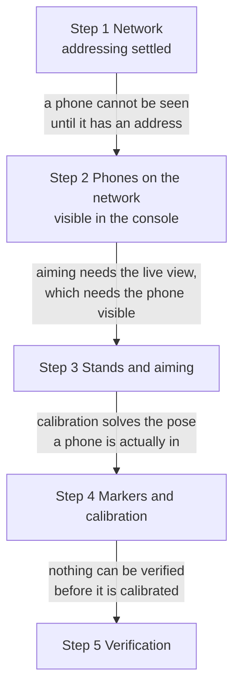
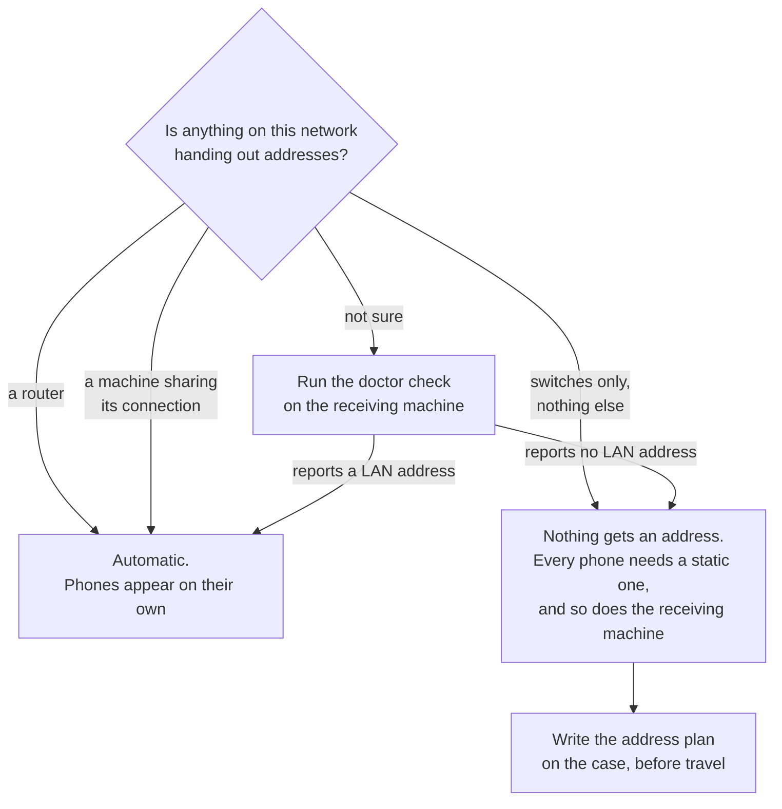
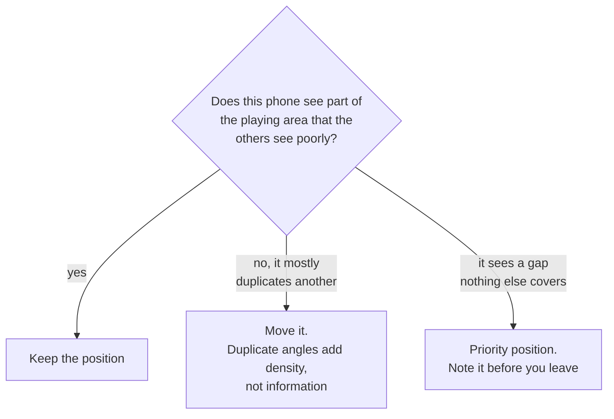

# Rig get-in

Building the rig in a venue, in the order that avoids rework. Assumes the
phones were prepared beforehand. If they were not, stop and do
[Preparing a phone](phone-preparation.html) first, because several of those
steps need internet the venue will not have.

## Order of work

The order is not a preference. Each step is the thing that lets the next one
be checked, so doing them out of order means doing them twice.



Read each arrow as the reason, not as a sequence number.

- **Network before phones**, because an unaddressed phone cannot appear in
  the console, and a phone you cannot see is a phone you cannot check.
- **Phones before stands**, because aiming is done from the live view. Doing
  stands first means climbing to every stand twice: once to mount, once
  again when you find out what it sees.
- **Stands before calibration**, because calibration solves for where a
  phone actually is. Move a stand afterwards and the solve is stale and
  silently wrong.
- **Calibration before verification**, because every check at the end is a
  check of the calibrated rig.

## 1. Network

Phones reach the receiving machine over Ethernet. Wi-Fi works and is the
fallback, but it costs latency and drops frames under load, so it is not what
a show runs on.

The gap is not marginal. A phone on a cable measured **0.55 ms** to the
receiving machine against roughly **8 ms** over Wi-Fi (measured, real phone,
one phone). An iPhone on a USB-C cable presents a real network link, so the
stream crosses the cable with nothing special done to it.

That matters more than the raw numbers suggest, because of what the depth
stream is. One frame from one phone is about a hundred packets, and a frame
missing any one of them is discarded whole rather than resent. Eight phones
with colour offer around 49,000 packets per second (measured, simulation).
Wi-Fi under load drops packets in bursts, and a burst that costs single
packets across many frames costs those whole frames. See
[Why it is built this way](../reference/design.html).

### Addressing, and the trap in it

**Check this before you need it.** A plain unmanaged switch does not hand out
addresses. If the rig has no router and no DHCP server on it, nothing on that
network gets an address automatically and every phone needs a static one.

Work out which case you are in before the get-in, not during it.



| Rig has | Addressing | What to do |
|---|---|---|
| A router, or a machine sharing its connection | Automatic | Nothing. Phones appear on their own. |
| Switches only | **None** | Set a static address on every phone and on the receiving machine. |

People expect a switch to sort this out because almost every switch they have
plugged into before had a router somewhere behind it. This one may not.

Decide the address plan in advance and write it on the case. A rig discovered
to need static addressing at 9am on a show day costs an hour.

The receiving machine can answer this for you. Run:

```
python3 WebConsole/doctor.py
```

On a switches-only rig with no static plan it fails with `no LAN address:
every interface is link-local, virtual or Tailscale`. With a single phone on
a cable it warns `USB link only, no LAN address`, which is fine on a desk and
wrong at a venue.

### Confirming the link

A phone should reach the console without anyone typing its address. If you
have to type an address to see a phone, the network is wrong and typing the
address only hides it.

## 2. Phones on the network

Per phone:

1. Power it from mains, not battery.
2. Confirm it appears in the console's device list by itself.
3. Confirm its device id is unique. Two phones sharing an id overwrite each
   other's frames, and the symptom looks like a dropout rather than a clash.
4. Confirm it reports charging and a nominal thermal state.

### The firewall trap

The console learns a phone's address from the health messages the phone
sends, and those arrive on a port TouchDesigner owns on the show machine. If
the firewall has no rule for TouchDesigner, the result is a specific and
confusing state: **phones show as online from their point data, but with no
battery, no temperature and no frame rate**, and control messages cannot
reach a phone whose address was never typed in.

The Windows setup script adds the rule. The doctor check confirms it. Run
both before deciding the network is fine.

## 3. Stands and aiming

Each phone goes where the coverage plan puts it. Coverage is the whole reason
there is more than one phone: a performer hidden from one camera has to be
visible to another, and that only happens if the angles were planned.

Aim with the console's live view rather than by eye. What matters is what the
phone sees, not where the phone points.

### Why aiming is a coverage decision, not a framing one

Occlusion has exactly one answer: another viewpoint. A performer behind
another performer cannot be recovered by any amount of processing of the view
that cannot see them, and is recovered trivially by a camera that can. That
is the entire reason there is more than one phone.

So the test of a phone position is not whether the picture looks good. It is
whether that phone sees something the others do not.



A rig where every phone looks from roughly the same side has redundancy and
little extra information. Two phones looking across the playing area from
opposite sides see more of a body standing between them than four phones
ranged along one side.

## 4. Markers and calibration

Calibration puts every phone into one shared stage coordinate space by
showing them printed markers at known positions.

### The marker size trap

**The size in the console must match the size you actually printed.** Not the
paper size, the printed black square.

| Printed on | Marker square |
|---|---|
| A4 | 195 mm |
| A3 | 280 mm |

A fresh roster now defaults to **195 mm**, which is A4 printed at true size.
So printing A4 and leaving it alone is correct.

**Printing A3 and leaving it alone is not.** The scale is then out by about
30 per cent, and nothing warns you, because a wrong marker size solves
perfectly well. It just solves to the wrong answer: every distance the system
reports is wrong by the same ratio, consistently, which is exactly the kind of
error that survives a casual look at the output.

Measure one printed marker with a ruler and set the console to that number.

**Loading a stage layout now sets the size for you.** The plan import reads
each marker's sheet size from the layout and applies one rig-wide marker size
derived from it. If you loaded a plan, the size should already be right.
Confirm it anyway: the number has to match the paper that came out of the
printer, not the paper the plan assumed.

### Placing markers

1. Put markers at positions you have measured, not estimated.
2. Tape them flat. A curled marker reads as a tilted one.
3. Keep them out of the path of anyone who will be moving around the stage.
4. Leave them up until calibration is verified, not until it is run.

## 5. Verification before you release the rig

Do not call a rig built until all of these pass:

- [ ] Every phone appears in the console without a typed address.
- [ ] Every phone has a unique device id.
- [ ] Every phone is charging and nominal thermally.
- [ ] The marker size in the console matches the printed markers.
- [ ] Calibration has solved for every phone.
- [ ] A person walking the playing area stays tracked as they cross between
      the areas each phone covers.
- [ ] The output reaches whatever is consuming it.

The walking test is the one that catches real problems. A rig can pass every
other check and still have a gap in coverage that only shows when someone
walks through it.

## What to record before you leave

Write down what the rig actually is, not what it was planned to be:

- Which phone id is on which stand.
- The addressing scheme used.
- The printed marker size.
- Anything that differs from the plan, and why.

The next person at this venue is possibly you, six weeks later, with no
memory of any of it.
