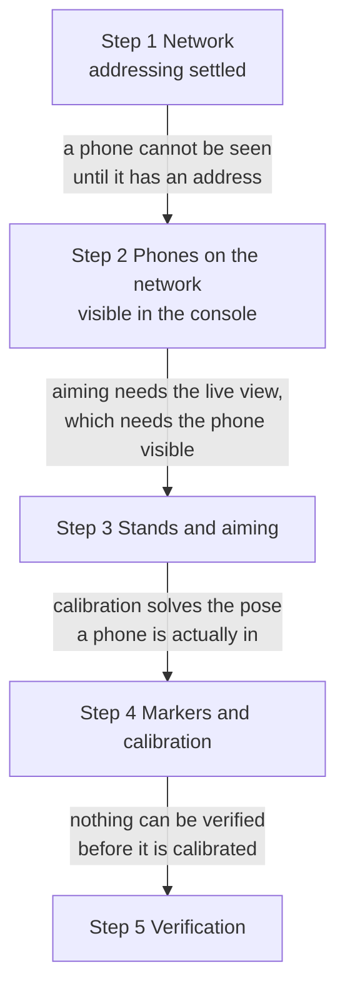
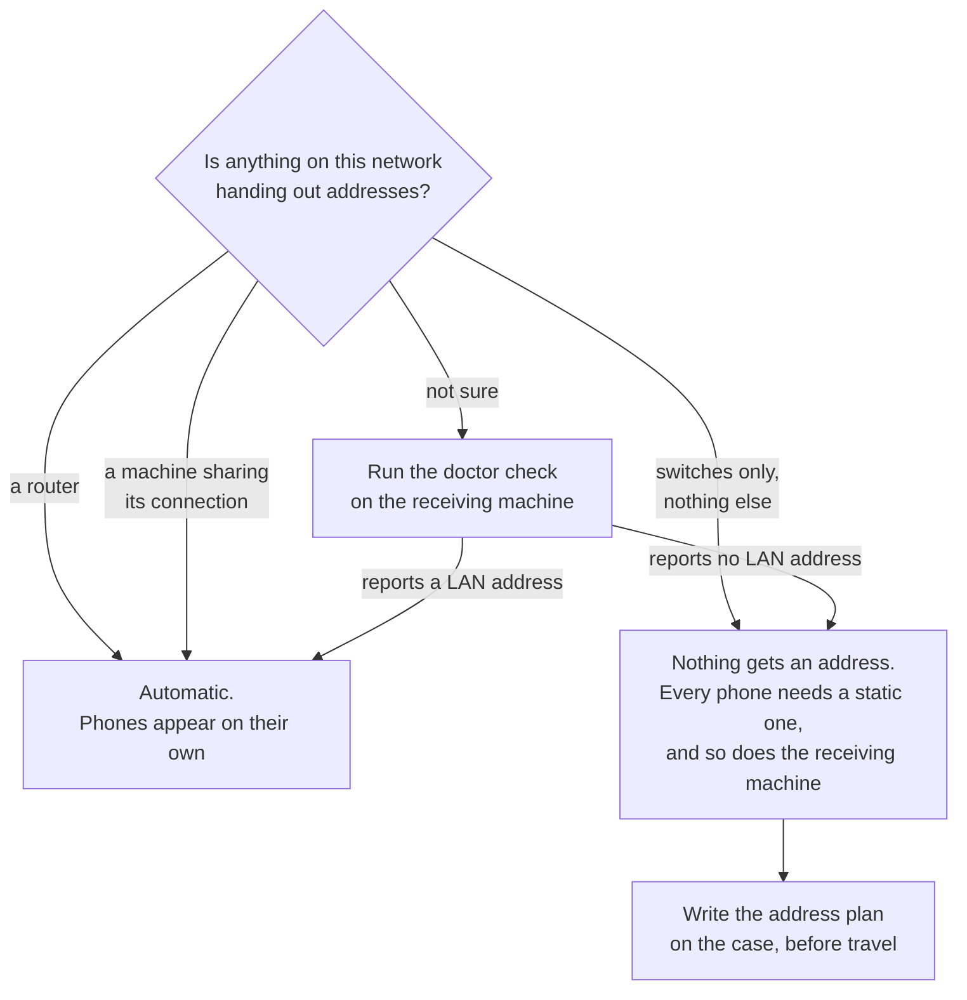
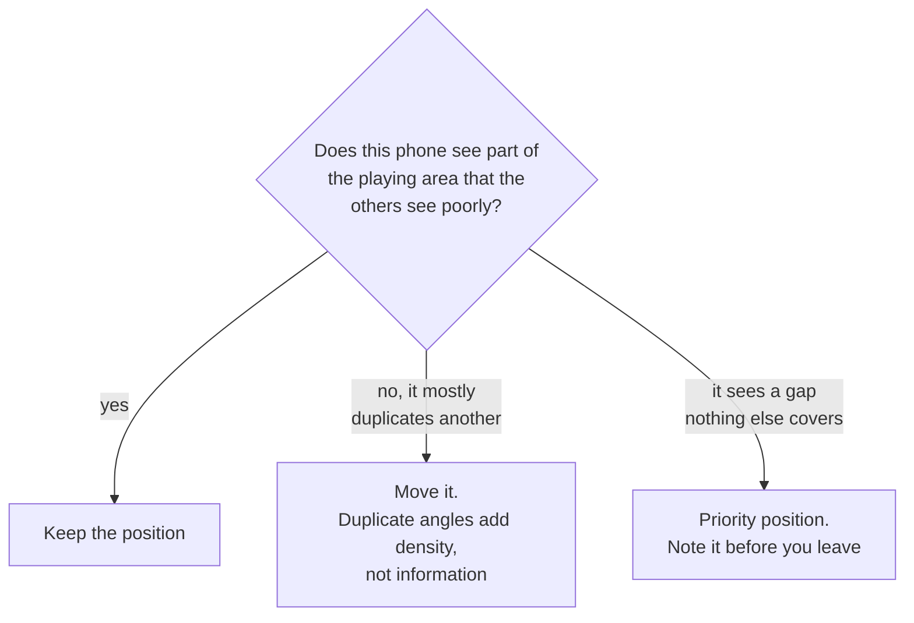
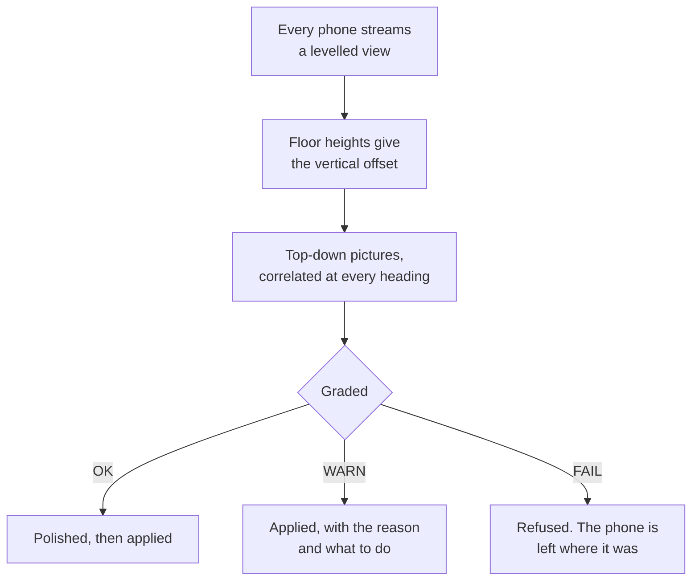

# Rig get-in

Building the rig in a venue, in the order that avoids rework. Assumes the
phones were prepared beforehand. If they were not, stop and do
[Preparing a phone](phone-preparation.html) first, because several of those
steps need internet the venue will not have.

## Order of work

The order is not a preference. Each step is the thing that lets the next one
be checked, so doing them out of order means doing them twice.



Read each arrow as the reason, not as a sequence number.

- **Network before phones**, because an unaddressed phone cannot appear in
  the console, and a phone you cannot see is a phone you cannot check.
- **Phones before stands**, because aiming is done from the live view. Doing
  stands first means climbing to every stand twice: once to mount, once
  again when you find out what it sees.
- **Stands before calibration**, because calibration solves for where a
  phone actually is. Move a stand afterwards and the solve is stale and
  silently wrong.
- **Calibration before verification**, because every check at the end is a
  check of the calibrated rig.

## 1. Network

Phones reach the receiving machine over Ethernet. Wi-Fi works and is the
fallback, but it costs latency and drops frames under load, so it is not what
a show runs on.

The gap is not marginal. A phone on a cable measured **0.55 ms** to the
receiving machine against roughly **8 ms** over Wi-Fi (measured, real phone,
one phone). An iPhone on a USB-C cable presents a real network link, so the
stream crosses the cable with nothing special done to it.

That matters more than the raw numbers suggest, because of what the depth
stream is. One frame from one phone is about a hundred packets, and a frame
missing any one of them is discarded whole rather than resent. Eight phones
with colour offer around 49,000 packets per second at the simulator's grid, and
about 76,000 at the grid real phones send.
Wi-Fi under load drops packets in bursts, and a burst that costs single
packets across many frames costs those whole frames. See
[Why it is built this way](../reference/design.html).

### Addressing, and the trap in it

**Check this before you need it.** A plain unmanaged switch does not hand out
addresses. If the rig has no router and no DHCP server on it, nothing on that
network gets an address automatically and every phone needs a static one.

Work out which case you are in before the get-in, not during it.



| Rig has | Addressing | What to do |
|---|---|---|
| A router, or a machine sharing its connection | Automatic | Nothing. Phones appear on their own. |
| Switches only | **None** | Set a static address on every phone and on the receiving machine. |

People expect a switch to sort this out because almost every switch they have
plugged into before had a router somewhere behind it. This one may not.

Decide the address plan in advance and write it on the case. A rig discovered
to need static addressing at 9am on a show day costs an hour.

The receiving machine can answer this for you. Run:

```
python3 WebConsole/doctor.py
```

On a switches-only rig with no static plan it fails with `no LAN address:
every interface is link-local, virtual or Tailscale`. With a single phone on
a cable it warns `USB link only, no LAN address`, which is fine on a desk and
wrong at a venue.

### Confirming the link

A phone should reach the console without anyone typing its address. If you
have to type an address to see a phone, the network is wrong and typing the
address only hides it.

## 2. Phones on the network

Per phone:

1. Power it from mains, not battery.
2. Confirm it appears in the console's device list by itself.
3. Confirm its device id is unique. Two phones sharing an id overwrite each
   other's frames, and the symptom looks like a dropout rather than a clash.
4. Confirm it reports charging and a nominal thermal state.

### The firewall trap

The console learns a phone's address from the health messages the phone
sends, and those arrive on a port TouchDesigner owns on the show machine. If
the firewall has no rule for TouchDesigner, the result is a specific and
confusing state: **phones show as online from their point data, but with no
battery, no temperature and no frame rate**, and control messages cannot
reach a phone whose address was never typed in.

The Windows setup script adds the rule. The doctor check confirms it. Run
both before deciding the network is fine.

## 3. Stands and aiming

Each phone goes where the coverage plan puts it. Coverage is the whole reason
there is more than one phone: a performer hidden from one camera has to be
visible to another, and that only happens if the angles were planned.

Aim with the console's live view rather than by eye. What matters is what the
phone sees, not where the phone points.

### Why aiming is a coverage decision, not a framing one

Occlusion has exactly one answer: another viewpoint. A performer behind
another performer cannot be recovered by any amount of processing of the view
that cannot see them, and is recovered trivially by a camera that can. That
is the entire reason there is more than one phone.

So the test of a phone position is not whether the picture looks good. It is
whether that phone sees something the others do not.



A rig where every phone looks from roughly the same side has redundancy and
little extra information. Two phones looking across the playing area from
opposite sides see more of a body standing between them than four phones
ranged along one side.

## 4. Markers and calibration

Calibration puts every phone into one shared stage coordinate space by
showing them printed markers at known positions.

### The marker size trap

**The size in the console must match the size you actually printed**, and the
thing you measure is not the obvious one.

{: .warning }
Measure the **whole marker image**, white margin included, between the centres
of the four crop marks. Not the black square: that is about 89 % of the image,
so ruling it and typing what you read sets every phone 11 % small.

| Printed on | Between the crop marks | The black square alone |
|---|---|---|
| A4 at true size | **195 mm** | about 174 mm |
| A3 at true size | **280 mm** | about 249 mm |

A fresh roster defaults to **195 mm**, which is A4 printed at true size. So
printing A4 and leaving it alone is correct. **Printing A3 and leaving it alone
is not**, and nothing warns you, because a wrong size solves perfectly well. It
just solves to the wrong answer.

What that wrong answer looks like is worth knowing, because the obvious guess
is wrong twice over. Depth is metric LiDAR, so nothing is rescaled and the
floor does not tilt. The phone simply believes it stands nearer its marker than
it does, and slides its **whole cloud** away from itself along that sight line
by that fraction of its distance to the marker — about 0.66 m for a phone 6 m
out at 11 % small. Each phone slides its own way, so the rig stops agreeing
with itself. The full working is in
[the console walkthrough](../console/guide.html#markers-and-the-mistake-that-does-not-announce-itself).

**A loaded stage layout does not reach the phones.** The plan import reads each
marker's sheet size and applies one rig-wide size to the console's **roster**,
and sends nothing. Until you press **Apply to all phones**, every phone still
holds whatever it was last told — so the console can read `every phone 280 mm`
while the phones calibrate on 195. Press it after every layout load, and
confirm the number against the paper that came out of your printer rather than
the paper the plan assumed.

### Placing markers

1. Put markers at positions you have measured, not estimated.
2. Tape them flat. A curled marker reads as a tilted one.
3. Keep them out of the path of anyone who will be moving around the stage.
4. Leave them up until calibration is verified, not until it is run.

### Aligning from the clouds instead

There is a second way to place phones, which needs no markers at all: **Rig
align** solves where every phone is relative to one anchor phone, from what the
clouds themselves see.

It works because the phones already know which way is down. Each one streams a
gravity-levelled view, so pitch and roll are right and only four numbers are
unknown between two phones: a heading and a position. The floor gives one of
them — the height difference between two phones' floors. For the other three,
the console looks at both clouds from above, rasterises what stands between
knee and head height, and cross-correlates the two pictures at every heading in
turn. The best match wins, then gets refined.

That is a **global** search, which matters: the finer alignment step it then
runs can only polish a rig that is already within about ten degrees and half a
metre, so on its own it cannot find the answer from nothing.



**Every answer is graded, and the grade is the useful part.** OK means the
solver settled — not that the pose is right. A WARN is applied with its reason
attached; a FAIL is refused and that phone is left alone rather than moved
somewhere confident and wrong.

{: .warning }
**A finished solve is not proof that every phone moved.** A refused phone is
left exactly where it was, and today it says so only in the Log and in the
solve's own result — there is no row in Rig health and no red anywhere to catch
your eye. So a solve can report itself finished with two phones still sitting
at whatever positions they had before, which on a fresh roster means the
defaults. **Read each phone's status**, in the result or in the Log, and treat
"the align finished" as meaning nothing on its own. The Live view's alignment
panel is where this is meant to end up, with a status for each phone.

Three things the grading is looking for, each worth recognising on a get-in:

- **Overlap.** How much of what one phone sees the other sees too. This is the
  failure no setting fixes: two phones pointed at different halves of the stage
  have nothing to match, and the answer is to move a phone, not to retry.
- **Consensus.** The match is re-run on subsets of the points. If those runs
  disagree with each other, the scene is ambiguous and it warns even when the
  score looks healthy.
- **Chaining.** Phones are matched pairwise and then composed along the
  strongest route back to the anchor, so a phone that shares nothing with the
  anchor — the back phone facing the front row — can still land through a
  neighbour it does share with.

{: .warning }
Two rooms defeat it, and both are rooms you might be standing in. An empty box
with a flat floor and bare walls has nothing to correlate, and a symmetric room
can match 180 degrees out. The solver reports its score and how far ahead the
winner was, for exactly that reason: a low score or a close second place means
look at the result before trusting it.

It runs as a background job — eight phones is twenty-eight pairs and takes tens
of seconds — so the console stays responsive and reports progress while it
works. One solve at a time.

{: .note }
Measured on simulated rigs, **not yet used at a real get-in**. The approach
follows the principles in Darien Brito's
[TDXDepthCamMerger](https://github.com/DarienBrito/TDXDepthCamMerger): grade
every answer with a reason and a fix rather than a bare pass, report overlap
for every pair, and only polish a match that is already good.

### Walking the stage instead

Cloud matching has one failure no amount of care fixes: **two phones that face
each other share no surfaces at all.** The back phone looking at the front row
and the front phone looking back see opposite sides of the same room, and
nothing in one view appears in the other. That is not an edge case on this rig,
it is the normal arrangement for covering a stage from both sides.

So there is a second solver that matches something every phone can see at once,
from any side: **one person walking.** Each phone reports where it thinks that
person is, frame by frame, in its own levelled frame. Line two phones' paths up
in time, and the shape of the walk gives the heading and the offset between
them — no shared scenery required.

Because latency differs per phone, the paths are first slid against each other
in time to find the best fit: fifty milliseconds at walking pace is six
centimetres, which is worth correcting before fitting anything.

**The procedure:**

1. **Learn the empty stage first.** The collector waits for this and says so.
2. Start the walk recording.
3. **Walk for about twenty seconds, where every phone can see you.** A loop
   through the middle of the stage, not a line along one edge.
4. Stop, then solve.

A recording you forget about stops itself after two minutes.

Graded per phone exactly as the cloud solve is, on different evidence — how
many samples matched, how well they fit, the time offset it found, and how far
the walk actually spanned. The most common failure is the one the name gives
away: **the walk was too short**. A walk of less than a metre across gives it
nothing to fit a heading to, and the fix is to walk a proper loop rather than
to re-run the solve.

### Using both on one rig

They compose, and this is the arrangement worth knowing, because neither
solver covers a whole rig on its own:

1. **Run the cloud solve first.** It places every phone that shares scenery
   with a neighbour.
2. **Run the walk solve for the phones it refused**, by listing them.

Every phone whose pose has already been checked stays exactly where it is and
is reported as `FIXED` — the walk places only the phones you listed, into the
frame the others already define. A pose nobody has confirmed is never used as a
root, so a seeded or restored position cannot quietly become the thing the rest
of the rig is measured against.

## 5. Verification before you release the rig

Do not call a rig built until all of these pass:

- [ ] Every phone appears in the console without a typed address.
- [ ] Every phone has a unique device id.
- [ ] Every phone is charging and nominal thermally.
- [ ] The marker size in the console matches the printed markers.
- [ ] Calibration has solved for every phone.
- [ ] **One person stands in the middle and the rig sees one person.**
- [ ] If you used Rig align: **every phone's status read**, not just that the
      solve finished.
- [ ] A person walking the playing area stays tracked as they cross between
      the areas each phone covers.
- [ ] The output reaches whatever is consuming it.

### The one-person test

Put somebody in the centre of the stage, where two phones on opposite sides
can both see them, and have calibrated on **different** markers. Then look at
the cloud.

| What you see | What it means |
|---|---|
| One body, in the right place | Those two phones agree. Move on. |
| **Two bodies**, separated along the line between the two stands | A marker size is wrong. The gap is roughly 11 % of the two phones' distances to their markers added together, so about 1.3 m for two phones 6 m out. |
| One body, in the wrong place | Both phones are off the same way. Check the size, then check the marker positions in the plan. |

What it does not catch, which matters as much as what it does:

- **Shifts that happen to cancel.** If every phone's marker lies in roughly the
  same direction from it, every cloud slides the same way: they still agree
  with each other, and the whole stage is simply in the wrong place. Two bodies
  prove an error; one body does not prove correctness.
- **Small errors.** A 1 % size error at 6 m is 6 cm, which you will not see by
  eye.

So run it a second time with a pair of phones at ninety degrees to the first,
which covers the other axis and breaks the cancelling case.

**The console can now do both halves for you** ([#41](https://github.com/AristidesAI/TDStage/issues/41),
built 2026-10-27). It compares what each phone thinks the centroid of that one
person is, which catches disagreement; and given a marked spot whose stage
coordinates you know, it compares the agreed position against that spot, which
is the half that can tell you the whole rig is offset rather than merely
self-consistent. Use it with the marked spot if you have one, because agreement
alone cannot prove correctness — which is the same reason this test needs a
second pair at ninety degrees.

The walking test is still the one that catches coverage problems. A rig can
pass every other check and still have a gap that only shows when someone walks
through it.

## What to record before you leave

Write down what the rig actually is, not what it was planned to be:

- Which phone id is on which stand.
- The addressing scheme used.
- The printed marker size.
- Anything that differs from the plan, and why.

The next person at this venue is possibly you, six weeks later, with no
memory of any of it.
