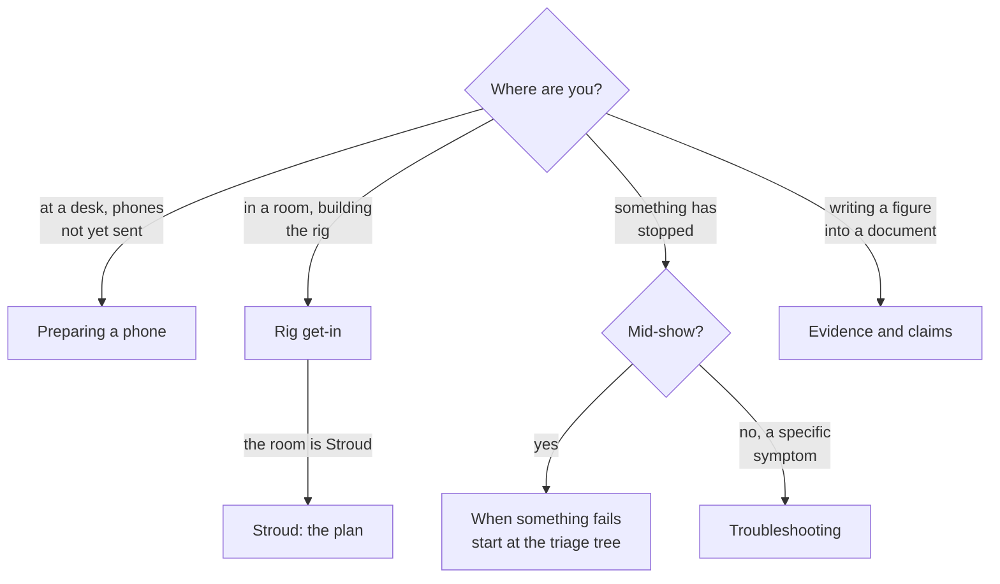

# Operations

Getting a rig up, running a show, and what to do when something stops. These
pages assume no knowledge of the code.

These pages are procedure. If you want to know *why* the system is shaped
the way it is, or you are connecting another system to its output, go to
[Reference](../reference/). Nobody at a get-in should have to read a wire
format to finish a get-in.

## Which page you need

| Page | For |
|---|---|
| [Preparing a phone](phone-preparation.html) | Everything that must happen before a phone reaches a venue, and why it cannot wait. |
| [Rig get-in](get-in.html) | Building the rig in the order that avoids rework. |
| [A session without TouchDesigner](no-touchdesigner.html) | The console alone: what to start on Windows, what its own pages show, and what the absent hub costs. |
| [Logging a session](live-log.html) | Sample the console once a second, type four marks as the run happens, and get a scored table out of it afterwards. |
| [The depth-only run](depth-only.html) | One performer, upside down, tracked without the person model. The cyr preset, the three conditions, and how to put the defaults back. |
| [A dry run, card by card](dry-run-cards.html) | The 18 November test cards: 75 minutes after placement, four scored maturity runs, a stream check and the inverted body twice, with what to settle before the clock starts. |
| [The Stroud running plan](stroud-plan.html) | The venue run of 24 to 26 November, end to end: roles, timeline, kit, network, bring-up, placement, alignment, the client outputs, the running rules, the failure cards, end of day and the open questions. |
| [Phones on USB cables](usb-cables.html) | A phone on USB-C is a network link, not a tunnel. Two cables on one Windows machine, and the routing check that decides whether both work. |
| [Getting the room out of the cloud](background.html) | The floor, the walls and the truss, and the two separate sets of controls that remove them. |
| [Stroud: the plan](stroud.html) | The November venue's own numbers: where each phone and marker goes, and how to set it out with a tape. |
| [When something fails](failure.html) | What recovers by itself, what you do, and what has no fallback. Start at the triage tree. |
| [Evidence and claims](evidence.html) | How to produce a number you can defend, and what not to claim. |
| [Troubleshooting](troubleshooting.html) | Symptom-first fixes, generated from the console's own messages. |

## The two things that cost the most time

Both are answered in advance or not at all.

**Addressing.** If the rig has no router and nothing else handing out
addresses, nothing gets an address and every phone needs a static one.
Discover that on the day and it costs an hour.
[Rig get-in](get-in.html) has the decision tree.

**Phone preparation.** Several steps need internet and a hand on the phone,
and a rig LAN has neither. A phone that arrives needing an app install or a
permission tap is a phone that is not in the show.
[Preparing a phone](phone-preparation.html) has the split.
