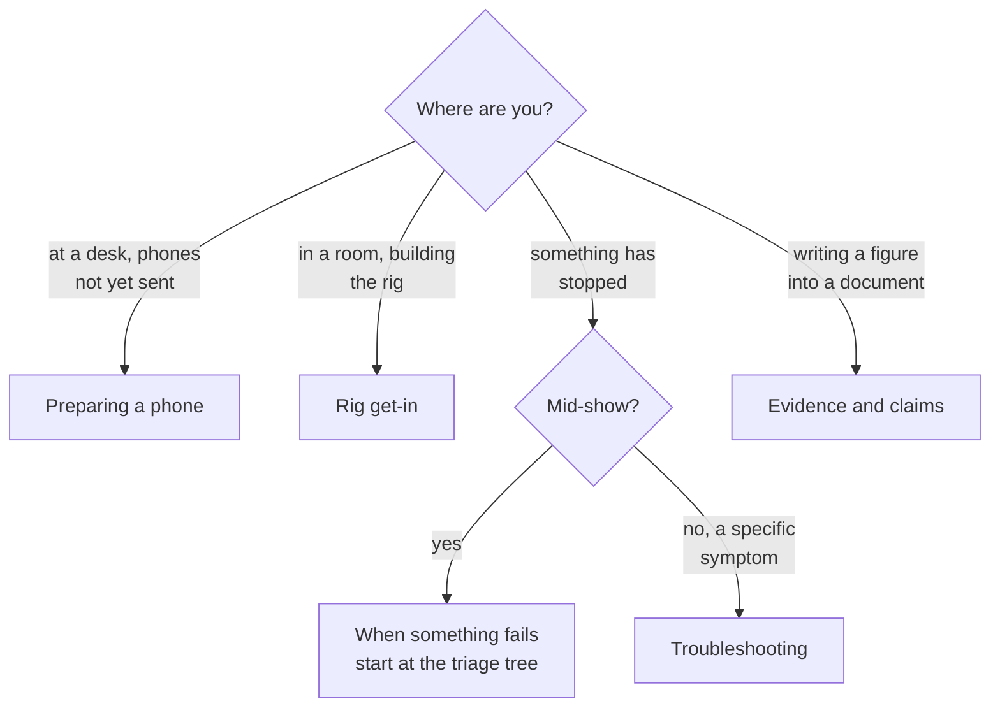

# Operations

Getting a rig up, running a show, and what to do when something stops. These
pages assume no knowledge of the code.

They are procedure. If you want to know *why* the system is shaped the way
it is, or you are connecting another system to its output, that is
[Reference](../reference/). Nobody at a get-in should have to read a wire
format to finish a get-in.

## Which page you need

| Page | For |
|---|---|
| [Preparing a phone](phone-preparation.html) | Everything that must happen before a phone reaches a venue, and why it cannot wait. |
| [Rig get-in](get-in.html) | Building the rig in the order that avoids rework. |
| [When something fails](failure.html) | What recovers by itself, what you do, and what has no fallback. Start at the triage tree. |
| [Evidence and claims](evidence.html) | How to produce a number you can defend, and what not to claim. |
| [Troubleshooting](troubleshooting.html) | Symptom-first fixes, generated from the console's own messages. |

## The two things that cost the most time

Both are answered in advance or not at all.

**Addressing.** If the rig has no router, nothing gets an address and every
phone needs a static one. Discovered on the day, that is an hour.
[Rig get-in](get-in.html) has the decision tree.

**Phone preparation.** Several steps need internet and a hand on the phone,
and a rig LAN has neither. A phone that arrives needing an app install or a
permission tap is a phone that is not in the show.
[Preparing a phone](phone-preparation.html) has the split.
