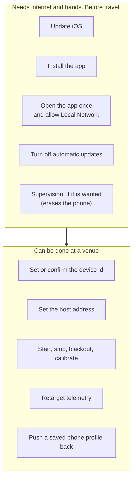

# Preparing a phone

Everything on this page has to happen **before a phone reaches the venue**,
on a normal internet connection, with a person holding the phone.

The reason is blunt: a show rig has no internet and often no spare hands. A
phone that needs an App Store sign-in, a software update or a permission tap
at a get-in is a phone that is not in the show. Several of the steps below
cannot be done remotely at all.

## The split that is the whole point of this page

Some of this can only be done where there is internet and a person holding
the phone. The rest can be done at a venue, from the console, with the phone
on a stand three metres up. Knowing which is which is the difference between
a get-in and a crisis.

The left-hand box is not a preference, it is a hard boundary. A rig LAN has
no internet and no app store sign-in, and a permission prompt needs a finger
on the glass.

Two of those are worth singling out.

**Opening the app once, on internet, is the step people skip.** First launch
is when the operating system asks for Local Network access. Decline it, or
never trigger it, and the phone looks completely healthy and sends nothing,
with nothing in the console to explain why. There is no remote fix.

**Supervision erases the phone**, so it cannot be added at a venue, in a
hotel, or on the day. If it is wanted it has to be decided before the phones
go out. See the decision below.

The right-hand box is deliberately large, because every setting that *can*
be remote was made remote. The phone is a streamer with a control surface,
so a phone on a stand needs no one to climb to it for anything that is not
physical.

## Why this cannot wait until the venue

| Step | Why it has to be done early |
|---|---|
| iOS update | Large download, needs internet and time, and reboots the phone. |
| Installing the app | Needs an Apple Account signed in and internet. Neither exists on a rig LAN. |
| Local Network permission | A one-time prompt on first launch. If it is declined, no data leaves the phone and nothing in the console explains why. |
| Device id and host address | Set once per phone. Two phones sharing an id overwrite each other's frames. |

## Before the phone leaves

Work through this per phone. It takes about fifteen minutes each, most of it
waiting for the update.

### 1. Software

1. Update iOS to the version the build targets, on Wi-Fi at home or in the
   office. Confirm it finished and the phone has rebooted.
2. Sign in to the Apple Account that was invited to the test build.
3. Install the app from the invitation.
4. **Open the app once while still on internet.** This is the step people
   skip. First launch is when iOS asks for Local Network access.
5. Allow Local Network access when prompted. Without it the phone looks
   healthy, streams nothing, and gives no clue why.
6. Turn off automatic app updates, so a build does not change under you
   between a rehearsal and a show.

### 2. Identity and destination

1. Set the **device id**. Every phone on a rig needs a different one.
2. Set the **host address** to the machine that will receive the stream.

**The device id is not optional.** A phone whose id was never set
deliberately refuses to start, with `START refused: Device ID N was never set
on this phone`. A fresh install will not stream at all until someone confirms
the id, on the phone or from the console. Do it before the phone ships.

The host address can also be set from the console once a phone is on the
network, but setting it early means a phone that joins the rig is already
correct rather than needing attention.

If two phones do end up sharing an id, the receiver now names it rather than
letting the frames quietly overwrite each other: the console reports two
senders on one device id, identified by their addresses and by the name and
model each phone sends.

> A note on the setting named `stage.tcpHost`. Despite the name it is the
> destination IP address, not a transport. Everything in this system runs over
> UDP. The name is a leftover and is being carried for compatibility.

### 3. Phone settings that break a show if missed

| Setting | Set to | What happens otherwise |
|---|---|---|
| Auto-Lock | Never | Belt and braces. The app holds the screen awake while it is in front, so this is not what interrupts capture. It matters if the app is ever backgrounded or drops to the home screen: an unlocked phone is still reachable, a locked one needs a person. |
| Passcode | Off | A locked phone cannot be recovered without someone walking to the stand. |
| Automatic updates | Off | iOS or the app changes between rehearsal and show. |
| Do Not Disturb | On | Notifications draw over the capture view. |
| Low Power Mode | Off | Throttles the frame rate. |

### 4. Power

A show phone runs on mains, not battery. Confirm the phone charges from the
power you will actually use at the venue, and that it keeps charging while
streaming. Streaming and charging at once is where a marginal cable or a
dead hub port shows up.

## The decision to make before the phones ship

**Supervision and Single App Mode.** A supervised phone can be locked into
one app and recovers to that app after a reboot. An unsupervised phone needs
a person to walk to the stand and tap the screen.

This matters more than it sounds. A powered Ethernet switch can cut power to
a phone, but **it cannot reboot a phone back into the app**. Without
supervision, any phone that restarts is out of the show until someone
physically reaches it, which during a performance may be never.

Supervision has to be applied before the phones go out, because it erases the
device. It is not something that can be added at a venue.

**Status: decision outstanding.** This is a logistics decision, not a
technical one, and it needs making before phones ship.

## Checking a phone is ready

With the phone on the same network as the console:

1. The phone appears in the console's device list on its own, without anyone
   typing its address.
2. Its battery reads above 80 per cent and shows as charging.
3. Its thermal state reads nominal.
4. Starting the stream from the console produces points, and stopping it
   stops them.

If the phone appears but sends nothing, the Local Network permission is the
first thing to check, not the network.
