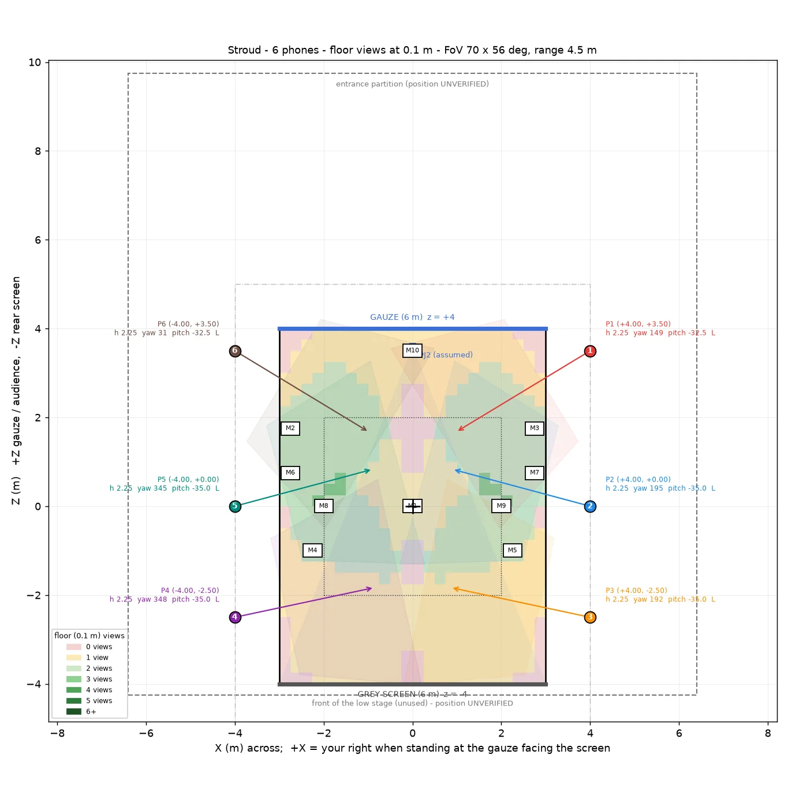
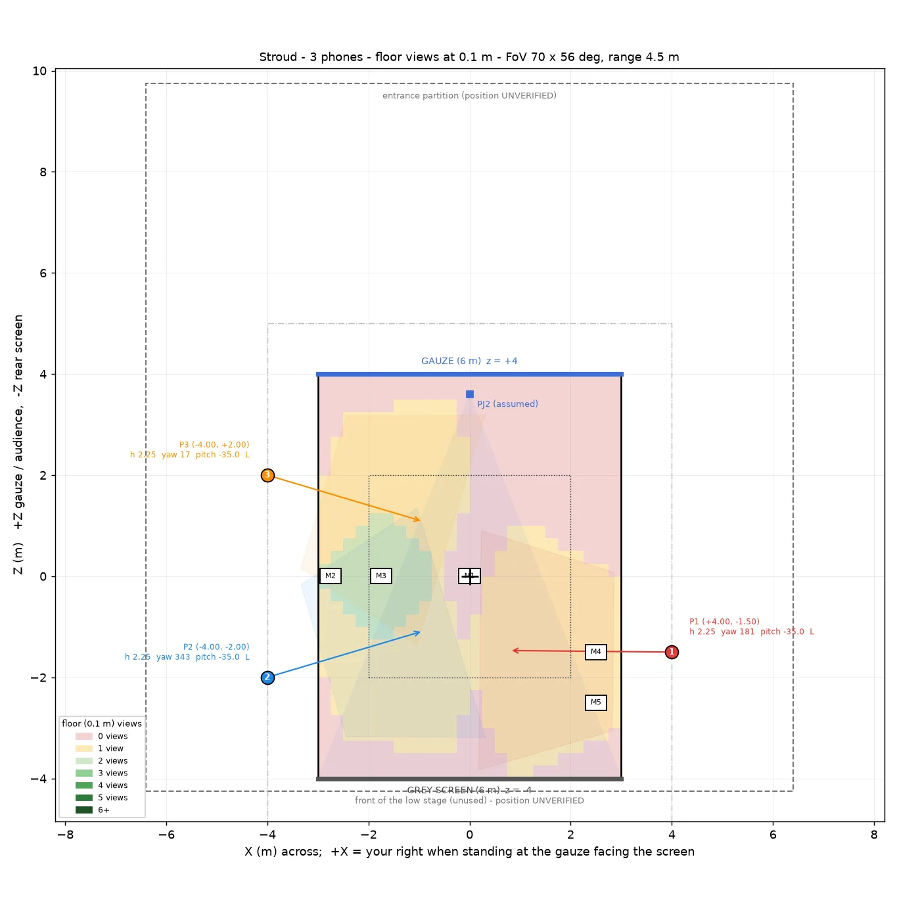

# Stroud: the plan

Where every phone, marker and tape line goes at Brunel's Goods Shed, Stroud,
for **23 to 27 November 2026**. [Rig get-in](get-in.html) is the
general procedure; this page is the venue's own numbers, so that the person
holding the tape measure does not have to work anything out.

Everything here comes from the numeric coverage study
(`Tools/coverage/coverage.py`, run 2026-10-25) and loads into the console as a
single plan, so the figures below, the plot, and what the software expects are
one set of numbers rather than three.

{: .warning }
> **The venue model has not arrived.** The layout is drawn against Mathias's
> plan of 20 October, a sketch. The room dimensions, the entrance partition,
> the front of the low stage and the projector position are all marked
> **unverified** below and on the plot itself. The playing area, the gauze and
> the screen are the parts to trust. Re-measure on the day before trusting any
> distance to a wall.

## The frame everything is measured in

| | |
|---|---|
| Origin | the centre of the playing area, on the floor |
| Playing area | 6.0 m across (X) by 8.0 m deep (Z) |
| +Z | toward the gauze |
| -Z | toward the rear screen |
| +X | your right, standing at the gauze facing the screen |
| Y | up, to the centre of the LiDAR lens |
| Yaw | the console's convention: 0 faces +X, 90 faces the screen, 180 faces -X, 270 faces the gauze |
| Pitch | negative is tilted down |

This is the same origin the client integration uses, so a position read off
this page is the position the show sees.

## Which plan, and why

Two shapes were modelled. **Six phones in side rows** is the one agreed with
Mathias on 3 November, and it is the one these tables describe.

| Shape | Phones | Seen by ≥ 1 phone | Floor ≥ 1 | Two views at torso height |
|---|---|---|---|---|
| **Side rows** (this plan) | 6, down both long sides | **92 %** | 91 % | 46 % |
| Front row + one behind | 6, five at the gauze end + one behind the screen end | 59 % | 52 % | 39 % |
| Side rows | 3 | 60 % | 62 % | 11 % |
| Front row + one behind | 3 | 49 % | 47 % | 7 % |

The front-and-back shape is the one the show-rig simulations use, and it suits
a shallow stage. Stroud's area is 8 m deep, which is deeper than that shape
reaches: about 40 % of the volume goes unseen, and it is unseen at the two
**ends** rather than in the middle: 8 % of the metre in front of the front
row, and 1 to 27 % of the 2 m by the screen. Side rows put every phone within
reach of the centre instead.

In the console these are the four **Stroud plan** buttons on the Rig page.
This plan is **Side rows · 6**; **Side rows · 3** is the reduced version for
three phones. The two **Front + back** buttons load the other shape. Loading a
plan overwrites every phone's planned pose and the marker positions, and one
undo reverts it.

{: .note }
> **What 92 % does and does not promise.** It is the share of the volume at
> foot, torso and head height that at least one phone can see, computed at a
> **4.5 m** usable body range. That range is the brief's figure, not a
> measured one: the far end has never been measured on a person, because no
> room we have had is long enough. If the real figure is 4.0 m, two-view
> coverage falls first. Measuring it is the first thing to do on site.
>
> Full double coverage of this area needs about **ten** phones (85 % at two or
> more views). Six is the most the brief's three-to-six range allows, and the
> plan spends it on breadth rather than on overlap.

## Where the phones go, at six

*Plotted 2026-10-25. The entrance partition and the front of the low stage are marked UNVERIFIED on the plot itself.*

All six stand on the two long sides, at x = ±4.00 m, lens height 2.25 m. None
crosses the gauze or the screen line, none stands in projector 2's beam, and
all are outside the 6 m width of the projected images.

| Phone | Side | x | z | z from the gauze line | Yaw | Pitch | Aim the axis at (x, z) | Tape to G0 / S0 |
|---|---|---|---|---|---|---|---|---|
| P1 | +X | +4.00 | +3.50 | 0.50 m | 148.8° | -32.5° | (+0.98, +1.67) | 4.03 / 8.50 m |
| P2 | +X | +4.00 | +0.00 | 4.00 m | 195.0° | -35.0° | (+0.90, +0.83) | 5.66 / 5.66 m |
| P3 | +X | +4.00 | -2.50 | 6.50 m | 192.0° | -35.0° | (+0.86, -1.83) | 7.63 / 4.27 m |
| P4 | -X | -4.00 | -2.50 | 6.50 m | 348.0° | -35.0° | (-0.86, -1.83) | 7.63 / 4.27 m |
| P5 | -X | -4.00 | +0.00 | 4.00 m | 345.0° | -35.0° | (-0.90, +0.83) | 5.66 / 5.66 m |
| P6 | -X | -4.00 | +3.50 | 0.50 m | 31.2° | -32.5° | (-0.98, +1.67) | 4.03 / 8.50 m |

Every phone is in landscape. G0 and S0 are the floor points under the middle
of the gauze and of the screen; the two tape measurements are the cross-check
that a position is right, and both must agree within 3 cm.

## Where the phones go, at three

The three phones in hand are two iPhone 18 Pro and one 17 Pro Max. Any phone
can take any position.

*The three-phone layout, plotted the same day, 2026-10-25, with the same two positions marked UNVERIFIED.*

| Phone | Side | x | z | z from the gauze line | Yaw | Pitch | Aim the axis at (x, z) | Tape to G0 / S0 |
|---|---|---|---|---|---|---|---|---|
| P1 | +X | +4.00 | -1.50 | 5.50 m | 180.6° | -35.0° | (+0.79, -1.47) | 6.80 / 4.72 m |
| P2 | -X | -4.00 | -2.00 | 6.00 m | 343.4° | -35.0° | (-0.92, -1.08) | 7.21 / 4.47 m |
| P3 | -X | -4.00 | +2.00 | 2.00 m | 16.6° | -35.0° | (-0.92, +1.08) | 4.47 / 7.21 m |

Three phones see 60 % of the volume once and **10 % twice**, which is about
4 m² of floor with two views. That is enough to measure synchronisation, calibration
and the fusion of two views on one person standing in the overlap. It is not a
tracking test of the area, and should not be reported as one.

## Markers

A3 sheets, 420 × 297 mm, flat on the floor, long edge parallel to the gauze,
the top of the printed image toward the screen. The position is the centre of
the marker.

| Marker | x | z | Seen by, and at what range |
|---|---|---|---|
| M1 (stage origin) | +0.00 | +0.00 | none within 4 m; it is the tape datum |
| M2 | -2.75 | +1.75 | P5 at 3.11 m, P6 at 3.11 m |
| M3 | +2.75 | +1.75 | P1 at 3.11 m, P2 at 3.11 m |
| M4 | -2.25 | -1.00 | P4 at 3.22 m, P5 at 3.02 m |
| M5 | +2.25 | -1.00 | P2 at 3.02 m, P3 at 3.22 m |
| M6 | -2.75 | +0.75 | P5 at 2.68 m, P6 at 3.77 m |
| M7 | +2.75 | +0.75 | P1 at 3.77 m, P2 at 2.68 m |
| M8 | -2.00 | +0.00 | P4 at 3.91 m, P5 at 3.01 m |
| M9 | +2.00 | +0.00 | P2 at 3.01 m, P3 at 3.91 m |
| M10 | +0.00 | +3.50 | none within 4 m (P1 and P6 at 4.59 m) |

With three phones the marker set is smaller: M1 at the origin, M2 at
(-2.75, 0.00), M3 at (-1.75, 0.00), M4 at (+2.50, -1.50), M5 at (+2.50, -2.50).

No phone sees the origin marker inside 4 m, since the nearest mount is 4 m away
in plan, and two phones on opposite sides, 8 m apart, can never share one. That
is fine: each phone takes its absolute pose from any single marker whose
position was taped, so a shared marker is a cross-check rather than a
requirement. Keep M1 anyway; it is the tape datum and a far check for
everyone.

{: .warning }
> **Tell the console the printed size.** These are A3, which is A4 scaled by
> 1.41. The solver takes the marker's real edge length from the console, so a
> marker printed at one size and declared at another moves every phone placed
> from it by exactly that ratio: a clean, plausible, completely wrong rig.
> Measure a printed marker's edge and enter it on the Markers page before
> calibrating anything.

## Setting it out with a tape

Two people: one on the tape, one on the chalk line. Everything is measured
from the gauze and the screen, never from the room walls, because the wall
positions along the room are not confirmed.

1. **G0 and S0.** Measure the gauze's bottom batten end to end (expect 6.00 m)
   and mark its midpoint on the floor directly below it: G0. Do the same under
   the grey screen: S0.
2. **Centreline.** Snap a chalk line from G0 to S0 and check it is 8.00 m. If
   it is not, use the measured length L: the origin goes at L/2 and every z
   below scales by L/8. If L is more than 0.2 m out, the study needs re-running
   with the real number.
3. **Origin.** 4.00 m from G0 along the centreline. Tape marker M1 here.
4. **The X axis.** A 3-4-5 square at the origin: mark A on the centreline
   3.00 m toward the gauze, swing 4.00 m from the origin and 5.00 m from A, and
   where they meet is on the +X axis when you swing to the right. Repeat left.
   Snap the cross line.
5. **The side lines**, x = ±4.00 m. At 1.0 m from G0 and 1.0 m from S0,
   measure 4.00 m square off the centreline each side and snap a line through
   each pair. If the area is centred in the room, these lines land 2.40 m from
   the side walls, which is a check rather than a measurement to work from.
6. **Each phone's foot.** On its side line, measure z from the cross line
   (positive toward the gauze), or use the "z from the gauze line" column. Check
   against both tape diagonals to G0 and S0; they must agree within 3 cm.
7. **Height** to the centre of the LiDAR lens in the top-left cluster, not to
   the top or the edge of the phone.
8. **Pitch** with an inclinometer on the phone's back, or the iOS Measure
   level, to ±1°.
9. **Yaw** by the floor aim point: tape a small cross where the table says the
   optical axis hits the floor, and turn the phone until that cross sits in the
   centre of the image. With the pitch already set this fixes yaw to about ±1°.
10. **Markers.** Tape each one on its (x, z), long edge parallel to the cross
    line, image top toward the screen. Enter the same (x, z) in the console
    (the console's plan view uses y = -z).
11. **Check in the console.** Every phone should report its markers at the
    ranges in the table, ±10 cm. A phone that cannot see a marker the table
    says it should is mis-aimed.

## What is still unverified

Read it before anyone plans around a number here.

| | Status |
|---|---|
| Room size, entrance partition, front of the low stage | **Unverified.** Used for the drawing and the console's room model only, never for a phone position. |
| Projector 2 at (0, 1.8, 3.6) | **Assumed** from "just behind the gauze". |
| Usable body range 4.5 m | The brief's figure. The sensor is rated to 5 m. **The far end has not been measured on a person.** |
| The gauze and the rear screen as opaque to LiDAR | Deliberately conservative: a scrim returns spurious depth, so it is modelled as a wall. |
| iPhone 18 Pro LiDAR | Assumed the same as the other phones. **Unverified.** |

Two things the plot cannot show:

- **A phone behind the screen stands in projector 2's beam** and would shadow
  the projection. It is not in this plan for that reason. If a rear view is
  ever wanted, it goes off to one side or above the screen, and loses the
  straight view of the performers' backs.
- **Pitches were swept for this venue**, at 30 to 35° down, rather than the 20 to
  25° the show-rig simulations use for a 4 m stage. Steeper sees more floor and
  cuts heads off at the far end.

{: .note }
> **The field of view in the study was right.** The study assumed 70.0 × 55.5°
> and flagged it as unmeasured, with a worry that the field log's numbers meant
> 56 to 59°. Measured on 2026-11-03 from the lens intrinsics stored inside a
> real recorded frame (`TD/newtox/testdata`, an iPhone 18 Pro): **71.0 ×
> 56.2°**, landscape. The study's figure is within one degree, so the coverage
> numbers on this page stand, and the narrower rows in the study's sensitivity
> table do not apply. The logged values that caused the worry were recorded at
> a 320-pixel width, not 256.
>
> **One phone model reads much narrower, and nothing on this page accounts for
> it.** The client reported 71.3 to 71.9 × 56.6 to 57.1° from their 16 Pro Max
> takes - in line with the above - and **65.1 × 51.1° from a 12 Pro Max**, from
> one live reading. That is six degrees narrower horizontally, so a 12 Pro Max
> standing where the study put a phone sees less than the study gave it, and
> the 92 per cent on this page is computed from the wider lens. Their figure,
> not ours: nobody here has read the intrinsics off a 12 Pro Max. No take from
> one is on file; the next one they send settles it.

**What a 12 Pro Max costs, as modelled.** The layout was re-run at the narrower
lens. Simulated, this plan's six positions over the 6 by 8 m area, share of the
volume unseen by any phone and share seen by two or more:

| Lens, at 5.0 m mounting height | Unseen | Two or more views |
|---|---|---|
| All six at 71° | 4 % | 58 % |
| Three of six at 65.1° | 6 % | 54 % |
| All six at 65.1° | 9 % | 52 % |

| Lens, at 4.5 m | Unseen | Two or more views |
|---|---|---|
| All six at 71° | 4 % | 45 % |
| Three of six at 65.1° | 6 % | 40 % |
| All six at 65.1° | 9 % | 36 % |

So a 12 Pro Max costs a few points of two-view share per phone rather than a
redesign, and height costs more than lens does: dropping from 5.0 m to 4.5 m
takes more two-view coverage than swapping every phone to the narrower lens.
**These are not the 92 and 46 per cent above**, which come from a different
tool and a different definition - read each table against its own column
headings and do not mix them.

{: .note }
The layout file carries 70° per phone and overrides the lens given on the
command line, so an earlier "71°" row of mine was really 70°. It moves the
two-view share by one point, 58 against 57, which is why the rows above are
labelled 71° and the difference is not worth re-running.
