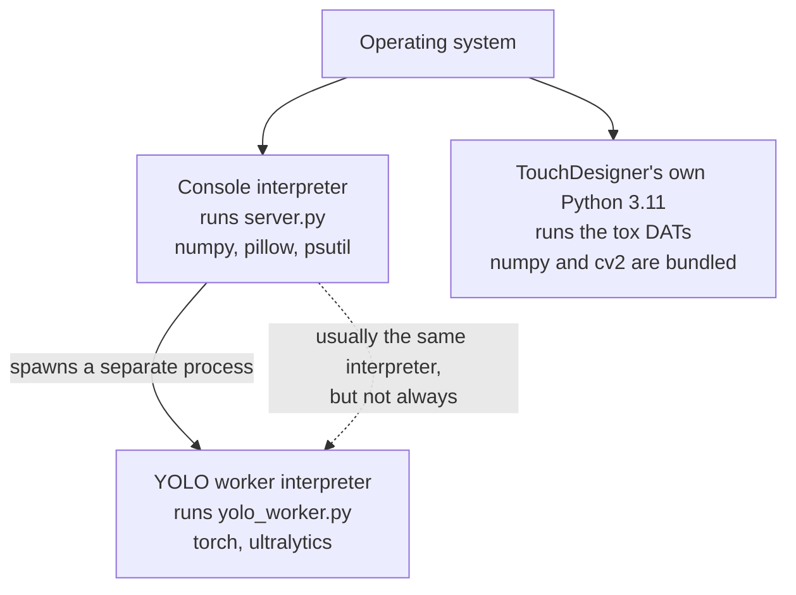

# Dependencies and requirements

Four sides of the system, each with its own runtime and its own idea of what
is installed. Nothing is shared between them: the web console, the iOS app and
TouchDesigner each carry a separate Python or a separate toolchain, and a
package installed for one is invisible to the others.

This page is for someone building a machine from nothing, or auditing what the
system actually needs. Every version here was read off a file or probed from
the installed software on 2026-10-27, not copied from a comment. Where a
declared dependency and a used dependency disagree, the disagreement is written
down rather than smoothed over, because those are the things that break on a
fresh machine and nowhere else.

## The three Python interpreters

The single most common setup mistake is assuming there is one Python. There are
three, and they do not share packages.



The console picks the worker interpreter at import time in
`WebConsole/yolo_seg.py`. The order is: the `TDSTAGE_YOLO_PYTHON` environment
variable, then the console's own interpreter if it can see `ultralytics`, then
a hard-coded legacy macOS virtualenv path that lives outside the repository,
then the console's interpreter anyway so that the error names a real path. On
the Windows show machine the installer puts everything in one virtualenv and
the first two branches collapse into one. On a development Mac they frequently
do not, and the console then runs segmentation in an interpreter nobody
remembers creating.

TouchDesigner never participates. It loads its own Python 3.11 from inside the
application bundle, so a package you install system wide, or into the console's
virtualenv, is not available to the tox.

---

## 1. The web console

Declared in `WebConsole/requirements.txt`. Installed on Windows by
`WebConsole/windows/install.bat`, which installs PyTorch first from a separate
index and then everything else from that file.

### Required

| Package | Version constraint | Declared where | What breaks without it |
|---|---|---|---|
| `numpy` | `>=1.26,<3` | `requirements.txt` | Nothing runs. Every module that touches a point grid imports it at module level. |
| `pillow` | `>=10.0,<13` | `requirements.txt` | The RGB view cannot encode JPEG or PNG, so `/api/rgb/...` fails and the Live view has no image. |
| `psutil` | `>=5.9,<8` | `requirements.txt` | Required on Windows, optional on macOS. Without it the console loses process control, USB link detection and per-thread CPU accounting. `xplat.py` guards the import and sets `psutil = None`; `doctor.py` reports it as a failure only on Windows. |

### Optional, and what dies quietly with each one

The console is built to boot degraded. Every optional dependency sits behind a
`try`/`except` that sets an `AVAILABLE` flag and records the import error, so a
missing package turns a feature off and reports why rather than stopping the
console. That is deliberate, and it means a half-installed machine looks
healthy until someone asks for the feature.

| Package | Declared where | Guarded in | What silently stops working |
|---|---|---|---|
| `ultralytics` (`>=8.4,<9`) | `requirements.txt` | `yolo_seg.py` `_probe()` | YOLO instance masks and body pose, which are the primary person segmentation. `AVAILABLE` goes false and `IMPORT_ERROR` names the interpreter that could not find it. The console still serves the roster, control and depth. |
| `torch`, `torchvision` | **Not** in `requirements.txt`, installed by `install.bat` from the PyTorch index | imported inside `yolo_worker.py` and `seg_gpu.py` | The YOLO worker cannot start at all. Deliberately excluded from `requirements.txt` so that pip does not pull a CPU build from PyPI over a CUDA build. |
| `pyobjc-framework-Vision`, `pyobjc-framework-Quartz` (`>=10`) | `requirements.txt`, macOS only via a `sys_platform` marker | `vision_seg.py`, `person_obs.py`, `hand_track.py` | Apple Vision person masks, body pose and hand tracking. On anything other than macOS this is the normal state and the YOLO path covers it. |
| `cyndilib` | Commented out of `requirements.txt`; `install.bat` attempts it separately and carries on if it fails | `ndi_out.py` | Video-over-IP output of the finished view. Nothing else. |
| `mediapipe` 1.1.1 | `requirements.txt` (as a comment) and `windows/install.bat` | `yolo_worker.py`, fail open | Hand landmarks on the cross-platform path. Without it hands fall back to the body pose's wrists. Installed with `--no-deps`: see below. |
| `mcap`, `mcap-ros2-support` | `requirements.txt` | not imported by the console | The MCAP exporter tool. No console feature depends on them. |
| `lz4` (`>=4.0,<5`) | `requirements.txt` | not imported by the console | Reading version 1 take files. Version 2 takes use a shuffle and deflate codec from the standard library and are unaffected. |
| `opencv-python` | Not declared; arrives as an `ultralytics` dependency | `hlib.py`, `hlib_grid.py`, `tox_dats/rgb_lib.py`, all guarded | Plan-view clustering in the shared isolation library when it runs outside TouchDesigner, and the hand overlay circles in the RGB view. |

`requirements.txt` carries a warning worth repeating: do not install
`opencv-python-headless` alongside `opencv-python`. The console never imports
`cv2` itself, `ultralytics` already depends on the non-headless build, and two
variants in one environment break `cv2`.

### Standard library only

These are imported across `WebConsole/*.py` and need nothing installed:
`argparse`, `base64`, `copy`, `gc`, `hashlib`, `http.server`, `importlib`,
`io`, `ipaddress`, `json`, `logging`, `math`, `mmap`, `multiprocessing`, `os`,
`re`, `shutil`, `signal`, `socket`, `statistics`, `struct`, `subprocess`,
`sys`, `tempfile`, `threading`, `time`, `traceback`, `urllib`, `uuid`, `zlib`.

The console's own cross-process link to the YOLO worker (`ipc_local.py`) is
built on `multiprocessing.connection`, so a Unix socket on POSIX and a named
pipe on Windows with no package behind either.

### Bundled model files

`WebConsole/models/` holds the weights, so there is no download at a venue.
`yolo_seg.py` searches `$TDSTAGE_YOLO_WEIGHTS`, then this folder, then a legacy
path.

| File | Approximate size | Needed for |
|---|---|---|
| `yolo26n-seg.pt` | 6.7 MB | Person instance masks. Without it `AVAILABLE` goes false. |
| `yolo26n-pose.pt` | 7.9 MB | Body pose. Optional: with no pose weights the pose option simply cannot be turned on. |
| `hand_landmarker.task` | 7.8 MB | MediaPipe hand landmarks (Apache-2.0, Google). Optional, and needs `mediapipe`. |

### Install commands that work

Windows, which is the show machine, and the only path with an installer:

```
WebConsole\windows\install.bat
WebConsole\windows\firewall.bat
WebConsole\windows\doctor.bat
```

The installer requires Python 3.12 or 3.11 reachable through the `py`
launcher, creates `WebConsole\.venv`, installs a CUDA 12.6 PyTorch build when
`nvidia-smi` is present and a CPU build otherwise, then installs
`requirements.txt`, then attempts `cyndilib` without treating failure as fatal.
It is safe to re-run. Git for Windows is also part of the install, because the
backup script is a bash script and runs under Git Bash.

macOS, by hand, because there is no macOS installer:

```
python3 -m venv WebConsole/.venv
WebConsole/.venv/bin/python -m pip install --upgrade pip
WebConsole/.venv/bin/python -m pip install torch torchvision
WebConsole/.venv/bin/python -m pip install -r WebConsole/requirements.txt
WebConsole/.venv/bin/python WebConsole/doctor.py --wait 0
```

The PyPI wheels for torch on macOS include Metal support, so no separate index

`doctor.py` is the check that matters. It is read-only, it never changes the
system, and it checks the Python version, every import, the compute device **in
the interpreter the worker will actually use**, the model files, whether the
ports are free, the firewall rules with the exact commands to add the missing
ones, this machine's addresses, and whether any phone telemetry arrives. Exit
code 0 means no failures.

### MediaPipe is installed without its dependencies, deliberately

`mediapipe` pulls `opencv-contrib-python`, which breaks the
`opencv-python` that `ultralytics` needs in the same environment. Both live in
one virtualenv here, so MediaPipe is installed with its dependency resolution
switched off:

```
pip install --no-deps "mediapipe==1.1.1" "absl-py>=2.3,<3"
```

The Windows installer does exactly that, and warns rather than failing if it
does not take: hands then fall back to the body pose's wrists. The model is
bundled as `models/hand_landmarker.task`, so there is no download at a venue.

`--no-deps` means pip will not tell you if a future MediaPipe needs something
new. That is the cost of keeping both libraries in one environment, and it is
a deliberate trade rather than an oversight.

### Running the Windows vision path on a Mac

`TDSTAGE_VISION=portable` turns Apple Vision off even where it exists, so a
Mac runs the same path the show machine runs: YOLO instance masks and body
pose plus MediaPipe hand landmarks, all inside the worker process.

```
TDSTAGE_VISION=portable python3 server.py --http 9080 --listen 9001
```

Worth knowing before a get-in: it is the only way to test what the show
machine will actually do without being in front of the show machine.

### Declared against actual: the mismatches

**The macOS console virtualenv in this repository is not what the file says.**
Probed on 2026-10-27, `WebConsole/.venv` is Python 3.14.7 and was created with
`--system-site-packages`. Only `pip`, the pyobjc frameworks and `cyndilib` were
installed into it. Everything else it can import, including `numpy` 2.4.6,
`pillow`, `lz4` and `mcap`, comes from the Homebrew system interpreter that
leaks through that flag. It cannot import `psutil`, `ultralytics` or `torch` at all. The consequence is specific: `_worker_python()` finds no
`ultralytics`, falls through to the hard-coded legacy macOS path in
`yolo_seg.py`, and segmentation runs in a Python 3.12 virtualenv belonging to
an unrelated project, with its own `ultralytics` and `torch`. That works, and it is not reproducible on any other machine.
A Mac rebuilt from the commands above will behave differently from this one
unless the legacy path is also recreated or `TDSTAGE_YOLO_PYTHON` is set.

**Installed but not declared:** `cyndilib` 0.1.1, which is intentional and
documented in the requirements file as the optional NDI output.

**Declared but not imported by the console:** `lz4`, `mcap` and
`mcap-ros2-support`. They are not dead. They belong to the take reader and the
MCAP exporter under `TD/newtox/`, which are run from the same interpreter as
the console. The requirements file is the environment's manifest, not the
console's alone, which is reasonable but is not what its header says.

**Python version:** nothing declares a floor. `doctor.py` fails below 3.9,
warns on Windows if the interpreter is not 3.11 or 3.12 because those are the
versions with CUDA torch wheels, and `install.bat` targets 3.12 then 3.11. The
Windows CI job pins 3.12. The macOS environment described above runs 3.14, which
nothing tests.

### What is checked automatically

`.github/workflows/windows-console.yml` runs the real `install.bat` on a
Windows runner on every push that touches the console, the TD ingest modules or
the tools, then `firewall.bat`, then `doctor.py`, then the YOLO worker over the
Windows named pipe with the bundled weights, then every pure-Python self-test.
The runner has no GPU, so CUDA is never exercised, and neither are phones or
TouchDesigner.

One tool, `Tools/requirements_check.py`, needs a decoder module supplied by the
integration partner that is deliberately not vendored into this repository.
Without it the field-format checks report as needing a rig rather than failing.

---

## 2. USB and wired transmission

This is the section most likely to be got wrong, because the intuition is
wrong.

**An attached iPhone is a network interface, not a tunnel.** Plugged into a
host over the cable, iOS presents a USB Ethernet (NCM) interface on both ends.
That is a real IP link. UDP crosses it natively, with no forwarding process, no
daemon and no tunnelling software anywhere in the path.

| Component | What it provides | Declared or implemented where |
|---|---|---|
| Operating system (macOS, Windows, Linux) | The USB Ethernet interface itself, and the link-local address on it. Nothing to install. | Driver support ships with the OS. |
| Both ends | A self-assigned `169.254.x.x` link-local address, because there is no DHCP server on a two-device cable. | Normal IPv4 link-local autoconfiguration. |
| iOS app | Chooses which interface the stream leaves on, and pins it. | `TDStage/Net/WiredLink.swift`, used by `PointCloudUDPStreamer.swift` and `OSCClient.swift` |
| Console | Finds the cable by looking for an interface with a link-local address that has a link-local neighbour in the ARP table. | `WebConsole/server.py` `usb_link()` on macOS, `WebConsole/xplat.py` `usb_link()` elsewhere |
| PoE rig | A PoE adapter into the phone's USB-C port, powering the phone and giving it Ethernet from the switch. | Hardware. Not software at all. |

### What is explicitly not needed

`iproxy`, and the whole `libimobiledevice` family it belongs to, is obsolete
here. It only ever forwarded TCP, which is precisely why the old wired path had
to use the legacy TCP depth protocol. The current protocol is UDP, the cable
carries UDP, and so the forwarder has nothing left to do. The remaining
mentions of `iproxy` in the source are comments explaining why it was removed
and one diagnostic that used to run an `iproxy` migration on a wrong premise.
Nothing invokes it.

Also not needed: a VPN, a bridge, a virtual adapter, or any Xcode or developer
tooling on the receiving machine. The receiving machine needs an IP stack.

### The traps

**The link-local address drifts.** Both ends self-assign without any authority
to coordinate them, and the host's chosen address changes across a replug. The
project has seen it move within two days on one rig. A phone configured with
the old address keeps sending into nothing and the stream simply stops, with no
error on either side. The console resolves the address fresh on every check
rather than storing it, and its auto-fix moves a phone onto the current cable
address when it finds one.

**A name that is not a transport.** The destination address lives in a setting
whose key name contains "tcp" for historical reasons. It is an IP address field.
Everything that reads it speaks UDP.

**Link-local everywhere is a venue failure, not a cable.** If every interface on
the machine is link-local, virtual or a mesh VPN address, there is no DHCP on
that network and nothing routes between the host and the phones, because each
device picked its own address range. `doctor.py` reports that as a failure and
tells you to set static addresses on the host and on each phone, or add a
router. One phone on one cable is the exception, and is reported as a warning
rather than a failure.

**Pinning a dead adapter must not park a phone.** The app requires the wired
interface when the operator asks for it, but if that connection has not become
ready within five seconds it is rebuilt once without the requirement, and the
link line on the phone says so. A routing-dead adapter costs a warning, not a
phone.

Measured on this rig: about 0.55 ms round trip over the cable against about
8 ms over Wi-Fi (measured, real phone, one phone). Cellular is never used for
show traffic.

---

## 3. The iOS app

| Item | Value | Declared where |
|---|---|---|
| Deployment target | iOS 26.0 | `IPHONEOS_DEPLOYMENT_TARGET` in `TDStage.xcodeproj/project.pbxproj` |
| Swift language version | 5.0 | `SWIFT_VERSION`, same file |
| Device family | iPhone only | `TARGETED_DEVICE_FAMILY = 1`, same file |
| Required device capability | `arkit` | `UIRequiredDeviceCapabilities` in `Support/Info.plist` |
| Hardware | An iPhone Pro with a rear LiDAR scanner. Checked at runtime by looking for the rear LiDAR depth camera. | `TDStage/Capture/AVDepthRenderer.swift` |
| Third-party packages | **None.** There is not a single Swift package reference in the project file. | `project.pbxproj` contains no `XCRemoteSwiftPackageReference` |
| Build toolchain | Xcode with an iOS 26 SDK or newer. CI fails the build if the runner image's newest iOS SDK is below 26. | `.github/workflows/ios.yml` |

Everything the app uses is an Apple framework linked from the SDK: `ARKit`,
`AVFoundation`, `Compression`, `CoreGraphics`, `CoreImage`, `CoreMedia`,
`CoreMotion`, `CoreVideo`, `Foundation`, `ImageIO`, `Metal`, `Network`,
`Observation`, `os`, `simd`, `SwiftUI`, `UIKit`, `UniformTypeIdentifiers` and
`Vision`. The test targets add `XCTest`, `Darwin` and `Synchronization`. No
dependency manager is involved, so there is no lock file, no resolution step and
nothing to vendor.

### The Info.plist keys that fail like network faults

This is the part worth reading before blaming the network. Several of these
keys, when missing, produce a symptom that looks exactly like a connectivity
problem, because iOS refuses an operation silently rather than reporting a
permissions error anywhere the operator will see it.

| Key | Where | What happens if it is missing |
|---|---|---|
| `NSLocalNetworkUsageDescription` | `project.pbxproj` as `INFOPLIST_KEY_NSLocalNetworkUsageDescription` | The app cannot reach anything on the LAN. The stream appears to send and nothing arrives. This is the one that looks hardest like a broken switch. |
| `NSCameraUsageDescription` | `project.pbxproj` as `INFOPLIST_KEY_NSCameraUsageDescription` | The capture session cannot start. The phone looks connected, reports healthy and streams no frames. |
| `NSMotionUsageDescription` | `Support/Info.plist` | Raw motion does not prompt on iOS, so nothing breaks at runtime. Linking CoreMotion with no purpose string is a recurring App Store review rejection. |
| `NSBonjourServices` (`_tdlidar-ctl._udp`) | `Support/Info.plist` | Service discovery for the control listener. |
| `ITSAppUsesNonExemptEncryption = false` | `Support/Info.plist` | Every TestFlight upload blocks on a manual export-compliance answer. The app ships no encryption of its own. |
| `UIFileSharingEnabled`, `LSSupportsOpeningDocumentsInPlace` | `Support/Info.plist` | Recorded takes stop appearing in the Files app and over the cable, so a take cannot be pulled off a phone without a build. |
| `UTExportedTypeDeclarations` and `CFBundleDocumentTypes` | `Support/Info.plist` | Both are needed. Without the exported declaration, cross-app sharing of a take silently produces nothing. Without the document type, a take cannot be opened into the app. The identifier is shared byte-for-byte with the sibling app, so that one file type opens into either. |
| `PrivacyInfo.xcprivacy` | `TDStage/PrivacyInfo.xcprivacy` | Upload is rejected. It declares the required-reason API categories the app actually uses: user defaults, file timestamps, disk space and system boot time. |

### Building

```
DEVELOPER_DIR=/Applications/Xcode.app/Contents/Developer \
  xcodebuild -project TDStage.xcodeproj -scheme TDStage \
  -destination generic/platform=iOS CODE_SIGNING_ALLOWED=NO build
```

The `DEVELOPER_DIR` prefix is not optional on a machine whose `xcode-select`
points at the command line tools. Use `generic/platform=iOS`, which current
`xcodebuild` accepts, rather than the older destination spelling, which it
rejects.

Distribution needs three environment variables naming an App Store Connect API
key, read by `Support/testflight.sh`: a key id, an issuer id and a path to the
`.p8` key file. The export options live in `Support/ExportOptions.plist`.

---

## 4. TouchDesigner

| Item | Value | Verified how |
|---|---|---|
| TouchDesigner build | 2025.33230 is the build in use. The tox requires the build it was saved with, 2025.32820 or newer. | Read from the installed application bundle on 2026-10-27 |
| Bundled Python | 3.11.15, a Derivative build | Probed from the bundled interpreter |
| Bundled `numpy` | 2.1.2 | Probed from the bundle |
| Bundled `cv2` | 4.11.0 | Probed from the bundle |
| Minimum for the point-operator path | 2025.30000 or newer, because point operators are only production from the 2025 release | Architecture decision note |
| GPU | The show path runs the merge on the GPU. The show machine is an NVIDIA card; development runs on Apple Silicon. | Build target note |

### What the tox's own code imports

Everything in `TD/newtox/tox_dats/` imports only the standard library plus
`numpy`, and `cv2` behind a guard that sets it to `None`. Both are bundled with
TouchDesigner. The wider `TD/newtox/` modules add `mmap`, `zlib`, `struct`,
`socket`, `multiprocessing` and the usual standard library, and import each
other by name.

So the tox needs **nothing installed**. That is a deliberate property and worth
preserving: the hub runs on a machine with a stock TouchDesigner and the
repository folder, and nothing else.

### The trap that costs an afternoon

**TouchDesigner's Python is not your Python.** The bundled interpreter is 3.11
with its own `site-packages` inside the application bundle. A package installed
with the system `pip`, or into the console's virtualenv, is not importable from
a DAT. Probed on this machine, the bundled interpreter has `numpy` and `cv2` and
does **not** have `lz4`, `mcap` or `scipy`.

That matters for two things in particular. Reading a version 1 take needs
`lz4`, and exporting to MCAP needs `mcap`. Neither runs inside TouchDesigner.
Both are host-side tools under `TD/newtox/`, run from the console's
interpreter, which is why those packages sit in the console's requirements file
rather than being a TouchDesigner concern.

The shared isolation library is written as pure `numpy` and `cv2` with no
TouchDesigner imports, specifically so the same file runs inside the tox and in
an offline test. Adding a TouchDesigner import to it breaks the offline tests
and is the one change to avoid.

### Starting it

TouchDesigner needs no build step. Open the working tox. The supporting
processes start together:

```
Tools/show_mac.sh                 # macOS
WebConsole\windows\show.bat       # show machine
```

Those start the bridge, which receives the phones outside TouchDesigner and
hands whole frames to both TouchDesigner and the console through one
memory-mapped file, and the console itself. Note that `show_mac.sh` invokes
`python3` from the path rather than the console's virtualenv, so on a Mac the
console runs under whichever interpreter `python3` resolves to. Set `PYTHON` to
override it.

A verification worth running after any tox change compares the saved tox's DAT
code against the repository byte for byte, using TouchDesigner's own extraction
tool and with TouchDesigner not running:

```
python3 TD/newtox/tox_drift.py
```

Zero differences and zero DATs present only in the tox means the repository is
the tox's code.

---

## Summary of what a fresh machine gets wrong

   the cross-platform path are absent on any machine built from the installer,
   and nothing reports it as an error.
2. There is no macOS installer, and the virtualenv in this repository is not
   reproducible from the declared files. It was created with system site
   packages and relies on a hard-coded legacy path for the heavy machine
   learning dependencies.
3. The requirements file is the environment's manifest, not the console's. Three
   packages in it belong to host-side tools rather than to the console, which is
   fine once you know, and confusing when auditing imports against declarations.
4. TouchDesigner's bundled Python is separate from everything else, and no
   amount of installing into the console's environment will make a package
   importable from a DAT.

Run `python WebConsole/doctor.py` before believing any machine is ready. It
checks the worker interpreter rather than the one you are standing in, which is
the distinction that catches most of this.
