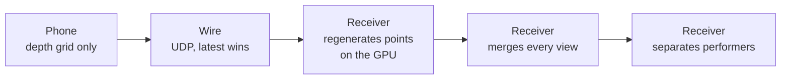
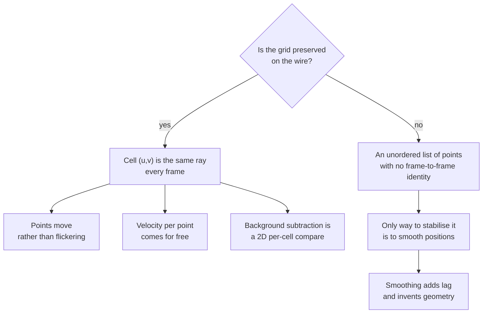
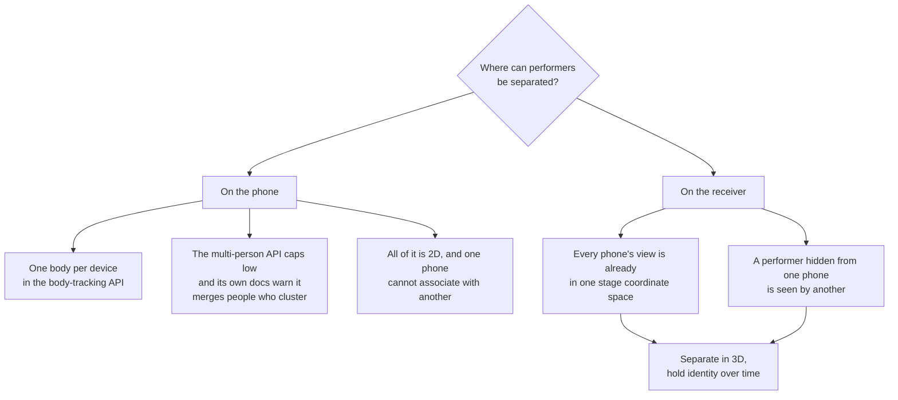

# Why it is built this way

The decisions on this page are the ones that look arbitrary from outside,
get questioned by every new reader, and would be expensive to revisit. Each
one is here because it was argued out against measured numbers rather than
chosen by taste.

If you are about to propose changing one of these, this page is the argument
you are arguing against.

## The shape of the whole thing

Every arrow points away from the phone. That is the single organising idea:
**the phone measures and sends, the receiver decides.** Each decision below
is a consequence of it.

## 1. UDP everywhere, and no TCP option

A depth frame is useful for about 33 ms. After that the next frame has
replaced it and the old one is worthless.

That one fact settles the transport.

| | UDP, drop incomplete frames | TCP |
|---|---|---|
| Cost of one lost packet | One frame from one phone is dropped. The next frame arrives 33 ms later and replaces it. | The lost segment is resent, which takes about one round trip. |
| What happens to the frames behind it | Nothing. They arrive and are used. | They are held in the buffer until the resend completes. Head-of-line blocking. |
| When the resent packet arrives | Not applicable. | Already stale, and it has delayed fresh data to get there. |

The TCP column is not a small inefficiency. A resent packet arrives after
the frame it belongs to is worthless, *and* it holds up every fresh frame
queued behind it. On an eight-phone rig inside a latency budget of around
120 ms that stall is fatal, and it happens exactly when the network is
busiest, which is during a show. Every real-time media protocol sits on UDP
for this reason.

So the policy is: **no retransmission, no negative acknowledgement, drop any
frame with a missing packet, and let the next frame fix it.** The frame is
split into numbered packets and reassembled by frame id on the receiver. If
any packet is missing the whole frame is discarded.

A frame is around 150 KB and a safe datagram is 1472 bytes, so a frame is
about a hundred packets. Application-layer fragmentation is unavoidable;
this is the same approach video-over-IP protocols take.

**There is therefore no TCP mode and no TCP fallback.** Any TCP found in this
system is a leftover to be removed, not an option to be offered. The
phone-side TCP streamer was deleted in September 2026.

> **A name that misleads.** A setting called `stage.tcpHost` holds the
> destination IP address. It is not a transport selector. The UDP point
> stream, the telemetry and the control replies all read it. Never infer a
> transport from a name: check which socket the code opens.

## 2. Depth crosses the wire, points do not

The obvious design is for the phone to work out where each point is in space
and send a list of coordinates. It is the wrong design, and the cost is
measured in multiples rather than percentages: five times the bytes against
the setting a show actually uses, seven and a half against depth alone.

A phone's depth camera produces a grid of distances. A point's position in
space is `depth × ray direction (u,v)`, and the ray direction is fixed by the
camera's calibration. The receiver already has the calibration, because the
phone sends it in every frame header. So the coordinates are a deterministic
function of data the receiver already holds.

Sending them anyway means paying for bandwidth to transmit information that
was already there.

{: .warning }
**The grid is the phone's choice, not a constant, and it decides every number
below.** The app takes the smallest float depth format the camera offers, which
is **320×240 on an iPhone 17 Pro** — 1.56 times the cells of the 256×192 that
the simulator uses and that most figures in this project were originally
computed at. A `stage.depthgrid` setting exists and is inert. So read the right
column for a real rig, and the left one only when you are reasoning about
simulated phones.

At 30 fps over a gigabit link with roughly 940 Mbit/s usable. These are
**arithmetic from the transport spec**, not measurements: cell count times
bytes times frame rate. The transport was then measured separately, at the
bottom of this page.

| What is sent | Bytes per cell | Eight phones at 256×192 | **Eight phones at 320×240** | Share of the link |
|---|---:|---:|---:|---:|
| Coordinates and colour, unprojected on the phone | 15 | 1,416 Mbit/s | **2,212 Mbit/s** | 235 per cent. Does not fit. |
| Depth, confidence and colour as a grid | 6 | 566 Mbit/s | **885 Mbit/s** | 94 per cent. Does not leave room. |
| **Depth and confidence as a grid (the show setting)** | 3 | 283 Mbit/s | **442 Mbit/s** | 47 per cent |
| Depth alone as a grid | 2 | 189 Mbit/s | **295 Mbit/s** | 31 per cent |

The first row does not fit on a gigabit network at all, which is the argument
for sending a grid. The chosen row fits twice over.

The second row is the one that changed character when the grid did. At 256×192
colour on a full rig looked like a 60 per cent load, which is a decision about
taste; at 320×240 it is 94 per cent of the usable link, which is not a decision
anyone should take during a show. **Colour is for three phones and for
measurement, not for eight phones live.**

The work does not disappear, it moves. The receiver regenerates the points
from the grid on the GPU, where unprojecting around 614,000 cells is
sub-millisecond work. The phone's CPU is spared and the network carries less
than half the traffic.

Two consequences worth knowing:

- Compression was considered and rejected. On a dedicated gigabit LAN there
  is bandwidth to spare, and compression costs latency and CPU to save
  something that is not scarce.
- The frame is **planar**, not interleaved: all the depth, then all the
  confidence, then all the colour. Planes can be omitted independently, and
  a planar depth buffer uploads to a GPU texture with no repacking.

## 3. The grid is kept, and that is what gives continuity

The grid is not just a convenient container. Keeping it is what makes the
point cloud stable.

Cell `(u,v)` is **the same camera ray every frame**. So the point that cell
produces does not appear and disappear between frames, it moves along that
ray as the measured distance changes.

That is the whole trick: **coherent identity, raw positions.** The system
keeps identity per cell, and it does *not* low-pass the position. Each frame
shows the raw current depth. You get a point cloud that does not strobe into
the generative visuals, without the lag of positional smoothing.

Three things fall out of it:

- **Background subtraction becomes trivial.** A cell whose depth sits at the
  learned background distance is background, so dropping it is a 2D compare
  rather than a 3D lookup on the hot path.
- **Per-point velocity is free**, as change in position over change in time
  per cell.
- **A dropped frame costs nothing positionally.** Since each cell is the
  same ray next frame too, losing a frame loses 33 ms of update, not
  continuity. This is what makes the drop-incomplete-frames policy in
  section 1 safe.

**The caveat, stated because it is easy to overclaim.** This is *ray*
identity, not *surface* identity. A static surface's point slides along its
ray as the distance changes, which is correct. But a performer moving
sideways sweeps *across* cells, so the surface under a given cell changes at
a silhouette edge. The grid gives stable ids, per-point velocity, flicker
reduction and near-free background subtraction. It does not give true
per-material-point tracking, which would need per-point scene flow layered
on top. Do not describe it as tracking the same piece of a body over time.

## 4. Performer separation happens on the receiving side

Separating performers is the hard requirement, and no part of it can happen
on a phone. This was researched before it was decided.

The on-device route fails on definitions, not on tuning. ARKit's body anchor
tracks a single person per device. Vision's 3D body pose returns only the most
prominent person. The one genuinely multi-person API caps at a handful of
people, is two-dimensional, and Apple's own documentation warns it may miss
people or combine them when they cluster, which is precisely the case that
has to work. And no phone can associate what it sees with what another phone
sees, because it does not know the other phone exists.

**Occlusion has exactly one real answer: more viewpoints.** A body behind
another body cannot be recovered by any amount of processing of the view
that cannot see it. It can be recovered trivially by a second camera that
can. This is why the rig has six to eight phones rather than one good one,
and it is why the aiming step at a get-in is a coverage decision and not a
framing decision.

That makes the camera positions a design input, not a convenience. Angles
planned on paper are what make separation possible later; a rig where every
phone looks from roughly the same side has redundancy but no additional
information.

## 5. The phones are deliberately dumb

A phone captures depth and sends it. It does not render, clean, cluster,
track or decide. This is a choice, and these are the reasons.

| Reason | Detail |
|---|---|
| A phone cannot see the problem | Separation is a multi-view problem. A single phone lacks the information to solve it, however much compute it has. |
| Processing on a phone cannot be inspected | Eight phones each making their own decisions is eight black boxes. One receiver making all of them is one place to look when the answer is wrong. |
| Thermal headroom is the scarce resource | A phone on a stand under stage lighting, streaming for hours on mains, is thermally constrained. Capture is what it must never drop. |
| Raw data can be reprocessed | A recording of what the phone sent can be replayed through a changed receiver. A recording of what a phone concluded cannot. |
| One streamer, one lifecycle | There is a single streaming path on the phone and a single place that owns the connection. Fewer states means fewer states that can be wrong at a venue. |

The capture itself is raw on purpose. The app uses AVFoundation's LiDAR depth
camera with filtering turned **off**, so invalid cells stay invalid rather
than being filled in. Smoothed, hole-filled depth looks better on one phone
and is worse for fusing several, because it invents geometry that the other
phones will contradict. Apple's own guidance is that computer-vision work
should prefer the unfiltered path.

**ARKit is used for one brief job and then the phone swaps back**, that job
being marker-based calibration, which needs no camera motion and works on a
static device. It is not used for capture, and the reasons are not
preferences:

| | AVFoundation, unfiltered | ARKit scene depth |
|---|---|---|
| The sensor | The same LiDAR, through the same densification | The same LiDAR, through the same densification |
| Streaming resolution | Higher | Lower |
| Filtering | Can be turned off | Cannot |
| Body tracking | Not used | One body per device, and needs camera motion the tripod will never give it |

Both APIs are the same sensor underneath, so choosing ARKit buys no better
depth. It costs resolution and forces smoothing on.

## 6. The limit that must never be claimed away

**Identity through sustained physical contact is not measurable. Not by this
system, and not by any markerless system, at any number of cameras.**

When two bodies are physically together there is no low-density gap for
clustering to find and no seam in the fused surface. The information is not
there to be processed. This is the explicit motivating problem of the
state-of-the-art research in the field, whose solution needs per-subject
learned priors and optimisation over a whole recorded sequence, and is
offline.

So the live behaviour is this, and it is the honest behaviour rather than a
shortfall:

- Do not attempt to re-derive the boundary from the current frame.
- Carry identity through by prediction.
- Reacquire on separation.
- **Flag the identity as uncertain**, so whatever consumes the output can
  decide for itself whether to trust it.

That flag is the feature. A system that says "I am guessing" is usable by a
downstream designer. A system that guesses silently is not.

More phones do not fix this. More phones fix occlusion, which is a different
problem: occlusion means the information exists but this camera cannot see
it, and contact means the information does not exist. Adding viewpoints
helps the first and does nothing for the second.

Say it plainly and early, to anyone deciding what the system will do. It is a
property of the physics, not a defect in the implementation, and it does not
improve with budget.

## What this all costs, measured

For context on whether the decisions paid off. Every figure here is from
synthetic streams, not from phones.

| Figure | Value | Label |
|---|---|---|
| GPU merge path, frame rate held | 60 fps at 8, 12 and 16 streams | Measured, simulation |
| Transport loss up to 16 streams | 0 incomplete frames, at 573 Mbit/s | Measured, simulation |
| Bridge to TouchDesigner delay | 9.5 ms median, 15.3 ms at the 95th percentile | Measured, simulation |
| Bridge receive capacity | 61,000 packets per second with no drops | Measured, simulation |
| Eight phones with colour, offered load | 49,000 packets per second at 256×192; about 76,000 at the 320×240 real phones send | Arithmetic from the frame size |

Real-phone evidence is **one phone**. Nothing in this table was produced by
eight real phones, and simulated phones do not get hot, fight for a switch or
stand in front of each other. See
[Evidence and claims](../operations/evidence.html).
