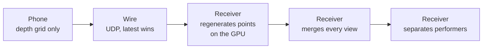
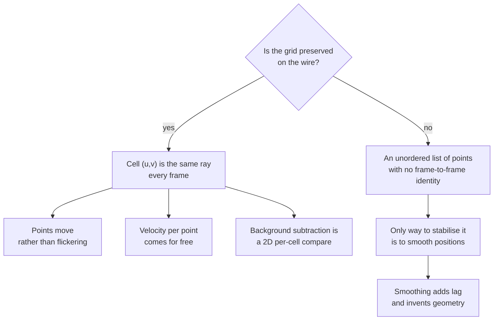
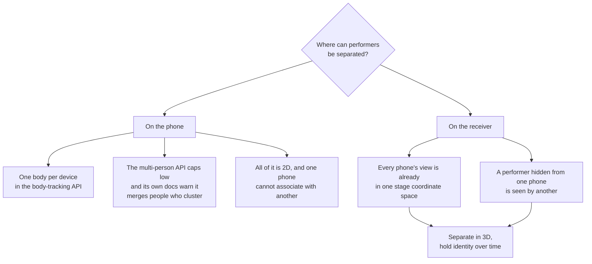
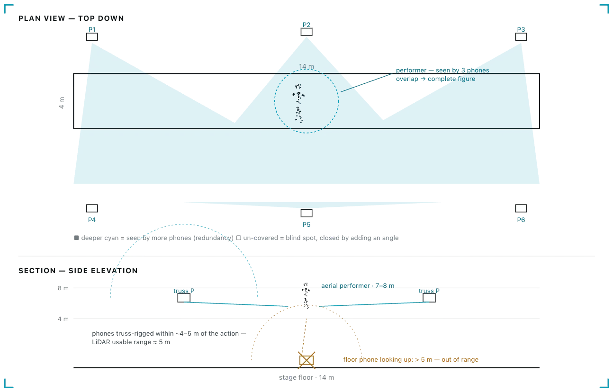

# Why it is built this way

The decisions on this page are the ones that look arbitrary from outside,
get questioned by every new reader, and would be expensive to revisit. Each
one is here because it was argued out against measured numbers rather than
chosen by taste.

If you are about to propose changing one of these, this page is the argument
you are arguing against.

## The shape of the whole thing

Every arrow points away from the phone. That is the single organising idea:
**the phone measures and sends, the receiver decides.** Each decision below
follows from it.

## 1. UDP everywhere, and no TCP option

A depth frame is useful for about 33 ms. After that the next frame has
replaced it and the old one is worthless. That one fact settles the
transport.

| | UDP, drop incomplete frames | TCP |
|---|---|---|
| Cost of one lost packet | One frame from one phone is dropped. The next frame arrives 33 ms later and replaces it. | The lost segment is resent, which takes about one round trip. |
| What happens to the frames behind it | Nothing. They arrive and are used. | They wait in the buffer until the resend completes. That is head-of-line blocking. |
| When the resent packet arrives | Not applicable. | Already stale, and it has delayed fresh data to get there. |

The TCP column is not a small inefficiency. A resent packet arrives after
the frame it belongs to is worthless, *and* it holds up every fresh frame
queued behind it. On an eight-phone rig inside a latency budget of around 120 ms
that stall is fatal, and it happens when the network is busiest, which is
during a show. Every real-time media protocol sits on UDP for this reason.

So the policy is: **no retransmission, no negative acknowledgement, drop any
frame with a missing packet, and let the next frame fix it.** The phone
splits each frame into numbered packets and the receiver reassembles them by
frame id. If any packet is missing, the receiver discards the whole frame.

A depth-and-confidence frame is around 150 KB at the 256×192 grid the rig
sends and around 230 KB at the 320×240 the parked AVFoundation app takes on a
17 Pro, and a safe datagram is 1472 bytes, so a frame is 100 to 160 packets. The app has to split frames itself
(application-layer fragmentation), which is what video-over-IP protocols do too.

**There is therefore no TCP mode and no TCP fallback.** Any TCP you find in
this system is a leftover; remove it. The phone-side TCP streamer was deleted in
September 2026.

> **A name that misleads.** A setting called `stage.tcpHost` holds the
> destination IP address. It is not a transport selector. The UDP point
> stream, the telemetry and the control replies all read it. Never infer a
> transport from a name: check which socket the code opens.

## 2. Depth crosses the wire, points do not

The obvious design has the phone work out where each point is in space and
send a list of coordinates. It is the wrong design, and the cost comes in
multiples rather than percentages: five times the bytes of the setting a show
uses, seven and a half times depth alone.

A phone's depth camera produces a grid of distances. A point's position in
space is `depth × ray direction (u,v)`, and the ray direction is fixed by the
camera's calibration. The receiver already has the calibration, because the
phone sends it in every frame header. So the coordinates are a deterministic
function of data the receiver already holds, and sending them anyway means
paying bandwidth to transmit information that was already there.

{: .warning }
**The grid decides every number below, and it depends on which app the phone is
running.** TDStage AR, the app the rig deploys, captures through ARKit, and
ARKit's scene depth is **256×192 on every LiDAR iPhone**: a 12 Pro, a 16 Pro
Max and an 18 Pro all send the same grid. The parked AVFoundation app takes the
first video format that offers depth and the smallest float grid behind it,
which is **320×240 on an iPhone 17 Pro**, 1.56 times the cells. A
`stage.depthgrid` setting exists in both and is inert in both. So the left
column is the deployed rig and the simulator; the right column is the parked
app's path.

The table assumes 30 fps over a gigabit link with roughly 940 Mbit/s usable.
Its figures are **arithmetic from the transport spec** (cell count times bytes
times frame rate), not measurements. The measured transport numbers are at the
bottom of this page.

| What is sent | Bytes per cell | **Eight phones at 256×192, the rig's grid** | Eight at 320×240 | That column on the wire, framed | Share of a gigabit link |
|---|---:|---:|---:|---:|---:|
| Coordinates and colour, unprojected on the phone | 15 | **1,416 Mbit/s** | 2,212 Mbit/s | Not applicable | 151 per cent at 256×192. Does not fit either way |
| **Depth, confidence and colour as a grid** | 6 | **566 Mbit/s** | 885 Mbit/s | 937 Mbit/s at 320×240, about 600 at 256×192 | **60 per cent at the rig's grid**, 94 per cent at 320×240 |
| Depth and confidence as a grid | 3 | **283 Mbit/s** | 442 Mbit/s | 469 Mbit/s at 320×240 | 30 per cent at the rig's grid |
| Depth alone as a grid | 2 | **189 Mbit/s** | 295 Mbit/s | 313 Mbit/s at 320×240 | 20 per cent at the rig's grid |

The grid columns and the framed column are two **bases**, and saying which one
a figure uses avoids an argument later. A grid column is payload at the IP
layer: cells × bytes × frame rate, compared against the roughly 940 Mbit/s a
gigabit link carries once its own overhead is taken out. The framed column adds
what Ethernet charges per packet (38 bytes of preamble, header, checksum and
inter-frame gap, plus the UDP, IP and TDP4 headers) and compares against the
full 1,000 Mbit/s line rate.

They agree to within half a percentage point, which is the useful part: the
conclusion does not depend on which basis you pick. For a claim about whether
something fits on a cable, the framed number is the honest one, because that is
what the cable carries.

The first row does not fit on a gigabit network at all, which is the argument
for sending a grid. The chosen row fits twice over.

The second row is the one that changes character with the grid, and the grid
changed twice. At 320×240 it is 937 Mbit/s of framed traffic on a 1,000 Mbit/s
line, which is not a load to carry into a show, and that is the figure the
2.5 GbE decision was taken on. At the 256×192 the rig now sends it is about
600 Mbit/s, a 60 per cent load, and **colour from all eight phones fits a
gigabit link**. Stroud runs ARKit on every phone, decided 10 November.

Two ceilings could bind, the receiving software or the link, and it is now
settled that the link does. A load test on 2026-10-27 took the receiving
bridge to 114,500 packets per second (twelve phones of 320×240 with colour)
with no incomplete frames and every phone still at 30.0 fps, at 55 per cent of
one core. Eight colour phones offer 76,300, so the bridge has about half as
much again in hand. The 61,000 figure in older notes was the highest load
tested, not a limit.

So the constraint is 937 Mbit/s of framed traffic on a 1,000 Mbit/s line, with
nothing left for a burst. That is a cabling decision rather than a software
one, and on 2026-10-30 it was taken.

### The decision: a faster link, not less colour

**The show is to run 2.5 gigabit** (a switch with a 2.5G uplink and a 2.5G card in
the show machine) and **every phone sends colour** ([#42](https://github.com/AristidesAI/TDStage/issues/42)).
The hardware is not in yet: the switch named for Stroud on 2026-11-03 (a GS316EPP)
has gigabit ports and no 2.5G port, so six colour phones fit on it at about 70 per
cent and eight do not. Until the 2.5G link exists, rehearsals on a gigabit switch
run colour on three phones.

Eight colour phones on a 2.5 Gbit/s link is 937 of 2,500 Mbit/s: **37 per
cent**, which is headroom rather than a tightrope. Every alternative bought the
same relief by giving something up: colour from most of the rig, colour detail,
colour frame rate, or days of protocol work. This one costs a switch and a
network card.

### What the move to ARKit does to that decision

Every figure above is the **AVFoundation** capture grid, 320 × 240, which is
what the decision had in front of it on 30 October. The app the rig actually
deploys now captures through ARKit, at 256 × 192, and that is 44 per cent fewer
cells:

| Colour from every phone | 6 phones | 7 phones | 8 phones |
|---|---:|---:|---:|
| ARKit, 256 × 192 | 450 Mbit/s (45 %) | 525 (53 %) | 600 (60 %) |
| AVFoundation, 320 × 240 | 703 Mbit/s (70 %) | 820 (82 %) | 937 (94 %) |

*Per cent of one gigabit line, with framing. Arithmetic, confirmed against the
simulator's byte counts exactly.*

**So on ARKit, colour from all eight phones fits one gigabit** at 60 per cent,
inside the 70 per cent guideline, and the 2.5 GbE hardware is not needed for
bandwidth. It is still needed if the show runs AVFoundation, or ARKit at 60 fps,
or more than about nine colour phones.

That matters for Stroud, because the switch discussed for it has gigabit ports
and no 2.5 G port at all, so with that switch the link is 1 GbE whatever card
the machine has. As of 9 November no 2.5 G switch or card has been bought.

{: .warning }
> **Bandwidth is not the only question the link has to answer**, and the other
> one is open on both grids: what the switch does when several phones' frames
> arrive at once on separate ports. The buffer arithmetic says two colour frames
> starting within about a millisecond of each other overflow the switch named
> for Stroud. [Where the lost-packet rule stops
> holding](ports.html#where-that-rule-stops-holding-the-switchs-buffer) has the
> figures. It is settled by real phones through the real switch at the get-in,
> with colour on fewer phones as the fallback on site.

The same choice will come again, so the principle is worth stating:
**the cheapest thing in this system is usually the hardware.** A protocol
change costs days of work across the phone, TouchDesigner, the console, the
simulators, the take format and the spec, and it costs them again every time
somebody reads the wire. A faster link costs a purchase order.

{: .note }
Still to be measured: the receive path through a real network card and the
venue's switch, rather than loopback (sender and receiver on the same machine,
no card involved). The bridge is proven to 114,500 packets a second on
loopback, and eight colour phones offer about 76,300, but loopback skips the
card's own receive path, which is where a real rig would struggle. That test is
part of [#42](https://github.com/AristidesAI/TDStage/issues/42).

### What a show without colour gives up

This, rather than the megabits, is what decides it, and it is easy to miss
because "colour" sounds like appearance.

The console's person vision reads the phones' colour plane. Without it there
are **no person masks**, so performers are separated by geometry alone, and
**no hands**, because the wrist detector works on a colour image. The system
keeps tracking and keeps publishing positions (the mask stage fails open, so a
phone with no mask contributes all of its points rather than none), but two of
the things that make the tracking good are absent.

So depth-and-confidence is not "the same thing, smaller". It is a different
product: positions without appearance, and bodies separated by shape instead of
by who they look like. Know that before the link budget decides it for you.

### The fact that makes the trade cheaper than it looks

The person model has a **total** budget of inferences per second shared across
every phone, 70 by default. Each phone therefore runs at the budget divided by
the phone count, so **at eight phones the model already looks at each one about
nine times a second**, not thirty.

Two consequences follow, and they turn an apparently brutal choice into a mild
one:

- **Colour at a reduced frame rate costs the person model nothing**, because it
  was only sampling at about that rate anyway. What it costs is colour in the
  point cloud lagging a fast-moving arm.
- **Colour on a subset of phones** costs masks and hands from the phones that
  do not send it, and nothing from the ones that do.

The options, with their link loads and what each gives up, are in
[#42](https://github.com/AristidesAI/TDStage/issues/42). The decision is
Ari's; this page exists so that whoever takes it knows the model's appetite for
colour is smaller than the wire's.

Two things make reduced-rate colour work rather than merely cost less, and both
exist because sending colour intermittently used to break something:

- **In the console, a frame without colour keeps the colours it had.** Each point
  borrows the phone's last real image, up to a second old and on the same grid.
  Without that, every point of a colourless frame was **black**, so the coloured
  cloud, the video output and the appearance colours the tracker uses would have
  blinked black on every such frame, which is what sending colour less often
  was supposed to protect. TouchDesigner does not hold colour: its atlas marks a
  colourless frame as having none.
- **A phone that is moving gets slightly stale colours** for up to that second,
  because the held image is pinned to the grid rather than to the scene. On a
  phone on a stand this is invisible; know it before anybody hand-holds one.

**A hot phone can do this by itself, and currently does not.** The thermal
ladder (the ordered list of things a phone sheds as it heats up) can drop the
colour plane before it cuts frame rate, which would halve that phone's
bandwidth while keeping its rate. It is switched off by default because the
heat run of 2026-10-28 found that taking colour off the wire did not visibly
change a phone's thermal state, so it cost the person masks and the hands from
that phone and bought nothing measurable.

{: .note }
Those bridge figures were measured over loopback. That is the right way to find
the software's own ceiling, and it skips a real network card's receive path and
the switch, so the end-to-end path at this load has still not been measured.

The work does not disappear, it moves. The receiver regenerates the points
from the grid on the GPU: the 2026-07-18 architecture note put unprojecting the
393,000 cells of eight 256×192 grids at under a millisecond, and the GPU merge
path holds TouchDesigner at 60 fps with eight simulated phones. The phone's CPU
is spared and the network carries less than half the traffic.

Two consequences:

- Compression was considered and rejected. On a dedicated gigabit LAN there
  is bandwidth to spare, and compression costs latency and CPU to save
  something that is not scarce.
- The frame is **planar**, not interleaved: all the depth, then all the
  confidence, then all the colour. Planes can be omitted independently, and
  a planar depth buffer uploads to a GPU texture with no repacking.

## 3. The grid is kept, and that is what gives continuity

The grid is more than a convenient container: keeping it is what makes the
point cloud stable.

Cell `(u,v)` is **the same camera ray every frame**. So the point that cell
produces does not appear and disappear between frames; it moves along that
ray as the measured distance changes.

The whole trick is **coherent identity, raw positions.** The system keeps
identity per cell, and it does *not* low-pass (smooth over time) the position.
Each frame shows the raw current depth. You get a point cloud that does not
strobe into the generative visuals, without the lag of positional smoothing.

Three things fall out of it:

- **Background subtraction becomes trivial.** A cell whose depth sits at the
  learned background distance is background, so dropping it is a 2D compare
  rather than a 3D lookup on the hot path.
- **Per-point velocity is free**, as change in position over change in time
  per cell.
- **A dropped frame costs nothing positionally.** Since each cell is the
  same ray next frame too, losing a frame loses 33 ms of update, not
  continuity. This is what makes the drop-incomplete-frames policy in
  section 1 safe.

**The caveat, stated because it is easy to overclaim.** This is *ray*
identity, not *surface* identity. A static surface's point slides along its
ray as the distance changes, which is correct. But a performer moving
sideways sweeps *across* cells, so the surface under a given cell changes at
a silhouette edge. The grid gives stable ids, per-point velocity, flicker
reduction and near-free background subtraction. It does not give true
per-material-point tracking, which would need per-point scene flow layered
on top. Do not describe it as tracking the same piece of a body over time.

## 4. Performer separation happens on the receiving side

Separating performers is the hard requirement, and no part of it can happen
on a phone. The research came before the decision.

The on-device route fails on the APIs' own definitions, so no tuning rescues
it. ARKit's body anchor tracks a single person per device. Vision's 3D body
pose returns only the most prominent person. The one multi-person API caps at
a handful of people, is two-dimensional, and Apple's own documentation warns
it may miss people or combine them when they cluster, which is the case that
has to work. And no phone can associate what it sees with what another phone
sees, because it does not know the other phone exists.

**Occlusion has one answer: more viewpoints.** No amount of processing
recovers a body behind another body from the view that cannot see it. A
second camera that can see it recovers it at once. This is why the rig has
six to eight phones rather than one good one,
and it is why the aiming step at a get-in is a coverage decision and not a
framing decision.

*The original brief's concept drawing. Its 14 m stage and truss rig are superseded by Stroud's 8 x 6 m area with phones on stands; the idea it shows, one performer covered by several angles, is unchanged.*

That makes the camera positions a design input, not a convenience. Angles
planned on paper are what make separation possible later; a rig where every
phone looks from roughly the same side has redundancy but no additional
information.

## 5. The phones are deliberately dumb

A phone captures depth and sends it. It does not render, clean, cluster,
track or decide. This is a choice, and these are the reasons.

| Reason | Detail |
|---|---|
| A phone cannot see the problem | Separation is a multi-view problem. A single phone lacks the information to solve it, however much compute it has. |
| Processing on a phone cannot be inspected | Eight phones each making their own decisions is eight black boxes. One receiver making all of them is one place to look when the answer is wrong. |
| Thermal headroom is the scarce resource | A phone on a stand under stage lighting, streaming for hours on mains, is thermally constrained. Capture is what it must never drop. |
| Raw data can be reprocessed | A recording of what the phone sent can be replayed through a changed receiver. A recording of what a phone concluded cannot. |
| One streamer, one lifecycle | There is a single streaming path on the phone and a single place that owns the connection. Fewer states means fewer states that can be wrong at a venue. |

The capture itself is raw on purpose: invalid cells stay invalid rather than
being filled in. Smoothed, hole-filled depth looks better on one phone and is
worse for fusing several, because it invents geometry the other phones will
contradict.

### Which capture API, and why that changed

{: .note }
> **Since 2026-11-06 the project ships one phone app, TDStage AR, and it
> captures with ARKit scene depth.** The original app captured with
> AVFoundation's LiDAR depth camera with filtering turned off, and used ARKit
> only for marker calibration. That app is parked, not deleted. Anything you
> read elsewhere describing AVFoundation as *the* capture path, including
> older notes in the repository, predates this.

The original comparison is still the reason the first app was built the way it
was, and it is still true about the two APIs:

| | AVFoundation, unfiltered | ARKit scene depth |
|---|---|---|
| The sensor | The same LiDAR, through the same densification | The same LiDAR, through the same densification |
| Streaming resolution | Higher | Lower |
| Filtering | Can be turned off | Cannot |
| Body tracking | Not used | One body per device, and needs camera motion a tripod will never give it |

What changed is not that table. It is that **edge bleed turned out to cost more
than resolution**. Depth at the silhouette of a body smears onto whatever is
behind it, and those smeared points survive into the fused cloud as a halo that
no receiver-side cleanup removes reliably. The ARKit fork went after that
directly: a per-pixel bimodal edge cull, a temporal median, flip hysteresis,
and ARKit's own person matte. On 6 November the project kept the fork and
parked the other app rather than maintain two.

Two things about that decision should be said plainly, because they are the
questions a reviewer asks:

- **The A/B was never run.** Comparing the two paths on resolution against
  confidence on a real performer is still open (#10). The choice was made on
  the edge-bleed work, not on a measured comparison of the two capture paths.
- **ARKit costs latency, and the measurement is not a clean comparison.**
  Capture to send on 28 October: ARKit **62 to 78 ms with two phones**,
  AVFoundation **37 ms with one phone**. Different phone counts, so the gap is
  not all attributable to the API. It has not been re-measured at equal
  configuration.

Both APIs are the same sensor underneath, so neither buys better raw depth.

## 6. The limit that must never be claimed away

**Identity through sustained physical contact is not measurable, by this
system or by any markerless system, at any number of cameras.**

When two bodies are physically together there is no low-density gap for
clustering to find and no seam in the fused surface. The information is not
there to be processed. This is the explicit motivating problem of the
state-of-the-art research in the field, whose solution needs per-subject
learned priors and optimisation over a whole recorded sequence, and is
offline.

So the live behaviour is this, and it is the honest behaviour rather than a
shortfall:

- Do not attempt to re-derive the boundary from the current frame.
- Carry identity through by prediction.
- Reacquire on separation.
- **Flag the identity as uncertain**, so whatever consumes the output can
  decide for itself whether to trust it.

That flag is the feature. A downstream designer can use a system that says
"I am guessing", and cannot use one that guesses silently.

More phones do not fix this. More phones fix occlusion, which is a different
problem: occlusion means the information exists but this camera cannot see
it, and contact means the information does not exist. Adding viewpoints
helps the first and does nothing for the second.

Say it plainly and early, to anyone deciding what the system will do. It is a
property of the physics, not a defect in the implementation, and it does not
improve with budget.

## What this all costs, measured

These figures show whether the decisions paid off. Every one is from
synthetic streams, not from phones.

| Figure | Value | Label |
|---|---|---|
| GPU merge path, frame rate held | 60 fps at 8, 12 and 16 streams, on a development Mac with the person model idle and no content rendering | Measured 2026-10-26, simulation at 256×192, depth and confidence |
| Transport loss up to 16 streams | 0 incomplete frames, at 573 Mbit/s | Measured 2026-10-26, simulation at 256×192, depth and confidence |
| Bridge to TouchDesigner delay | 9.5 ms median, 15.3 ms at the 95th percentile | Measured 2026-10-26, simulation at 256×192, depth and confidence |
| Bridge receive capacity | 114,500 packets per second with no drops, 55 % of one core (twelve phones of 320×240 with colour). An earlier 61,000 was the highest load then tried, not a limit | Measured 2026-10-27, loopback |
| Eight phones with colour, offered load | 49,000 packets per second at 256×192; about 76,000 at the 320×240 real phones send | Arithmetic from the frame size |

Real-phone evidence is **two phones in one room**, measured together since
2026-10-28. Nothing in this table was produced by eight real phones, and
simulated phones do not get hot, fight for a switch or stand in front of each
other. See
[Evidence and claims](../operations/evidence.html).
