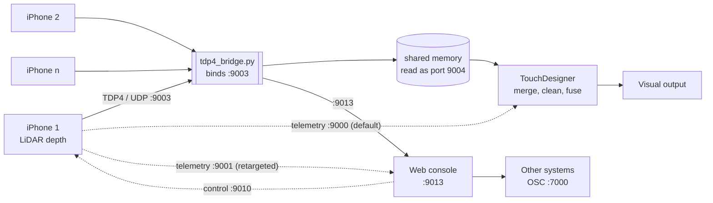
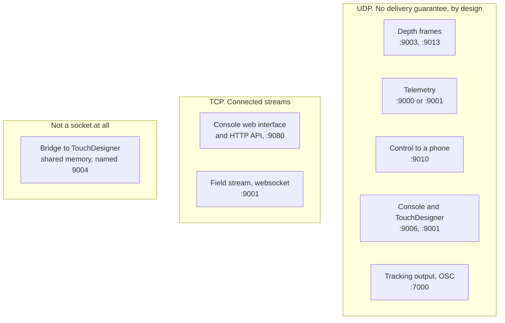

# Ports and topology

Everything carrying stage data runs over **UDP**. There are three exceptions,
and none of them carries depth: the browser talking to the console over HTTP,
the websocket that carries the field stream, and the bridge handing frames to
TouchDesigner, which is a shared memory file rather than a socket at all.

## Why UDP, and why there is no TCP option

A lost packet on UDP costs one frame from one phone, about 33 ms, and the
next frame replaces it. TCP would instead hold every fresh frame behind the
lost one until it was resent. On a rig of eight phones inside a latency
budget of around 120 ms, that stall is fatal, and it arrives exactly when the
network is busiest, which is during a show.

So there is no TCP mode and no TCP fallback. Any TCP found in this system is
a leftover to remove, not a choice to offer.

The full argument, with the bandwidth arithmetic behind it, is in
[Why it is built this way](design.html).

### What that means if you are receiving from this system

| Property | Consequence for your integration |
|---|---|
| No retransmission, no negative acknowledgement | A gap is normal. Do not treat one as a fault or a disconnection. |
| A frame with any missing packet is dropped whole | You never receive a partial frame. You receive the next complete one instead. |
| Latest wins | A newer frame replaces an older unread one. Do not assume you see every frame, and do not build state that depends on seeing them all. |
| One socket serves every device | Every datagram identifies its own sender, so demultiplex by the device id in the data and not by source address. |
| Datagrams are kept inside a normal MTU | A frame is split across roughly a hundred numbered packets and reassembled by frame id. Do not rely on IP fragmentation. |

Eight phones with colour offer around 49,000 packets per second (measured,
simulation). A receiver that does not drain on a dedicated thread with a
raised socket buffer will lose packets as buffer overflow, which looks like
network loss and is not.

> **A name that misleads.** A setting called `stage.tcpHost` holds the
> destination IP address. It is not a transport selector. The UDP point
> stream, the telemetry and the control replies all read it. Never infer a
> transport from a name: check which socket the code opens.

## Current topology

The bridge receives the phones in its own process and hands TouchDesigner
whole frames through a memory-mapped file, which TouchDesigner reads as if it
were port 9004. It exists because the GPU merge path starves a receive thread
running inside TouchDesigner, so the receiving cannot live there.

> **Older diagrams are out of date.** Documentation describing a fan-out relay
> in the show path predates 2026-10-27. The relay still exists and still
> works, but it is no longer the show path. Treat it as legacy.

## Which surface is which protocol

People assume everything is HTTP, because the console is a web page. It is
not. Almost nothing here is HTTP, and the exceptions are the two surfaces a
person or a browser touches.

Three things follow from that picture.

**Every surface carrying stage data is UDP, and none of them guarantees
delivery.** Write an integration that expects gaps. A missing frame means a
newer one replaced it.

**Port 9001 is two different things depending on protocol.** 9001/udp is the
console's own telemetry listener, which is where phone health goes when
telemetry is retargeted away from TouchDesigner. 9001/tcp is the field
stream's websocket. Same number, different protocol, unrelated purposes. This
confuses people and is worth checking before assuming a port conflict.

**The bridge to TouchDesigner hop is not a network hop.** It is a
memory-mapped file, published under the name 9004 so that TouchDesigner's own
port setting needs no change. Nothing is listening on 9004. A port scan will
not find it, and a firewall rule for it does nothing.

## Ports

| Port | Protocol | Direction | Carries |
|---|---|---|---|
| 9003 | UDP | phones to the bridge | Depth grid frames and the device hello |
| 9004 | **not a socket** | bridge to TouchDesigner | The same frames, through shared memory. The number is a published name, not a port. |
| 9013 | UDP | bridge to the console | Depth grid frames for the console's own outputs |
| 9000 | UDP | phones to TouchDesigner | Telemetry: battery, thermal, frame rate, stream health. The default. |
| 9001 | UDP | phones or TouchDesigner to the console | Telemetry, when it has been retargeted to the console's own listener, and the TouchDesigner link's replies |
| 9001 | TCP | console to another system | The field stream, as a websocket |
| 9010 | UDP | to a phone | Control messages |
| 9006 | UDP | console to TouchDesigner | Poses, health and status |
| 9080 | TCP | browser to the console | The console's web interface and HTTP API |
| 7000 | UDP | console to another system | The tracking output, as OSC |

The old relay sat on 9003 and 9004 as real sockets. If a document says
TouchDesigner binds 9004, it predates the bridge.

## What must never carry depth

**Not over the tracking or telemetry channels.** Those have no way to split a
message across packets, so a depth frame does not fit and does not arrive.

**Not over video.** Video compression is built to throw away detail the eye
will not miss. Depth values are not pixels, and a codec that is invisible on
a picture corrupts distances. Video output is for finished visuals only.

## A port that collides

The telemetry port, 9000, is a common default. If another piece of software
on the same machine already holds it, telemetry silently goes nowhere and
every phone reads as offline while streaming perfectly.

The symptom is specific and worth memorising: **points arrive, health does
not**. Start the console on a different listening port and point the phones
at it.
