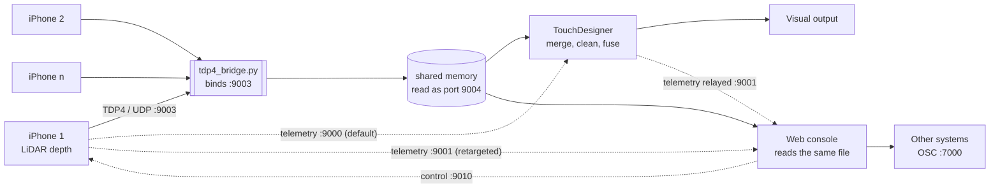
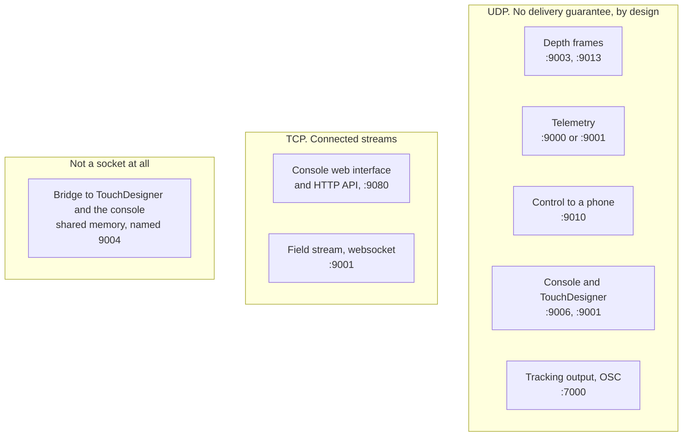

# Ports and topology

Everything carrying stage data runs over **UDP**. There are three exceptions,
and none of them carries depth: the browser talking to the console over HTTP,
the websocket that carries the field stream, and the bridge handing frames to
TouchDesigner, which is a shared memory file rather than a socket at all.

## Why UDP, and why there is no TCP option

A lost packet on UDP costs one frame from one phone, about 33 ms, and the
next frame replaces it. TCP would instead hold every fresh frame behind the
lost one until it was resent. On a rig of eight phones inside a latency
budget of around 120 ms, that stall is fatal, and it arrives exactly when the
network is busiest, which is during a show.

So there is no TCP mode and no TCP fallback. Treat any TCP you find in this
system as a leftover and remove it.

The full argument, with the bandwidth arithmetic behind it, is in
[Why it is built this way](design.html).

### What that means if you are receiving from this system

| Property | Consequence for your integration |
|---|---|
| No retransmission, no negative acknowledgement | A gap is normal. Do not treat one as a fault or a disconnection. |
| A frame with any missing packet is dropped whole | You never receive a partial frame. You receive the next complete one instead. |
| Latest wins | A newer frame replaces an older unread one. Do not assume you see every frame, and do not build state that depends on seeing them all. |
| One socket serves every device | Every datagram identifies its own sender, so demultiplex by the device id in the data and not by source address. |
| Datagrams are kept inside a normal MTU | A frame is split across numbered packets of at most 1,452 payload bytes (about 70 for a 256×192 depth-only frame, about 320 for a 320×240 frame with colour) and reassembled by frame id. Do not rely on IP fragmentation. |

Check which packet rate you are quoting. The number quoted most often is the
**simulator's**, and real phones send more.

| Eight phones, 30 fps | 256×192 (the simulator) | **320×240 (iPhone 17 Pro)** |
|---|---:|---:|
| Depth, confidence and colour | 49,000 pkt/s | **76,000 pkt/s** |
| Depth and confidence (the phone's default setting) | 24,000 pkt/s | **38,000 pkt/s** |
| Depth alone | 16,000 pkt/s | **25,000 pkt/s** |

The 49,000 figure that appears in this project's launcher comments and notes is
the left column: the simulator sends 256×192. A rig of iPhone 17 Pros sends
320×240, so the show setting is about 38,000 packets per second and colour on
eight phones is about 76,000.

**The bridge is not the limit.** In a test on 2026-10-27 it handled 114,500
packets per second (twelve simulated phones at 320×240 with colour, sent over
loopback on one Mac) with no incomplete frames, every phone still at 30.0 fps,
and 55 per cent of one core.
Eight colour phones offer 76,300, so there is about half as much again in hand.

An earlier figure of 61,000 appears in this project's launcher comments and in
older notes. **That was the highest load anyone had tried, and it was never a
ceiling.** Keep the difference in mind, because a number quoted as a limit tends
to become one in people's planning.

{: .note }
**The link was the limit, so the link changed.** Eight
phones with colour is 937 Mbit/s of framed traffic, which is 94 per cent of a
gigabit line and 37 per cent of the 2.5 Gbit/s the show now runs: a switch with
a 2.5G uplink and a 2.5G card in the show machine, decided 2026-10-30
([#42](https://github.com/AristidesAI/TDStage/issues/42)). Every phone sends colour.

The bridge figures were measured over loopback, which skips a real network
card's receive path and the switch. The software half is proven; the
end-to-end path through the venue's switch still needs measuring, and that
measurement is open on the same issue.

The retired fan-out relay lost packets above about 30,000 per second, which is
why it is retired.

A receiver that does not drain on a dedicated thread with a raised socket
buffer will lose packets to buffer overflow. That loss looks the same as network
loss, but it happens inside the receiver.

> **A name that misleads.** A setting called `stage.tcpHost` holds the
> destination IP address. It is not a transport selector. The UDP point
> stream reads it directly, and the telemetry (with the control replies that
> ride the telemetry channel) falls back to it when `stage.oscHost` is empty.
> Never infer a transport from a name: check which socket the code opens.

## Current topology

The bridge receives the phones in its own process and hands TouchDesigner
whole frames through a memory-mapped file, which TouchDesigner reads as if it
were port 9004. The console reads the same file as a second, independent
reader, so it is not downstream of TouchDesigner and no relay copies
datagrams to it. The bridge exists because the GPU merge path starves a
receive thread running inside TouchDesigner, so the receiving cannot live
there.

> **Older diagrams are out of date.** Documentation describing a fan-out relay
> in the show path predates 2026-10-27. The relay still exists and still
> works, but it is no longer the show path. Treat it as legacy.

## Which surface is which protocol

The console is a web page, so people assume everything is HTTP. Almost
nothing here is HTTP. The two exceptions are the surfaces a person or a browser
touches.

Three things follow from that picture.

**Every surface carrying stage data is UDP, and none of them guarantees
delivery.** Write an integration that expects gaps. A missing frame means a
newer one replaced it.

**Port 9001 is two different things depending on protocol.** 9001/udp is the
console's own telemetry listener, which is where phone health goes when
telemetry is retargeted away from TouchDesigner, and where the tox relays each
phone's telemetry and sends its own replies while the link is up. 9001/tcp is the field
stream's websocket. Same number, different protocol, unrelated purposes. Check
which one you are looking at before you assume a port conflict.

**The bridge to TouchDesigner hop is not a network hop.** It is a
memory-mapped file, published under the name 9004 so that TouchDesigner's own
port setting needs no change. While the bridge is running, nothing is
listening on 9004: a port scan will not find it, and a firewall rule for it
does nothing. Only when the bridge is not running does TouchDesigner bind
9004 itself.

## Ports

| Port | Protocol | Direction | Carries |
|---|---|---|---|
| 9003 | UDP | phones to the bridge | Depth grid frames and the device hello |
| 9004 | **not a socket** | bridge to TouchDesigner | The same frames, through shared memory. The number is a published name, not a port. |
| 9013 | UDP | into the console's own listener | Depth grid frames from the built-in simulator, from a phone pointed at it, or from the retired fan-out's second copy. The bridge does not use it: the console reads the bridge's file. |
| 9000 | UDP | phones to TouchDesigner | Telemetry: battery, thermal, frame rate, stream health. The default. |
| 9001 | UDP | phones or TouchDesigner to the console | Telemetry, when it has been retargeted to the console's own listener or relayed by the tox, and the TouchDesigner link's replies |
| 9001 | TCP | console to another system | The field stream, as a websocket |
| 9010 | UDP | to a phone | Control messages |
| 9006 | UDP | console to TouchDesigner | Poses, health and status |
| 9080 | TCP | browser to the console | The console's web interface and HTTP API |
| 7000 | UDP | console to another system | The tracking output, as OSC |

The old relay bound 9003 and sent copies to two real sockets: TouchDesigner's
on 9004 and the console's on 9013. If a document says TouchDesigner binds
9004, it predates the bridge.

## What must never carry depth

**The tracking and telemetry channels.** Those have no way to split a
message across packets, so a depth frame does not fit and does not arrive.

**Video.** Video compression is built to throw away detail the eye
will not miss. Depth values are not pixels, and a codec that is invisible on
a picture corrupts distances. Video output is for finished visuals only.

## A port that collides

The telemetry port, 9000, is a common default. If another piece of software
on the same machine already holds it, telemetry silently goes nowhere and
every phone shows no battery, thermal or stream statistics while its point
data still marks it online.

The symptom to remember is **points arrive, health does not**. Start the
console on a different listening port and point the phones at it with the
console's **Send telemetry here** button.
