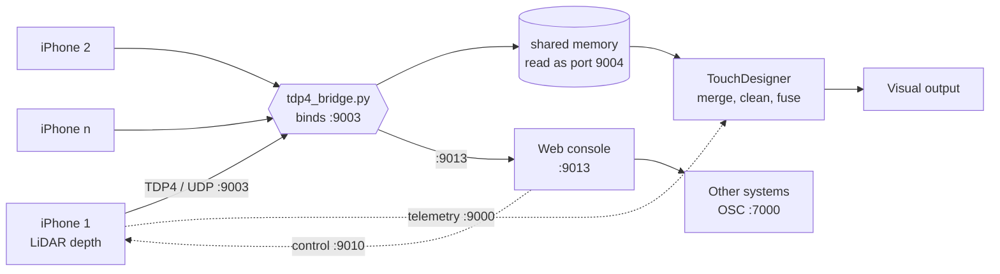

# Ports and topology

Everything carrying stage data runs over **UDP**. The only exceptions are the
browser talking to the console over HTTP and the websocket that carries the
tracking channel.

## Why UDP, and why there is no TCP option

A lost packet on UDP costs one frame from one phone, about 33 ms, and the
next frame replaces it. TCP would instead hold every fresh frame behind the
lost one until it was resent. On a rig of eight phones inside a latency
budget of around 120 ms, that stall is fatal, and it arrives exactly when the
network is busiest, which is during a show.

So there is no TCP mode and no TCP fallback. Any TCP found in this system is
a leftover to remove, not a choice to offer.

> **A name that misleads.** A setting called `stage.tcpHost` holds the
> destination IP address. It is not a transport selector. The UDP point
> stream, the telemetry and the control replies all read it. Never infer a
> transport from a name: check which socket the code opens.

## Current topology

The bridge receives the phones in its own process and hands TouchDesigner
whole frames through a memory-mapped file, which TouchDesigner reads as if it
were port 9004. It exists because the GPU merge path starves a receive thread
running inside TouchDesigner, so the receiving cannot live there.

> **Older diagrams are out of date.** Documentation describing a fan-out relay
> in the show path predates 2026-10-27. The relay still exists and still
> works, but it is no longer the show path. Treat it as legacy.

## Ports

| Port | Direction | Carries |
|---|---|---|
| 9003/udp | phones to the bridge | Depth grid frames and the device hello |
| 9004 | bridge to TouchDesigner | The same frames, through shared memory rather than a socket |
| 9013/udp | bridge to the console | Depth grid frames for the console's own outputs |
| 9000/udp | phones to TouchDesigner | Telemetry: battery, thermal, frame rate, stream health |
| 9010/udp | to a phone | Control messages |
| 9006/udp, 9001/udp | console and TouchDesigner | Poses, health and status between the two |
| 9080/tcp | browser to the console | The console's web interface and HTTP API |
| 7000/udp | console to another system | The tracking output |

## What must never carry depth

**Not over the tracking or telemetry channels.** Those have no way to split a
message across packets, so a depth frame does not fit and does not arrive.

**Not over video.** Video compression is built to throw away detail the eye
will not miss. Depth values are not pixels, and a codec that is invisible on
a picture corrupts distances. Video output is for finished visuals only.

## A port that collides

The telemetry port, 9000, is a common default. If another piece of software
on the same machine already holds it, telemetry silently goes nowhere and
every phone reads as offline while streaming perfectly.

The symptom is specific and worth memorising: **points arrive, health does
not**. Start the console on a different listening port and point the phones
at it.
