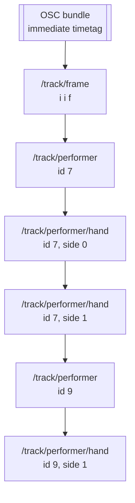
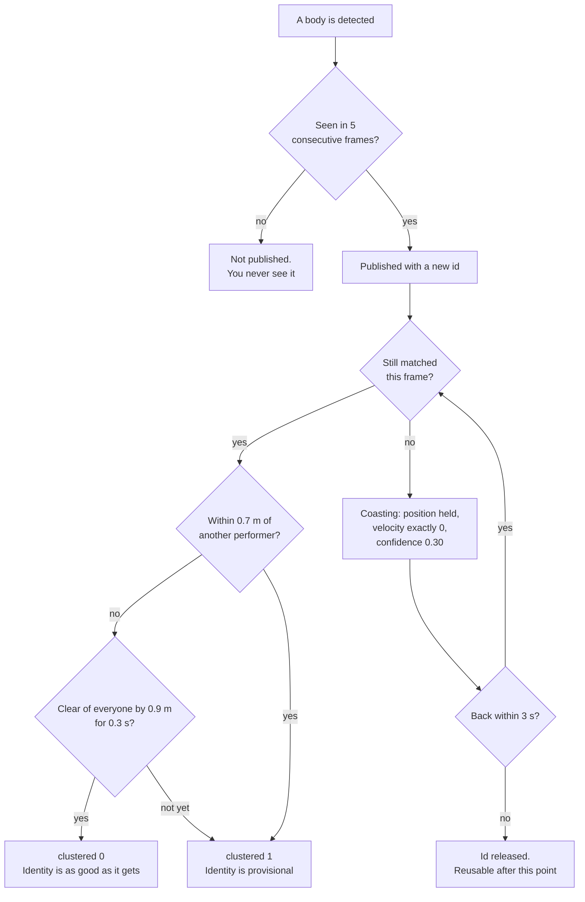

# The tracking output

{: .no_toc }

This is the contract for a system **receiving** from TDStage. If you are
writing the receiver, this page is the only one you need; everything else here
is about how the figures are produced.

  
On this page

{: .text-delta }
- TOC
{:toc}

## In one paragraph

The console sends **one OSC bundle per emitted frame** over UDP, by default at
30 Hz, to a host and port you give it (7000 by convention). Each bundle holds
one `/track/frame` message, then one `/track/performer` per published
performer, then one `/track/performer/hand` per confident hand. Positions are
metres in the stage frame, Y up, origin at the centre of the stage floor.
Nothing is acknowledged and nothing is retransmitted.

## The bundle

The timetag is **immediate** (`0x0000000000000001`), not a scheduled time. Do
not wait on it; act on the bundle when it arrives.

Hands ride in the **same** bundle as their performer and after it. That is
deliberate: a receiver that keeps per-frame state can drop a hand whose
performer id it has not seen in that frame, and this ordering means it never
has to. The console enforces it on the way out, as part of a self-check
described further down.

### `/track/frame`

| # | Type | Name | Meaning |
|---|---|---|---|
| 1 | `i` | frame | Counts up from 0 at start. Not a wall clock, and it does not reset when performers come and go. |
| 2 | `f` | seconds | Seconds since the emitter started, strictly increasing. Use this for ordering, not the frame number, if you intend to interpolate. |
| 3 | `i` | devices | How many phones fed this frame. **Read this.** A frame built from one phone is a different quality of measurement from one built from six, and this is the only field that tells you. |

### `/track/performer`

| # | Type | Name | Meaning |
|---|---|---|---|
| 1 | `i` | id | Stable identity. See [Identity](#identity-what-an-id-promises) below, because what it promises is narrower than it looks. |
| 2-4 | `f f f` | x, y, z | Position in metres. `y` is the base of the body, 0 on the floor: see [The coordinate frame](#the-coordinate-frame). |
| 5-7 | `f f f` | vx, vy, vz | Velocity in metres per second, smoothed. **Exactly zero on all three axes while a performer is coasting**, which is the cheapest way to detect that state without a flag for it. |
| 8 | `f` | confidence | 0 to 1. The formula is below; it is not a probability. |
| 9 | `i` | clustered | 1 while this performer cannot be told apart from a neighbour. Treat the identity as provisional whenever this is 1. |

### `/track/performer/hand`

| # | Type | Name | Meaning |
|---|---|---|---|
| 1 | `i` | id | The performer this hand belongs to. Always a performer in the same bundle. |
| 2 | `i` | side | 0 or 1. One message per side per performer, never two. |
| 3-5 | `f f f` | x, y, z | Position in metres, same frame as the performer. |
| 6-8 | `f f f` | vx, vy, vz | Velocity in metres per second. |
| 9 | `f` | confidence | 0 to 1. |

Hands can be turned off, in which case these messages simply do not appear.
Absence of hands is not an error and a receiver should not wait for them.

## The coordinate frame

Metres. **Y is up.** The origin is the centre of the stage floor.

`y` is the performer's **base, not their height**: exactly `0.0` when they are
standing on the stage floor, and the lowest point of the body otherwise, which
is what you get when somebody is on a rostrum, on a step or lifted. So a
performer standing centre stage reads `(0, 0, 0)`, and a `y` of 0.4 means their
feet are 0.4 m up, not that they are 0.4 m tall.

That surprises people, so it is worth saying what it is for: the useful thing
downstream is almost always where a body meets the floor, and a position that
sits at a varying point up the body moves whenever they crouch. This one does
not.

One switch can change what you receive: an operator setting that negates `z`
and `vz` on the wire. It exists because the sign of the depth axis is the one
convention that differs between every two systems that have ever been
connected, and discovering it at a get-in is worth a one-click fix rather than
a code change on either side. If your world is mirrored front to back, that
setting is the first thing to check, before anything in your own transform.

## Rate, and what arrives between frames

The default is 30 Hz, settable from 1 to 60. The emitter runs on its own clock
and **re-sends the current state when no new point cloud has arrived**, so the
rate you receive is steady even when the phones stutter.

That has a consequence worth stating plainly: **a frame is not evidence that
anything was measured since the last one.** A performer standing still and a
rig that has stopped delivering look identical for about half a second, after
which tracks begin to coast and their velocities go to exactly zero. If you
need to know whether the measurement is fresh, watch the device count on
`/track/frame` and the coasting signal, not the frame rate.

## Identity: what an id promises

Three numbers in that picture are the contract:

**Five sightings before publication.** A body that appears for four frames is
never sent. You will not see flicker ids for noise, and in exchange a real
performer walking on stage appears about 170 ms late at 30 Hz.

**Three seconds of reservation.** When a performer is lost, the id is held and
not reused for three seconds. So an id that disappears and comes back inside
three seconds is the same person. An id reappearing after longer than that is
a new identity that happens to have been given a recycled number.

**Zero velocity means coasting.** A coasting performer is a prediction, not a
measurement. Its position is the last known one, held still; its confidence
drops to a flat 0.30. If your downstream smooths or extrapolates, this is the
state where you should stop doing that.

{: .warning }
`clustered` is the field most likely to be misread. It does not mean "two
people are close together", it means **this id's position is real, but which
body it belongs to may be wrong**. Positions stay usable — for forces, fields,
anything spatial. What should hold or fade is anything keyed to *who* a
performer is: a personal colour, a per-person score.

It **enters** at 0.7 m and **leaves** only after 0.9 m of separation held for
0.3 s. That gap is deliberate: two performers hovering either side of a single
threshold would otherwise flicker the flag at frame rate, and a receiver would
act on the flicker rather than on the situation. Sustained physical contact between performers is not
resolvable by any markerless system, so during it the ids may be exchanged.
Build anything identity-critical to degrade while `clustered` is 1. The exact
semantics are still being pinned down with the client in
[#32](https://github.com/AristidesAI/TDStage/issues/32).

## Confidence, and what it is not

It is a composite of three things, not a statistical probability:

| Term | Weight | What it reads |
|---|---|---|
| Base | 0.35 | Published at all, so never below this while live |
| Size and shape | 0.35 | Point count toward 600, halved toward 0.6 when the vertical span is outside 1.2-2.2 m |
| Age | 0.30 | Reaching full after one second of life |

Then it is multiplied by 0.75 while `clustered` is 1, replaced outright by
0.30 while coasting, and clamped to 0.05-0.99. It never reaches 1.

Read it as a usability score: **high means a well-sampled, body-shaped,
established track**. Low means thin, oddly proportioned, brand new, clustered
or coasting, and the other fields tell you which. Do not threshold it as if it
were a detection probability; threshold on the thing you actually care about
(`clustered`, coasting, device count) and use confidence to rank.

## Guarantees the console makes

Every bundle is checked before it goes out, on the semantics a receiver's own
probe cannot see from outside:

- no non-finite number in any float field, ever. A single NaN would poison a
  receiving filter permanently, so a performer with one is dropped rather than
  sent
- every hand id has a performer in the same bundle
- `side` is 0 or 1, and no performer sends the same side twice
- `clustered` is 0 or 1
- confidence is within 0 to 1
- the frame timestamp strictly increases

A violation is counted and reported in the console rather than sent. If you
find one of these broken on the wire, it is worth reporting as a bug rather
than defended against.

## What a placement change does to you

Moving a phone, or a phone rejoining the stream, changes what that phone
contributes to a scene the tracker has already learned. The handling is worth
knowing because it is **per phone**, and because one setting turns it into
something much blunter.

**Normally:** that phone's points are left out for about thirty seconds while
its view is re-learned. **Every other phone keeps tracking, and performer ids
survive** — you lose one view's contribution, not the cast list. If you would
rather not wait, telling the console the stage is empty ends it immediately.

**With the background frozen** (an option for keeping a performer who stands
still from fading into the scenery): a real move clears the frozen background
outright, and **nothing is published at all** until somebody tells the console
the stage is empty again. The console says so in Rig health. This is the
trade: freezing buys you a performer who can stand still indefinitely, and
costs you an automatic recovery from moving a phone.

{: .warning }
If you move a stand during a show with the background frozen, the tracking
output goes to nobody and stays there until a person acts. That is not a
failure to diagnose, it is the setting doing what it says — but it is worth
knowing before the first time it happens rather than during it.

The button an operator presses is **Stage is empty now**, in the Live view, and
every message that asks for it calls it by that name.

## Guarantees the console does not make

**Delivery.** It is UDP. A gap is normal and is not a disconnection. There is
no sequence negotiation, no retransmission and no heartbeat beyond the frames
themselves.

**That you see every frame.** Treat the stream as latest-wins. Do not build
state that depends on observing each one.

**A fixed performer count.** By default there is no cap, because an operator
on a real stage knows how many bodies are out there and a wrong cap is worse
than none. An operator can set one, in which case the least confident
performers are dropped and the console says it is capping.

**That a performer exists.** Nothing is published until the background has
settled, which takes a few seconds of a stage with nobody on it. An empty
bundle, with `/track/frame` and no performers, is a normal and correct
message.

## Writing the receiver

A short checklist that covers most of what goes wrong:

1. Bind UDP, read bundles, do not expect a connection.
2. Parse `/track/frame` first and keep the device count beside everything you
   derive from that bundle.
3. Index performers by id within the bundle, then attach hands to them. Do not
   carry a hand across bundles.
4. Treat zero velocity on all three axes as "this is a prediction".
5. Treat `clustered` 1 as "the id may be wrong" and degrade accordingly.
6. Expect ids to vanish. Expect a vanished id back within three seconds to be
   the same person, and after three seconds not to be.
7. Check the depth-axis sign once, on day one, with one performer walking
   upstage.

## Where this comes from

The emitter is `WebConsole/track_emit.py`, which also exposes a rolling trace
of the last sixty seconds of emitted frames over the console's HTTP API for
offline analysis. The fields that let you score a run afterwards, and what
counts as evidence for a claim about this output, are on
[Evidence and claims](../operations/evidence.html). The transport reasoning,
including why none of this is TCP, is on
[Ports and topology](ports.html).
