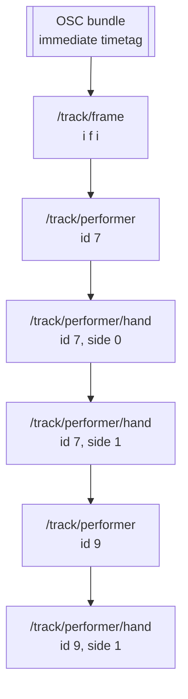
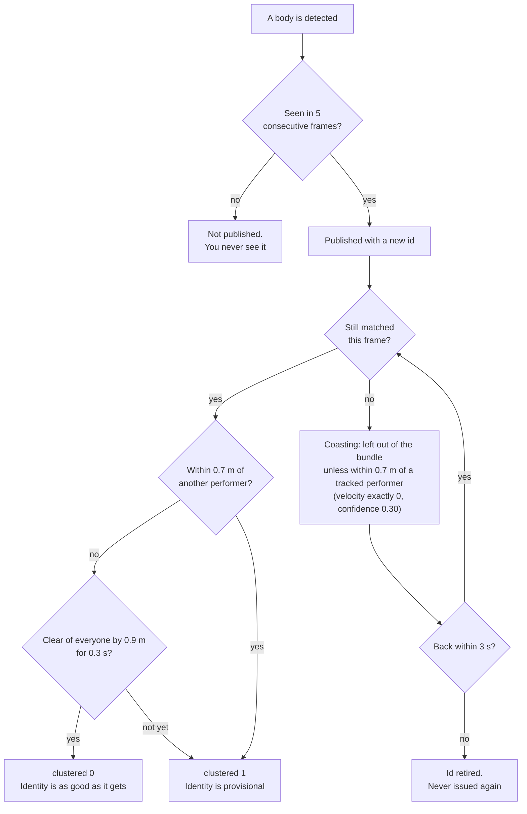

# The tracking output

{: .no_toc }

This is the contract for a system **receiving** from TDStage. If you are
writing the receiver, this page is the only one you need; everything else here
is about how the figures are produced.

  
On this page

{: .text-delta }
- TOC
{:toc}

## In one paragraph

The console sends **one OSC bundle per emitted frame** over UDP, by default at
30 Hz, to a host and port you give it (7000 by convention). Each bundle holds
one `/track/frame` message, then one `/track/performer` per published
performer, then one `/track/performer/hand` per confident hand. Positions are
metres in the stage frame, Y up, origin at the centre of the stage floor.
Nothing is acknowledged and nothing is retransmitted.

## The bundle

The timetag is **immediate** (`0x0000000000000001`), not a scheduled time. Do
not wait on it; act on the bundle when it arrives.

Hands ride in the **same** bundle as their performer and after it. That is
deliberate: a receiver that keeps per-frame state can drop a hand whose
performer id it has not seen in that frame, and this ordering means it never
has to. The console enforces it on the way out, as part of a self-check
described further down.

### `/track/frame`

| # | Type | Name | Meaning |
|---|---|---|---|
| 1 | `i` | frame | Counts up from 0 at start. Not a wall clock, and it does not reset when performers come and go. |
| 2 | `f` | seconds | Seconds since the emitter started, strictly increasing. Use this for ordering, not the frame number, if you intend to interpolate. |
| 3 | `i` | devices | How many phones fed this frame. **Read this.** A frame built from one phone is a different quality of measurement from one built from six, and this is the only field that tells you. |

### `/track/performer`

| # | Type | Name | Meaning |
|---|---|---|---|
| 1 | `i` | id | Stable identity. See [Identity](#identity-what-an-id-promises) below, because what it promises is narrower than it looks. |
| 2-4 | `f f f` | x, y, z | Position in metres. `y` is the base of the body, 0 on the floor: see [The coordinate frame](#the-coordinate-frame). |
| 5-7 | `f f f` | vx, vy, vz | Velocity in metres per second, smoothed. **Exactly zero on all three axes while a performer is coasting**, which is the cheapest way to detect that state without a flag for it. |
| 8 | `f` | confidence | 0 to 1. The formula is below; it is not a probability. |
| 9 | `i` | clustered | 1 while this performer cannot be told apart from a neighbour. Treat the identity as provisional whenever this is 1. |

### `/track/performer/hand`

| # | Type | Name | Meaning |
|---|---|---|---|
| 1 | `i` | id | The performer this hand belongs to. Always a performer in the same bundle. |
| 2 | `i` | side | **0 is the performer's left, 1 their right** - anatomical side, not which side of the picture it appeared on. One message per side per performer, never two. |
| 3-5 | `f f f` | x, y, z | Absolute position in metres, same frame as the performer, not relative to them. Unsmoothed. |
| 6-8 | `f f f` | vx, vy, vz | Velocity in metres per second, a least-squares slope over the last few samples rather than a frame-to-frame difference. **Exactly zero while the hand is being held** - see below. |
| 9 | `f` | confidence | 0 to 1. Caps at 0.5 when the wrist's depth had to be taken from further away than the joint, which is most of what separates a confident hand from a guessed one. |

Hands are emitted only for a performer who is **confirmed, not coasting and
not clustered**. A performer whose identity has gone provisional has no hands
in the bundle, by design: a clustered blob would hand you the wrong body's arm.

Hands can also be turned off at the console, in which case these messages do
not appear at all. Absence of hands is not an error and a receiver should not
wait for them.

{: .warning }
> **Everything on this page about hands is simulated, and the default
> configuration on a Mac carries none at all.** Take T1 replayed into a
> console with the live settings produced **0 hands in 2,328 performer
> frames**, with the `Hands` switch on. The wrists come from Apple's body pose
> there, which falls back to about 3 Hz, and the hand tracker needs three
> samples less than 0.2 s apart, so nothing is ever born. With the segmentation
> model's keypoint pass switched on, **91 per cent of performer frames carried
> a hand** and 72 per cent carried two.
>
> The keypoint pass turns itself on only where Apple's body pose is absent,
> which means the Windows show machine. On a Mac it stays the operator's
> choice, and `python3 Tools/hands_test.py check --fix` is the one step that
> says whether hands can be carried and switches on what they need.
>
> No hand has been measured on a real body by anything: these figures are a
> replayed take. Build the receiver from this contract, and treat the first
> rig session as where it is confirmed.

### When a hand stops being seen

A wrist is a small target. It leaves the picture behind a body, behind a prop,
or at the edge of a phone's view, several times a minute, and comes back. What
goes on the wire through that is deliberate, because a gesture latch keyed to
hand speed has to be able to close:

| Time since the last accepted sample | What is sent |
|---|---|
| up to 0.15 s | the position, with its measured velocity |
| 0.15 s to 0.2 s | the **last** position, velocity exactly zero |
| past 0.2 s | **one closing frame** - last position, velocity zero - then nothing |

After the closing frame the hand is omitted until it is seen again, and then it
has to earn its way back: three new sightings before it is published, the same
hysteresis it needed the first time. So a hand that flickers in and out does
not flicker on the wire.

Two cases skip the hold. If the performer becomes **coasting or clustered**,
the hand closes immediately rather than waiting out the 0.2 s. And if the
performer leaves the bundle altogether there is **no closing frame at all** -
the hand goes with them, and the receiver should treat a performer's departure
as closing every hand it had.

**Velocity zero means "not measured now", exactly as it does for a
performer.** A held hand and a hand resting still are the same three zeros. If
your gesture detection integrates hand velocity, a zero is the signal to stop,
not a value to carry.

A hand position is **not smoothed by us and is fused across phones**. Each
phone lifts its wrist pixel through its own depth, so a wrist half-hidden from
one phone lands on whatever was behind it, the torso or the wall. Where two or
more phones saw that wrist within 0.12 s of each other, the published position
is the confidence-weighted mean of those that agree, with any sample more than
0.15 m from the median of them dropped. With one phone it is that phone's
reading. A single-frame jump beyond 0.25 m (scaled by the interval at rates
under 30 Hz) is rejected and the last position kept, but two rejections in a
row are taken as the truth and the history restarts - so the rejection covers a
glitch, never a real fast move.

The client's own bus One-Euro-smooths every position it receives, hands
included, and takes hand velocity raw as its gesture signal. That is why we
send position unsmoothed and velocity fitted: smoothing twice would add lag,
and a frame-to-frame velocity at 30 Hz amplifies position noise about forty
times, which is enough to fire gestures out of a still hand.

### `/track/performer/body`

Seventeen points on the body, off by default, and a **proposal rather than a
settled contract** - the shape below is what we will put to Default Ltd on 17
November. Points and confidences only: no bones, no rotations, no skeleton
fitting.

The format is worth building against. **The accuracy is not there yet**, and
the numbers are below rather than buried: as measured on 11 November the points
are not good enough to switch on for a show, and a red-team review the same day
named two faults that have to be fixed first. It ships switched off.

| # | Type | Name | Meaning |
|---|---|---|---|
| 1 | `i` | id | The performer, as in every other message. |
| 2 onward | `f f f f i` × 17 | x, y, z, confidence, views | One group per joint, in a fixed order. 85 arguments after the id, **86 in all**. |

(If you see 87 quoted anywhere, that is the length of the OSC type-tag string,
`,i` followed by `ffffi` seventeen times. The argument count is 86.)

The order is COCO-17 and never varies, so a receiver indexes it rather than
parsing names: nose, left eye, right eye, left ear, right ear, left shoulder,
right shoulder, left elbow, right elbow, left wrist, right wrist, left hip,
right hip, left knee, right knee, left ankle, right ankle. **Left is the
performer's own left**, as with hands.

Positions are stage metres in the same frame as everything else, and `z`
follows the `zFlip` switch like every other position here.

Two fields need reading before the coordinates:

- **`confidence` 0 means the joint is missing.** No phone supplied it, and its
  x, y and z are sent as zeros. They are not a position at the origin. They are
  never NaN, deliberately: a NaN would poison the bus's filter permanently.
- **`views` is how many phones agreed on that joint.** 1 means a single phone
  lifted it through its own depth with nothing to check it against, which is
  the weakest a published joint gets. The arm of a performer side-on to the rig
  will sit at 1 while their shoulders sit at 3 or 4.

**One message per performer, each in its own bundle**, sent immediately after
the frame's bundle, for every confirmed performer who is neither coasting nor
clustered - the hands' rule, for the hands' reason. The separate bundles are a
packet-size decision: a body is about 470 bytes, so three of them inside the
frame's bundle would push it past a single 1500-byte datagram. That keeps the
bodies out of the frame's bundle; it does not put a ceiling on the frame's
bundle itself, which grows with the performers and hands in it. **Match a body
to its performer by the id, not by which bundle it arrived in.**

With `tracking.bodyPoints` off, which is the default, no body message is sent
and nothing else about the output changes.

Turning it on does **not** always turn on the keypoint pass the joints come
from. It does so in one case: the segmentation model is the primary observer
and `/track` hands are off, which is where nothing else would have switched the
pass on. Where Apple's body pose is the primary observer, or the automatic
choice is disabled, the setting changes nothing by itself and the keypoints
have to be switched on as well. The console's own settings page names which
rule is in force.

#### What is wrong with it, after the fixes

A red-team review on 11 November found nine things; five were fixed the same
day and the fixes are measured. The feature still **ships off and is still not
show-grade**, and the reason has moved: it is no longer mostly wrong-side
joints, it is that the planned rig does not see enough of a body from more than
one phone.

**For anything that has to be right, use only joints with `views` of 2 or
more.** That is the test, not a confidence threshold: a confidence above 0.5
implies two or more views, but not the other way round, so `views` is the field
to read. On the show layout a single-view joint is more than 30 cm out
**10 to 21 per cent of the time**, where the joints that survive the filter are
out that far 2.8 to 5.3 per cent of the time.

The catch is in the same sentence. **On the show layout most joints come from
one phone**, so the filter keeps only **18 to 34 per cent of limb joints**: it
leaves you a sparse body rather than a filtered one. On a ring of phones around
the stage the same filter keeps 52 to 97 per cent - the difference is the
layout, not the software. That is the honest state
of it, and it is why this is not show-grade on the rig as planned.

Two more things to design around:

- **Two phones at 90° are the weakest case for left and right.** Relabelling
  votes across views, so with two views that disagree the joint used to be
  withheld outright; the triangulated nose now resolves about half of those
  conflicts, and the rest are still withheld. Nothing new came out on the wrong
  side in the red team's own case, but a two-phone rig remains the arrangement
  to distrust on sides.
- **A clustered performer gets no body**, as they get no hands. A duet in
  contact is two performers with positions and no joints. Wrong-person views
  are now rejected by matching on each phone's lifted torso centre, so a close
  pass costs joints rather than giving you someone else's arm.

And one limit is **gone**: the fusion used to run before the frame was sent and
delayed it. The frame bundle now goes first, then the fusion, then one bundle
per performer, so switching body points on no longer adds latency to the
performers and hands. Off, the fusion does not run at all.

Switching it on anywhere still needs two separate yeses. Default Ltd are being
asked on **17 November** whether their bus will take a bundle that holds only a
body message - open until the call - and the measurements have to be good
enough for whoever is depending on them. With both it can run at the dry run
the next day as a **labelled experiment**. Without either it stays off, and it
stays off for Stroud.

#### How the joints are found, and how good they are

Each phone's keypoint model reports the seventeen joints as pixels - the
segmentation worker's keypoints, or Apple's body pose on a Mac, whichever
observer is carrying them - and each pixel is lifted through that phone's own
depth. Across phones the joint is **triangulated from
every phone's two-dimensional keypoints**, using each frame's own camera matrix
rather than a nominal one, and a view whose keypoint lands more than eight
pixels from the result is dropped. Depth is then the check that a camera-only
system cannot make: a view whose lifted point sits more than 0.25 m **in front
of** the triangulated joint was looking at an occluder, and is dropped too. The
published position is the agreeing views' depth, refereed by the triangulation,
because at this grid one pixel of keypoint error is about two centimetres at
four metres and the LiDAR is better than that. Three other fusion modes exist
for comparison; [how a body point is made](design.html) has them and the rest
of the mechanism.

There is no temporal model and the phones are not synchronised. Views more than
0.15 s apart are not fused, and a limb seen at different moments reprojects
outside the gate and is dropped rather than averaged into a smear.

{: .warning }
> **Not accurate enough to switch on for a show, on the layout the show uses.**
> Measured through the real keypoint model on rendered people from simulated
> phones, scored against the simulation's own joints, on the corrected
> simulator. Limb joints, hybrid fusion: median and 95th percentile error, how
> often an emitted joint is more than 30 cm out, and the share of joints
> published at all.
>
> | Rig | Median | p95 | Over 30 cm | Published |
> |---|---|---|---|---|
> | Stroud layout, 6 phones, 3 people | 101 mm | 539 mm | 13.4 % | 74 % |
> | Stroud layout, 8 phones, 1 person | 91 mm | 431 mm | 8.3 % | 67 % |
> | Stroud layout, 3 phones, 1 person | 103 mm | 596 mm | 16.1 % | 79 % |
> | 8 phones in a ring, 3 people | 60 mm | 300 mm | 5.0 % | 96 % |
> | 8 phones in a ring, 1 person | 55 mm | 224 mm | 2.7 % | 97 % |
> | 3 phones in a ring, 1 person | 83 mm | 382 mm | 8.8 % | 73 % |
>
> About 10 cm in the middle and 0.4 to 0.6 m at the 95th percentile on the show
> layout. The second row was held out of the tuning, which is why it is the one
> to trust most.
>
> **The layout is the difference, not the software.** The show rig sees most
> performers from one phone - 1.2 to 1.5 views on average - and its single-view
> joints are more than 30 cm out **10 to 21 per cent** of the time against
> **2.8 to 5.3 per cent** for its multi-view joints. Applying `views >= 2`
> leaves you 18 to 34 per cent of the limb joints on that layout; on a ring it
> leaves 52 to 97 per cent.
>
> **The remaining error is mostly not reachable by better logic.** It breaks
> down as left/right swaps 59 per cent, the depth lift 18, the wrong person 15,
> two-dimensional outliers 8 - and on the show layout the swaps are per-joint,
> on side-on single views, where a facing cue has nothing to work with. A
> perfect whole-body left/right oracle would only take the emitted share over
> 30 cm from 8.53 to 7.55 per cent. **More phones, or phones at more angles, is
> the lever; cleverer fusion is not.**

{: .note }
> **Every figure published for this feature before 11 November was measured on
> a broken simulation.** The simulated walkers did not face their direction of
> travel, so each phone saw a body at the wrong angle. The simulator is fixed
> and the table above is re-measured on it. In aggregate the error barely moved
> - 7.26 to 7.20 per cent of joints over 30 cm - but the **single-view** share
> got worse, 14.6 to 18.1 per cent, which is the case the side-row layout is
> full of. The facing cues were tuned on crab-walking people and are due a
> re-tune on rig data after London.
>
> One harness is explicitly not to be quoted, and the source says so: the
> synthetic comparison with two pixels of Gaussian keypoint noise is not
> representative of real keypoints, and it reverses which fusion mode wins.
> Everything in the table comes from the real keypoint model.
>
> Nothing here has been measured on a real body or a real rig. The cost is
> measured and small: about 1.6 ms a tick at eight phones and three performers,
> 1.0 ms when the keypoints have not changed, all after the frame has gone out.
>
> What has run with a real phone in it is one take, replayed before all of this:
> 1,625 body messages against 1,762 performer messages, every one well formed,
> every joint at `views` 1 because there was one phone. The 137-message gap has
> not been broken down, and three things cause it: a performer gets no body
> while coasting or clustered, when no phone frame younger than 0.15 s carries
> a person within 0.8 m of them, and when every joint fuses to confidence 0.

## The coordinate frame

Metres. **Y is up.** The origin is the centre of the stage floor.

`y` is the performer's **base, not their height**: exactly `0.0` whenever the
lowest point of the body is under 0.4 m, so standing on the stage floor or on a
low step, and the lowest point of the body (its 5th height percentile) otherwise,
which is what you get when somebody is on a rostrum or lifted. So a
performer standing centre stage reads `(0, 0, 0)`, and a `y` of 0.4 means their
feet are 0.4 m up, not that they are 0.4 m tall.

That surprises people. The useful thing downstream is almost always where a
body meets the floor, and a position that sits at a varying point up the body
moves whenever they crouch. This one does not.

One switch can change what you receive: an operator setting that negates `z`
and `vz` on the wire. It exists because the sign of the depth axis is the one
convention that differs between every two systems that have ever been
connected, and discovering it at a get-in is worth a one-click fix rather than
a code change on either side. If your world is mirrored front to back, that
setting is the first thing to check, before anything in your own transform.

## Rate, and what arrives between frames

The default is 30 Hz, settable from 1 to 60. The emitter runs on its own clock
and **re-sends the current state when no new point cloud has arrived**, so the
rate you receive is steady even when the phones stutter.

The consequence is that **a frame is not evidence that anything was measured
since the last one.** A performer standing still and a
rig that has stopped delivering look identical for about half a second, after
which every track starts coasting and, with no neighbour to ride, leaves the
bundle: the frames keep coming with no performers and a device count of 0. If
you need to know whether the measurement is fresh, watch the device count on
`/track/frame` and the coasting signal, not the frame rate. That count is of
the phones feeding *that* frame, so it also drops while a phone is being
re-learned after somebody moved it: see [What a placement change does to
you](#what-a-placement-change-does-to-you).

{: .warning }
> **On an empty stage, a dead rig does not yet report a device count of 0.**
> The step that zeroes it runs only while performers are tracked, so if the
> clouds stop with nobody on stage the last fresh count keeps going out: a
> receiver watching that count reads "three phones, no performers" from a rig
> that has been off for an hour. With somebody tracked when it died the count
> does go to 0, which is why this has not been noticed in a rehearsal.
>
> Fixed, and riding with `sys/integ-c`. The self-test runs the real emit loop against a store that
> goes silent and reads the count off the wire, rather than asserting on
> anything internal. Until it reaches trunk, treat a steady count as "no phone
> has dropped out", not as "the rig is alive", and read liveness from the
> capture timestamps or from the console.

## Identity: what an id promises

Three numbers in that picture are the contract:

**Five sightings before publication.** A body that appears for four frames is
never sent. You will not see flicker ids for noise, and in exchange a real
performer walking on stage appears on the fifth sighting, about 130 ms late
at a 30 Hz cloud.

**Three seconds of reservation.** When a performer is lost, the id is held and
not reused for three seconds. So an id that disappears and comes back inside
three seconds is the same person. After that the id is retired: the counter
only counts up, so a number never comes back under a different body, and a
returning performer gets a new one.

**Zero velocity means coasting.** A coasting performer is a prediction, not a
measurement. It reaches the wire only while it sits within 0.7 m of a tracked
performer, riding their blob (next section); a performer lost on their own
leaves the bundle at once and their id is held for the three seconds. While coasting its position is carried, not
measured, and its confidence drops to a flat 0.30. If your downstream smooths
or extrapolates, this is the state where you should stop doing that.

### Switching the output off and on, and restarting the console

Three things in the bundle are counters, and what they do across a restart is
part of the contract:

| | `Send /track` off, then on | Console restarted |
|---|---|---|
| `frameId` | keeps counting | back to 0 |
| `timestamp` | keeps running | back to 0 |
| performer ids | keep counting up | back to 1 |

The row that catches people is the middle column. **Turning the output off and
on gives every performer on stage a new id.** The id counter carries on, so no
number is ever reused and nothing you cached collides, but the tracker itself is
rebuilt, so the same bodies are re-acquired from nothing: five sightings each,
then new numbers. Nobody keeps their identity across the switch.

A console restart resets all three to their starting values, which means a
receiver that treats `frameId` as monotonic forever, or `timestamp` as a clock
it can compare across runs, breaks on a restart rather than on anything going
wrong. Both are monotonic **within one run of the console** and that is all they
claim. Watch for `frameId` going backwards and treat it as "a new session
started", not as a fault.

**A restart costs more than the pause suggests.** The frames come back about a
second after the console is up, with `frameId` and the clock at 0 - but for
about thirty seconds after that the bundles carry **no performers, and a device
count of 0 while every phone is streaming**, because the engine has to learn
the scene again before anybody is published. The same happens when phones come
back after an outage. Measured in simulation; a fix is being looked at.

That makes the device count ambiguous for half a minute: **0 can mean "no
phones" or "relearning"**, and the two look identical on the wire. If you need
to tell them apart, the console's own health view knows; a receiver does not.
The honest reading of a 0 is "no performers are coming right now", for either
reason.

So the shape a receiver should expect across a restart is: frames quickly,
people slowly, and everyone under a new id. A receiver that treats "frames
arriving" as "tracking working" will show an empty stage for half a minute and
report nothing wrong. The Stroud running plan warns the content team that
`/track` pauses and that ids start again afterwards; the half minute is the
part worth rehearsing.

{: .warning }
`clustered` is the field most likely to be misread. It does not mean "two
people are close together". It means **this id's position is real, but which
body it belongs to may be wrong**. Positions stay usable for forces, fields,
anything spatial. What should hold or fade is anything keyed to *who* a
performer is: a personal colour, a per-person score.

It **enters** at 0.7 m and **leaves** only after 0.9 m of separation held for
0.3 s. That gap is deliberate: two performers hovering either side of a single
threshold would otherwise flicker the flag at frame rate, and a receiver would
act on the flicker rather than on the situation. Sustained physical contact between performers is not
resolvable by any markerless system, so during it the ids may be exchanged.
Build anything identity-critical to degrade while `clustered` is 1. The exact
semantics are still being pinned down with the client in
[#32](https://github.com/AristidesAI/TDStage/issues/32).

## Where the position actually comes from

Know two things about `x, y, z` before you build on them.

**It is not the average of the points.** A body in a depth cloud drags a tail:
the patch of wall it was just standing in front of stays briefly in the
foreground and is attached to the body by adjacency. Averaging all of that puts
the performer behind where they are, and the error grows with how fast they
move. So the position is a **density core**: find the densest ten-centimetre
cell in plan view, then average only the points within 45 cm of it. The tail is
outside that radius and does not vote.

**Each phone finds the body, and the phones are then merged.** The density
core is computed by every phone that can see the person, in its own view, and
those readings are combined before the tracker sees them: biggest evidence
first, and any reading within 0.7 m in plan is folded into it as a running
mean weighted by how many points each contributed. So a phone with a clear
view of somebody outweighs one seeing a sliver of them past a neighbour, and
the published position is one number per body rather than per phone. The
number of phones that agreed rides in the confidence.

**The position is not smoothed. The velocity is.** What you receive for a
tracked performer is the detection from that frame as measured, so it carries
the measurement's own jitter and never lags behind a real move. Velocity is a
running average because the frame-to-frame difference of two noisy positions is
much noisier than either. If you need a smooth position, filter it yourself,
knowing what the filter costs you in lag; the contract deliberately does not
choose that for you.

`vy` is a special case of that. While the lowest point of a body is on the
floor there is nothing vertical to measure, so the vertical velocity is fed
zero and decays toward it rather than snapping. A small `vy` just after
somebody crouches and stands is the average catching up, not a measurement.

**Somebody on the floor is a special case, and it has a test.** A performer is
normally recognised by standing taller than a minimum; a body lying down does
not, so a low observation is kept as a performer when it has enough points
behind it **and at least a quarter of those points stand more than 5 cm off the
floor**.

That test exists because of a specific failure. A phone reported 675 points
topping out at five millimetres, 0.6 m from a walker; it was accepted as a body
lying down, the walker's own id coasted along beside it, and the result was a
fourth performer for three walkers in 15 to 24 per cent of bundles - a rate
measured on the simulator before its walkers were made to face their direction
of travel, so read it as "often" rather than as a number. The patch
was the floor beyond the walker, kept because that phone's depth band had
centred on the floor rather than on the body.

The shape of the test is worth knowing, because the obvious ones fail in both
directions. A bar on the observation's vertical span was tried first and would
have **cost real floor work**: checked against simulated lying bodies, a slim
body on its back spans as little as 0.092 m, and 6 to 17 per cent of slim views
fell under a 0.12 m bar and would have dropped out of `/track` - a performer on
the floor flickering out of the tracking is worse than a patch flickering in.
A bar on the patch's top height kept every lying view but let the patch
through, because the same patch with a few leg points in it tops out at
0.136 m, and seventeen bundles with a fourth performer came back.

What separates a body from a patch is how much of it is off the floor rather
than how tall or how thick it is. A lying body keeps a third of its points
above 5 cm even with its mask bled eight pixels onto the floor; a floor patch
has almost none.

{: .warning }
**No real lying body has been measured against this.** The quarter comes from
simulation - lying bodies on tripods between 1.55 and 2.44 m, at 2.5 to 6 m,
slim and normal, on their back and their side, with the mask exact and bled 4
to 8 pixels onto the floor, never went below a third of their points above
5 cm. A performer genuinely pressed flat into the deck, seen from a shallow
angle, is the case to measure on a rig before relying on it.

**While two performers are merged, one of the two ids is dead reckoning.** A
merge gives the tracker one blob where it wants two. The id that matches the
blob gets the real density-core position. The other id, the swallowed one,
is carried at the **offset it last had** from its neighbour, for up to ten
seconds, so that when they separate there are still two tracks to assign and
the split can be decided.

That second position is a memory, not a measurement, and it is reported as one
if you read the other fields:

| Field | What it says while swallowed |
|---|---|
| velocity | exactly zero on all three axes, because it is coasting |
| confidence | a flat 0.30 |
| `clustered` | 1 |

**A rider takes its performer back when they separate.** The offset a
swallowed id rides at is a guess and it goes stale: a rider that grabs a
fragment of its host's blob for one frame can end up carrying that id a metre
from where its performer re-emerges. Until this release that cost the performer
their id - they were published as a new one, and the old id rode on beside the
host as a ghost, which in one simulated run put a fourth performer in 319
bundles for three walkers.

Now, before any new id is born, **a rider still inside its ten seconds, whose
host was matched this frame, claims the nearest detection within 0.9 m of the
host's own detection.** So a performer coming out of a merge keeps the id they
went in with. A detection already held by a confirmed track is left alone; one
held only by a tentative track takes the rider instead, and the tentative track
is dropped.

What this does not change: **during** the merge there is still a rider, and it
still looks like one performer more than there are people - velocity exactly
zero, confidence 0.30, `clustered` 1, moving with its host at a fixed offset.
That is the dead reckoning above, and it is intended. What has gone is the
ghost that used to outlive the split.

So the head-count rule stands and it is still this page's own: **do not count a
performer whose velocity is zero on all three axes, whose confidence is 0.30
and whose `clustered` is 1 while another performer is within 0.7 m.** It now
describes a performer who is genuinely merged with somebody rather than one who
has been left behind.

So the rule for a receiver is the same one as everywhere else in this
contract: **take the position, distrust the identity**, and treat zero velocity
as "this is a prediction". Two performers walking together for ten seconds will
produce one tracked body and one ghost holding station beside it, which is the
honest answer to a scene nothing can resolve.

## Confidence, and what it is not

It is a composite of three things, not a statistical probability:

| Term | Weight | What it reads |
|---|---|---|
| Base | 0.35 | Published at all, so never below this while live |
| Size and shape | 0.35 | Point count toward 600, multiplied by 0.6 when the vertical span is outside 1.2-2.2 m |
| Age | 0.30 | Reaching full after one second of life |

Then it is multiplied by 0.75 while `clustered` is 1, replaced outright by
0.30 while coasting, and clamped to 0.05-0.99. It never reaches 1.

Read it as a usability score: **high means a well-sampled, body-shaped,
established track**. Low means thin, oddly proportioned, brand new, clustered
or coasting, and the other fields tell you which. Do not threshold it as if it
were a detection probability; threshold on the thing you care about
(`clustered`, coasting, device count) and use confidence to rank.

## Guarantees the console makes

Every bundle is checked before it goes out, on the semantics a receiver's own
probe cannot see from outside:

- no non-finite number in any float field, ever. A single NaN would poison a
  receiving filter permanently, so a performer with one is dropped rather than
  sent
- every hand id has a performer in the same bundle
- `side` is 0 or 1, and no performer sends the same side twice
- `clustered` is 0 or 1
- confidence is within 0 to 1
- the frame timestamp strictly increases

A non-finite performer or hand, and a hand with no performer or a bad side,
is dropped from the bundle (a non-finite performer is also logged as an
emitter error); the bundle still goes out, and the other checks are counted
and shown on the console's conformance line. If you find one of these broken
on the wire, report it as a bug rather than defending against it.

## What a placement change does to you

Moving a phone, or a phone rejoining the stream, changes what that phone
contributes to a scene the tracker has already learned. The handling is
**per phone**, and one setting turns it into something much blunter.

**Normally:** that phone's points are left out for about thirty seconds while
its view is re-learned. **Every other phone keeps tracking, and performer ids
survive**. You lose one view's contribution, not the cast list. If you would
rather not wait, telling the console the stage is empty ends it immediately.

Two details a receiver can see. **`deviceCount` drops while a phone is held**,
because the count is of the phones actually contributing to that frame, so a
move reads downstream exactly like a phone falling off the network. Nothing
distinguishes the two on the wire, and if you alarm on a falling device count
you will alarm on somebody straightening a stand.

And thirty seconds is the hold, not the whole wait. The hold is 30 s, or
longer if the background learning window has been lengthened; after it, the
check that the learned background has stopped moving starts again from
scratch. So performers come back **about 35 seconds** after the change rather
than 30, and 37.4 s in simulation. Budget the longer number when you plan a
get-in around it.

**With the background frozen** (an option for keeping a performer who stands
still from fading into the scenery): a real move clears the frozen background
outright, and **nothing is published at all** until somebody tells the console
the stage is empty again. The console says so in Rig health. This is the
trade: freezing buys you a performer who can stand still indefinitely, and
costs you an automatic recovery from moving a phone.

{: .warning }
If you move a stand during a show with the background frozen, the tracking
output goes to nobody and stays there until a person acts. That is the setting
doing what it says, not a failure to diagnose. Learn it before the first time
it happens rather than during it.

The button an operator presses is **Stage is empty now**, in the Live view, and
every message that asks for it calls it by that name.

## Guarantees the console does not make

**Delivery.** It is UDP. A gap is normal and is not a disconnection. There is
no sequence negotiation, no retransmission and no heartbeat beyond the frames
themselves.

**That you see every frame.** Treat the stream as latest-wins. Do not build
state that depends on observing each one.

**A fixed performer count.** By default there is no cap, because an operator
on a real stage knows how many bodies are out there and a wrong cap is worse
than none. An operator can set one, in which case the least confident
performers are dropped and the emitter's status (`capped` under `track` in
`/api/live`) reports how many.

**That a performer exists.** Nothing is published until the background has
settled: the engine must have learned the empty stage (about half a minute of
nobody on it on its own, or two seconds after **Stage is empty now**), and the
background count must then hold steady for five seconds. An empty
bundle, with `/track/frame` and no performers, is a normal and correct
message.

## Writing the receiver

A short checklist that covers most of what goes wrong:

1. Bind UDP, read bundles, do not expect a connection.
2. Parse `/track/frame` first and keep the device count beside everything you
   derive from that bundle.
3. Index performers by id within the bundle, then attach hands to them. Do not
   carry a hand across bundles.
4. Treat zero velocity on all three axes as "this is a prediction".
5. Treat `clustered` 1 as "the id may be wrong" and degrade accordingly.
6. Expect ids to vanish. Expect a vanished id back within three seconds to be
   the same person, and one gone for longer never to come back; the returning
   performer arrives under a new id.
7. Check the depth-axis sign once, on day one, with one performer walking
   upstage.

## Where this comes from

The emitter is `WebConsole/track_emit.py`, which also exposes a rolling trace
of the last 1800 frames that consumed a new cloud (sixty seconds at 30 Hz) at
`/api/track/trace` for offline analysis. The fields that let you score a run afterwards, and what
counts as evidence for a claim about this output, are on
[Evidence and claims](../operations/evidence.html). The transport reasoning,
including why none of this is TCP, is on
[Ports and topology](ports.html).
