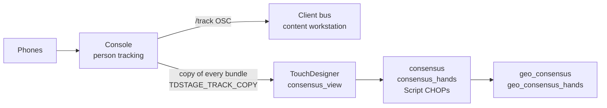

# Consensus view: the console's tracking, drawn in TouchDesigner

The console decides who is on stage. The consensus view puts that decision
inside TouchDesigner, as performers and hands you can instance geometry on,
without recomputing any of it.

{: .warning }
> **This is not in the tox yet.** The module, the DAT callbacks and the wiring
> steps exist and are tested; the operators have not been built into
> `TDStageConductor.tox`. Every result on this page is **simulated**: recorded
> bundles, synthetic phones, CI. It has never run inside TouchDesigner against
> real bodies, and TouchDesigner has never been run on the Windows show machine
> at all. [How far each part is proven](../reference/status.html) is the list.

## What it is, and what it is not

Person tracking lives in the console (`WebConsole/track_emit.py`): it fuses
each phone's person instances over the multi-view consensus foreground, keeps
ids through dropouts, raises `clustered` when two bodies merge, and fuses
wrists across phones into hands. It sends that out as `/track` OSC bundles, the
client contract, one bundle per frame at 30 Hz.

The consensus view **receives those same bundles** and keeps the newest frame.
Nothing is recalculated in TouchDesigner. What you see is what the client bus
receives, so if the visuals and the client disagree about where a performer is,
it is no longer because two different trackers ran.

It is not the Hands page. The Hands page draws per-phone dots from
`hands_lib`, which have no identity. These hands belong to a performer id and
carry a side.



## Getting the bundles to TouchDesigner

The console sends `/track` to **one** target, the client bus. At the show that
bus is on the content workstation, so TouchDesigner on the tracking machine
would see nothing. It gets a copy instead:

```
TDSTAGE_TRACK_COPY=127.0.0.1:7001
```

Byte for byte, every bundle, each target on its own socket.
`WebConsole/windows/run.bat` sets it for the show console. Three things about
it explain most silent views:

- **It is read from the environment at start.** A console you started by hand
  does not copy, so a scratch console cannot feed the show's TouchDesigner.
  `TDSTAGE_TRACK_COPY=none` turns it off.
- **Copies are sent only while `/track` is on**, and independently of the bus.
  When the content workstation is off or its link is down, the console counts
  the bus error and **still sends the copy**, so the view keeps working
  through a dead bus, which is the failure it most needs to survive.
- **Zero performers is a normal early state.** Until the console's
  segmentation has learned the empty stage, it sends frames with nobody in
  them. The view is working; the tracker has nothing to say yet.

## The Consensus page

| Parameter | Default | What it does |
|---|---|---|
| `Consensusactive` | off | Runs the listener |
| `Consensusport` | 7001 | The port the console's copy arrives on |
| `Consensusbind` | 127.0.0.1 | Loopback by default, so it needs no firewall rule |
| `Consensusmaxage` | 1.0 | Seconds before a frame is treated as stale |
| `Consensuszflip` | off | Undoes the console's `track.zFlip` |
| `Consensusf1` | off | Reads performer size from the F1 presence stream |
| `Consensusf1url` | ws://127.0.0.1:9001/ | The console's F1 WebSocket |
| `Consensusshow3d` | on | Render flag for both geometries |
| `Consensusstatus` | n/a | Read-only; warns first, counts second |

{: .note }
> **Leave `Consensusf1` off on the show** until it has been measured with eight
> streams. Its cost inside TouchDesigner's process while the GPU merge path
> runs has not been measured. With it off, every performer is drawn as a
> standing adult (0.25 m radius, 1.70 m tall, `extent = 0`); with it on, each
> takes the size of the F1 presence cluster underneath it (`extent = 1`),
> because `/track` itself carries no size.

## What the Script CHOPs carry

One sample per performer, one channel per column:

```
id x y z vx vy vz conf clustered radius height extent speed age nhands r g b active
```

and one sample per hand:

```
id side x y z vx vy vz conf r g b active
```

`side` 0 is the performer's left, 1 their right. `r g b` is a stable colour per
id, pulled toward amber while `clustered` is raised. With nobody on stage, or a
stale stream, each CHOP carries a single zero sample with `active = 0`, so
instanced markers draw nothing rather than piling up at the origin.

`consensus_table` carries the same frame as a table, refreshed twice a second,
for reading rather than for the hot path. Nothing is written to a table per frame.

## Where the markers actually sit

Understand this before trusting a position on screen.

TouchDesigner places a cloud point as trim, registration, tilt, `Flooroffset`,
the level solve, then the phone's extrinsic. The console places a performer
with registration, tilt and the extrinsic. The same registration, because the
console pushes its poses to TouchDesigner. The console never sees the other
two.

- **`Flooroffset` is folded in.** It is a y shift, and it commutes with
  registration and tilt, so `consensus_exec` applies it: hands and lifted
  performers move down with the cloud, and a performer standing on the floor
  stays at y = 0, which is where Autofloor put TouchDesigner's floor. Autofloor
  ends the get-in drill, so a non-zero `Flooroffset` is the normal case.
- **The Level-page trim is applied last**, as TouchDesigner applies it.
- **The stage level solve is not applied, and cannot be.** It acts inside each
  phone's own frame, before registration, so no single transform of `/track`
  reproduces it. While the solve is off, the markers sit on TouchDesigner's
  cloud. While it is on, they are off by an amount that grows with distance
  from each phone's origin, and `Consensusstatus` starts with
  `LEVEL SOLVE ON` and gives that bound at 5 m.

{: .warning }
> That last point holds **by construction, read from the code. It has not been
> measured with phones.** If a performer marker and the point cloud disagree on
> the rig, check whether the level solve is on before looking for a bug.

## Testing it without TouchDesigner

The module is standard-library Python with no TouchDesigner import, so the same
file that is the `consensus_view` DAT runs on a Mac, on the Windows CI runner,
and under TouchDesigner's own bundled interpreter as a plain process.

```bash
python3 TD/newtox/consensus_view.py --selftest
```

31 checks: the fields against the client contract file, the console's own
encoder producing the same bytes, malformed and non-finite input counted rather
than raised, the `Flooroffset` and trim arithmetic, id reservation, presence
decoding, and that `stop()` frees the port within 50 ms.

```bash
python3 TD/newtox/consensus_view.py --replay TD/newtox/testdata/track-sim-hands.jsonl.gz --to 127.0.0.1:7001 --loop
```

Replays 900 recorded bundles (3,347 performer records, 1 to 6 performers, 842
bundles with a clustered performer, 1,313 hands) as the exact datagrams the
console sent. This is how to exercise the view, or the geometry hanging off it,
with no phones and no console.

```bash
python3 TD/newtox/td_dat_test.py
```

Drives the tox's DATs without TouchDesigner: the listener started from the
Consensus page, recorded bundles over UDP, both Script CHOPs and the table
carrying the frame, a trim moving every performer, `Flooroffset` moving hands
down and leaving grounded performers at zero, and switching off freeing the
port.

The parser has also been fuzzed: 200,000 mutated datagrams, zero uncaught on
both Python 3.14.7 and TouchDesigner's 3.11.15. The same fuzz against the
previous parser raised 14 `OverflowError`.

## Building it into the tox

Not yet done. In `/project1/TDStageConductor`:

1. Text DAT `consensus_view`, holding the text of `TD/newtox/consensus_view.py`.
2. Execute DAT `consensus_exec` with Frame Start and Frame End on.
3. Text DATs `consensus_callbacks` and `consensus_hands_callbacks`, with Script
   CHOPs `consensus` and `consensus_hands` using them.
4. Table DAT `consensus_table`.
5. The **Consensus** custom page, with the parameters and defaults in the table
   above.
6. `geo_consensus`: a Cylinder SOP, radius 1, height 1, standing on y = 0,
   instanced from `consensus`: translate `x y z`, scale `radius height radius`,
   colour `r g b`, active; render flag `parent().par.Consensusshow3d`; a
   Constant MAT at about 0.35 alpha.
7. `geo_consensus_hands`: a Sphere SOP of radius 0.07, instanced from
   `consensus_hands`: translate, colour, active; same render flag.
8. Add both to `render_pc`'s Geometry list.
9. Out CHOPs `out_consensus` and `out_consensus_hands` for the content network.
10. Save as the next numbered tox and the working copy, following
    [Maintenance](maintenance.html): the clean-save sequence, the version
    constant, then `tox_drift.py`.

After changing any DAT's `.text`, toggle its `active` off and on, or the old
callbacks keep running.
