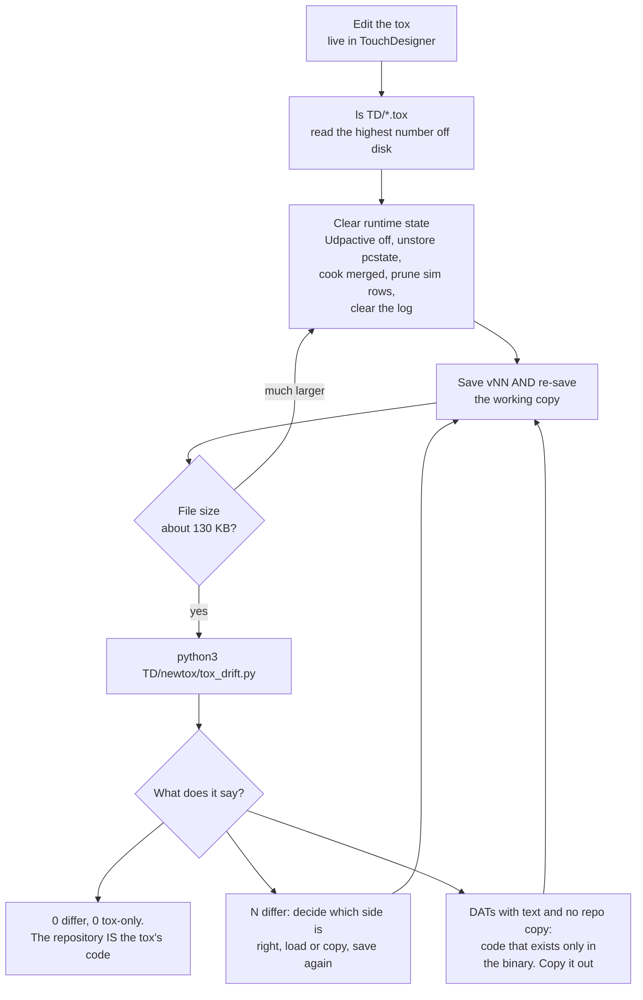

# Maintenance

The hub is a binary file edited live. That makes two things essential: a
versioning discipline so you can always get back, and a check that the code
inside the file is the code the repository thinks it is.

## The loop

Every change to the component goes round this. It is four steps and one check,
and skipping the check is how the repository and the binary drift apart
without anything saying so.



### Why it is a binary edited by hand

There is a generator, `TD/newtox/build_tox.py`, and the component it was meant
to produce was never finished. What exists is a component edited live in
TouchDesigner, which is the normal way to work in TouchDesigner and is not
going to change.

The consequence is that the artefact is a binary, so git can store it but
cannot tell you what changed in it. The numbered snapshots are therefore the
only usable history: a snapshot is a thing you can open, and a diff of two
snapshots is a thing you cannot read. That asymmetry is the whole reason for
the discipline below, and the reason the **code** inside the component is also
kept as plain text in the repository, where it can be diffed and reviewed like
anything else.

`tox_drift.py` is what keeps the two copies honest. Without it, the repository
is a hopeful account of what is in the binary rather than a record of it.

## The versioning rule

**Every change to the tox is saved as the next numbered version, and the
working copy is re-saved.**

```
TD/TDStageConductor.tox         <- the working copy, always the latest
TD/TDStageConductor_v01.tox     <- history
...
TD/TDStageConductor_v78.tox     <- the highest number at the time of writing
```

List the directory before picking a number:

```
ls TD/*.tox
```

Do not trust a session note, a changelog line or your memory for the current
number. Numbers have been skipped and re-used because someone trusted a note
that said "now v36" while v37, v38 and v39 already existed on disk.

The Python modules and GLSL shaders under `TD/newtox/` are plain text and
tracked in git. They need no numbered versioning. The tox does, because a diff
of a binary tells you nothing.

## Clear runtime state before you save

A Script operator saves its last output into the tox. Component storage saves
too. So a save taken while streaming bakes a live point cloud and a live device
list into the file.

The symptom is file size. A clean working copy is around 130 KB. One that
baked `pcstate` reached 1 MB; one that baked the merged Script CHOP's cloud
reached 340 KB.

Worse than the size: a baked `pcstate` comes back on the next load with
timestamps from the previous session. `absTime` restarts at zero, so those
devices read as newer than now, stay LIVE for ever, and show a frozen cloud
that never updates. This happened on 2026-09-04. The hub now clears `pcstate`
in `udp_pc_exec.onStart`, which logs `pcstate cleared on start (fresh
session)`, so the frozen-ghost case is handled on load. The file is still
bloated, and the save is still wrong.

### Clean save with a phone or a sim streaming

Do this in separate steps, not one script. Module and callback reloads in
TouchDesigner are lazy, so a single script that changes something and then
depends on the change sees the old state.

1. Set `Udpactive` to 0. Stop here and let a frame pass.
2. Then, in the next step:
   - `parent().unstore('pcstate')`, plus any test keys you added
   - `op('merged').cook(force=True)`, so the Script CHOP's saved output is the
     empty one and not a baked cloud
   - prune rows with id 100 or above from `registration`, which are sims
   - `logtable.clear(keepFirstRow=True)`
   - save the numbered snapshot and the working copy
3. Set `Udpactive` back to 1.
4. Check the file size.

## Check the saved tox against the repository: `tox_drift.py`

The tox carries its scripts and shaders as DAT text. The repository keeps the
same text under `TD/newtox/`, in `tox_dats/` and in the shared modules. An edit
made live in TouchDesigner and never copied back, or a repository edit never
loaded into TouchDesigner, leaves one of them wrong, and nothing says so.

`tox_drift.py` expands a saved tox with TouchDesigner's own `toeexpand`, which
needs no running TouchDesigner, decodes every DAT's text, and compares it byte
for byte with the repository file of the same name.

```
python3 TD/newtox/tox_drift.py                            # the working copy
python3 TD/newtox/tox_drift.py TD/TDStageConductor_v78.tox
python3 TD/newtox/tox_drift.py --diff                     # print the differing lines
python3 TD/newtox/tox_drift.py --extract /tmp/v78-dats    # every DAT's text as files
```

Run it after every numbered save. The result you want is **0 differ and 0 in
the tox only**: then the repository is the tox's code.

`--extract` is also a backup worth having. It writes the tox's code out as
plain text files, readable and diffable without TouchDesigner.

`toeexpand` exits 1 even when it worked, on current TouchDesigner. The tool
judges it by its output, not its exit code, so do not be alarmed.

Give `--extract` a path **outside** the repository. Expanding a tox writes a
`.tox.dir` folder and a `.tox.toc` beside it, and left in `TD/` those show up
as untracked files that look like someone's work in progress.

### A worked example

Run on 2026-10-27 against the working copy:

```
TD/TDStageConductor.tox: 32 DATs with a repo copy identical, 1 differ,
                         0 DATs with text and no repo copy
  DIFFERS  TDStageConductor/tdp4_receiver vs TD/newtox/tdp4_receiver.py (53 lines)
```

The repository's receiver was ahead of the tox's copy by one commit. The fix
is to load the repository file into the DAT, not to copy the DAT back. Which
direction is correct is a judgement the tool cannot make for you; it only tells
you that a judgement is needed.

That is the whole value of running it. The missing commit was the device-id
collision naming, so a rig with two phones sharing an id would have been warned
by the console and told nothing by TouchDesigner, and nobody would have known
why the two disagreed.

Loading the repository file and saving produced v77 and then v78, and the same
command now reads:

```
TD/TDStageConductor.tox: 33 DATs with a repo copy identical, 0 differ,
                         0 DATs with text and no repo copy
```

That is what a clean result looks like.

### Hot-swapping a module DAT in a running tox

Module reload is lazy. After setting `dat.text`, `dat.module` still returns the
old module object in the same script; a frame later it is the new one. For the
receiver, which owns a thread and a socket, that matters: stopping and swapping
in different frames lets the arming callback re-arm the **old** module on the
port, and the new one then fails to bind on every frame afterwards.

Do it in three separate steps:

1. Set `Udpactive` off, call `stop_receiver()` on the **old** module, and check
   no receiver thread remains. Then set the text, opening the source file with
   `encoding='utf-8'`. TouchDesigner's Python defaults to ASCII on this rig and
   chokes on any file with a dash character in it.
2. Next step: confirm the new module is loaded, and that the receiver singleton
   is `None`.
3. Next step: set `Udpactive` on.

### After editing a callback's text

An execute DAT or parameter-execute DAT whose `.text` you set does not
re-register its callbacks. The old behaviour keeps running: tables stop
updating, pulses do nothing. Toggle `par.active` off, cook, on, cook. Do this
after every scripted callback-text edit.

## Where learned state lives

Learned numpy state is large, and component storage is the wrong place for it.
It lives on disk as compressed numpy checkpoints, reloaded lazily when a module
recompiles.

| Platform | Directory |
|---|---|
| macOS | `~/Library/Application Support/TDStage-TD/` |
| Windows | `%LOCALAPPDATA%\TDStage-TD\` |

| File | What it holds | Written by |
|---|---|---|
| `learned_bg.npz` | The learned background grid, the thing `Segmode` = `learned` subtracts | A `Learnbg` pass |
| `stage_level_state.npz` | The solved stage level and lens unwarp | A level or unwarp solve |

Two consequences.

**Back this directory up before testing in learned mode.** A learn overwrites
the background, and a learn run against a simulator throws away a real one.

**A fresh machine starts with no learned state.** Dropping the tox on a new
show machine gets you the cloud and the geometry, not the learned background or
the level solve. Both have to be re-run on site, and they have to be re-run
with the stage empty and the rig in its final position.

The learned background also depends on the rig not moving. Move a phone and the
learned background for that phone is wrong.

## What does not get versioned, and why

| Thing | Where it lives | Why |
|---|---|---|
| Tox | `TD/TDStageConductor*.tox` | Binary, numbered snapshots |
| Python modules and shaders | `TD/newtox/`, `TD/newtox/tox_dats/`, `TD/newtox/glsl/` | Plain text, git tracks them, `tox_drift.py` keeps them honest against the tox |
| Learned state | Application support directory | Site-specific and re-derivable. Never commit it. |
| Device roster and markers | The web console's own configuration | The console owns them, with its own rotating backups |
| Runtime tables and storage | Nowhere, by design | Cleared before every save |

## Snapshot everything before risky work

```
./Tools/backup_state.sh [destination]
```

Writes a snapshot to `~/TDStage-Backups/<time>/` containing:

- both repositories as **verified** git bundles, which clone with no network
- uncommitted work as a binary-safe patch (`git diff --binary --full-index`,
  so a modified tox restores rather than arriving corrupt)
- an archive of untracked files, which a patch alone would miss
- the console configuration with its rotating backups, the profiles and the log
- the working tox and the newest numbered one
- the TouchDesigner learned state from the platform's application-support
  folder, with a warning when that folder is empty
- a manifest carrying a checksum for every file and the restore steps

Restoring means cloning the bundle, applying the patch if there is one, and
extracting the untracked archive if there is one. **Verified on macOS against
a dirty tree.**

{: .warning }
On the Windows show machine this needs Git Bash, and until the repository
pins shell scripts to LF line endings a default Git for Windows checkout
breaks the script on its first line. Run it from a checkout made with
`core.autocrlf=false`.

Run it before anything you might want to undo.

## Rules that hold inside the tox

These are not style preferences. Each one is here because breaking it caused a
specific failure.

- **Never write to a table per frame on the hot path.** Ingest, merge, cleanup,
  fusion and output use storage dictionaries.
- **Learned state goes to disk, never into component storage.**
- **Control output uses a raw UDP socket**, not an OSC Out DAT. An OSC Out DAT
  cannot be re-bound inside a pulse callback: setting its address and port then
  sending needs a cook, which is not allowed mid-callback, so it silently sends
  to the old target or nowhere.
- **Gate periodic work on `absTime.seconds`, not on `frame % N`.** Frames are
  skipped under load, so a modulus gate lands erratically or never. This froze
  the health line once and the device-table rebuild once.
- **A Script operator whose `onCook` reads only Python dictionaries gets no
  cook dependency.** TouchDesigner marks it clean and the output silently goes
  stale. Read a channel from a per-frame-cooking CHOP inside `onCook` to create
  the dependency. The hub uses `cook_clock` for this.
- **Never add a TouchDesigner import to `hlib.py` or `hlib_grid.py`.** They are
  pure numpy and OpenCV so the same files run inside the tox and in the offline
  tests.
- **Worker threads touch numpy and plain module dictionaries only.** No
  TouchDesigner API calls from a thread.
- **Never load a native extension such as a Python Objective-C bridge into
  TouchDesigner's process.**

## Changing the wire format

TDP4 is implemented in four places plus its specification. All five move
together or the rig breaks in a way that looks like a network fault.

| Role | File |
|---|---|
| Phone packer | `TDStage/Net/PointCloudUDPStreamer.swift` |
| Hub parser | `TD/newtox/tdp4_receiver.py` |
| Simulator | `TD/newtox/tdp4_sim.py` |
| Bench | `TD/newtox/tdp4_bench.py`, which imports the parser and never reimplements it |
| Specification | `docs/superpowers/specs/2026-07-18-tdp4-udp-depth-transport.md`, authoritative |

Then run `python3 TD/newtox/tdp4_bench.py --selftest`, and reload the receiver
into the tox and re-check with `tox_drift.py`.

Shader constants have the same rule in miniature: a shader and its numpy
reference change together, and `python3 TD/newtox/glsl_parity_test.py` fails if
they do not.
