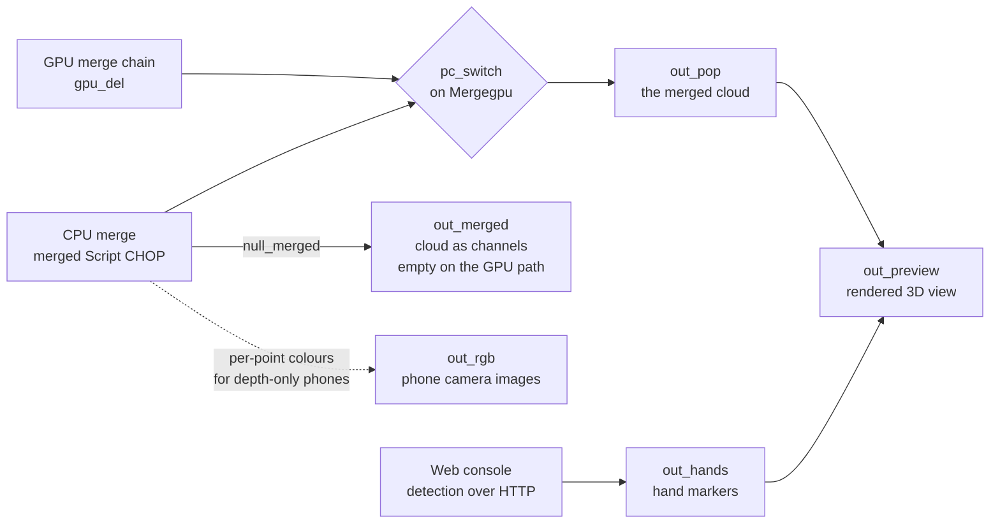

# Outputs

The hub is a component with five Out operators. Wire from them, or reference
them by path. Everything below is read from the saved tox, not from an older
plan.

| Operator | Family | Carries | Fed by |
|---|---|---|---|
| `out_pop` | POP Out | The merged point cloud | `null_pop` |
| `out_merged` | CHOP Out | The same cloud as channels, CPU merge path only | `null_merged` |
| `out_rgb` | TOP Out | Each phone's camera image | `rgb_switch` |
| `out_preview` | TOP Out | The rendered 3D view | `render_pc` |
| `out_hands` | CHOP Out | Hand markers | `hands` |

The component's node viewer is `out_preview`.



Read the dependencies, not the layout. `out_pop` is the only output that works
on both merge paths. `out_merged` depends on the CPU path. `out_hands` depends
on the console being up. `out_preview` depends on everything and is for a
person to look at.

## Coordinates

Every point is in stage coordinates: metres, Y up, origin at the centre of the
stage floor.

**The hub does not only union.** A phone's extrinsic is gravity-levelled but
origin-centred: the phone knows which way is up and nothing about where it
stands, so without help three phones pile up on top of each other at the
origin. The hub applies a **per-device registration** of yaw, tx, ty and tz on
both merge paths, from the console roster when `Posesource` is `console` or
from the Align page knobs otherwise, and then the stage level solve and the
manual trim.

The full transform, per phone, is `Trim . Reg . Floor . Level . E`.
[How the pipeline is built](pipeline.html#where-the-per-device-registration-is-applied)
has the terms and where each one is applied.

That means a point you read from `out_pop` is already in the space your content
works in. No further transform is needed or wanted. The alignment happens in
the hub precisely so that nothing downstream has to repeat it.

## `out_pop`: the merged point cloud

This is the output to build content on.

`out_pop` follows `null_pop`, which follows `pc_switch`. The switch is driven
by `Mergegpu`, so the POP carries one of two chains.

```
Mergegpu off ──▶ chopto_pop  (CHOP to POP, from the CPU merge)
Mergegpu on  ──▶ gpu_del     (end of the GLSL POP chain)
```

Read these three attributes and ignore everything else:

| Attribute | Type | Meaning |
|---|---|---|
| `P` | position | The point, in stage metres |
| `Color` | colour | The phone's own colour, or the device tint when `Colormode` is `tint` |
| `DeviceId` | custom float | Which phone the point came from |

Both chains carry all three, under the same names, so content written against
them works on either path.

### Attributes you will also see on the GPU path

The GLSL POP chain carries working attributes that later stages read and the
last stage never strips. On the GPU path `out_pop` also carries `keep`, the
hysteresis attributes (`hk`, `hs`, `hv`, `ho`, `hp`), the cleanup attributes
(`dk`, `dn`, `pc`, `lb`, `cnp`, `car`, `gt`), and the fusion attributes (`fk`,
`fn`, `fo`, `fs`, `fr`, `fg`, `fb`, `fx`, `fy`, `fz` and the six second-moment
components).

These are internal. Their names and meanings change when the shaders change.
Do not build content against them.

`gpu_del` has already deleted the points the shaders rejected, so you do not
need to filter on `keep` yourself.

### Point count

On the CPU path, `Maxpoints` caps the output. The emit strides evenly over the
merged cloud to stay under the budget, so the cloud thins rather than being
truncated.

On the GPU path the count is whatever survives the crop, cleanup and fusion.
`Maxpoints` does not apply.

## `out_merged`: the cloud as channels

`out_merged` follows `null_merged`, which follows the `merged` Script CHOP. One
sample per point, seven channels:

| Channel | Meaning |
|---|---|
| `tx`, `ty`, `tz` | Position in stage metres |
| `r`, `g`, `b` | Colour |
| `id` | Device id |

**This CHOP is empty while `Mergegpu` is on.** The GPU merge path owns the
cloud, the CPU merge stands down entirely, and the Script CHOP emits a single
empty sample. The saved working copy ships with `Mergegpu` on, so a reader
wired to `out_merged` gets nothing by default.

The one exception is while a background learn is running: the CPU path comes
back for that, because the GPU path reads the learned grid the CPU path builds.

If you need a CHOP, either take the CPU path deliberately and accept its lower
merge rate, or convert `out_pop` yourself downstream. The POP is the output
that works on both paths.

## `out_rgb`: the phones' camera images

Eight Script TOPs, `rgb_1` through `rgb_8`, each showing one phone's own camera
image. The image is the camera image: there is no reprojection, so there are no
holes and no resampling artefacts. When a phone streams depth only, the slot is
drawn from the same per-point colours the merge uses, so the slot stays live
rather than going black.

`rgb_switch` chooses what `out_rgb` carries, from `Rgbselect`:

- `grid`: `rgb_grid`, a four by two layout of all eight slots
- `1` to `8`: that slot alone

Slot size is `Rgbw` by `Rgbh`, 320 by 240 by default. `Rgbmap` decides whether
slot N means the Nth live phone or device id N.

This is the output to look down when you are aiming a phone or checking what
one camera actually sees.

## `out_preview`: the rendered view

`render_pc` is a Render TOP at 1280 by 720. It renders three geometry
components through `cam1`:

| Component | What it draws |
|---|---|
| `geo_pc` | The point cloud, as point sprites. Material `mat_points`, size from `Pointsize`, sprite texture `dot_tex`. |
| `geo_floor` | The floor plane, when `Floorviz` is on |
| `geo_hands` | Hand markers, when `Handsshow3d` is on |

This is an operator view, not a show output. It exists so a person can see
whether the rig is working. `Autoframe` keeps the camera on the cloud.

Do not send `out_preview` to a projector and call it the show. Build content
from `out_pop`.

## `out_hands`: hand markers

`out_hands` follows the `hands` Script CHOP. One sample per detected hand, ten
channels:

| Channel | Meaning |
|---|---|
| `did` | Device id the hand was seen on |
| `idx` | Hand index within that device |
| `x`, `y`, `z` | Position in stage metres |
| `u`, `v` | Pixel the hand was detected at, in that device's grid |
| `conf` | Detection confidence |
| `side` | Which hand |
| `active` | 1 for a real hand |

With no hands detected, the CHOP carries one sample with `active` = 0, so
instanced markers draw nothing rather than drawing a marker at the origin.
Gate on `active`.

Detection itself runs in the web console. The hub polls the console over HTTP
at `Handsurl` and turns each hit back into the stage point the merge already
produced. If the console is not running, this output is empty and the cloud is
unaffected.

## Taking the cloud into other TouchDesigner work

Three ways, in order of preference.

1. **Wire from the component's outputs.** The Out operators are the contract.
2. **Reference by path**, for example
   `op('/project1/TDStageConductor/out_pop')`. Useful in scripts and in GLSL
   POP inputs. The paths in the tox are stable.
3. **Read the POP in Python**, for example
   `op('.../out_pop').points('P')`. This is how the merge scoring tool gets
   truth out of a running hub. It is not a per-frame technique.

Rules that hold on the hot path, and that your own work should keep:

- Do not write to tables per frame. The ingest, merge, cleanup and fusion path
  never does. Use storage dictionaries.
- Do not add a receive thread of your own inside TouchDesigner. That is exactly
  the problem the bridge exists to solve.
- Keep learned state out of component storage. See
  [Maintenance](maintenance.html) for where it lives.

## NDI, and what must never ride it

The hub has no NDI operator. Nothing in the tox emits NDI today.

The NDI feed is produced by the web console, not by TouchDesigner. It renders
the live merged, colourised cloud to a virtual-camera view, front or top, and
broadcasts it as a named source at 960 by 540, 30 frames per second. Any NDI
receiver, including TouchDesigner's own NDI In TOP, sees it. It is a rendered
visual feed, and it is honest about that.

**Bulk depth never rides NDI.** NDI compresses through a lossy DCT video codec.
Packing depth into pixels and sending it through NDI quantises the exact values
the whole system exists to measure, smears them at edges, costs more bandwidth
than sending depth as half-floats, and adds encode and decode latency. NDI
earns its place carrying finished visuals. It does not carry measurements.

**Bulk depth never rides OSC either.** OSC has no fragmentation layer, so a
depth grid does not fit in a message and there is no defined way to split one.
OSC in this system carries telemetry and control: small, infrequent, named
values.

Depth rides TDP4 over UDP, which was built for it. That is not a preference; it
is the only one of the three that preserves the values.

## Where the client-facing outputs live

For completeness, because an older diagram puts them here: the tracking output
to other systems, the websocket field data and the NDI feed are all produced by
the web console, not by the tox. The hub's job is the cloud and the visuals.

Closing the console mid-show has no effect on the hub's cloud. It stops those
outputs.
