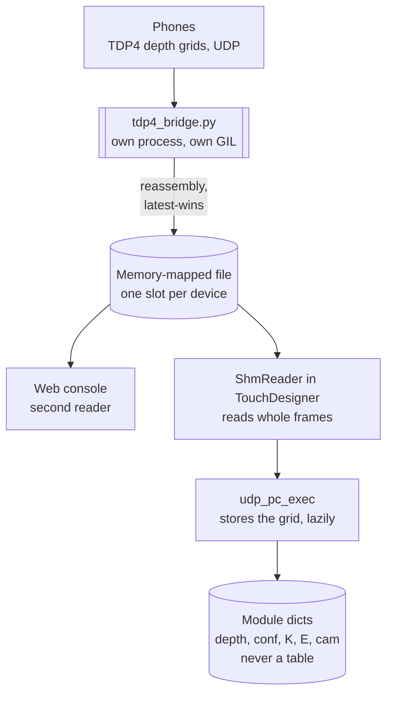
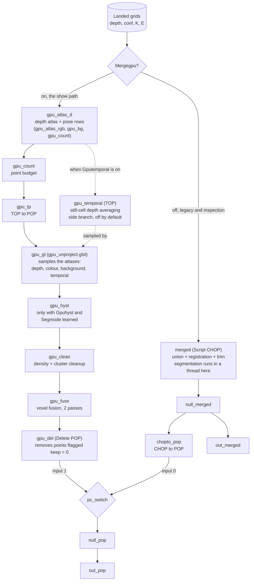

# How the pipeline is built

This page covers what you cannot see by opening the tox. The network shows
the operators. It does not show the order they run in, which of them stand
down, or where each transform is applied. Nothing on screen tells you that two
complete merge pipelines sit side by side, that only one of them runs, or that
the phone poses are applied inside a texture row.

Everything below comes from the DAT text in the saved component and from
the lockstep copies under `TD/newtox/tox_dats/`. The operator that **reads** a
value is the contract. Where a figure appears it is labelled.

## From the wire to a landed frame

Every path shares this front end. It runs on TouchDesigner's main thread, once
per cooked frame, and it is short by design.



Two things in that picture are easy to get wrong.

**The console is not downstream of TouchDesigner.** It reads the same
memory-mapped file, as a second independent reader. Its own outputs do not
depend on TouchDesigner's pipeline, which is why closing one does not affect
the other.

**Where the floor offset, the level solve and the lens unwarp are applied
depends on which merge path is running, and the two differ.**

On the **CPU path** they are applied here, at landing, so by the time anything
merges the frame is already level and already at the right height.

On the **GPU path**, which is how the saved project ships, landing stores the
raw grid and does no transforming at all. The same corrections arrive later,
baked into the per-phone pose row the atlas builder writes, as
`Trim . Registration . Floor . Level . Extrinsic`. Both paths produce the same
geometry. They compute it in different places.

That distinction matters when a cloud is in the wrong place: on the GPU path
there is nothing to inspect at landing, because the numbers are still raw.

### What the receiver guarantees

`tdp4_receiver` holds at most two in-flight frame slots per device. A frame
with any packet missing is dropped whole and never retransmitted; the next
frame supersedes it within about 33 ms. A completed frame goes into a
single-slot mailbox, so a newer frame replaces an unread older one rather than
queueing behind it.

That policy is the whole reason the transport works, and it only works because
of the grid. See [Why depth crosses the wire as a grid](#why-depth-crosses-the-wire-as-a-grid).

The receiver also tells a stream restart from a straggler. It keeps a
high-water mark of the highest frame id **seen** rather than the highest
delivered. Judging against the delivered id alone wedged the receiver on the
rig. A lossy run left two partial slots far above a stale delivered id, every
later packet fell between the two, and the receiver discarded each one as
stale for ever while the thread ran and the socket drained. The signature of
that fault is packets and stale counts rising in lockstep with completed frames
flat.

The rule itself has two arms. A frame id below the high-water mark is a
restart when the gap is larger than `RESTART_GAP`, 300 frames (about ten
seconds at 30 fps), or when the device had gone quiet for longer than
`RESTART_IDLE`, 1.0 s of data silence, and the packet opens a new slot rather
than completing one already open. A packet that finishes an open slot after a
stall is the same stream continuing. A restart wipes both in-flight slots,
counts them as `dropped_incomplete`, clears the delivered id and the
high-water mark, and increments `restarts`.

### What landing does, and what it skips

`udp_pc_exec` turns each assembled frame into a grid dictionary: the depth
plane, the confidence plane, the validity mask, the intrinsics `K`, the
extrinsic `E`, the camera position, the grid size and the frame id. These are
references to arrays the receiver and `level_ops` already own, not copies.

On the GPU merge path the per-frame CPU unprojection is **skipped**. The GLSL
chain unprojects every cell itself, so computing the same points on the CPU
first is pure waste. Measured, simulation, 2026-10-25: 0.9 to 1.7 ms per phone frame,
which is 25 to 40 per cent of the main thread at eight streams. The frame is
stored with a lazy marker instead, and the few readers that need CPU points
call `ensure(did)` to compute them on demand: the auto-frame camera, the floor
pulse (which asks for every device at once), hand detection on any lazy phone
where a hand was found, and the CPU merge, which asks for every device on each
merge. A level solve or a background learn in progress forces the full path,
because each needs every frame.

The RGB views are **not** among them. A view of a phone with no colour plane
draws as a depth shade rather than by unprojecting points for it, which is why
opening one costs nothing on the GPU path.

## The two merge paths

`Mergegpu` chooses between two complete pipelines. They are **alternatives,
not stages**. Nothing flows from one into the other.



With `Mergegpu` on, `out_merged` is **empty by design**. The Script CHOP emits
one empty sample. That is not a fault, and it is the state the saved component
ships in.

The saved component, `TDStageConductor_v87.tox` (the working copy is the same
file), carries the state the "ships as" sentences on this page rest on:
`Mergegpu` is saved on, `Segmode` is saved `geometric`,
`Posesource` is not in the saved file at all, so it sits at its default,
`console`, and `Geoceiling` is saved at 4 m against its 2.4 m default. The
full list of saved values that differ from their defaults is in
[What the saved file ships with](parameters.html#what-the-saved-file-ships-with).

The one exception is a background learn. The learned grid is built by the CPU
pipeline, so `gpu_exec` force-cooks `merged` for the duration of a learn even
on the GPU path. That is also why a rig running entirely on the GPU still
needs a `Learnbg` pass on an empty stage: the two paths **share** the learned
background. The CPU pipeline learns it with `hlib` at 5 cm voxels, and the GPU
path consumes the same grid as an R8 texture.

Measure Alignment is the other thing that works around `merged` standing down.
Its snapshot is thirty cooks of `merged` after the pulse, and on the GPU path
nothing cooks `merged`, so until 2026-10-28 the pulse waited for ever. Now
`status_exec` takes the snapshot instead, one frame per `onFrameEnd`, through
`merged_callbacks._collect_gpu`, which registers each live phone's points
exactly as the CPU path's per-device step would. It runs only while a snapshot
is wanted, only with `Mergegpu` on, and not while a learn is already forcing
`merged` to cook. After the thirtieth frame the align worker launches.

### The GPU path, stage by stage

| Stage | Operator | What it does | Reads |
|---|---|---|---|
| Atlas build | `gpu_atlas_d`, `gpu_atlas_rgb`, `gpu_bg` (Script TOPs) | Packs every live phone's depth grid into one RGBA32F texture, its colour into an RGBA8 texture, and the learned background into an R8 texture | `Stalesecs`, `registration`, `Flooroffset`, level state |
| Temporal | `gpu_temporal` (GLSL TOP, fed back on itself) | Averages a depth cell over up to sixteen frames while it holds still, three-frame hold, resets on movement | `Gputemporal`, `Gputempsigma` |
| Unproject | `gpu_gl` running `gpu_unproject.glsl` | One thread per atlas texel: ray times depth, pose matrix, Brown radial term, crop box, learned-background drop | `Cropminx/z`, `Cropmaxx/z`, `Floorcut`, `Geoceiling`, `Colormode`, `Segmode` |
| Hysteresis | `gpu_hyst` | A cell must hold points for several consecutive merges before it appears, and inherits the streak from any of its 27 neighbours. The streak scales with the timeline rate, so it is six cooks at 60 Hz rather than a fixed three (and the hold after a cell empties is 24 rather than 12). **Runs only when `Gpuhyst` is on AND `Segmode` is `learned`**, so on a project shipped as `geometric` it is a pass-through | `Gpuhyst`, `Segmode`, `Fusevox` |
| Cleanup | `gpu_clean` | Density and cluster cleanup on a spatial hash grid | `Gpuclean`, `Densitymin`, `Minclusterpts` |
| Fusion | `gpu_fuse` | Collapses overlapping views into one point per voxel | `Gpufuse`, `Fusevox`, `Gpufusemin`, `Gpusmooth` |
| Delete | `gpu_del` (Delete POP) | Removes every point the shaders rejected | - |

The atlas is `W` wide by `N*H + N` tall: `N` phones of `H` rows each, then one
**pose row** per phone. That pose row is how the whole transform reaches the
GPU without a uniform per phone:

| Column | Holds |
|---|---|
| 0 to 3 | The four rows of the per-phone matrix `G` |
| 4 | `fx`, `fy`, `cx`, `cy` |
| 5 | Radial `k1`, grid width, grid height, device id |
| 6 | Colour present, frame id modulo 2^24 |
| 7 | The device tint |

`keep` is a custom float on every point: 0 rejected, 1 kept, and **2 for a
point in the floor band just under `Floorcut`**. The band is a fixed 0.08 m,
the `w` component of the `uMin` uniform rather than a parameter (see
[which parameter the crop box reads](parameters.html#which-parameter-the-crop-box-actually-reads));
anything lower than `Floorcut` minus 0.08 m is gone. The shader stashes the
band rather than discarding it so that `gpu_clean` can rescue feet, which would
otherwise be cut off the bottom of every performer: a band point is kept when
its plan cell belongs to a component that survived the cluster gate.

`gpu_clean`'s own thresholds are fixed in the component, not on a page, so an
operator turning `Densitymin` or `Minclusterpts` is tuning against them.
Density is counted in cells of four times `Fusevox` (10 cm at the default
0.025 m); a point in a cell with fewer than `Densitymin` points is dropped. The
plan-view cluster cell is 0.06 m, a cell is occupied with two or more points,
the occupancy is dilated 3 by 3 and labelled into 8-connected components, and
a component is kept when it has at least 20 plan cells **and** at least
max(`Minclusterpts`, 0.5 per cent of the points that passed the density gate).
The hash grid's origin is `Cropmin` minus 0.5 m in X and Z and minus 0.1 m in
Y, and its plan extent is `Cropmax - Cropmin + 1` over 0.06, plus two cells,
on each of X and Z. When the point count is no more than that plan grid's cell
count plus one, or `Gpuclean` is off, the shader passes everything through,
which is why the point budget below is raised to make room for it.

Four cook decisions, three in `gpu_exec` and one in the atlas builder, each fix a measured problem:

- The atlases are force-cooked at frame start. A Script TOP has no cook
  dependency on the Python state it reads, so without this the GLSL chain
  reprocesses a frozen atlas. Measured, 2026-10-25: zero atlas cooks per
  second while the POP chain ran at 70 per second.
- The background texture is cooked **only** when the learned grid, the
  pipeline object or `Segmode` changes. Cooking it every frame re-uploaded
  about 21 MB and summed five million voxels per frame for nothing.
- The atlases are persistent. A phone's slot is rewritten only when that slot
  holds a new frame, which matters because phones send at 30 and
  TouchDesigner cooks at 60. Rebuilding both atlases from zeros every frame
  cost 2.4 ms of numpy on the main thread at eight streams (measured,
  simulation, 2026-10-26).
- `gpu_count`, the TOP whose texel count sets how many threads every GPU POP
  runs, is re-cooked **only** when the atlas size changes, judged against the
  TOP's actual size rather than a remembered one, because a re-cook makes
  `gpu_tp` rebuild its points at about 80 ms. Its row count is raised above the
  atlas's `N*H + N` so that `gpu_clean`'s plan grid, `nx` times `nz` cells
  plus two, held in per-point attributes, fits inside the point count; with
  fewer points than plan cells `gpu_clean` passes everything through,
  silently (red team, 2026-10-27). The threads past the atlas write
  `keep = 0`, the rows are capped at 16,384, and the raise is logged once,
  not every frame.

### The CPU path, stage by stage

`merged` is a Script CHOP. It unions every live device, applies the
registration table and the Level page trim, then segments according to
`Segmode`:

| `Segmode` | What runs |
|---|---|
| `off` | Crop, voxel dedup and the output budget only |
| `geometric` | `hlib_grid.isolate_geometric`: floor cut, ceiling, stage box, density, clustering. Nothing learned, so it works from the first frame on a levelled cloud |
| `learned` | An `hlib` background-stencil subtract, then the floor map, clustering and fusion. Needs a `Learnbg` pass first |

Three limits sit in front of that. Landing decimates each phone's CPU points
to about 40,000 by even striding, in `udp_pc_exec._land`, so the union never
starts from full grids. `Fuserate`, 30 Hz by default, caps real fusions:
cooked again within 0.98 of `1/Fuserate` since the last one, the CHOP
re-emits that fusion (or a newer worker result that has finished since) rather
than recomputing, because phones deliver about 30 views a second while the
CHOP cooks at 60. And after the union and the trim, more than 300,000 points
are strided down below that before any processing. `Fusionmode` `grid` or
`merged` replaces the point union with the angle-weighted merge on the full
organized grids, `merged` fusing as well, and falls through to the point path
when no device has a grid yet. Both parameters are described on
[the parameters page](parameters.html#merge-path).

Segmentation runs on a latest-wins worker thread when `Mergethread` is on, so
TouchDesigner's frame rate stops following the phone count. It costs about one
merge of extra latency.

The toggle is permission rather than instruction. The first cook always runs
on the main thread, and the work only moves off it once the measured
segmentation cost passes about 20 ms, returning to synchronous when it drops
back under about 12 ms. So a light scene stays synchronous with the toggle on,
and a profile that shows no worker is not evidence the toggle is off. The
worker touches numpy and plain module dictionaries only, never the
TouchDesigner API.

The tail is shared between the cook paths: `Maxpoints` caps the output by
striding evenly across the merged cloud, so the cloud thins rather than being
truncated, and the result is emitted as seven channels.

### Where the per-device registration is applied

This is the correction most worth reading. A phone's extrinsic is
gravity-levelled but **origin-centred**: the phone knows which way is up and
nothing about where it stands. Three phones therefore pile up on top of each
other until something tells each one where it is. The `registration` table is
that something, and the hub applies it per device on both paths.

So the hub does not only union. The full transform from a depth cell to a
stage point is, on the GPU path, one matrix built per phone per frame:

```
G = Trim . Reg . Floor . Level . E
```

| Term | From | Scope |
|---|---|---|
| `E` | The phone's own extrinsic, on the wire | Per device |
| `Level` | The stage level solve | Whole rig |
| `Floor` | `Flooroffset` | Whole rig |
| `Reg` | `registration`: yaw about Y, then translate | **Per device** |
| `Trim` | The Level page `Trim` knobs | Whole cloud |

When the console has sent a pitch and roll tilt for a device, that tilt is
applied per device between `Floor` and `Reg`, about the camera.

The same table decides membership. A device whose `registration` row has
`enabled` = 0 is dropped before merging on **both** paths, and so is a device whose
last frame is older than `Stalesecs` (0.5 s by default, 0.28 s in the saved
component). On the GPU path that pair of tests is what admits a phone to the
atlas at all, and the atlas stops at `MAXDEV`, sixteen phones, in device-id
order.

The CPU path applies the same terms in the same order, in `merged_callbacks`
and `level_ops` rather than in a matrix row.

{: .note }
**The CPU path's `id` channel is wrong where two people touch**
([#51](https://github.com/AristidesAI/TDStage/issues/51)). Its fusion
averages the track ids of the points that land in one 2.5 cm voxel and rounds,
so a voxel shared by tracks 1 and 3 is labelled 2, a person who does not exist.
The show path is the GPU merge, which carries no ids, and the tracking output
comes from the console, so this bites only on the CPU fallback and on any
content keyed to TouchDesigner's own id channel. Do not key content on it
until the fix (take the heaviest id per voxel, not the mean) is in.

`Posesource` decides where `Reg` comes from: the console roster, or the Align
page knobs. The registration yaw is not the same number as the roster's plan
heading, so a figure typed in by hand from a plan will be ninety degrees out.

What **is** true, and worth keeping, is the consequence: a point read from
`out_pop` is already in the space the content works in. No further transform
is needed or wanted. The hub does the alignment so that nothing downstream has
to.

### What both paths feed

| Consumer | What it gets | Rate |
|---|---|---|
| Console health line | Real frame rate, merge cook time, live phone count, output point count | `Healthhz`, once a second by default |
| `rgb_callbacks` | The per-phone colour views and the grid | Per frame while `Rgbactive` |
| Hands library | The stage point under each detected hand | `Handsrate` |

On the GPU path the health line reports `out_pop`'s point count, because
`merged` stands down and reporting its sample count showed "points 1" for an
88,000-point cloud. The frame rate on that line is counted from cooked frames,
not from `absTime`, and is published as -1 when it cannot be measured rather
than silently substituting the wall figure.

## Why it is built this way

Each of these was a decision with a cost, and each one is expensive to
revisit. What follows is the hub's side of them: what the choice forced the
component to look like. The system-wide version of the same arguments, with
the transport reasoning in full, is
[Why it is built this way](../reference/design.html).

### Why the receiving had to leave TouchDesigner

TouchDesigner's main thread holds the Python global interpreter lock through
GPU work. A receive thread living inside TouchDesigner is starved for the
duration, the socket buffer fills, and the kernel discards what it cannot hand
over. The loss is invisible from inside: the thread is running, the socket is
draining, and frames never complete.

Measured, simulation, 2026-10-26: three streams of depth and confidence into
TouchDesigner's own socket lost about 25,000 of 55,080 packets over six
seconds, about 48 per cent, reproducibly. With the GPU merge path off, none.

So the receiving moved into its own process, with its own lock. It runs the
**same** `tdp4_receiver`, with the same reassembly and the same policy, but
**in the bridge process** rather than inside TouchDesigner. TouchDesigner's
reader takes whole frames out of the file and never sees a packet. The bridge
does not interpret the data; it reassembles frames and publishes each device's
latest one.

Every implementation choice inside the bridge protects TouchDesigner from a
bridge fault:

- A plain file plus `mmap`, not `multiprocessing.shared_memory`. That module
  starts a resource-tracker helper by re-running `sys.executable`, which
  inside TouchDesigner is TouchDesigner.
- The layout version is in the filename. A bridge and a tox from different
  builds then miss each other, and TouchDesigner keeps its own socket, instead
  of one process resizing a file the other has mapped, which is a crash on
  macOS.
- Every slot and the metadata block is seqlocked: the writer makes the
  sequence odd, writes, makes it even, and a reader keeps a copy only if the
  sequence was even and unchanged. There are no memory barriers; a per-slot
  checksum is the upgrade if a torn frame is ever seen.
- A heartbeat in the header, with a two-second freshness window, is what hands
  the socket over in either direction without either process knowing about the
  other. The bridge rewrites it every 0.5 s, together with the metadata block
  (receiver stats, its own `evicted` and `oversize` counters, slot count and
  bind port, and the roster), and sleeps a millisecond when no new frame
  arrived. See [Running the hub](running.html#handover).
- The file is sized once: sixteen slots of 512 KB. A frame larger than a slot
  is refused and counted as `oversize`; a seventeenth device takes the slot
  written longest ago and counts as `evicted`. The table in
  [Running the hub](running.html) has the reasons.

### Why depth crosses the wire as a grid

The phone could unproject on device and send xyz points. It does not, and the
reason is arithmetic rather than taste.

The xyz coordinates are a deterministic function of `depth x ray(u, v)`, and
the ray comes from the intrinsics, which the receiver already has. Sending
points means paying for information the receiver can regenerate for free on
the GPU. At eight streams of the 320 by 240 grid an iPhone 17 Pro sends:

| On the wire | Bandwidth at 30 fps, eight streams | Share of gigabit |
|---|---|---|
| Depth only, half-float | about 295 Mbit/s | 31 per cent |
| Depth and confidence (the show default) | about 442 Mbit/s | 47 per cent |
| Depth, confidence and colour | about 885 Mbit/s | 94 per cent |
| xyz points on device | about 2.2 Gbit/s | does not fit |

Those figures are payload arithmetic from the frame size, not measurements;
framing adds about six per cent, and the share is against the roughly 940
Mbit/s a gigabit link carries. xyz on device is 7.5 times depth-only and does
not fit on the link at all, so the conclusion is not a close call. The
[system-wide page](../reference/design.html) gives the same table at both
grids and on both bases.

The grid is also planar, not interleaved, so that each plane can be omitted
independently and so that a depth plane uploads straight into a GPU texture
with no repacking. That is what makes the atlas build cheap enough to
run on the main thread.

### Why the organized grid gives identity without smoothing

This is the insight the whole pipeline rests on.

In an organized depth grid, cell `(u, v)` is the **same camera ray every
frame**. A surface in front of that ray gets measured again and again. The
point moves along the ray; it does not appear and disappear, and it does not
swap places with its neighbours.

That buys two things at once.

It makes a dropped frame harmless. A lost packet costs one frame from one
phone ([except when a switch's buffer is what dropped
it](../reference/ports.html#where-that-rule-stops-holding-the-switchs-buffer)). The next frame measures the same rays, so there is no positional
artefact and nothing to interpolate across. Compare the alternative: an
unordered point list has no cell identity, so a dropped frame is a gap you
have to invent your way out of.

And it removes the reason to smooth positionally. Temporal smoothing exists to
stop points flickering between frames. Here they do not flicker, so the
smoothing is not needed, and that matters because smoothing harms multi-view
fusion: it invents geometry, and two views that have
each invented slightly different geometry fuse worse than two noisy honest
ones. This is why the phone captures with Apple's depth filtering switched
off.

Two stages carry state across frames. `gpu_hyst` keeps a feedback buffer and
its own counters, which is what hysteresis means. The other is
`gpu_temporal`, and it is careful about it. It averages a cell **only while
it holds still**, gated against a depth-noise model, and the average resets
the moment the cell moves. It is off by default,
and the offline check for it requires that body error on moving performers
stays within one millimetre of raw.

### Why the learned background lives in files

A learned background is a large numpy array. Component storage is saved into
the tox, so putting it there would bloat a binary file that is already
versioned by hand, and would carry a venue's floor into every snapshot.

So it lives on disk as a compressed numpy checkpoint, with the learned floor
map inside it (the level and lens-unwarp state beside it is saved
uncompressed), reloaded lazily when the
module recompiles. See [Maintenance](maintenance.html#where-learned-state-lives)
for the paths and the consequences, of which the important one is that a fresh
show machine starts with no learned state at all.

### Why both merge paths still exist

The GPU path is the show path. It is faster, and it is the one the saved
component ships in. The CPU path is not dead weight, for three reasons.

1. **It learns the background.** The GPU path consumes the learned grid; the
   CPU pipeline is what builds it. Deleting the CPU path would mean porting
   the learn.
2. **It is the readable reference.** `hlib.py` and `hlib_grid.py` are pure
   numpy and OpenCV, with no TouchDesigner imports, so the same files run
   inside the component and in offline tests. A GLSL shader cannot be tested
   that way. The parity test exists to hold the shaders to the numpy
   references, and that only works while the references are real working
   code.
3. **It survives a GPU problem.** The CPU path needs no bridge and no
   compute-capable POP chain. It is slower, and on a loaded rig it is the merge
   worker's rate rather than TouchDesigner's frame rate, but it produces a
   cloud.

Measured, simulation, 2026-10-26, depth and confidence, with the bridge in
place: the GPU path held 60 real frames per second at 8, 12 and 16 streams,
while the CPU path at 8 streams saturated its merge worker at 27.7 merges per
second, 38 ms each. There is no multi-phone rig measurement of either.

{: .warning }
**Read those as headroom on a quiet machine, not as show figures.** They were
taken on a development Mac with the person model idle and no content
rendering, which is two of the things a show machine does at the same time.
The number that matters for a venue is the same test on the show machine with
its real load, and nobody has run it.

## Why the show path does not weight its fusion

The CPU merge weights each contribution by the angle it was seen at, its range
and its confidence. The GPU path the show actually runs takes a **plain mean**
of the points in each 2.5 cm voxel. That looks like an omission and is a
measured decision.

Weighting was tested against an exact synthetic surface, six phones, on the
voxels two or more phones share:

| | plain | weighted |
|---|---:|---:|
| median error, ring rig | 8.3 mm | 7.9 mm |
| 90th percentile, ring rig | 14.8 mm | **15.1 mm** |
| median, show rig | 9.0 mm | 8.9 mm |
| 90th percentile, show rig | 16.3 mm | **16.8 mm** |

Across all voxels there was no difference at all. So weighting buys a few
tenths of a millimetre at the median and **gives them back at the tail**, which
is the end that matters because a limb edge lives there. For that, it is
not worth a shader change on the show path ([#13](https://github.com/AristidesAI/TDStage/issues/13)).

The weights are still there in the CPU fallback, with the confidence
normalisation fix that prompted the question, and the offline grid test still
covers them. If the fusion ever moves to a surface where angle matters more
than it does here, the measurement is `Tools/fuse_weight_ab.py` and it can be
re-run rather than re-argued.

The one refinement the show path does carry is `Gpusmooth`, off by default. The
mean of a 2.5 cm voxel removes duplicates but not noise: depth noise runs along
each phone's ray and scatters samples across voxels, so half of them hold one
point. With smoothing on, `gpu_fuse` moves each voxel's mean **along the
normal** of a plane fitted to its 3 by 3 by 3 neighbourhood, never sideways,
and only where that neighbourhood holds four or more points and is clearly
flat (smallest eigenvalue under 0.25 of the middle one); a voxel that fails
the test keeps its plain mean, so no point is lost. Measured in TouchDesigner
against the six-phone `merge_sim`, static: median error 9.0 to 6.0 mm, body
median 10.7 to 8.4 mm, 42 per cent of voxels moved, 60 cooks a second at
twelve streams either way. It stays off until real takes decide.
