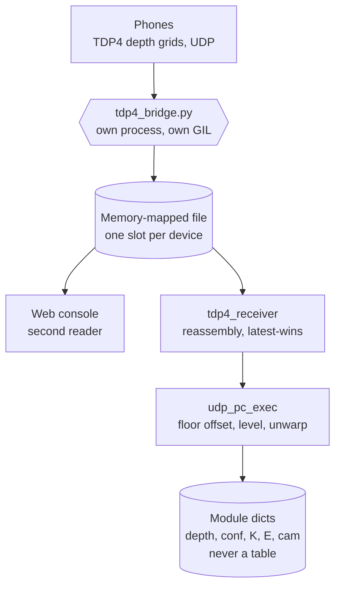
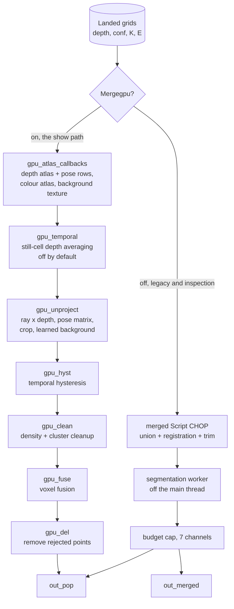

# How the pipeline is built

This page is the thing you cannot see by opening the tox. The operators are
visible; the order they run in, which of them stand down, and where each
transform is applied are not. Opening the component shows a network. It does
not show that two complete merge pipelines sit side by side, that only one of
them runs, or that the phone poses are applied inside a texture row.

Everything below was read from the DAT text in the saved component and from
the lockstep copies under `TD/newtox/tox_dats/`. The operator that **reads** a
value is the contract. Where a figure appears it is labelled.

## From the wire to a landed frame

Every path shares this front end. It runs on TouchDesigner's main thread, once
per cooked frame, and it is deliberately short.



Two things in that picture are easy to get wrong.

**The console is not downstream of TouchDesigner.** It reads the same
memory-mapped file, as a second independent reader. Its own outputs do not
depend on TouchDesigner's pipeline at all, which is why closing one does not
affect the other.

**The floor offset, the stage level solve and the lens unwarp are applied
here, at landing, not later in the chain.** By the time anything merges, the
frame is already level and already sitting at the right height. A document
that puts levelling after the merge is describing something that does not
exist.

### What the receiver guarantees

`tdp4_receiver` holds at most two in-flight frame slots per device. A frame
with any packet missing is dropped whole and never retransmitted; the next
frame supersedes it within about 33 ms. A completed frame goes into a
single-slot mailbox, so a newer frame replaces an unread older one rather than
queueing behind it.

That policy is the whole reason the transport works, and it only works because
of the grid. See [Why depth crosses the wire as a grid](#why-depth-crosses-the-wire-as-a-grid).

The receiver also tells a stream restart from a straggler, by keeping a
high-water mark of the highest frame id **seen** rather than the highest
delivered. Judging against the delivered id alone wedged the receiver on the
rig: a lossy run left two partial slots far above a stale delivered id, and
every later packet fell between the two and was discarded as stale for ever
while the thread ran and the socket drained happily. The signature of that
fault is packets and stale counts rising in lockstep with completed frames
flat.

### What landing does, and what it skips

`udp_pc_exec` turns each assembled frame into a grid dictionary: the depth
plane, the confidence plane, the validity mask, the intrinsics `K`, the
extrinsic `E`, the camera position, the grid size and the frame id. These are
references to arrays the receiver and `level_ops` already own, not copies.

On the GPU merge path the per-frame CPU unprojection is **skipped**. The GLSL
chain unprojects every cell itself, so computing the same points on the CPU
first is pure waste. Measured, simulation: 0.9 to 1.7 ms per phone frame,
which is 25 to 40 per cent of the main thread at eight streams. The frame is
stored with a lazy marker instead, and the few occasional readers that really
need CPU points call `ensure(did)` to compute them on demand: the auto-frame
camera, the floor pulse, hands on a phone with no colour plane, an RGB view
with no colour plane, and a background learn. A level solve in progress forces
the full path, because it needs every frame.

## The two merge paths

`Mergegpu` chooses between two complete pipelines. They are **alternatives,
not stages**. Nothing flows from one into the other.



With `Mergegpu` on, `out_merged` is **empty by design**. The Script CHOP emits
one empty sample. That is not a fault, and it is the state the saved component
ships in.

The one exception is a background learn. The learned grid is built by the CPU
pipeline, so `gpu_exec` force-cooks `merged` for the duration of a learn even
on the GPU path. That is also why a rig running entirely on the GPU still
needs a `Learnbg` pass on an empty stage: the two paths **share** the learned
background. The CPU pipeline learns it with `hlib` at 5 cm voxels, and the GPU
path consumes the same grid as an R8 texture.

### The GPU path, stage by stage

| Stage | Operator | What it does | Reads |
|---|---|---|---|
| Atlas build | `gpu_atlas_d`, `gpu_atlas_rgb`, `gpu_bg` (Script TOPs) | Packs every live phone's depth grid into one RGBA32F texture, its colour into an RGBA8 texture, and the learned background into an R8 texture | `Stalesecs`, `registration`, `Flooroffset`, level state |
| Temporal | `gpu_temporal` (GLSL TOP, fed back on itself) | Averages a depth cell over up to sixteen frames while it holds still, three-frame hold, resets on movement | `Gputemporal`, `Gputempsigma` |
| Unproject | `gpu_gl` running `gpu_unproject.glsl` | One thread per atlas texel: ray times depth, pose matrix, Brown radial term, crop box, learned-background drop | `Cropminx/z`, `Cropmaxx/z`, `Floorcut`, `Geoceiling`, `Colormode`, `Segmode` |
| Hysteresis | `gpu_hyst` | A cell must hold points for three consecutive merges before it appears, and inherits the streak from any of its 27 neighbours | `Gpuhyst`, `Fusevox` |
| Cleanup | `gpu_clean` | Density and cluster cleanup on a spatial hash grid | `Gpuclean`, `Densitymin`, `Minclusterpts` |
| Fusion | `gpu_fuse` | Collapses overlapping views into one point per voxel | `Gpufuse`, `Fusevox`, `Gpufusemin`, `Gpusmooth` |
| Delete | `gpu_del` (Delete POP) | Removes every point the shaders rejected | - |

The atlas is `W` wide by `N*H + N` tall: `N` phones of `H` rows each, then one
**pose row** per phone. That pose row is how the whole transform reaches the
GPU without a uniform per phone:

| Column | Holds |
|---|---|
| 0 to 3 | The four rows of the per-phone matrix `G` |
| 4 | `fx`, `fy`, `cx`, `cy` |
| 5 | Radial `k1`, grid width, grid height, device id |
| 6 | Colour present, frame id modulo 2^24 |
| 7 | The device tint |

`keep` is a custom float on every point: 0 rejected, 1 kept, and **2 for a
point in the floor band just under `Floorcut`**. The band is stashed rather
than discarded so that `gpu_clean` can rescue feet, which would otherwise be
cut off the bottom of every performer.

Three cook decisions in `gpu_exec` are worth knowing, because each one was a
measured problem:

- The atlases are force-cooked at frame start. A Script TOP has no cook
  dependency on the Python state it reads, so without this the GLSL chain
  reprocesses a frozen atlas. Measured, 2026-10-25: zero atlas cooks per
  second while the POP chain ran at 70 per second.
- The background texture is cooked **only** when the learned grid, the
  pipeline object or `Segmode` changes. Cooking it every frame re-uploaded
  about 21 MB and summed five million voxels per frame for nothing.
- The atlases are persistent. A phone's slot is rewritten only when that slot
  holds a new frame, which matters because phones send at 30 and
  TouchDesigner cooks at 60. Rebuilding both atlases from zeros every frame
  cost 2.4 ms of numpy on the main thread at eight streams (measured,
  simulation, 2026-10-26).

### The CPU path, stage by stage

`merged` is a Script CHOP. It unions every live device, applies the
registration table and the Level page trim, then segments according to
`Segmode`:

| `Segmode` | What runs |
|---|---|
| `off` | Crop, voxel dedup and the output budget only |
| `geometric` | `hlib_grid.isolate_geometric`: floor cut, ceiling, stage box, density, clustering. Nothing learned, so it works from the first frame on a levelled cloud |
| `learned` | An `hlib` background-stencil subtract, then the floor map, clustering and fusion. Needs a `Learnbg` pass first |

Segmentation runs on a latest-wins worker thread when `Mergethread` is on, so
TouchDesigner's frame rate stops following the phone count. It costs about one
merge of extra latency. The worker touches numpy and plain module dictionaries
only, never the TouchDesigner API.

The tail is shared between the cook paths: `Maxpoints` caps the output by
striding evenly across the merged cloud, so the cloud thins rather than being
truncated, and the result is emitted as seven channels.

### Where the per-device registration is applied

This is the correction most worth reading. A phone's extrinsic is
gravity-levelled but **origin-centred**: the phone knows which way is up and
nothing about where it stands. Three phones therefore pile up on top of each
other until something tells each one where it is. The `registration` table is
that something, and the hub applies it per device on both paths.

So the hub does not only union. The full transform from a depth cell to a
stage point is, on the GPU path, one matrix built per phone per frame:

```
G = Trim . Reg . Floor . Level . E
```

| Term | From | Scope |
|---|---|---|
| `E` | The phone's own extrinsic, on the wire | Per device |
| `Level` | The stage level solve | Whole rig |
| `Floor` | `Flooroffset` | Whole rig |
| `Reg` | `registration`: yaw about Y, then translate | **Per device** |
| `Trim` | The Level page `Trim` knobs | Whole cloud |

The CPU path applies the same terms in the same order, in `merged_callbacks`
and `level_ops` rather than in a matrix row.

`Posesource` decides where `Reg` comes from: the console roster, or the Align
page knobs. Note that the registration yaw is not the same number as the
roster's plan heading, so a figure typed in by hand from a plan will be ninety
degrees out.

What **is** true, and worth keeping, is the consequence: a point read from
`out_pop` is already in the space the content works in. No further transform
is needed or wanted. The hub does the alignment so that nothing downstream has
to.

### What both paths feed

| Consumer | What it gets | Rate |
|---|---|---|
| Console health line | Real frame rate, merge cook time, live phone count, output point count | `Healthhz`, once a second by default |
| `rgb_callbacks` | The per-phone colour views and the grid | Per frame while `Rgbactive` |
| Hands library | The stage point under each detected hand | `Handsrate` |

On the GPU path the health line reports `out_pop`'s point count, because
`merged` stands down and reporting its sample count showed "points 1" for an
88,000-point cloud. The frame rate on that line is counted from cooked frames,
not from `absTime`, and is published as -1 when it cannot be measured rather
than silently substituting the wall figure.

## Why it is built this way

Each of these was a decision with a cost, and each one is expensive to
revisit. What follows is the hub's side of them: what the choice forced the
component to look like. The system-wide version of the same arguments, with
the transport reasoning in full, is
[Why it is built this way](../reference/design.html).

### Why the receiving had to leave TouchDesigner

TouchDesigner's main thread holds the Python global interpreter lock through
GPU work. A receive thread living inside TouchDesigner is starved for the
duration, the socket buffer fills, and the kernel discards what it cannot hand
over. The loss is invisible from inside: the thread is running, the socket is
draining, and frames simply never complete.

Measured, simulation, 2026-10-26: three streams of depth and confidence into
TouchDesigner's own socket lost about 25,000 of 55,080 packets over six
seconds, about 48 per cent, reproducibly. With the GPU merge path off, none.

So the receiving moved into its own process, with its own lock, running the
**same** `tdp4_receiver` with the same reassembly and the same policy. The
bridge does not interpret the data; it reassembles frames and publishes each
device's latest one.

The implementation choices inside the bridge are all about not taking
TouchDesigner down with it:

- A plain file plus `mmap`, not `multiprocessing.shared_memory`. That module
  starts a resource-tracker helper by re-running `sys.executable`, which
  inside TouchDesigner is TouchDesigner.
- The layout version is in the filename. A bridge and a tox from different
  builds then miss each other, and TouchDesigner keeps its own socket, instead
  of one process resizing a file the other has mapped, which is a crash on
  macOS.
- Every slot and the metadata block is seqlocked: the writer makes the
  sequence odd, writes, makes it even, and a reader keeps a copy only if the
  sequence was even and unchanged. There are no memory barriers; a per-slot
  checksum is the upgrade if a torn frame is ever actually seen.
- A heartbeat in the header, with a two-second freshness window, is what hands
  the socket over in either direction without either process knowing about the
  other. See [Running the hub](running.html#handover).

### Why depth crosses the wire as a grid

The phone could unproject on device and send xyz points. It does not, and the
reason is arithmetic rather than taste.

The xyz coordinates are a deterministic function of `depth x ray(u, v)`, and
the ray comes from the intrinsics, which the receiver already has. Sending
points means paying for information the receiver can regenerate for free on
the GPU. At eight streams:

| On the wire | Bandwidth at 30 fps, eight streams | Share of gigabit |
|---|---|---|
| Depth only, half-float | about 189 Mbit/s | 20 per cent |
| Depth and confidence (the show default) | about 283 Mbit/s | 30 per cent |
| Depth, confidence and colour | about 566 Mbit/s | 60 per cent |
| xyz points on device | about 1.4 Gbit/s | does not fit |

Those are arithmetic from the frame size, not measurements. The conclusion is
not marginal: xyz on device is 7.5 times depth-only, and it does not fit on
the link at all.

The grid is also planar, not interleaved, specifically so that each plane can
be omitted independently and so that a depth plane uploads straight into a GPU
texture with no repacking. That is what makes the atlas build cheap enough to
run on the main thread.

### Why the organized grid gives identity without smoothing

This is the insight the whole pipeline rests on.

In an organized depth grid, cell `(u, v)` is the **same camera ray every
frame**. A surface in front of that ray gets measured again and again. The
point moves along the ray; it does not appear and disappear, and it does not
swap places with its neighbours.

That buys two things at once.

It makes a dropped frame harmless. A lost packet costs one frame from one
phone. The next frame measures the same rays, so there is no positional
artefact and nothing to interpolate across. Compare the alternative: an
unordered point list has no cell identity, so a dropped frame is a gap you
have to invent your way out of.

And it removes the reason to smooth positionally. Temporal smoothing exists to
stop points flickering between frames. Here they do not flicker, so the
smoothing is not needed, and that matters because smoothing is actively
harmful to multi-view fusion: it invents geometry, and two views that have
each invented slightly different geometry fuse worse than two noisy honest
ones. This is why the phone captures with Apple's depth filtering switched
off.

The one place time is used is `gpu_temporal`, and it is careful about it: a
cell is averaged **only while it holds still**, gated against a depth-noise
model, and the average resets the moment the cell moves. It is off by default,
and the offline check for it requires that body error on moving performers
stays within one millimetre of raw.

### Why the learned background lives in files

A learned background is a large numpy array. Component storage is saved into
the tox, so putting it there would bloat a binary file that is already
versioned by hand, and would carry a venue's floor into every snapshot.

So it lives on disk as a compressed numpy checkpoint, reloaded lazily when the
module recompiles. See [Maintenance](maintenance.html#where-learned-state-lives)
for the paths and the consequences, of which the important one is that a fresh
show machine starts with no learned state at all.

### Why both merge paths still exist

The GPU path is the show path. It is faster, and it is the one the saved
component ships in. The CPU path is not dead weight, for three reasons.

1. **It learns the background.** The GPU path consumes the learned grid; the
   CPU pipeline is what builds it. Deleting the CPU path would mean porting
   the learn.
2. **It is the readable reference.** `hlib.py` and `hlib_grid.py` are pure
   numpy and OpenCV, with no TouchDesigner imports, so the same files run
   inside the component and in offline tests. A GLSL shader cannot be tested
   that way. The parity test exists precisely to hold the shaders to the
   numpy references, and that only works while the references are real working
   code.
3. **It survives a GPU problem.** The CPU path needs no bridge and no
   compute-capable POP chain. It is slower, and on a loaded rig it is the merge
   worker's rate rather than TouchDesigner's frame rate, but it produces a
   cloud.

Measured, simulation, 2026-10-26, depth and confidence, with the bridge in
place: the GPU path held 60 real frames per second at 8, 12 and 16 streams,
while the CPU path at 8 streams saturated its merge worker at 27.7 merges per
second, 38 ms each. There is no multi-phone rig measurement of either.
