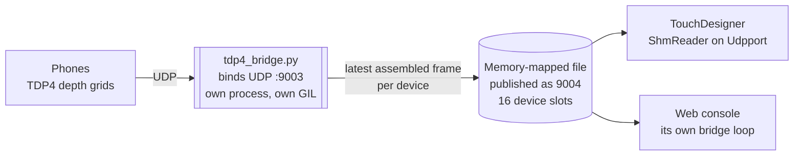
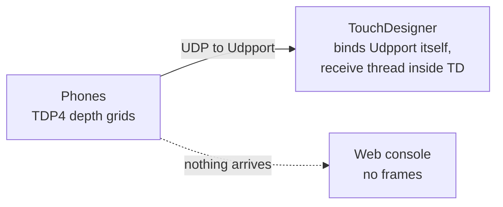

# Running the hub

The hub is one component: `TD/TDStageConductor.tox`. Open it in TouchDesigner
and it receives every phone, builds one point cloud in stage coordinates,
cleans and fuses it, and publishes the result on its output connectors.

There is no build step. The tox is edited live in TouchDesigner and saved as
numbered snapshots, so the file in the repository is the working hub.

`TDStageShow.tox` was never built. If a document mentions it, or mentions
`build_tox.py` producing it, that document is describing an unfinished plan.

## Open the tox

1. Open TouchDesigner.
2. Drop `TD/TDStageConductor.tox` into a project, or open a project that
   already contains it.
3. The component's node viewer shows `out_preview`, the rendered 3D view of
   the cloud. That is the picture you watch while aiming phones.

`TD/` also holds numbered snapshots, `TDStageConductor_v01.tox` through to the
current highest number. These are history. Always work from
`TDStageConductor.tox`, which is re-saved alongside each new snapshot. On
2026-10-27 the working copy was byte-identical to `TDStageConductor_v78.tox`,
checked by checksum.

## The topology

Phones send TDP4 depth grids over UDP. A separate process receives them and
hands TouchDesigner whole frames through a memory-mapped file. The web console
reads the same file, as a second independent reader.



Neither reader is downstream of the other. TouchDesigner's cloud and the
console's outputs come from the same frames and are independent of each other.

With no bridge running, TouchDesigner falls back to binding the socket itself
and the console loses its feed:



That fallback is a safety net, not a configuration. On the GPU merge path it
loses packets, badly, which is the reason the bridge exists at all.

### Why the receiving is not inside TouchDesigner

TouchDesigner's main thread holds the Python global interpreter lock through
GPU work. A receive thread living inside TouchDesigner is starved for the
duration, its socket buffer fills, and the kernel discards what it cannot hand
over. The loss is invisible from inside: the thread is running, the socket is
draining, and frames simply never complete.

Measured, simulation, 2026-10-26: three streams of depth and confidence into
TouchDesigner's own socket lost about 25,000 of 55,080 packets over six
seconds, about 48 per cent, reproducibly. With the GPU merge path off, none.

The bridge runs the **same** `tdp4_receiver` module, with the same reassembly
and the same drop-incomplete policy, in its own process with its own lock. It
does not interpret the data. The wire, the phones and the tox are unchanged.

A few implementation details are worth knowing because they decide how it
fails:

| Choice | Why |
|---|---|
| A plain file plus `mmap`, not `multiprocessing.shared_memory` | That module starts a resource-tracker helper by re-running `sys.executable`, which inside TouchDesigner is TouchDesigner |
| The layout version is in the filename | A bridge and a tox from different builds miss each other and TouchDesigner keeps its own socket, instead of one process resizing a file the other has mapped, which crashes TouchDesigner on macOS |
| Sixteen device slots, least-recently-written evicted | A seventeenth device takes a slot rather than growing the file |
| Each slot and the metadata block is seqlocked | The writer makes the sequence odd, writes, makes it even; a reader keeps a copy only if the sequence was even and unchanged. No memory barriers, so a per-slot checksum is the upgrade if a torn frame is ever actually seen |
| A frame larger than 512 KB is refused, counted, and not written | A 320 by 240 grid with depth, confidence and colour is 460,920 bytes, so the slot has headroom but not unlimited headroom |

How the frames then become a point cloud is
[How the pipeline is built](pipeline.html).

The bridge publishes its file under a port name. The show launchers bind
`:9003` and publish under the name `9004`, so a tox left on `Udpport` 9004
needs no change:

```
python3 TD/newtox/tdp4_bridge.py --port 9003 --shm-port 9004
```

Set `Udpport` to whichever name the bridge publishes under. With no
`--shm-port`, the bridge publishes under its bind port, so a tox on `Udpport`
9003 and a bridge on `--port 9003` also match.

### Handover

Start order does not matter, and neither process knows about the other. The
whole handover rides on one heartbeat timestamp in the file's header.

The bridge writes the file and starts its heartbeat **before** it binds.
TouchDesigner re-checks for a fresh heartbeat twice a second, so within about
half a second it drops its own socket and reads the file instead. The bridge
then binds the port it has been waiting for.

Coming back the other way, the timing depends on **how** the bridge stopped:

| How it stopped | What the heartbeat does | When TouchDesigner takes the socket |
|---|---|---|
| Clean stop, for example Ctrl-C | `ShmWriter.close` zeroes the heartbeat, so readers see it gone immediately | Within about half a second, at the next check |
| Crash or kill | The last heartbeat stays in the file and ages out | The freshness window is 2 s, so 2 to 2.5 s later |

So "TouchDesigner binds within a second" is the clean case only. After a crash
there is a gap of two to two and a half seconds during which neither process
holds the port and no frames land.

In practice the launchers close that gap from the other side: each watchdog
restarts the process it supervises two seconds after it exits, so a crashed
bridge is usually back at about the same moment TouchDesigner would have taken
over. Which of the two wins the race is not deterministic, and it does not
need to be: whichever binds, the other reads or stands down. What you should
expect after a bridge crash is a couple of seconds of missing frames and a log
line naming the new source, not a dead rig needing a restart.

### The fan-out relay is not in the show path

`WebConsole/udp_fanout.py` copied every datagram to TouchDesigner and to the
console. It came out of the show path on 2026-10-27 and is now legacy. It
remains only as an option for the CPU merge path with no bridge.

Measured, simulation: the relay is bound by its three syscalls per datagram and
tops out near 30,000 packets per second on an M-series Mac (no loss at 25,000,
24 per cent loss at 40,000, 43 per cent at 50,000). The bridge alone took
61,000 packets per second with no loss at twelve colour streams. Eight phones
sending depth, confidence and colour would be about 49,000 packets per second,
which is arithmetic from the frame size, not a measurement.

Do not put the relay in front of the bridge in a show configuration.

### Stale documents

Two documents in the source repository still describe older topologies. Trust
the code and the launchers over both.

| Document | What is stale |
|---|---|
| `TD/README-Demo-and-Networking.md` | Describes TCP ingest on port 9002, a Control page, a Test page, a colour demo and a `device_hosts` table. All removed. The file carries its own historical warning. |
| The architecture diagram in `CLAUDE.md`, and the header comments in `tox_dats/udp_pc_exec.py` and `tox_dats/status_exec.py` | Still draw the fan-out relay in the show path. |

## Start the hub

The launchers start the bridge and the web console together, each under a
watchdog that restarts it two seconds after it exits.

| Machine | Command |
|---|---|
| Mac | `Tools/show_mac.sh` |
| Show machine (Windows) | `WebConsole\windows\show.bat` |

Then open TouchDesigner with the tox. The bridge alone, without the console,
is `WebConsole\windows\bridge.bat` on Windows, or the `tdp4_bridge.py` command
above anywhere.

## Point Cloud page: the settings that matter

Four parameters decide whether anything arrives at all.

| Parameter | What to set | Why |
|---|---|---|
| `Udpactive` | On | The ingest is off while this is off. Nothing arrives and nothing says why. The saved working copy ships with it **off**, so this is the first switch to check. |
| `Udpport` | The name the bridge publishes under, or the port the phones send to when TouchDesigner binds the socket itself | A mismatch here looks exactly like a dead network. |
| `Stalesecs` | 0.28 in the saved working copy, 0.5 by default | A device silent for longer than this drops out of the merge and reads STALE in the `devices` table. |
| `Mergegpu` | On for the show path | The GPU merge path builds the cloud on the GPU. It needs the bridge. See [Parameters](parameters.html) for what it changes. |

The full page-by-page list is in [Parameters](parameters.html).

## Is anything arriving? A ten-second check

Look at four things, in this order. Each one narrows the problem.

### 1. The `devices` table

`TDStageConductor/devices` is rebuilt about four times a second. One row per
device, with these columns:

| Column | Meaning |
|---|---|
| `id` | Device id from the wire |
| `name`, `model` | From the device's TDPH hello |
| `state` | `LIVE` if a frame landed within `Stalesecs`, else `STALE` |
| `fps` | Frames landed in the last second, per device. Zero while STALE. |
| `points` | Points in the last frame, or valid grid cells on the GPU path |
| `age_ms` | Milliseconds since the last frame or hello |
| `frame` | The device's last frame id |
| `conn` | `udp:<port>` the frame came in on |
| `src` | The address the device is sending from |

A row with `state` LIVE and a non-zero `fps` is a phone that is arriving. No
rows at all means nothing has reached the ingest: check `Udpactive`, then
`Udpport`, then the bridge.

A row that appears and immediately reads STALE means hellos are arriving but
frames are not, or frames are arriving incomplete.

### 2. The log

`TDStageConductor/logtable` carries `time`, `device`, `level`, `msg`. It names
the ingest source on every change:

| Message | Meaning |
|---|---|
| `TDP4 via tdp4_bridge (:<port>, own process)` | Reading the bridge's file. This is the show path. |
| `TDP4/UDP receiver listening :<port>` | TouchDesigner bound the socket itself. The bridge is not running. |
| `TDP4 receiver cannot bind :<port>` | Something else holds the port. Often a bridge on the same port that TouchDesigner has not yet noticed, or a second TouchDesigner. |
| `TDP4 device <id> online` | First frame from that device |

### 3. The preview

The component's node viewer is `out_preview`. A cloud that moves is a cloud
that is arriving. A cloud frozen in place with LIVE rows in the table is a
different fault from an empty view.

### 4. The Console page `Link Status`

`Consolestatus` is a live string: the console address, how long ago it last
pinged, and the transmit, receive, relay, ignored and error counts. It tells
you whether the hub and the console are talking, which is separate from
whether phones are arriving.

## When nothing arrives

Work down this list.

1. `Udpactive` is off. The single most common cause, because the saved file
   ships that way.
2. `Udpport` does not match the bridge's published name. The log line names
   the port the receiver is actually on.
3. The bridge is not running, and the phones are sending to a port
   TouchDesigner is not bound to. With the bridge down, TouchDesigner binds
   `Udpport` itself, so the phones must be sending there.
4. Two processes want the same port. The `cannot bind` log line says so.
5. The phones are sending to the wrong address. That is a phone-side setting
   and the console shows it; it is not visible from inside the tox beyond the
   absence of rows.
