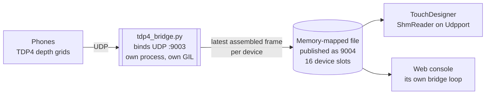
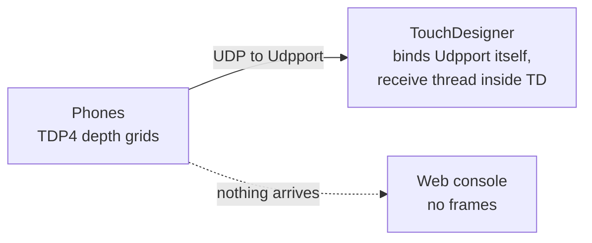

# Running the hub

The hub is one component: `TD/TDStageConductor.tox`. Open it in TouchDesigner
and it receives every phone, builds one point cloud in stage coordinates,
cleans and fuses it, and publishes the result on its output connectors.

There is no build step. You edit the tox live in TouchDesigner and save it as
numbered snapshots, so the file in the repository is the working hub.

`TDStageShow.tox` was never built. If a document mentions it, or mentions
`build_tox.py` producing it, that document is describing an unfinished plan.

## Open the tox

1. Open TouchDesigner.
2. Open the working project, `TDStage working1.22.toe`. Since 17 November 2026
   its `TDStageConductor` has **external tox** enabled and pointed at
   `TD/TDStageConductor.tox`, so each opening loads the working copy rather
   than a component frozen inside the file. The project before it had been
   carrying tox v84 since the v94 and v95 updates were loaded live and never
   saved, which is exactly the trap external tox removes. For a fresh project,
   drop `TD/TDStageConductor.tox` in instead.
3. The component's node viewer shows `out_preview`, the rendered 3D view of
   the cloud. That is the picture you watch while aiming phones.

`TD/` also holds numbered snapshots, `TDStageConductor_v01.tox` through to the
current highest number. These are history. Always work from
`TDStageConductor.tox`, which is re-saved alongside each new snapshot. On
17 November 2026 the working copy was byte-identical to
`TDStageConductor_v95.tox`, checked by checksum. The clean save that removed
the bench registration rows from the file is in every version from v87 on, so a
fresh show machine does not start with three phones placed where they stood in
a living room.

{: .note }
> **The saved tox and the repository now agree.** The five scripts that were
> behind on 9 November (`clib`, `hands_lib`, `hlib`, `hlib_grid` and
> `udp_pc_exec`, the Windows UDP connection-reset switch among them) went in
> with the saves up to v95: the drift check reads 41 DATs identical, 0
> differing. [Where it stands today](maintenance.html#where-it-stands-today)
> is the current reading and how to take it again.

**Where the stage cut lives.** Inside `TDStageConductor`, on its own **Stage
Cut** page, which is the second tab of the component's parameters. It holds the
floor cut, the crop box, the backdrop wall and the ceiling. Checked on
17 November with three simulated phones through the bridge: 69,162 points with
the floor kept, 18,890 with `Floorcut` at 0.06, and 7,455 with `Wallcut` on at
3.5 m [simulated].

## The topology

Phones send TDP4 depth grids over UDP. A separate process receives them and
hands TouchDesigner whole frames through a memory-mapped file. The web console
reads the same file, as a second independent reader.



Neither reader is downstream of the other. TouchDesigner's cloud and the
console's outputs come from the same frames and are independent of each other.

With no bridge running, TouchDesigner falls back to binding the socket itself
and the console loses its feed:



That fallback is a safety net only. On the GPU merge path it loses packets,
badly, which is the reason the bridge exists at all.

### Why the receiving is not inside TouchDesigner

TouchDesigner's main thread holds the Python global interpreter lock through
GPU work. A receive thread living inside TouchDesigner is starved for the
duration, its socket buffer fills, and the kernel discards what it cannot hand
over. The loss is invisible from inside: the thread is running, the socket is
draining, and frames never complete.

Measured, simulation, 2026-10-26: three streams of depth and confidence into
TouchDesigner's own socket lost about 25,000 of 55,080 packets over six
seconds, about 48 per cent, reproducibly. With the GPU merge path off, none.

The bridge runs the **same** `tdp4_receiver` module, with the same reassembly
and the same drop-incomplete policy, in its own process with its own lock. It
does not interpret the data. The wire, the phones and the tox are unchanged.

These implementation choices decide how the bridge fails:

| Choice | Why |
|---|---|
| A plain file plus `mmap`, not `multiprocessing.shared_memory` | That module starts a resource-tracker helper by re-running `sys.executable`, which inside TouchDesigner is TouchDesigner |
| The layout version is in the filename | A bridge and a tox from different builds miss each other and TouchDesigner keeps its own socket, instead of one process resizing a file the other has mapped, which crashes TouchDesigner on macOS |
| Sixteen device slots, least-recently-written evicted | A seventeenth device takes a slot rather than growing the file |
| Each slot and the metadata block is seqlocked | The writer makes the sequence odd, writes, makes it even; a reader keeps a copy only if the sequence was even and unchanged. No memory barriers, so a per-slot checksum is the upgrade if a torn frame is ever seen |
| A frame larger than 512 KB is refused, counted, and not written | A 320 by 240 grid with depth, confidence and colour is 460,920 bytes, so the slot has headroom but not unlimited headroom |

[How the pipeline is built](pipeline.html) covers how the frames then become
a point cloud.

The bridge publishes its file under a port name. The show launchers bind
`:9003` and publish under the name `9004`, so a tox left on `Udpport` 9004
needs no change:

```
python3 TD/newtox/tdp4_bridge.py --port 9003 --shm-port 9004
```

{: .warning }
> **`--port` defaults to 9004, which is not where the phones send.** Run the
> bridge bare, without the flags above, and it binds the publish name instead
> of the phones' port, so nothing arrives and everything looks healthy. Always
> give it both flags.

Set `Udpport` to whichever name the bridge publishes under. With no
`--shm-port`, the bridge publishes under its bind port, so a tox on `Udpport`
9003 and a bridge on `--port 9003` also match.

### Handover

Start order does not matter, and neither process knows about the other. The
whole handover rides on one heartbeat timestamp in the file's header.

The bridge writes the file and starts its heartbeat **before** it binds.
TouchDesigner re-checks for a fresh heartbeat twice a second, so within about
half a second it drops its own socket and reads the file instead. The bridge
then binds the port it has been waiting for.

Coming back the other way, the timing depends on **how** the bridge stopped:

| How it stopped | What the heartbeat does | When TouchDesigner takes the socket |
|---|---|---|
| Clean stop, for example Ctrl-C | `ShmWriter.close` zeroes the heartbeat, so readers see it gone immediately | Within about half a second, at the next check |
| Crash or kill | The last heartbeat stays in the file and ages out | The heartbeat is written every half second and the freshness window is 2 s, so 1.5 to 2.5 s later |

So "TouchDesigner binds within a second" is the clean case only. After a crash
there is a gap of one and a half to two and a half seconds during which neither
process holds the port and no frames land.

In practice the launchers close that gap from the other side: the bridge's
watchdog restarts it two seconds after it exits, so a crashed
bridge is usually back at about the same moment TouchDesigner would have taken
over. Which of the two wins the race is not deterministic, and it does not
need to be: whichever binds, the other reads or stands down. After a bridge
crash, expect a couple of seconds of missing frames and a log line naming the
new source. The rig does not need a restart.

#### Measured rather than reasoned: `bridge_outage.py`

Everything above is read from the code. This measures it:

```bash
python3 Tools/bridge_outage.py                 # orderly, then kill
python3 Tools/bridge_outage.py --runs 10       # five of each
python3 Tools/bridge_outage.py --expect-no-again
```

It recreates what the show launchers do (the bridge on `--port P`
`--shm-port P+1`, restarted two seconds after it exits) on loopback, with one
simulated phone sending at 30 fps and a reader doing exactly what
`udp_pc_exec` does once per frame at 60 Hz. Counted from the moment the bridge
process has exited, it reports when the reader gave up and bound the port
itself, when the first genuinely newer frame landed, and **how many old frames
the reader handed back as new** in between.

Run 9 November 2026, ports 9561 and 9562, one run of each kind:

| Stop | Reader took the socket | First new frame | Old frames returned again |
|---|---|---|---|
| Orderly (SIGINT) | 0.32 s | 2.58 s | 16 |
| Hard (SIGKILL) | 1.96 s | 2.72 s | 20 |

Two things follow. The handover itself is fast and behaves as
the table above says: a third of a second on a clean stop, about two on a kill.
**The frames are gone for longer than the handover takes**: around 2.6 seconds
either way, because the restarted bridge has to come up and the phone's next
frames have to arrive.

And the reader returns old frames as new across the gap, sixteen and twenty
here. In the tox that means a second or so of stale geometry rather than a
frozen or empty cloud, which is usually the better failure, but it is a real
effect and not what "new frames only" sounds like. `--expect-no-again` exits 1
on any of them, for a run that wants to assert the opposite.

{: .note }
> Loopback, a simulated phone, an 8 x 6 grid. It measures the **software** path
> (heartbeat, the twice-a-second check, the restart delay, start-up) and not
> a phone, a network, a full-size grid or Windows. The orderly mode needs
> SIGINT, so on Windows only `--mode kill` runs. Its ports default to 9561 and
> 9562; never give it a show port.

### Where the console looks for the bridge file

The console does not read TouchDesigner's parameter. It looks for a bridge
file in this order: the port TouchDesigner reports over the link, then 9004,
then 9003, taking the first that exists. `TDSTAGE_BRIDGE_PORT` pins it to one
port and skips the search.

So a bridge publishing under a name none of those three match is invisible to
the console while TouchDesigner is perfectly happy, which reads as the console
having lost the phones.

{: .note }
> **On Windows a stale file of the wrong size stops the bridge loudly**, with a
> message saying it has the wrong size and is in use and to close TouchDesigner
> or delete the file. That is the good case. The file is named for its port and
> its layout version, so a bridge and a reader built from different versions
> look for different files rather than silently sharing a mismatched one.

### The fan-out relay is not in the show path

`WebConsole/udp_fanout.py` copied every datagram to TouchDesigner and to the
console. It came out of the show path on 2026-10-27 and is now legacy. It
remains only as an option for the CPU merge path with no bridge.

Measured, simulation, 2026-10-27: the relay is bound by its three syscalls per
datagram and tops out near 30,000 packets per second on an M-series Mac (no
loss at 25,000, 24 per cent loss at 40,000, 43 per cent at 50,000).

The bridge alone, measured on loopback on 2026-10-27, took 114,500 packets per
second with no loss at twelve colour streams of 320×240, at 55 per cent of one
core. An earlier figure of 61,000 was the highest load tried at the time, not a
ceiling.

Eight phones sending depth, confidence and colour is about 49,000 packets per
second **at 256×192**, the grid the simulator uses and the grid TDStage AR
sends, and about 76,300 at the 320×240 the parked AVFoundation app takes, by Apple's figure, on an
LiDAR iPhone. Both are arithmetic from the frame size; the second was also run
on loopback (eight colour sims at 320×240, 76,300 packets per second, none
lost), so even that one is inside what the bridge was measured to carry.

The binding limit is the link rather than the bridge, and how tight it is
depends on the grid: eight colour phones are about 600 Mbit/s with framing at
256×192 and 937 Mbit/s at 320×240. Real phones through the show switch have not
been measured.

Do not put the relay in front of the bridge in a show configuration.

### Stale documents

Two documents in the source repository still describe older topologies. Trust
the code and the launchers over both.

| Document | What is stale |
|---|---|
| `TD/README-Demo-and-Networking.md` | Describes TCP ingest on port 9002, a Control page, a Test page, a colour demo and a `device_hosts` table. All removed. The file carries its own historical warning. |
| The architecture diagram in `CLAUDE.md`, and the header comments in `tox_dats/udp_pc_exec.py` and `tox_dats/status_exec.py` | Still draw the fan-out relay in the show path. |

## Start the hub

The launchers start the bridge and the web console together, each under a
watchdog that restarts it two seconds after it exits (three seconds for the
console on Windows, `run.bat`).

| Machine | Command |
|---|---|
| Mac | `Tools/show_mac.sh` |
| Show machine (Windows) | `WebConsole\windows\show.bat` |

Then open TouchDesigner with the tox. The bridge alone, without the console,
is `WebConsole\windows\bridge.bat` on Windows, or the `tdp4_bridge.py` command
above anywhere.

## Point Cloud page: the settings that matter

Four parameters decide whether anything arrives at all.

| Parameter | What to set | Why |
|---|---|---|
| `Udpactive` | On | The ingest is off while this is off. Nothing arrives and nothing says why. The saved working copy ships with it **off**, so this is the first switch to check. |
| `Udpport` | The name the bridge publishes under, or the port the phones send to when TouchDesigner binds the socket itself. 9004 in the saved working copy, 9003 by default | A mismatch here looks exactly like a dead network. |
| `Stalesecs` | 0.28 in the saved working copy, 0.5 by default | A device silent for longer than this drops out of the merge and reads STALE in the `devices` table. |
| `Mergegpu` | On for the show path, and on in the saved working copy | The GPU merge path builds the cloud on the GPU. It needs the bridge. See [Parameters](parameters.html) for what it changes. |

The full page-by-page list is in [Parameters](parameters.html).

## Is anything arriving? A ten-second check

Look at four things, in this order. Each one narrows the problem.

### 1. The `devices` table

`TDStageConductor/devices` is rebuilt about four times a second. One row per
device, with these columns:

| Column | Meaning |
|---|---|
| `id` | Device id from the wire |
| `name`, `model` | From the device's TDPH hello |
| `state` | `LIVE` if a frame landed within `Stalesecs`, else `STALE` |
| `fps` | Frames landed in the last second, per device. Zero while STALE. |
| `points` | Points in the last frame, or valid grid cells on the GPU path. Zero while STALE. |
| `age_ms` | Milliseconds since the last frame or hello |
| `frame` | The device's last frame id |
| `conn` | `udp:<port>` the frame came in on |
| `src` | The address the device is sending from |

A row with `state` LIVE and a non-zero `fps` is a phone that is arriving. No
rows at all means nothing has reached the ingest: check `Udpactive`, then
`Udpport`, then the bridge.

A row that appears and immediately reads STALE means hellos are arriving but
frames are not, or frames are arriving incomplete.

### What the `devices` table does on its own

Two behaviours surprise people, and neither is a fault.

- **A phone silent for 30 seconds is removed from the table rather than shown
  as offline.** The row vanishes. A real phone re-creates it on reconnect and
  its registration row survives regardless, so a disappearance means "not
  heard from", not "lost its pose".
- **A new device id below 1000 registers itself** the first time it appears,
  with an identity pose. Ids from 1000 up are simulator and fallback rows and
  are left alone. So a phone that has never been placed still gets a row in
  `registration`, sitting at the origin until something places it.

### 2. The log

`TDStageConductor/logtable` carries `time`, `device`, `level`, `msg`. It names
the ingest source on every change:

| Message | Meaning |
|---|---|
| `TDP4 via tdp4_bridge (:<port>, own process)` | Reading the bridge's file. This is the show path. |
| `TDP4/UDP receiver listening :<port>` | TouchDesigner bound the socket itself. The bridge is not running. |
| `TDP4 receiver cannot bind :<port>` | Something else holds the port. Often a bridge on the same port that TouchDesigner has not yet noticed, or a second TouchDesigner. |
| `TDP4 device <id> online (GPU path)`, or `(<n> pts)` on the CPU path | First frame from that device |

### 3. The preview

The component's node viewer is `out_preview`. A cloud that moves is a cloud
that is arriving. A cloud frozen in place with LIVE rows in the table is a
different fault from an empty view.

### 4. The Console page `Link Status`

`Consolestatus` is a live string: the console address, how long ago it last
pinged, and the transmit, receive, relay, ignored and error counts. It tells
you whether the hub and the console are talking, which is separate from
whether phones are arriving.

## The link, message by message

Both directions run all the time. The hub receives on `Consoleport` (9006 by
default) and answers to the console's own listen port, which it learns from the
ping, so nothing has to be configured on the tox beyond that port. The
authoritative list is the header of `TD/newtox/tox_dats/console_link_lib.py`;
this is the same list with what each message costs you.

### Console to hub

| Message | What it does |
|---|---|
| `/tdstage/ping <seq> [replyPort]` | Answered with `/tdstage/td/pong <seq>`. It is also how the hub learns where the console is: the address it came from, and the reply port it carries. |
| `/tdstage/pose <id> <x> <y> <z> <yaw> <pitch> <roll> <fovH> <fovV>` | Writes that device's row in `registration`: yaw about Y, then translate, which is exactly what the merge applies per device. This is how the console aligns the streams. Arguments 6 and 7 are the plan aim and are **not** read as tilt. |
| `/tdstage/tilt <id> <pitchDeg> <rollDeg>` | The phone's tilt correction about its own camera, into the same table. Sent beside every pose; `0 0` for a marker-calibrated phone. An older console never sends it, and the row's tilt then stays 0. |
| `/tdstage/pose/clear <id>` | Zeroes that device's pose **and** its tilt. |
| `/tdstage/set <Parname> <value>` | Sets one custom parameter of the tox: menu, toggle, int, float or string. Answered with `/tdstage/td/par <name> <value>`, the value read back after the set. |
| `/tdstage/get <Parname>` | Answered with `/tdstage/td/par <name> <value>`. |
| `/tdstage/pulse <Parname>` | Pulses one, which is how `Learnbg`, `Autofloor` and `Levelsolve` are fired from outside. Silent: a pulse has no value to report. |
| `/tdstage/rgbrotate <spec>` | Per-device colour-rotation overrides as `2:180,5:90`. Both ends work out `auto` from the extrinsic in the frame header, so only forced values travel and an empty string clears every override. |
| `/tdstage/usb` | Accepted and ignored. A config-side verb an older console still sends. |

Three things that bite:

- **`Posesource` decides who owns the registration table.** On `manual` the hub
  counts every incoming pose and tilt as ignored, because the operator is
  nudging clouds by hand on the Registration page and a push would undo that
  under their fingers. The console's push reports success; nothing moves.
- **A name the tox does not have, a read-only parameter, or a pulse addressed
  with `set`** all answer `/tdstage/td/par <name> unknown` rather than failing
  silently. If a script's set looks ignored, read the reply.
- **Anything else is counted, not logged.** Unknown addresses raise the
  `ignored` counter in `Consolestatus`, and a handler that throws raises
  `errors` and keeps the last message. Both are in that string, which is the
  first place to look when a console action does nothing.

### Hub to console

Sent every `1/Healthhz` seconds, to the port the ping came from.

| Message | Arguments |
|---|---|
| `/tdstage/td/health` | `fps` `cookMs` `liveDevices` `points` `wallFps` `cooksPerS`. **-1 means not measurable and must never be shown as a number**: `fps` before its first mark, and `cookMs` and `cooksPerS` whenever `Mergegpu` is on, where the CPU merge stands down. The console turns each of those into a null rather than a zero. `liveDevices` counts the devices whose last frame is inside `Stalesecs`. |
| `/tdstage/td/status` | `segmode` `levelStatus` `toxVersion` `Udpport` `Mergegpu` `rxSource`. `rxSource` is `bridge` or `socket`, which is how the console knows whether to give up port 9003. The level status is truncated to 60 characters. |
| `/tdstage/td/rx` | `pkt/s` `frames/s` `stale/s` `dropped/s` `restarts` `slots` `running`, and on a tox from v75 an eighth, `landedPerS`, the frames TouchDesigner itself read out of the bridge file. Per-second deltas, not totals: totals pass 2^31 in a week at eight phones and OSC integers are 32-bit. |
| `/tdstage/td/pong` | `seq`, the sequence from the ping. |
| Every phone telemetry datagram | Forwarded to the console unchanged. The phones can send telemetry to one port only and today that port is the tox's, so the hub relays and the console owns telemetry. |

Two readings of those counters are worth knowing before you need them:

- **Packets and stale rising in lockstep while frames stay flat** is the
  receiver wedge: the socket is being drained and every packet rejected, which
  looks like a rig problem and is not one.
- **The bridge assembling frames while `landedPerS` is 0** means
  TouchDesigner's reader is stuck on a stale file or a layout it cannot parse.
  The console waits for two ticks before saying so, so one empty window at a
  restart stays quiet.

## When nothing arrives

Work down this list.

1. `Udpactive` is off. The single most common cause, because the saved file
   ships that way.
2. `Udpport` does not match the bridge's published name. The log line names
   the port the receiver is on.
3. The bridge is not running, and the phones are sending to a port
   TouchDesigner has not bound. With the bridge down, TouchDesigner binds
   `Udpport` itself, so the phones must be sending there.
4. Two processes want the same port. The `cannot bind` log line says so.
5. The phones are sending to the wrong address. That is a phone-side setting
   and the console shows it; it is not visible from inside the tox beyond the
   absence of rows.
