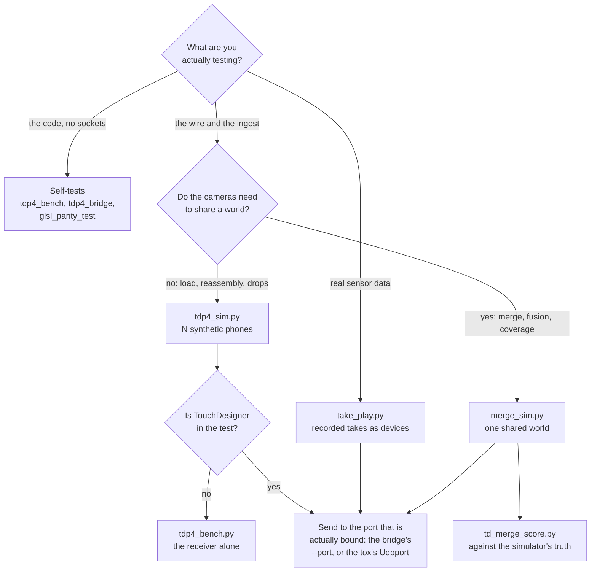

# Testing without hardware

You can exercise the whole hub with no phones in the room. Synthetic streams go
in on the same socket, in the same wire format, with the same fragmentation, so
the hub cannot tell the difference. Recorded takes do the same thing with real
sensor data.

Every command below was checked against the script's own argument parsing on
2026-10-27. The self-tests in this page were run and passed on that date.

Run them from the repository root. The scripts add their own directory to the
import path, so `python3 TD/newtox/<script>.py` works from anywhere in the
tree.

## Which one do I run?

There are five senders and six self-tests, and picking the wrong one wastes an
afternoon proving something you were not asking about. Start from what you are
testing, not from what is convenient to launch.



The distinction that catches people is the middle branch. `tdp4_sim.py` builds
its scene in **camera space**, so every synthetic phone sees a different
private world and the merged result is a ring of disjoint clouds. That is
correct for what it is for, and useless for judging a merge. `merge_sim.py`
exists for the other question.

## Which port to send to

Synthetic senders take a host and a port. Send to whichever port is actually
bound.

| Situation | Send to |
|---|---|
| The bridge is running | The bridge's `--port`, which the launchers set to 9003 |
| No bridge, TouchDesigner binds the socket | The tox's `Udpport` |
| Testing the receiver alone with the bench | The bench's `--port` |

Getting this wrong is the most common reason a sim appears to do nothing.

## Synthetic phones: `tdp4_sim.py`

Emits the TDP4 wire format: 20-byte packet headers, fragmentation at 1452
bytes of payload, planar assembled frames, a TDPH hello every two seconds. One
sender thread and socket per device. Device ids are 101 upwards.

```
python3 TD/newtox/tdp4_sim.py <host> <port> <seconds> [options]
```

| Option | Default | Meaning |
|---|---|---|
| `--devices N` | 7 | Number of synthetic phones |
| `--fps N` | 30 | Frames per second per device |
| `--planes P` | `depth+conf` | `depth`, `depth+conf` or `depth+conf+rgb` |
| `--spread-ms N` | 0 | Spread a frame's packets over this long instead of back to back |

Positional defaults are `127.0.0.1`, port 9003, 30 seconds.

Seven synthetic phones for a minute, into a running bridge:

```
python3 TD/newtox/tdp4_sim.py 127.0.0.1 9003 60 --devices 7
```

Seven synthetic plus one real phone is a full eight-stream show load.

The sim prints its own arithmetic before it starts: frame bytes, packets per
frame, per-device and aggregate Mbit/s. Those are computed from the frame size,
not measured.

### What `tdp4_sim.py` cannot test

Its scene is built in camera space: a background plane about four metres out,
plus animated ellipsoid performers two and a half to three and a half metres in
front of whichever camera is rendering. The extrinsic is applied downstream, so
every device sees a different private world. Measured, simulation: stage-space
performer centroids for three devices of a six-device ring came out metres
apart, as several disjoint clouds arranged in a ring.

That is correct for what the sim is for: exercising the wire, the reassembler
and the ingest at load. It cannot test merging, because the devices have never
been looking at the same thing.

## Synthetic phones that share a world: `merge_sim.py`

Use this when the question is about the merge, the fusion or the cleanup rather
than the transport. Every camera sees one shared world, so overlap, ghosting
and coverage mean something.

```
python3 TD/newtox/merge_sim.py <host> <port> <seconds> [options]
```

| Option | Default | Meaning |
|---|---|---|
| `--devices N` | 6 | Cameras |
| `--fps N` | 30 | Frames per second |
| `--preset P` | `ring` | Camera layout. `--rig show` is an alias for the planned rig layout. |
| `--scenario S` | `cross` | What the performers do |
| `--planes P` | `depth+conf` | Plane mask |
| `--reg-error M` | 0.0 | Per-device registration error, metres, one sigma |
| `--sigma-scale N` | 1.0 | Scale on the sensor noise model |
| `--no-noise` | off | Turn the noise model off entirely |
| `--frames N` | 60 | Frames to precompute |
| `--radius M` | 4.2 | Camera ring radius |
| `--seed N` | 7 | Deterministic seed |
| `--static` | off | Performers hold still, fresh noise every frame. For testing temporal filters. |
| `--spread-ms N` | 0 | Packet spread |

A static one-frame world, looped, which is what the scoring tool expects:

```
python3 TD/newtox/merge_sim.py 127.0.0.1 9003 120 --devices 6 --frames 1 --scenario cross
```

## Scoring the merge: `td_merge_score.py`

Scores the cloud TouchDesigner actually produced against the simulator's exact
truth. Three steps.

1. Stream a static world in, as above.
2. In TouchDesigner, dump the output POP once per variant you want to compare:

   ```python
   import numpy as np
   np.save('/tmp/td_fused.npy',
           np.array(list(op('/project1/TDStageConductor/out_pop').points('P')), 'f4'))
   ```

   Set `Gpufuse` to 0 and dump a second file for the unfused union.

3. Score, with an optional gate that exits non-zero when the last file misses a
   bound:

   ```
   python3 Tools/td_merge_score.py /tmp/td_union.npy /tmp/td_fused.npy \
       --expect "median<=7,ghosts<=1.5,cover>=0.97"
   ```

   Units are millimetres, per cent and share.

## Replaying recorded takes: `take_play.py`

A take is the wire itself. The phone's recorder taps the assembled TDP4 frame
just before fragmentation, so replaying one hands the bytes back at the same
point. Same socket, same destination, same fragmentation, same latest-wins
policy. A replay is indistinguishable from a live phone to the hub.

The only difference is `"source": "playback"` in the TDPH hello.

```
python3 TD/newtox/take_play.py <host> <port> <seconds> <take> [take ...] [options]
```

| Argument | Meaning |
|---|---|
| `seconds` | 0 means until the takes end, or forever with `--loop` |
| `--loop` | Restart each take when it ends |
| `--speed N` | Playback speed multiplier, default 1.0 |
| `--device-ids` | Comma list, one id per take. Default: the id stored in each take's header. |

Two takes as two devices, looping forever, into a running bridge:

```
python3 TD/newtox/take_play.py 127.0.0.1 9003 0 a.tdp4rec b.tdp4rec --loop
```

Each take becomes one device on the wire. Timing follows the recorded capture
stamps, not the header's nominal frame rate, so a take captured at 18 frames
per second replays at 18 even though its header says 30. The tool prints both
and tells you the `--speed` value that would force the nominal rate. A replay
that looks slow is usually faithful, and the recording is the thing to
question.

**Corollary that must not be broken:** the hub and the console must never need
to know whether a stream is live or replayed. If a fix requires a receiver-side
change to make playback work, the fix is wrong.

## Reading takes on the Mac: `take_reader.py`

```
python3 TD/newtox/take_reader.py --info --verify take.tdp4rec
```

One take per invocation. `--info` prints the metadata, frame count, codec and
compression ratio. `--verify` decodes every frame.

Format version 2 needs only the standard library. Version 1 takes used Apple's
framed LZ4 and need the `lz4` package installed to read.

## Takes to a recording viewer: `take_to_mcap.py`

Converts takes to MCAP so they can be inspected in a robotics log viewer as
ROS 2 image, camera info, transform and point cloud messages.

```
python3 TD/newtox/take_to_mcap.py a.tdp4rec [b.tdp4rec] -o out.mcap [--points]
```

| Option | Meaning |
|---|---|
| `--points` | Also write a point cloud topic, which is much larger |
| `--every N` | Keep every Nth frame |
| `--max-frames N` | Per-take frame cap |
| `--device-ids` | Override each take's device id and topic |
| `--clock capture\|wall` | Which timestamp to use |
| `--selftest` | Round trip on synthetic takes |

Needs `pip install mcap mcap-ros2-support`.

## The receive-side bench: `tdp4_bench.py`

Receives TDP4 outside TouchDesigner and reports what the transport is really
doing. It imports `tdp4_receiver` as the single parsing truth and drives it the
way the hub does, so its numbers are the hub's numbers minus TouchDesigner.

```
python3 TD/newtox/tdp4_bench.py [--port 9003] [--seconds 15]
```

Per second it prints complete frames per device, dropped incomplete frames,
stale packets, aggregate Mbit/s and mean reassembly latency. Then a per-device
summary table, then one line of JSON totals.

Point a sim at it:

```
python3 TD/newtox/tdp4_bench.py --port 9003 --seconds 15
python3 TD/newtox/tdp4_sim.py 127.0.0.1 9003 15 --devices 7
```

Note the bench binds the port, so it cannot run at the same time as the bridge
or as TouchDesigner on that port.

## Self-tests

These need no sockets, no GPU and no TouchDesigner. Run them after touching the
wire format, the shaders or the receiver.

| Command | What it checks |
|---|---|
| `python3 TD/newtox/tdp4_bench.py --selftest` | Pack, fragment, reassemble, parse. Field round-trips, depth and confidence and colour plane equality through half-float, out-of-order arrival, a missing packet, a stream restart after a lossy run, the TDPH hello. 26 checks; all passed 2026-10-27. |
| `python3 TD/newtox/tdp4_bridge.py --selftest` | The bridge round trip: packets, through the bridge's own loop, into the memory-mapped file, out through the reader. Includes a torn write, a slot eviction at seventeen devices, a bad payload, a layout mismatch, and the `--shm-port` republish. Passed 2026-10-27. |
| `python3 TD/newtox/glsl_parity_test.py` | Shader constants and the pose-row layout against their numpy references. A shader edited without its reference fails here instead of on the rig. Passed 2026-10-27. |
| `python3 TD/newtox/temporal_test.py` | The static-surface temporal depth filter against the merge simulator: on a still scene the depth error must fall at least 2.5 times; on moving performers the body error must stay within one millimetre of raw. |
| `python3 TD/newtox/pipeline_test_grid.py` | The organized-grid pipeline offline: wire round trip, isolation purity, angle-aware fusion collapsing a two-phone overlap, and the weighted-fuse mechanism. |
| `python3 TD/pipeline_test.py` | The older point-based isolation pipeline, offline. |

`hlib.py` and `hlib_grid.py` are pure numpy and OpenCV, with no TouchDesigner
imports, which is why the same files run inside the tox and in these offline
tests. Never add a TouchDesigner import to either.

## Synthetic telemetry

```
python3 TD/fake_telemetry.py <host> <port> <seconds>
```

Sends phone-shaped OSC telemetry. Defaults are `127.0.0.1`, port 9000, 20
seconds. Exercises the telemetry relay and the log transitions. The hub no
longer interprets telemetry itself; it relays it to the console.

## Legacy senders

`TD/tdp2_sim.py` and `TD/newtox/tdp3_sim.py` are TCP clients for the retired
TDP2 and TDP3 formats. Nothing in the system listens on TCP any more. They are
kept for the record. Do not use them to test the hub.

## Traps

**Two sims at once with the same device ids.** Both default to 101 upwards, so
their frame ids collide and the receiver reports thousands of dropped
incomplete frames that are not real loss. Run sims sequentially, or give one of
them different ids, and diff the counters per run.

**Testing in learned segmentation mode overwrites learned state.** A learn
writes into the application support directory. Back that up before running a
sim in `learned` mode. See [Maintenance](maintenance.html).

**TouchDesigner's own frame rate is not what you think.** In realtime mode
TouchDesigner skips timeline frames to stay on the wall clock, so anything
derived from `absTime.frame` reports 60 whatever the cook costs. Never quote a
frame rate from it. Use the console's reported figure, which counts real
frames. On the CPU merge path the cloud refresh rate is the merge worker's
rate, not TouchDesigner's frame rate.

**Gates on `frame % N` do not fire reliably.** Because frames are skipped, a
modulus gate lands erratically or never once the merge is loaded. Gate on
`absTime.seconds`. This has caused two separate freezes in the hub's own
callbacks.

## What the figures so far are worth

Every multi-stream figure measured to date is simulation. There is no
multi-phone rig measurement yet.

Measured, simulation, 2026-10-26, depth and confidence, with the bridge in
place:

| Figure | Value |
|---|---|
| GPU merge path, TouchDesigner frame rate | 60 real frames per second at 8, 12 and 16 streams, geometric or learned |
| CPU merge path at 8 streams, learned | 55 to 59 TouchDesigner frames per second, merge worker saturated at 27.7 merges per second, 38 ms each |
| Transport | 0 incomplete frames up to 16 streams, 573 Mbit/s |
| Bridge to TouchDesigner latency | p50 9.5 ms, p95 15.3 ms |

Do not present any of these as a rig number.
