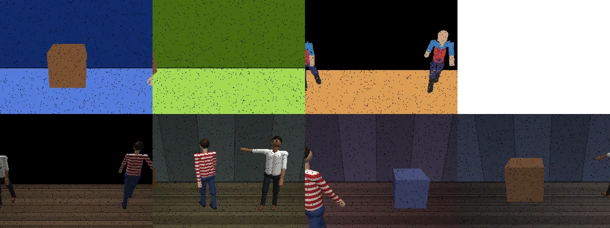
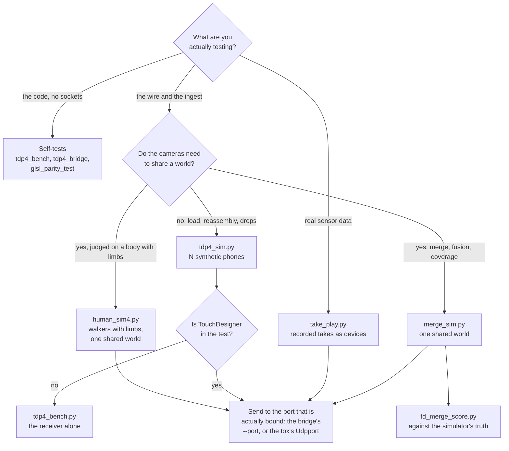

# Testing without hardware

You can exercise the whole hub with no phones in the room. Synthetic streams go
in on the same socket, in the same wire format, with the same fragmentation, so
the hub cannot tell the difference. Recorded takes do the same thing with real
sensor data.



Every command below matches the script's own argument parsing as of
2026-10-27 (`human_sim4.py` and `wire_fixture_test.py` as of 2026-11-03), and
each self-test row carries the date it last passed.

Run them from the repository root. The scripts add their own directory to the
import path, so `python3 TD/newtox/<script>.py` works from anywhere in the
tree.

## Which one do I run?

There are seven senders, nine self-tests and two ways of judging the filters on
a real take, and picking the wrong one wastes an afternoon proving something
you were not asking about. Start from what you are testing, not from what is
convenient to launch.



The distinction that catches people is the middle branch. `tdp4_sim.py` builds
its scene in **camera space**, so every synthetic phone sees a different
private world and the merged result is a ring of disjoint clouds. That is
correct for what it is for, and useless for judging a merge. `merge_sim.py`
exists for the other question.

## Which port to send to

Synthetic senders take a host and a port. Send to whichever port is actually
bound.

| Situation | Send to |
|---|---|
| The bridge is running | The bridge's `--port`, which the launchers set to 9003 (its own default is 9004) |
| No bridge, TouchDesigner binds the socket | The tox's `Udpport` |
| Testing the receiver alone with the bench | The bench's `--port` |

Getting this wrong is the most common reason a sim appears to do nothing.

## Synthetic phones: `tdp4_sim.py`

Emits the TDP4 wire format: 20-byte packet headers, fragmentation at 1452
bytes of payload, planar assembled frames, a TDPH hello every two seconds. One
sender thread and socket per device. Device ids are 101 upwards.

```
python3 TD/newtox/tdp4_sim.py <host> <port> <seconds> [options]
```

| Option | Default | Meaning |
|---|---|---|
| `--devices N` | 7 | Number of synthetic phones |
| `--fps N` | 30 | Frames per second per device |
| `--planes P` | `depth+conf` | `depth`, `depth+conf` or `depth+conf+rgb` |
| `--spread-ms N` | 0 | Spread a frame's packets over this long instead of back to back |
| `--first-id N` | 101 | First device id; a second sender on the same switch takes 201 |
| `--grid WxH` | `256x192` | Depth grid. The default is what TDStage AR streams, so it is already the show-rig grid; pass `320x240` only to model the parked AVFoundation app |

Positional defaults are `127.0.0.1`, port 9003, 30 seconds.

Seven synthetic phones for a minute, into a running bridge:

```
python3 TD/newtox/tdp4_sim.py 127.0.0.1 9003 60 --devices 7
```

Seven synthetic plus one real phone is a full eight-stream show load.

The sim prints its own arithmetic before it starts: frame bytes, packets per
frame, per-device and aggregate Mbit/s. Those are computed from the frame size,
not measured. At the default 256x192 grid with depth and confidence a frame is
147,576 bytes in 102 packets, 35.9 Mbit/s per device at 30 frames per second
and 287 Mbit/s for eight devices. **That default is the rig's grid**: TDStage
AR captures through ARKit, whose scene depth is 256x192 on every LiDAR iPhone,
so a show-rig load test at the default is already modelling the real load.

The parked AVFoundation app is the one that sends 320x240 on an iPhone 17 Pro.
At that grid the same planes are 230,520 bytes in 159 packets, 56.1 Mbit/s per
device, 449 Mbit/s for eight and 897 Mbit/s for sixteen, a factor of 1.56 over
the default. Pass `--grid 320x240` to model that app
([#42](https://github.com/AristidesAI/TDStage/issues/42)), not to model the
rig.

### What `tdp4_sim.py` cannot test

Its scene is built in camera space: a background plane about four metres out,
plus animated ellipsoid performers two and a half to three and a half metres in
front of whichever camera is rendering. The extrinsic is applied downstream, so
every device sees a different private world. Measured in simulation, the
stage-space performer centroids for three devices of a six-device ring came out
metres apart, as several disjoint clouds arranged in a ring.

That is correct for what the sim is for: exercising the wire, the reassembler
and the ingest at load. It cannot test merging, because the devices have never
been looking at the same thing.

## Synthetic phones that share a world: `merge_sim.py`

Use this when the question is about the merge, the fusion or the cleanup rather
than the transport. Every camera sees one shared world, so overlap, ghosting
and coverage mean something.

```
python3 TD/newtox/merge_sim.py <host> <port> <seconds> [options]
```

| Option | Default | Meaning |
|---|---|---|
| `--devices N` | 6 | Cameras |
| `--fps N` | 30 | Frames per second |
| `--preset P` | `ring` | Camera layout. `ring` spaces the cameras round the stage; `proscenium` puts every camera on the audience side, the real venue constraint, so upstage surfaces are seen by nobody; `pair` alternates the cameras between two viewpoints; `bad` clusters them at a nearly common viewpoint, so multi-view buys almost nothing and a merge that scores well there is not being tested; `show` is the show's own layout from `show_rig.py`, where height and radius do not apply. `--rig` is an alias of `--preset`. |
| `--scenario S` | `cross` | What the performers do |
| `--planes P` | `depth+conf` | Plane mask |
| `--reg-error M` | 0.0 | Per-device registration error, metres, one sigma |
| `--sigma-scale N` | 1.0 | Scale on the sensor noise model |
| `--no-noise` | off | Turn the noise model off entirely |
| `--frames N` | 60 | Frames to precompute |
| `--radius M` | 4.2 | Camera ring radius |
| `--seed N` | 7 | Deterministic seed |
| `--static` | off | Performers hold still, fresh noise every frame. For testing temporal filters. |
| `--spread-ms N` | 0 | Packet spread |

A static one-frame world, looped, which is what the scoring tool expects:

```
python3 TD/newtox/merge_sim.py 127.0.0.1 9003 120 --devices 6 --frames 1 --scenario cross
```

The same world is available in-process, with no socket: `from merge_sim import
MergeWorld, CamRig, render_frame`, then `MergeWorld(scenario='cross', seed=7)`,
`CamRig(6, preset='ring', reg_error=0.0)` and `render_frame(world, rig, t=0.4)`,
which returns every device's depth, confidence and colour planes for that
instant together with the ground truth. `CamRig` carries a true pose and a
believed pose per camera; `reg_error` injects a rigid error of that size
between them, in metres, one sigma per device. `fuse_weight_ab.py` renders
through `render_frame`, `temporal_test.py` through the single-camera
`render_view` and `apply_noise`, and `td_merge_score.py` scores a dumped cloud
against `MergeWorld`'s signed distance field; none of them goes over the wire.

### Walkers with limbs: `human_sim4.py`

`merge_sim.py`'s performers are ellipsoids, and ellipsoids fuse into an
ellipsoid however wrong the fusion is. `human_sim4.py` sends the 17-joint
articulated walker from `TD/human_sim.py` over the live TDP4 wire instead,
rasterised into each phone's organized depth grid through a z-buffer, so every
phone sees only its own side of a body that self-occludes and the fusion has
something to disagree about. The colour plane at the top of this page is its
output. The scene is in stage coordinates: a floor raked 0.5 degrees, a back
wall at z = -2, two prop boxes and N walkers. The phone extrinsics come from
`tdp4_sim.device_extrinsic` and are exact, so a fusion error is the hub's, not
the sim's. Frames are rendered on demand rather than precomputed, and the walk
loops every 31.416 seconds. Nothing in it is a second implementation: the
walker is imported from `human_sim`, the wire from `tdp4_sim`.

```
python3 TD/newtox/human_sim4.py <host> <port> <seconds> [options]
```

| Option | Default | Meaning |
|---|---|---|
| `--devices N` | 8 | Phones |
| `--people N` | 2 | Walkers; at least one |
| `--fps N` | 30 | Frames per second |
| `--planes P` | `depth+conf` | `depth`, `depth+conf` or `depth+conf+rgb` |
| `--rig ring\|show` | `ring` | `ring` puts the phones round the stage aimed at centre. `show` is the layout the show will use (`show_rig.py`): N-1 phones in a row on the audience side, one column of the stage each, plus one upstage centre facing the performers' backs, so most of the stage is seen by one phone. |
| `--sit P` | off | Walker P stops once a lap and sits, `--sit-at` seconds into the lap (5.0) for `--sit-s` seconds (6.0), then catches up. A sit that cannot be drawn is refused with the argument named. |
| `--costume own\|same` | `own` | `same` dresses every walker alike, so appearance cannot tell them apart |
| `--bg-keep F`, `--body-keep F` | 1.0 | Fraction of static cells and of body cells returned |
| `--procs auto\|threads\|fork` | `auto` | `auto` is one forked process per phone where fork exists, since the ray-cast people are many small numpy calls and eight threads share one interpreter lock, and threads elsewhere (Windows) |
| `--selftest` | | Offline checks of the walk, no sockets; see the self-tests table below |

Positional defaults are `127.0.0.1`, port 9003, 60 seconds. The startup print
gives the walk clock in wall time, so a `/track` trace can be scored against the
walkers' true positions. The console's Scene picker runs this script as
**Walkers (articulated)** ([console UI](../console/ui.html#simulator-synthetic-phones)).

## Scoring the merge: `td_merge_score.py`

Scores the cloud TouchDesigner produced against the simulator's exact truth.
Three steps.

1. Stream a static world in, as above.
2. In TouchDesigner, dump the output POP once per variant you want to compare:

   ```python
   import numpy as np
   np.save('/tmp/td_fused.npy',
           np.array(list(op('/project1/TDStageConductor/out_pop').points('P')), 'f4'))
   ```

   Set `Gpufuse` to 0 and dump a second file for the unfused union.

3. Score, with an optional gate that exits non-zero when the last file misses a
   bound:

   ```
   python3 Tools/td_merge_score.py /tmp/td_union.npy /tmp/td_fused.npy \
       --expect "median<=7,ghosts<=1.5,cover>=0.97"
   ```

   Units are millimetres, per cent and share.

## Replaying recorded takes: `take_play.py`

A take is the wire itself. The phone's recorder taps the assembled TDP4 frame
just before fragmentation, so replaying one hands the bytes back at the same
point. Same socket, same destination, same fragmentation, same latest-wins
policy. A replay is indistinguishable from a live phone to the hub.

The only difference is `"source": "playback"` in the TDPH hello, whose `app`
field from this tool starts with `take_play`.

```
python3 TD/newtox/take_play.py <host> <port> <seconds> <take> [take ...] [options]
```

| Argument | Meaning |
|---|---|
| `seconds` | 0 means until the takes end, or forever with `--loop` |
| `--loop` | Restart each take when it ends |
| `--speed N` | Playback speed multiplier, default 1.0 |
| `--device-ids` | Comma list, one id per take. Default: the id stored in each take's header, or 101 plus the take's position in the list when that header id is 0. |

Two takes as two devices, looping forever, into a running bridge:

```
python3 TD/newtox/take_play.py 127.0.0.1 9003 0 a.tdp4rec b.tdp4rec --loop
```

Each take becomes one device on the wire. Timing follows the recorded capture
stamps, not the header's nominal frame rate, so a take captured at 18 frames
per second replays at 18 even though its header says 30. The tool prints both
and tells you the `--speed` value that would force the nominal rate. A replay
that looks slow is usually faithful, and the recording is the thing to
question.

The one field a replay does not carry verbatim is the frame's `captureMicros`.
`take_play.py` overwrites it with the Mac clock at send time, so the clock keeps
moving, and it has no switch for that. Capture age measured by a receiver from a
replay is therefore the age of the replay path, not of the recording. The
phone's own player rewrites the stamp the same way by default and can be told
not to; see [the playback page](../ios/playback.html#more-playback-controls).

**Corollary that must not be broken:** the hub and the console must never need
to know whether a stream is live or replayed. If a fix requires a receiver-side
change to make playback work, the fix is wrong.

## Reading takes on the Mac: `take_reader.py`

```
python3 TD/newtox/take_reader.py --info --verify take.tdp4rec
```

One take per invocation. `--info` prints the metadata, frame count, codec and
compression ratio. `--verify` decodes every frame.

The format version 2 codec needs only the standard library; the reader itself
also imports numpy. Version 1 takes used Apple's framed LZ4 and need the `lz4`
package installed to read.

## Takes to a recording viewer: `take_to_mcap.py`

Converts takes to MCAP so you can inspect them in a robotics log viewer as
ROS 2 image, camera info, transform and point cloud messages.

```
python3 TD/newtox/take_to_mcap.py a.tdp4rec [b.tdp4rec] -o out.mcap [--points]
```

| Option | Meaning |
|---|---|
| `--points` | Also write a point cloud topic, which is much larger |
| `--every N` | Keep every Nth frame |
| `--max-frames N` | Per-take frame cap |
| `--device-ids` | Override each take's device id and topic |
| `--clock capture\|wall` | Which timestamp to use |
| `--selftest` | Round trip on synthetic takes |

Needs `pip install mcap mcap-ros2-support`.

## The receive-side bench: `tdp4_bench.py`

Receives TDP4 outside TouchDesigner and reports what the transport is doing.
It imports `tdp4_receiver` as the single parsing truth and drives it the
way the hub does, so its numbers are the hub's numbers minus TouchDesigner.

```
python3 TD/newtox/tdp4_bench.py [--port 9003] [--seconds 15]
```

Per second it prints complete frames per device, dropped incomplete frames,
stale packets, aggregate Mbit/s and mean reassembly latency. Then a per-device
summary table, then one line of JSON totals.

The summary's columns are `device`, `frames`, `fps`, `packets`, `MB`, `drop`,
`stale`, `unco` and `lat_ms`. `unco` is `frames_unconsumed`: complete frames
that a newer frame replaced before anything read them. The bench drains the
receiver every 20 ms the way the hub does, which is what keeps that count
honest. The JSON line is the last line on stdout and carries `seconds`, `port`,
`devices`, `packets`, `bytes`, `frames_complete`, `dropped_incomplete`,
`stale_packets`, `frames_unconsumed`, `mbit_s`, `mean_latency_ms`,
`fps_per_device` and `roster`. The Windows CI workflow reads that last line with
`ConvertFrom-Json` and fails the run unless, on one of two attempts, the
fan-out delivered at least 90 per cent of the `frames_complete` a direct run
did.

Point a sim at it:

```
python3 TD/newtox/tdp4_bench.py --port 9003 --seconds 15
python3 TD/newtox/tdp4_sim.py 127.0.0.1 9003 15 --devices 7
```

The bench binds the port, so it cannot run at the same time as the bridge or
as TouchDesigner on that port.

## The phone's own packer against the receiver: `Tools/wiretest`

Every other test on this page packs TDP4 in Python and parses it in Python. If
the phone and the receiver ever drifted apart, none of them would notice. This
one compiles **the phone app's shipped streamer source**, unmodified, runs it
for real, and feeds the datagrams it emits to the receiver TouchDesigner uses.

```bash
./Tools/wiretest/run.sh
```

It compiles `Net/PointCloudUDPStreamer.swift` from the TDStage AR checkout as
it stands, with no copy and no edit, plus a stub for the link chooser. It sends 18
frames through the streamer's own `sendGrid` and `sendAssembled` into a UDP
socket, and captures every datagram as it arrives. `check.py` then feeds those
datagrams to `tdp4_receiver`'s reassembler and parser, and replays them through
`tdp4_bridge` into a memory-mapped file and back out, as TouchDesigner reads
them.

The comparison is three-way. The bytes are
checked against the streamer's intent, against the receiver, **and against the
spec's numbers written out independently in `check.py`**. The receiver's own
constants are checked against those numbers too, so a streamer and a receiver
that drifted from the spec *together* still fail.

The cases are chosen for the arithmetic that breaks fragmenters: a frame that
is exactly one full packet, exactly two, two bytes over one, a 1×1 frame, a
318-datagram frame where the packet index passes 255, a device id with the high
bit set, and a playback frame through `sendAssembled`. Half-float conversion is
measured per case from 0.5 to 16 m, including exact ties of both parities, and
a run of 500 or more cells without an inexact case **fails**, so a generator
change cannot quietly stop testing the rounding.

Last run 2026-11-09 against TDStage AR `f7fc7b4`: **6,236 checks, 8 frames, 541
datagrams, passed.**

It needs the phone app's source, so it cannot run in this repository's CI.
Instead CI replays a committed capture, `fixture/ar-streamer.wire.gz`:

```bash
python3 Tools/wiretest/check.py Tools/wiretest/fixture/ar-streamer.wire.gz
```

{: .warning }
> The fixture catches receiver drift. It cannot catch **a change in the phone's
> streamer**, being a recording of the old one. Re-run `run.sh --write-fixture` after
> any change to `PointCloudUDPStreamer.swift`. The script refuses to write a
> fixture unless that file is committed and clean, so the manifest always names
> the exact source the bytes came from.
>
> Ports are 94xx and 95xx only. The script, the Swift harness and `check.py`
> each refuse the show ports, so this cannot be run into a live rig by accident.

## How close is too close? `separation_test.py`

The project says, everywhere, that separating performers is a multi-view
property and that one view has nothing to fuse. This measures it, and puts a
distance on it.

```bash
python3 TD/newtox/separation_test.py                   # 1, 2 and 6 devices
python3 TD/newtox/separation_test.py --devices 6 --fuse
```

Two standing performers are placed a **known** centre-to-centre distance apart
in `merge_sim`'s shared world, and the real receiver path runs end to end: the
shipped `clean_organized` and `compute_cell_weights`, optionally
`merge_lib.fuse`, then the shipped `_cluster_w` and `_split_multipeak`. Only
wire fields reach that pipeline. The exact per-performer signed-distance field
is given to the **scorer only**, so purity is measured against truth rather
than against a guess at which point belongs to whom.

Two numbers come out: `tracks`, how many performers the pipeline reported (2 is
correct), and `purity`, the share of surviving points whose track id maps to
the body they really belong to under the best assignment.

Run 9 November 2026, ring preset, no fusion, no registration error:

| Separation | 1 device | 2 devices | 6 devices |
|---|---|---|---|
| 0.10 m | 1.00 tracks, 55.2 % | 1.00, 54.7 % | 1.00, 54.4 % |
| 0.20 m | 1.00, 53.8 % | 1.00, 53.4 % | 1.00, 53.2 % |
| 0.25 m | 1.00, 53.8 % | 1.00, 52.7 % | **1.33, 64.2 %** |
| 0.30 m | 1.00, 52.8 % | 1.00, 52.9 % | **2.00, 86.8 %** |
| 0.40 m | 1.00, 50.9 % | 1.00, 52.7 % | 2.00, 93.1 % |
| 0.45 m | 1.00, 50.8 % | 1.00, 52.3 % | 2.00, 95.3 % |
| 0.50 m | 1.67, 82.6 % | 1.67, 82.4 % | 2.00, 96.9 % |
| 0.60 m | 2.00, 99.8 % | 2.00, 98.3 % | 2.00, 98.5 % |
| 1.00 m | 2.00, 100 % | 2.00, 100 % | 2.00, 100 % |

Read the 6-device column against the other two and the whole argument for more
phones is in one place: **six views split two bodies from 0.30 m, where one or
two views need 0.50 to 0.60 m.** Below 0.25 m every configuration reports one
performer, and purity sits near 50 per cent. That is what a coin flip looks
like when half the points of a merged pair get the one surviving id.

{: .warning }
> **Simulated.** This is `merge_sim`'s world, the shipping pipeline, and an
> exact ground truth, which is why a number exists at all. It is not two
> people in a room. It says what the code does to a known input, and the
> figures should be quoted that way: *in simulation, with six phones, two
> standing bodies separate from 0.30 m apart.*
>
> It also does not touch the harder claim. Two bodies in sustained physical
> contact are not separable by any markerless system at any number of views,
> and that limit is in the physics rather than in this pipeline
> ([what never to claim](../operations/evidence.html#what-never-to-claim)).

## Judging the filters on a real take

A simulator knows where its surfaces are, so `td_merge_score.py` can score
against truth. A real take has no truth in it, which is exactly why the
filters are hard to tune on one. Two tools get a truth anyway, from two
different directions.

### Do these settings keep a moving limb? `edge_bleed_sweep.py`

The live version of this question is `Tools/limb_test.py`, which drives a phone
through settings and reads the console's `/api/diag/limbs`. This asks it of a
**recorded** take, with no phone, no console and no TouchDesigner:

```bash
python3 Tools/edge_bleed_sweep.py TAKE.tdp4rec            # every config
python3 Tools/edge_bleed_sweep.py TAKE --only default,flip0 --frames 300
python3 Tools/edge_bleed_sweep.py --list                  # the configs
python3 Tools/edge_bleed_sweep.py --selftest              # the ports, on synthetic cases
```

The ground truth is **Apple Vision person segmentation on each frame's own RGB**
(`Tools/person_mask.swift`, `.accurate`, upsampled four times, cached). That
matters: it comes from colour, not depth, so the depth filters are not being
scored against themselves.

The filters are numpy ports, read from their own sources, of two stages: the
phone's `stageConditionDepth` Metal kernel (adaptive bimodal edge cull,
confidence gate, motion-adaptive temporal median, deadband, flip limiter, with
`StageDepthConditioner.encode`'s parameter mapping), and TouchDesigner's GPU
path after the merge: `gpu_unproject`'s crop and floor band, `gpu_hyst` on a
learned `Segmode`, and `gpu_clean`'s density and plan-view cluster gate, with
the saved tox's own uniform expressions. The metric is
`CloudStore.limb_stats` from `WebConsole/ingest.py`, replicated line for line
and aggregated the way `limb_test.py` aggregates it, so the numbers are
comparable with the live tool's.

Being offline buys four things the live tool cannot see:

| Column | What it measures |
|---|---|
| `bleed above floor` | The live `bleed` counts floor cells around the feet as flying pixels. This keeps only ring cells more than 15 cm above the floor |
| `edge blink` | Silhouette cells that flip valid to invalid, or jump 25 cm or more between frames: the boil the flip limiter exists for |
| `limb moving` | The third of frames whose mask changed most: the hard third, scored on its own |
| Paired difference | Every config against `default` on identical frames, with a 95 per cent moving-block bootstrap interval |

{: .warning }
> **Read the take's frame flags, which it prints at the start.** A TDStage AR
> take carries the conditioning that already ran on the phone, in `frameFlags`
> bits 1 to 4. Cells a phone filter removed at record time cannot come back
> offline, so a setting looser than the recorded one scores at best as the
> recorded one. It does not score as itself. A raw AVFoundation take, with
> those bits clear, is the only kind on which every setting is measured from
> scratch.

`--parity N` checks the numpy port against the shipped Metal kernel on N real
frames, which needs the TDStage AR checkout beside this one and the Metal
compiler. The mask helper needs `swiftc` either way. `--selftest` exercises the
ports on synthetic cases with neither: passing 9 November 2026.

### How thick does a flat thing look? `flat_patch.py`

A flat board, or a wall, or the floor, held still in view of two or more
phones is its own ground truth. It is a plane, so the spread of its points
about the best-fit plane **is** the noise, and comparing two filter settings
needs no simulator at all.

Replay a take into TouchDesigner, dump the cloud once per setting, and measure
the same box in each dump:

```bash
python3 TD/newtox/take_play.py 127.0.0.1 9003 0 a.tdp4rec b.tdp4rec --loop
```

```python
# in TouchDesigner, once per setting
import numpy as np
np.save('/tmp/off.npy', np.array(
    [tuple(p) for p in op('/project1/TDStageConductor/out_pop').points('P')], 'f4'))
```

```bash
python3 Tools/flat_patch.py /tmp/off.npy /tmp/temporal.npy --box -0.4 0.4 1.0 1.6 1.8 2.2
```

Per file it prints the points in the box, the RMS and 95th-percentile distance
to the plane, and the thickness, which is the 5th to 95th percentile of signed
distance. **The plane is fitted once, to the first file's points**, so every
setting is judged against one plane rather than against its own.

Lower is better, with one condition, which is why the count is printed: *as long as the point count does not collapse*. A filter that throws
most of the board away reports a beautifully thin remainder.

## Self-tests

These need no GPU and no TouchDesigner, and no sockets apart from the bridge
self-test's own loopback ports, which it takes from 59473 upward: real UDP
sockets on 59474 and 59476, memory-mapped files keyed by 59473, 59474 and
59477. It never touches 9003 or 9004, so it can run beside a live bridge. Run
them after touching the wire format, the shaders or the receiver.

| Command | What it checks |
|---|---|
| `python3 TD/newtox/tdp4_bench.py --selftest` | Pack, fragment, reassemble, parse. Field round-trips, depth and confidence and colour plane equality through half-float, out-of-order arrival, a missing packet, a stream restart after a lossy run, the TDPH hello. 26 checks; all passed 2026-10-27. |
| `python3 TD/newtox/tdp4_bridge.py --selftest` | The bridge round trip: packets, through the bridge's own loop, into the memory-mapped file, out through the reader. Includes a torn write, a slot eviction at seventeen devices, a bad payload, a layout mismatch, and the `--shm-port` republish. Passed 2026-10-27. |
| `python3 TD/newtox/wire_fixture_test.py` | Two frames a real iPhone 18 Pro put on the wire, through `tdp4_receiver`. The fixture `TD/newtox/testdata/real-iphone18-2frames.tdp4rec` holds frames 300 and 301 of a 916-frame take (TDStage 1.0, iOS 26.6, 2026-09-07) exactly as the phone sent them, since a take is the assembled frame. Each must parse as a 256 x 192 depth, confidence and colour frame of the spec's length, with a real room's depth, intrinsics and a principal point in range, a proper rotation, raw AVFoundation confidence of 0 and 2 only, and confidence 0 exactly where depth is invalid; then each is cut into 1452-byte datagrams with 20-byte headers and reassembled byte for byte, with nothing dropped. 23 checks; passed 2026-11-03. Note that these bytes came from TDStage 1.0, the non-AR app parked on 6 November, so this proves the receiver against a phone build that is no longer shipped; `Tools/wiretest` above is the check against the app that is. |
| `python3 TD/newtox/glsl_parity_test.py` | Shader constants and the pose-row layout against their numpy references. A shader edited without its reference fails here instead of on the rig. Passed 2026-10-27. |
| `python3 TD/newtox/temporal_test.py` | The static-surface temporal depth filter against the merge simulator: on a still scene the depth error must fall at least 2.5 times; on moving performers the body error must stay within one millimetre of raw. |
| `python3 TD/newtox/pipeline_test_grid.py` | The organized-grid pipeline offline: wire round trip, isolation purity, angle-aware fusion collapsing a two-phone overlap, and the weighted-fuse mechanism. All of this is the CPU path. |
| `python3 Tools/fuse_weight_ab.py` | Weighted fusion against plain fusion on an exact synthetic surface. This is the measurement behind the show path keeping a plain mean: weighted came out a few tenths of a millimetre better at the median and slightly worse at the 90th percentile. |
| `python3 TD/pipeline_test.py` | The older point-based isolation pipeline, offline. |
| `python3 TD/newtox/human_sim4.py --selftest` | The walk, no sockets. Over 24 two-lap walks with two, three and four walkers, with and without a sitter, no walker's root moves more than 3 cm a frame, pairs still pass 0.45 m apart, every walk is periodic, six sits that cannot be drawn are refused by `configure()` and by the command line, each naming the argument, and a run log's scenario line restores the walker count and walk version. Passed 2026-11-03. |

{: .note }
**What none of these check on their own**
([#50](https://github.com/AristidesAI/TDStage/issues/50), now closed by
`Tools/wiretest` above): the phone's own fragmenter against this receiver.
Every test in the table packs and fragments in Python, and the wire fixture of
two real iPhone frames (`wire_fixture_test.py`) holds the **assembled** frame,
captured before fragmentation, which the test then re-splits with the
receiver's own packet header. So on this table alone, the 20-byte packet header
the phone writes (packet index, packet count, payload length, flags) has no
cross-language check, and a regression in the Swift fragmenter would pass every
one of them and show up on a rig as frames dropped for missing packets.
`Tools/wiretest` is the test that closes that, by compiling the shipped
streamer and capturing what it actually sends. What is still open is that it
needs the phone app's source, so **CI replays a recording of the streamer
rather than running it**. Re-write the fixture after any change to
`PointCloudUDPStreamer.swift`.

`hlib.py` and `hlib_grid.py` are pure numpy and OpenCV, with no TouchDesigner
imports, which is why the same files run inside the tox and in these offline
tests. Never add a TouchDesigner import to either.

## Synthetic telemetry

```
python3 TD/fake_telemetry.py <host> <port> <seconds>
```

Sends phone-shaped OSC telemetry. Defaults are `127.0.0.1`, port 9000, 20
seconds. Exercises the telemetry relay and the log transitions. The hub no
longer interprets telemetry itself; it relays it to the console.

## Legacy senders

`TD/tdp2_sim.py` and `TD/newtox/tdp3_sim.py` are TCP clients for the retired
TDP2 and TDP3 formats. Nothing in the system listens on TCP any more. They are
kept for the record. Do not use them to test the hub.

`TD/human_sim.py` is a third: the articulated-walker scene over TDP2 and TCP
:9002, retired as a sender on 2026-10-26 because nothing has listened on that
port since tox v32. The file stays because its walker and body generators are
still imported, by `human_sim4.py` above and by `TD/pipeline_test.py`, both of
which load it without running its socket main.

## Traps

**Two sims at once with the same device ids.** Both default to 101 upwards, so
their frame ids collide and the receiver reports thousands of dropped
incomplete frames that are not real loss. Run sims sequentially, or give one of
them different ids (`tdp4_sim.py --first-id 201`; `merge_sim.py` has no such
flag), and diff the counters per run.

**Testing in learned segmentation mode overwrites learned state.** A learn
writes `learned_bg.npz` into the application support directory. Back that up
before running a sim in `learned` mode. The directory on each platform is in
[Where learned state lives](maintenance.html#where-learned-state-lives).

**TouchDesigner's own frame rate is not what you think.** In realtime mode
TouchDesigner skips timeline frames to stay on the wall clock, so anything
derived from `absTime.frame` reports 60 whatever the cook costs. Never quote a
frame rate from it. Use the console's reported figure, which counts real
frames. On the CPU merge path the cloud refresh rate is the merge worker's
rate, not TouchDesigner's frame rate.

**Gates on `frame % N` do not fire reliably.** Because frames are skipped, a
modulus gate lands erratically or never once the merge is loaded. Gate on
`absTime.seconds`. This froze four of the hub's own gates (the health line,
then device auto-registration, the hands poller and autoframe) before they
were moved to time gates.

## What the figures so far are worth

Every multi-stream figure measured to date is simulation. There is no
multi-phone rig measurement of them yet; the rig has run up to three real
phones live, but none of these figures was measured on them.

Measured, simulation, 2026-10-26, depth and confidence, with the bridge in
place:

| Figure | Value |
|---|---|
| GPU merge path, TouchDesigner frame rate | 60 real frames per second at 8, 12 and 16 streams, geometric or learned. **Development Mac, person model idle, no content rendering**, so this is headroom rather than a show figure |
| CPU merge path at 8 streams, learned | 55 to 59 TouchDesigner frames per second, merge worker saturated at 27.7 merges per second, 38 ms each |
| Transport | 0 incomplete frames up to 16 streams, 573 Mbit/s |
| Bridge to TouchDesigner latency | p50 9.5 ms, p95 15.3 ms |

Do not present any of these as a rig number. They were sent at the spec's
256x192 grid: `tdp4_sim.py` had no other grid until `--grid` arrived on
2026-10-27, and 573 Mbit/s sits beside the 574.5 Mbit/s it computes for sixteen
devices at 256x192. That grid **is** what the rig's phones stream, so the load
is the right one; what makes these headroom figures rather than rig figures is
the machine they ran on, with the person model idle and nothing rendering.
